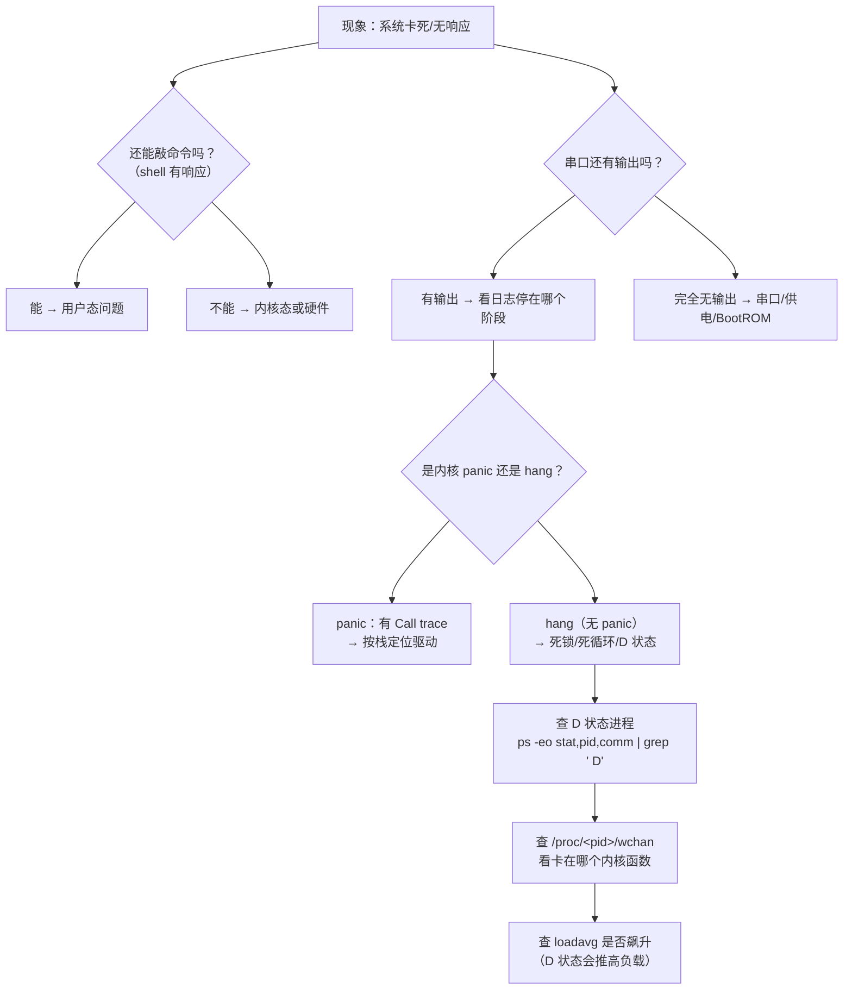

# 03 系统卡死排查思路
**这是嵌入式最棘手的问题类型**。建立一套固定顺序，不要乱猜。



### 6.1 卡死的三种类型

| 类型 | 现象 | 常见原因 |
| --- | --- | --- |
| **内核 panic** | 串口打印 `Kernel panic` + Call trace，**系统停止** | 驱动空指针、内存破坏、严重硬件错误 |
| **内核 hang（挂起）** | 无任何输出，但也不重启 | **死锁**、中断风暴、死循环关中断 |
| **用户态卡死** | shell 有响应，但某程序不动 | 进程死锁、D 状态、资源耗尽 |

### 6.2 第一步：看 D 状态进程

```bash
ps -eo stat,pid,comm --no-headers | awk '$1 ~ /D/'
```

**D 状态 = 不可中断睡眠**，通常是等 IO（磁盘/网络/Flash）。

**D 状态进程 `kill -9` 杀不掉**。实测本机的进程状态分布：

```bash
$ ps -eo stat --no-headers | sort | uniq -c | sort -rn | head -8
     55 S
     36 I<
     32 Sl
     23 I
     17 Ssl
     14 Ss
      4 Z          ← 有 4 个僵尸进程
      2 SN
```

（这台机器上有 **4 个僵尸**——它们占着 PID，虽然无害但说明有程序没正确 wait）

### 6.3 第二步：wchan——看进程卡在哪个内核函数

**这是最被低估的调试手段**。

```bash
$ cat /proc/1/wchan
do_epoll_wait
```

**`/proc/<pid>/wchan` 显示进程当前阻塞在哪个内核函数**。上面显示 PID 1（systemd）正阻塞在 `do_epoll_wait`——完全正常，它在等待事件。

批量查看：

```bash
for p in $(ls /proc | grep -E '^[0-9]+$'); do
    printf "%-8s %-20s %s\n" "$p" "$(cat /proc/$p/comm 2>/dev/null)" "$(cat /proc/$p/wchan 2>/dev/null)"
done
```

:::tip[wchan 的判读]
| wchan 显示 | 含义 |
| --- | --- |
| `do_epoll_wait` / `do_select` | 正常等待 IO 事件 |
| `futex_wait` | 等待锁/条件变量（**大量进程卡这 = 死锁嫌疑**） |
| `wait_on_page_bit` / `__lock_page` | **等页 IO**（存储慢或卡住） |
| `nfs_wait_bit_killable` | **NFS 服务端失联** |
| `pipe_wait` | 等管道数据 |
| （空） | 正在运行或不可中断 |

**大量进程卡在存储相关函数 → 存储硬件或驱动问题**，这是嵌入式板子卡死的高频原因（SD 卡坏、eMMC 虚焊）。
:::

### 6.4 第三步：内核 hang 检测机制

内核有内建的** hung task 检测**（需要开启 `CONFIG_DETECT_HUNG_TASK`）：

```bash
$ cat /proc/sys/kernel/hung_task_timeout_secs
120
```

**默认 120 秒**：如果一个任务在 D 状态超过 120 秒，内核会打印警告和堆栈：

```
INFO: task myapp:1234 blocked for more than 120 seconds.
      Tainted: G
Call Trace:
 [<...>] __mutex_lock_slowpath+...
```

**这个输出直接告诉你卡在哪个锁**，是排查死锁最有力的证据。

### 6.5 第四步：Magic SysRq（系统完全无响应时的救命稻草）

**即使系统看起来完全卡死，内核可能还活着**——可以用 SysRq 组合键强制它做事。

实测本机的 SysRq 开关：

```bash
$ cat /proc/sys/kernel/sysrq
438
```

**438** 是位掩码（十进制），换算成二进制是 `110110110`，表示启用了多项功能。

启用全部：

```bash
echo 1 > /proc/sys/kernel/sysrq      # 全部开启
```

| SysRq 组合 | 作用 | 记忆 |
| --- | --- | --- |
| **`Alt+SysRq+b`** | **立即重启**（不 sync，可能丢数据） | **b**oot |
| `Alt+SysRq+t` | **打印所有进程的堆栈**（排查卡死的神器） | **t**hread |
| `Alt+SysRq+w` | 打印**处于不可中断状态**的进程 | — |
| `Alt+SysRq+m` | 打印内存信息 | **m**emory |
| `Alt+SysRq+l` | 打印所有 CPU 的 backtrace | — |
| `Alt+SysRq+s` | **sync**（同步磁盘） | **s**ync |
| `Alt+SysRq+u` | 重新挂载所有文件系统为只读 | **u**mount |
| **`Alt+SysRq+reisub`** | **安全重启**的完整序列 | 倒着拼 "busier" |

:::tip[串口上怎么用 SysRq]
开发板没有键盘，但**可以通过串口发送 BREAK 信号**触发 SysRq（需要内核开启 `CONFIG_MAGIC_SYSRQ_SERIAL`）：

```bash
# 真正的 BREAK 无法用 echo 写一个字节来模拟——用 minicom/screen 的"发送 break"功能
# 也可以在程序里用 termios 的 tcsendbreak() 发出真正的 BREAK
```

或者直接从 shell 写：

```bash
echo t > /proc/sysrq-trigger      # 打印所有进程堆栈
echo w > /proc/sysrq-trigger      # 打印 D 状态进程
echo b > /proc/sysrq-trigger      # 立即重启
```

**`echo t > /proc/sysrq-trigger` 是排查系统卡死的第一手段**——它会把所有进程的调用栈打到 dmesg，你能直接看到谁卡在哪。
:::

### 6.6 第五步：看是不是 OOM

```bash
$ cat /proc/vmstat | grep oom_kill
oom_kill 0
```

如果 `oom_kill` 计数增加，说明内核因为**内存耗尽**杀过进程。查详细信息：

```bash
dmesg | grep -i "out of memory"
dmesg | grep -i "killed process"
```

**OOM killer 的输出会告诉你谁被杀了、当时内存状态如何**：

```
Out of memory: Killed process 1234 (myapp) total-vm:500000kB, anon-rss:480000kB
```

实测本机的内存压力指标（PSI，Pressure Stall Information，Linux 4.20+）：

```bash
$ cat /sys/fs/cgroup/memory.pressure
some avg10=0.00 avg60=0.00 avg300=0.00 total=6869371
full avg10=0.00 avg60=0.00 avg300=0.00 total=5617456
```

`some` = 至少有一个任务因内存受阻的时间比例；`full` = 所有任务都受阻（真正的停顿）。

:::info[PSI 是比 loadavg 更好的指标]
**loadavg 包含 D 状态进程**，所以存储卡死时 loadavg 会飙升，但你不知道是不是 CPU 真的忙。

**PSI（`/proc/pressure/` 或 cgroup 的 `*.pressure`）直接告诉你"有多少比例的时间任务因为 CPU/内存/IO 而停顿"**，是 Linux 4.20 引入的现代指标。嵌入式上排查卡顿优先看它。
:::

### 6.7 第六步：看硬件错误

```bash
# 存储错误
dmesg | grep -iE "i/o error|exception|mmc|nand|ata"

# 温度（很多 SoC 会过热降频）
cat /sys/class/thermal/thermal_zone*/temp

# 电压/欠压（树莓派等板子常见问题）
dmesg | grep -i "under-voltage"
```

:::danger[嵌入式卡死最常见的三个硬件原因]
1. **供电不足**——SD 卡/USB 设备启动时电流不够，电压跌落导致 SD 卡控制器复位（表现为莫名的 IO error）
2. **SD 卡损坏/劣质卡**——用久了出现坏块，ext4 会转只读
3. **过热**——SoC 降频或复位。加散热片

**这三样能解释大部分"莫名其妙的卡死"**，先排除它们再去查软件。
:::

## 7. 用户态调试的利器：Sanitizer

实测本机 **ASan 可用**：

```bash
$ gcc -fsanitize=address -o /tmp/as_test t.c
$ ls -l /tmp/as_test
-rwxr-xr-x 1 root root 25056 /tmp/as_test
ASan 可用
```

| Sanitizer | 检测什么 | 编译选项 |
| --- | --- | --- |
| **ASan** | 内存越界、use-after-free、double-free | `-fsanitize=address` |
| **UBSan** | 未定义行为（整数溢出、空指针解引用等） | `-fsanitize=undefined` |
| **TSan** | 数据竞争（多线程） | `-fsanitize=thread` |
| **LSan** | 内存泄漏（已含在 ASan 里） | `-fsanitize=leak` |

:::tip[开发期用 ASan，发布时去掉]
ASan 会让程序**慢 2~3 倍、内存占用增加数倍**，但能抓到绝大多数内存 bug。

**交叉编译时也能用**（工具链支持的话）：

```bash
aarch64-linux-gnu-gcc -fsanitize=address -g -o myapp myapp.c
# 需要把 libasan.so 也拷到板子上
```

**嵌入式上的替代**：`valgrind`（板子上太慢但能用）、或自己写内存分配的 wrapper 统计。
:::

---

**翻页**：[← 上一页](./debug-02) · [下一页 →](./debug-04) · [返回目录](./)
