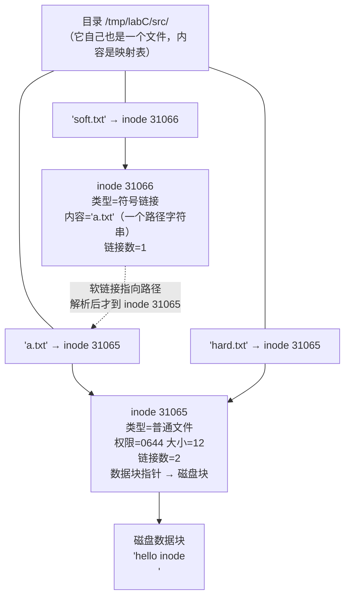

# 01 本页学什么
这一页解决嵌入式 Linux 里**最容易被忽略、但一出问题就要命**的一块：存储。

- **inode 是什么**？为什么"文件名"和"文件"是两回事？
- 硬链接和软链接的**本质区别**（不只是"一个能跨分区一个不能"）
- 为什么新建的**目录**链接数是 2，而不是 1（高频面试题）
- 挂载到底做了什么？为什么挂载后原目录内容"消失"了？
- **ext4 / f2fs / squashfs / ubifs / jffs2 / tmpfs** 各自适合什么硬件？
- MBR vs GPT，fdisk / parted 怎么用

:::info[实测环境]
Debian 13 (trixie) / 内核 6.12.94 / x86_64。存储为一块 59.6G 的磁盘 `/dev/sda`，`/` 是 ext4，另有 swap 分区。所有输出均为真实执行结果。
:::

## 1. inode：文件的"身份证"

### 1.1 一个反直觉的事实

**inode 里不存文件名。**

这是理解 Linux 文件系统的第一道坎。文件系统把"文件"拆成两部分：

| 部分 | 存什么 | 存在哪 |
| --- | --- | --- |
| **inode**（索引节点） | 文件的**元数据**：大小、权限、属主、时间戳、**数据块指针**、链接数 | inode 表 |
| **目录项（dentry）** | **文件名 → inode 号**的映射 | 目录文件的内容里 |

也就是说，**"文件名"是目录的内容，而不是文件的属性**。文件本身只有一个编号（inode 号）。



这张图直接解释了硬链接和软链接的全部差异——**继续往下看**。

### 1.2 实测：inode 元数据

```bash
$ stat /tmp/labC/meta
  File: /tmp/labC/meta
  Size: 1         	Blocks: 8          IO Block: 4096   regular file
Device: 0,39	Inode: 31070       Links: 1
Access: (0644/-rw-r--r--)  Uid: (    0/    root)   Gid: (    0/    root)
Access: 2026-10-18 00:32:09.517165339 +0800
Modify: 2026-10-18 00:32:09.517165339 +0800
Change: 2026-10-18 00:32:09.517165339 +0800
 Birth: 2026-10-18 00:32:09.517165339 +0800
```

字段解读：

| 字段 | 含义 |
| --- | --- |
| `Size` | 文件字节数 |
| `Blocks` | 实际占用的**磁盘块数**（512 字节为单位）。注意 Size=1 但 Blocks=8，说明**最小分配单位是块** |
| `IO Block` | 文件系统块大小（4096） |
| `Inode` | inode 号 **31070** |
| `Links` | **硬链接计数** |
| `Access` | 权限位 + 八进制 |
| `Uid` / `Gid` | 属主/属组 |

### 1.3 三个时间戳：atime / mtime / ctime

这是高频混淆点：

| 缩写 | 全称 | 什么时候变 | 误称 |
| --- | --- | --- | --- |
| **atime** | access time | 读文件内容时（`cat`） | — |
| **mtime** | **modify** time | **内容**改变时（写入） | 常被误叫"修改时间"但其实 ctime 才是 change |
| **ctime** | **change** time（不是 create！） | **inode 元数据**改变时（chmod、chown、改链接数） | **常被误认为创建时间** |
| **Birth** | 创建时间 | 文件创建时 | 真正的"创建时间"，ext4 支持 |

:::warning[ctime 不是创建时间]
`ctime` = **change time**（inode 变更时间），不是 create time。改权限（`chmod`）会让 ctime 变，但 **mtime 不变**（内容没动）。

而且注意：**读文件会更新 atime**，这会造成额外的磁盘写入。嵌入式上为了减少 Flash 写入，常给挂载加 `noatime` 选项（见第 5 节）。
:::

### 1.4 inode 数量是用完的

每个文件系统在创建时就**固定了 inode 总数**。即使磁盘还有空间，**inode 用完也无法新建文件**。

```bash
$ df -i /tmp
Filesystem      Inodes IUsed   IFree IUse% Mounted on
tmpfs          1048576   482 1048094    1% /tmp
```

名为 "Disk full" 但 `df -h` 显示还有空间？**查 `df -i`**——这就是 inode 耗尽。常见于：

- 邮件服务器（海量小文件）
- 板子上 log 目录塞满了成千上万个小文件
- `/tmp` 里堆了大量 session 文件

## 2. 硬链接 vs 软链接

### 2.1 实测：一眼看穿区别

```bash
$ ls -li src/
31065 -rw-r--r-- 2 root root 12 Oct 18 00:32 a.txt
31067 lrwxrwxrwx 1 root root 19 Oct 18 00:32 abs.txt -> /tmp/labC/src/a.txt
31065 -rw-r--r-- 2 root root 12 Oct 18 00:32 hard.txt
31066 lrwxrwxrwx 1 root root  5 Oct 18 00:32 soft.txt -> a.txt
```

**关键观察**：

- `a.txt` 和 `hard.txt` 的 inode **都是 31065**（同一个文件！），链接数是 **2**
- `soft.txt` 的 inode 是 **31066**（**独立的文件**），链接数是 1，类型是 `l`，内容是 `a.txt` 这个路径字符串
- `abs.txt` 是另一个软链接（绝对路径版），inode 31067

### 2.2 删除源文件后会发生什么

```bash
$ rm src/a.txt
$ ls -li src/
31067 lrwxrwxrwx 1 root root 19 abs.txt -> /tmp/labC/src/a.txt
31065 -rw-r--r-- 1 root root 12 hard.txt
31066 lrwxrwxrwx 1 root root  5 soft.txt -> a.txt
$ cat src/soft.txt
cat: src/soft.txt: No such file or directory
$ readlink src/abs.txt
/tmp/labC/src/a.txt
```

| | 硬链接 `hard.txt` | 软链接 `soft.txt` |
| --- | --- | --- |
| 删除源文件后 | **仍然可用**，数据还在（链接数 2→1） | **悬空（dangling）**，`cat` 报 No such file |
| inode | 与源文件**相同** | **独立的新 inode** |
| 存的内容 | 不存内容，只是一个目录项 | **存的是路径字符串** |

**这就是本质区别**：

- 硬链接 = **同一个 inode 的另一个名字**（多了一个目录项，链接数 +1）
- 软链接 = **一个独立的文件**，它的内容是"请去那个路径找我"

### 2.3 完整对比表

| 特性 | 硬链接 | 软链接（符号链接） |
| --- | --- | --- |
| 命令 | `ln src dst` | `ln -s src dst` |
| inode | 与源相同 | 独立 inode |
| **能否跨文件系统/分区** | ❌ **不能**（inode 号只在同分区内有意义） | ✅ 能 |
| **能否指向目录** | ❌ 通常不能（root 也不行，防止环路） | ✅ 能 |
| 源文件删除后 | 数据仍可通过硬链接访问 | **悬空失效** |
| 源文件移动后 | 仍然有效（同一 inode） | 相对链接失效，绝对链接也失效 |
| `ls -l` 显示 | 普通文件，链接数 `>1` | 类型 `l`，显示 `-> 目标` |
| 磁盘占用 | 不额外占数据块（多一个目录项） | **占用一个 inode + 存路径的块** |

:::tip[什么时候用哪个]
- **软链接**是日常默认选择：能跨分区、能指向目录、意图明显（`ls` 一眼看出是链接）
- **硬链接**的特有价值：**同一个文件在多处出现且必须保持同步**，删除任意一处其他处不受影响。典型场景是 BusyBox（见 [根文件系统](./rootfs)——`/bin/ls`、`/bin/cat` 都是 BusyBox 这个可执行文件的硬链接，靠 `argv[0]` 区分行为）
:::

### 2.4 链接计数：为什么空目录是 2

实测：

```bash
$ mkdir /tmp/labC/d1
$ stat -c 'dir=%n links=%h inode=%i' /tmp/labC/d1
dir=/tmp/labC/d1 links=2 inode=31068
$ mkdir /tmp/labC/d1/sub
$ stat -c 'dir=%n links=%h inode=%i' /tmp/labC/d1
dir=/tmp/labC/d1 links=3 inode=31068
```

**新建目录 links=2，新建一个子目录后变成 3。**

原因：目录的链接数 = **2 + 子目录数**

- 第 1 个：父目录中的条目（`/tmp/labC/d1`）
- 第 2 个：该目录内部的 `.`（自己）
- 每多一个子目录：子目录内部的 `..` 也指向它 → **+1**

```
/tmp/labC/d1              ← 链接 1（父目录的条目）
/tmp/labC/d1/.            ← 链接 2（自己）
/tmp/labC/d1/sub/..       ← 链接 3（子目录的 ..）
```

:::info[为什么子目录算，子文件不算？]
因为**只有目录才有 `..`**。普通文件不会产生指回父目录的链接，所以 `touch` 新文件不会增加父目录的链接数。

这也解释了为什么 `.` 和 `..` 是真实存在的目录项——它们是文件系统自动维护的硬链接。
:::

### 2.5 什么时候文件才真正被删除

**删除文件的真实过程**：

1. `rm file` 实际上是调用 `unlink()`，删掉**一个目录项**（文件名 → inode 的映射）
2. inode 的**链接计数减 1**
3. **只有当链接计数归零，且没有任何进程打开它时**，数据块才会被释放

这产生两个重要现象：

:::warning[现象一：被删除的文件仍占空间]
```bash
# 某个进程正打开一个大日志文件，你 rm 了它
rm /var/log/huge.log
df -h          # 空间没有释放！
```

因为进程还持有 fd，inode 没被回收。**解决方法是重启那个进程**，或者清空而不是删除：

```bash
> /var/log/huge.log     # 截断成 0 字节，空间立即释放，进程 fd 仍有效
```

这是运维和嵌入式上极常见的"磁盘满了但找不到大文件"谜题的根源。
:::

:::tip[现象二：/tmp 里"删不掉"的空间]
同理，用 `du` 和 `df` 看到的空间不一致，往往就是被删除但仍被进程持有的文件。查法：

```bash
lsof | grep deleted
```
:::

---

**翻页**：[下一页 →](./filesystem-02) · [返回目录](./)
