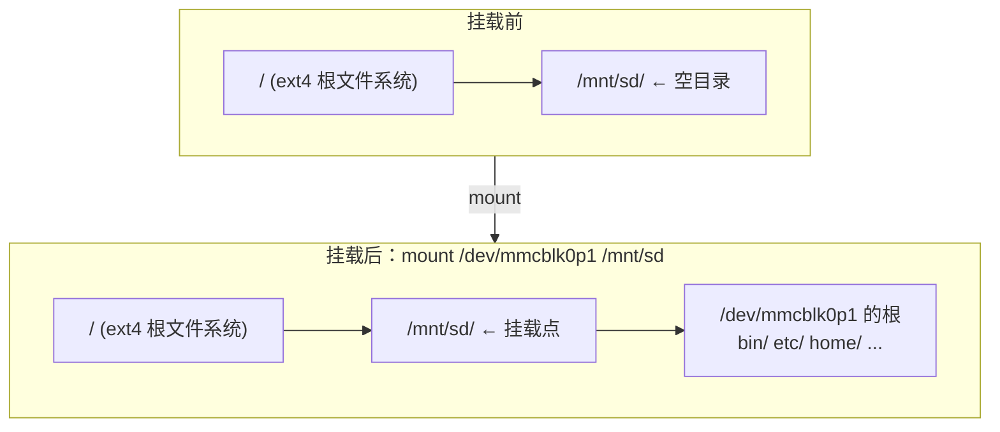
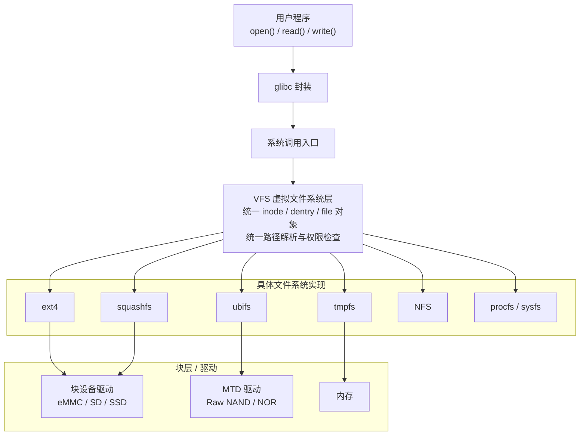
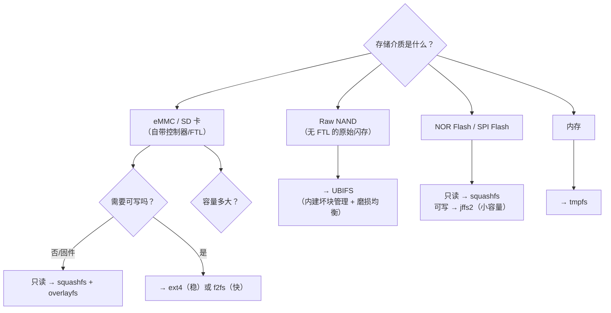

# 02 挂载机制
### 3.1 挂载做了什么

**挂载 = 把一个文件系统的根，接到现有目录树的某个目录（挂载点）上。**

挂载后，通过挂载点访问的就是**新文件系统**的内容；挂载点目录**原有的内容被暂时"遮挡"**，卸载后又会显现。



### 3.2 实测：查看已挂载的文件系统

```bash
$ findmnt -rno TARGET,SOURCE,FSTYPE,OPTIONS -T /
/ /dev/sda1 ext4 rw,relatime,errors=remount-ro
```

```bash
$ head -8 /proc/mounts
sysfs /sys sysfs rw,nosuid,nodev,noexec,relatime 0 0
proc /proc proc rw,nosuid,nodev,noexec,relatime 0 0
udev /dev devtmpfs rw,nosuid,relatime,size=1973660k,nr_inodes=493415,mode=755,inode64 0 0
devpts /dev/pts devpts rw,nosuid,noexec,relatime,gid=5,mode=600,ptmxmode=000 0 0
tmpfs /run tmpfs rw,nosuid,nodev,noexec,relatime,size=400428k,mode=755,inode64 0 0
/dev/sda1 / ext4 rw,relatime,errors=remount-ro 0 0
securityfs /sys/kernel/security securityfs rw,nosuid,nodev,noexec,relatime 0 0
tmpfs /dev/shm tmpfs rw,nosuid,nodev,inode64 0 0
```

`/proc/mounts` 每一行格式是：`设备 挂载点 文件系统类型 挂载选项 dump pass`

### 3.3 常用挂载选项（嵌入式很关键）

| 选项 | 作用 | 嵌入式意义 |
| --- | --- | --- |
| `ro` / `rw` | 只读 / 读写 | **根文件系统常设 `ro` 保护 Flash** |
| `noatime` | 不更新 atime | **减少 Flash 写入**，延长寿命 |
| `nodiratime` | 同上，针对目录 | 同上 |
| `sync` | 同步写入（不缓存） | 安全但**很慢**，Flash 上一般不用 |
| `async` | 异步写入（默认） | 快，但掉电可能丢数据 |
| `noexec` | 禁止执行 | `/tmp` 常设，安全加固 |
| `nosuid` | 忽略 setuid 位 | 安全加固 |
| `nodev` | 不解释设备文件 | 安全加固 |
| `errors=remount-ro` | 出错时**自动转只读** | 实测中 `/` 就有这个，防止文件系统进一步损坏 |

:::tip[嵌入式根文件系统挂载的典型组合]
```bash
# 只读根文件系统 + noatime
/dev/mmcblk0p2 / ext4 ro,noatime 0 1
```
配合 [overlayfs](./rootfs) 提供可写层，这是很多路由器/ IoT 设备的标准做法。
:::

### 3.4 /etc/fstab：开机自动挂载

```bash
$ cat /etc/fstab
# /etc/fstab: static file system information.
UUID=d45532a8-f577-4a6a-80a2-7bf9cbc61058 /               ext4    errors=remount-ro 0       1
UUID=80af691e-739b-4df2-a2a1-e23a28fc3b44 none            swap    sw              0       0
```

每行 6 个字段：

| 字段 | 含义 | 例子 |
| --- | --- | --- |
| 1 | 设备（**推荐用 UUID**） | `UUID=xxx` 或 `/dev/sda1` |
| 2 | 挂载点 | `/`、`/boot`、`none`（swap） |
| 3 | 文件系统类型 | `ext4`、`vfat`、`swap` |
| 4 | 挂载选项 | `defaults`、`noatime` |
| 5 | dump 备份标志 | 通常是 0 |
| 6 | fsck 检查顺序 | `1`=根分区先检，`2`=其他，`0`=不检 |

:::danger[用 UUID 而不是 /dev/sdX]
`/dev/sda1` 这种名字**可能变**（插拔顺序、多块盘时枚举顺序不固定）。用 `UUID=` 是稳定可靠的做法，这也是 Debian 安装器默认生成 UUID 的原因。

查 UUID：`blkid` 或 `lsblk -f`。
:::

## 4. VFS：为什么 Linux 能同时用十种文件系统

Linux 能同时挂载 ext4、FAT32、NFS、tmpfs、ubifs，并且用同一套 `open()/read()/write()` 访问它们——靠的是 **VFS（Virtual File System，虚拟文件系统）** 抽象层。



**关键分层概念**：

| 层 | 处理什么 |
| --- | --- |
| 用户程序 + glibc | 提供 `fopen`/`fread` 等 C 库 API |
| 系统调用 | 陷入内核 |
| **VFS** | 路径解析、权限检查、**缓存（dentry cache / page cache）**、把操作分派给具体文件系统 |
| 具体文件系统 | 实现"inode 号如何映射到磁盘块" |
| **块层 / MTD 层** | 真正读写硬件 |

:::info[MTD 是什么]
**MTD（Memory Technology Device）** 是 Linux 为 **Raw Flash（NOR / NAND）** 准备的独立子系统，与"块设备"并列。

- **块设备**（磁盘、eMMC、SD 卡）：有扇区概念，可以随机读写，上层用 ext4/f2fs
- **MTD 设备**（Raw NAND/NOR）：只能**按擦除块擦除、按页读写**，有坏块，上层用 ubifs/jffs2

这是嵌入式最独特的一层，PC 上完全不存在。
:::

## 5. 文件系统选型（嵌入式重点）

**这一节是本页最有嵌入式价值的部分**。选错文件系统会直接导致产品寿命问题。

### 5.1 对比总表

| 文件系统 | 类型 | 可写 | 压缩 | 适用介质 | 典型用途 |
| --- | --- | --- | --- | --- | --- |
| **ext4** | 日志型 | ✅ | ❌ | eMMC、SD、SSD、硬盘 | **通用首选**，PC 与嵌入式根分区 |
| **f2fs** | 日志型（Log-structured） | ✅ | ❌ | eMMC、SD、**SSD** | 为 Flash 优化，随机写性能好 |
| **squashfs** | 只读压缩 | ❌ **只读** | ✅ | 任何块设备 | **只读根文件系统**、固件、LiveCD |
| **ubifs** | 日志型（UBI 之上） | ✅ | ✅(可选) | **Raw NAND** | **Raw NAND 首选** |
| **jffs2** | 日志型 | ✅ | ✅ | **NOR Flash**、小容量 NAND | 老方案，挂载慢（需全盘扫描） |
| **tmpfs** | 内存 | ✅ | ❌ | **RAM** | `/tmp`、`/run`，重启即失 |
| **vfat/FAT32** | 简单 | ✅ | ❌ | SD 卡、U 盘 | **Bootloader 分区**（U-Boot/UEFI 要读） |
| **overlayfs** | 叠加 | ✅ | ❌ | 在其他 FS 之上 | **只读根 + 可写层** |
| **initramfs/cpio** | 内存 | — | ✅ | RAM | 早期用户态、临时根 |

### 5.2 按硬件选型（决策树）



:::danger[最重要的一条：Raw NAND 不能用 ext4]
**ext4 假设底层是"可以随机覆写的块设备"**。Raw NAND 完全不符合这个假设：

| Raw NAND 的特性 | 后果 |
| --- | --- |
| **必须先擦除再写**，擦除单位是 block（128KB~），写单位是 page（2KB~） | 不能原地覆写 |
| **有坏块**，且使用中还会新增 | 需要坏块管理 |
| **擦写次数有限**（SLC 约 10 万次，MLC 约 1 万次，TLC 更少） | 需要**磨损均衡（wear leveling）** |

ext4 不具备这些能力，直接用在 Raw NAND 上会**很快写坏**。必须用 **UBIFS**（跑在 UBI 层之上，UBI 负责坏块管理和磨损均衡）。

**而 eMMC 和 SD 卡内部已经有控制器（FTL，Flash Translation Layer）做了这些事**，对主机呈现为"普通块设备"，所以用 ext4 没问题。
:::

:::tip[怎么判断我的是 Raw NAND 还是 eMMC？]
- 系统里有 `/dev/mtd0`、`/dev/mtdblock0` → **Raw NAND/NOR**，MTD 子系统
- 系统里有 `/dev/mmcblk0` → **eMMC 或 SD 卡**，块设备

```bash
cat /proc/mtd          # 有输出 = 有 MTD 设备
ls /dev/mmcblk*        # 有输出 = eMMC/SD
```
:::

### 5.3 squashfs：只读压缩，嵌入式固件的标配

特点：

- **只读**（不能写，这是设计目标）
- **高压缩率**（gzip/xz/lzo/zstd），能省一半以上空间
- 按块解压，读取时按需解压

典型用法：**只读的根文件系统**。固件升级时整块替换，配合 overlayfs 提供可写的上层。

```bash
# 制作 squashfs 镜像
mksquashfs rootfs/ rootfs.squashfs -comp xz

# 测试挂载（只读）
mount -o loop -t squashfs rootfs.squashfs /mnt
```

### 5.4 ubifs 与 UBI 的关系

```
硬件：Raw NAND
  ↑
MTD 子系统        (/dev/mtd0, /dev/mtd1 ...)
  ↑
UBI 层            (提供卷管理 + 坏块管理 + 磨损均衡，/dev/ubi0_0)
  ↑
UBIFS 文件系统     (在 UBI 卷之上)
```

**UBI 不是文件系统，是卷管理层**。理解这个层次很重要：

```bash
ubiformat /dev/mtd0              # 格式化 MTD 设备为 UBI
ubiattach -m 0 -d 0              # 关联 MTD 设备到 UBI
ubimkvol /dev/ubi0 -N rootfs -m  # 创建卷
mount -t ubifs ubi0:rootfs /mnt  # 挂载卷（注意设备名是 ubi0:rootfs 而不是 /dev/xxx）
```

### 5.5 tmpfs：把内存当磁盘用

```bash
$ df -Th
文件系统       类型   大小  已用  可用 已用% 挂载点
/dev/sda1      ext4    56G   20G   33G   38% /
tmpfs          tmpfs  2.0G  6.1M  2.0G    1% /tmp
```

嵌入式上的价值：

- **日志、临时文件放 tmpfs**，避免反复擦写 Flash
- 代价：**掉电即失**，不能放需要持久化的数据
- 大小由 `size=` 选项控制，默认一般是内存的一半

### 5.6 ext4 vs f2fs（eMMC/SD 场景）

| | ext4 | f2fs |
| --- | --- | --- |
| 成熟度 | **极高**，几十年 | 较新（2012 年由三星提出，已进入 mainline 多年） |
| 随机写性能 | 一般 | **更好**（Log-structured 设计契合 Flash） |
| 碎片 | 用久后可能碎片化 | 天生抗碎片 |
| 小分区开销 | 日志区开销明显 | 更省 |
| 恢复工具 | 成熟 | 较少 |

**务实建议**：eMMC/SD 卡上，**ext4 是安全选择**，f2fs 在你有大量随机小写入（数据库、频繁日志）时才体现出优势。手机厂商普遍用 f2fs（Android 早期就切换过）。

---

**翻页**：[← 上一页](./filesystem-01) · [下一页 →](./filesystem-03) · [返回目录](./)
