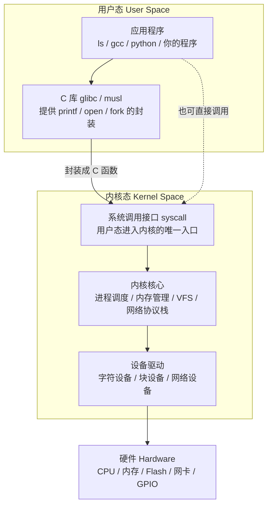
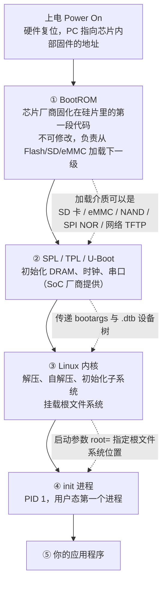
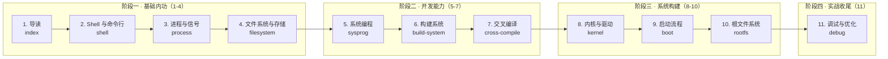
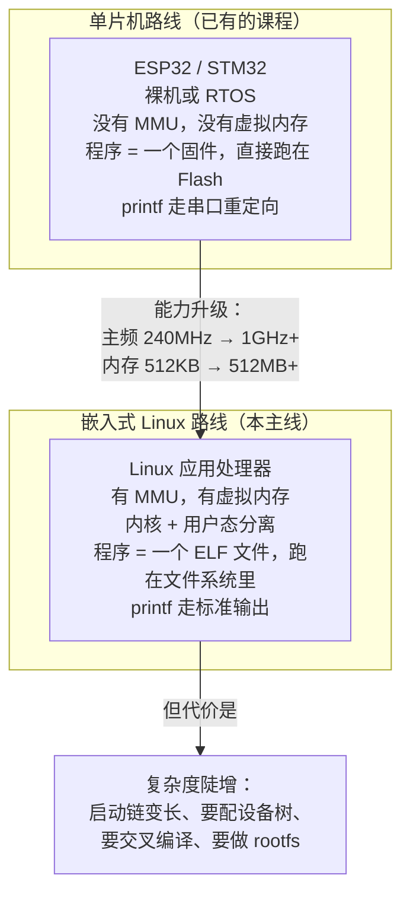

# 嵌入式 Linux 课程导读

## 本页学什么

这一页不教你敲命令，而是先把**整条 Linux 主线的地图**给你。读完你应该能回答四个问题：

1. "Linux"这个名字到底指内核还是指操作系统？Ubuntu 和 Linux 是什么关系？
2. 嵌入式 Linux 和你在 PC 上用的 Ubuntu、和服务器上的 CentOS，**本质区别在哪里**？
3. 一块树莓派/全志/RK 板子从上电到跑起你的程序，中间到底经过了哪些环节？
4. 本站这 11 页按什么顺序学，每一页解决什么问题？

:::info[本页的定位]
这是**嵌入式 Linux**，不是服务器运维。你会看到 `systemd`、`apt`、`crontab` 这类内容被刻意压缩，而**交叉编译、设备树、根文件系统、启动链路**被大幅展开。判断标准很简单：如果这个知识点在开发板上用不到，它就不该占这里的篇幅。
:::

## 1. "Linux"到底指什么

这是最容易被含糊过去、但越早分清越省事的一个概念。

严格说，**Linux 只是一个内核（kernel）**。它是 Linus Torvalds 从 1991 年开始写的一个程序，职责是：

- 管理 CPU（进程调度）
- 管理内存（虚拟内存、页表）
- 管理硬件（设备驱动）
- 提供系统调用接口（用户程序与内核之间的唯一通道）

内核**不能单独使用**。你没法"只装一个 Linux 内核"然后干活，因为它没有 `ls`、没有 `gcc`、没有 `vi`、没有 shell。

你在电脑上装的 Ubuntu、Debian、Fedora、Arch，学名叫**发行版（distribution，简称 distro）**。一个发行版 = Linux 内核 + 一堆用户态软件 + 一套包管理系统 + 一套配置约定。



这张图是整个 Linux 世界的骨架，**后面 10 页都是在对它做局部放大**：

| 图中的部分 | 对应本课程的哪一页 |
| --- | --- |
| 应用程序 + shell | [Shell 与命令行](./shell) |
| 进程调度 | [进程与信号](./process) |
| VFS + 块设备 | [文件系统与存储](./filesystem) |
| 系统调用接口 | [系统编程入门](./sysprog) |
| 怎么把程序变成可执行文件 | [构建系统](./build-system)、[交叉编译](./cross-compile) |
| 设备驱动 + 内核核心 | [内核与驱动入门](./kernel) |
| 从硬件到内核启动这一整段 | [启动流程全链](./boot) |
| 用户态那一堆软件和根在哪 | [根文件系统](./rootfs) |
| 出问题时怎么定位 | [调试与优化](./debug) |

:::tip[一句话记住]
内核是**发动机**，发行版是**整车**。嵌入式 Linux 开发者的日常，就是自己攒一台车：发动机（内核）要按你的板子调，车厢（根文件系统）要自己按尺寸做，而绝大多数零件（用户态软件）得在 PC 上造好了再搬上去——这就是交叉编译。
:::

## 2. 内核与发行版的关系：一个常见的误解

很多人以为"Ubuntu 6.8 内核"和"Debian 6.12 内核"是两个不同的内核。其实不是。

**内核源码只有一份**，在 [kernel.org](https://www.kernel.org/) 上以 `6.12.94`、`6.13` 这样的版本号发布（这个叫 **vanilla / mainline 内核**，Linus 的团队维护）。发行版做的事情是：

1. 挑一个 mainline 版本（或 **LTS 长期支持版**）作为基线
2. 打上自己的补丁（安全修复、硬件兼容补丁、尚未合入上游的驱动）
3. 用一份配置文件 `.config` 决定哪些功能编进内核、哪些编成模块
4. 编译打包成 `.deb` / `.rpm`

所以发行版之间的内核差异主要在第 2 和第 3 步，而不是内核本身有两套。

### 实测：本站服务器的发行版与内核

本课程的"实测输出"全部来自一台真实的 Debian 服务器。下面是它的身份信息：

```bash
$ uname -a
Linux debian 6.12.94+deb13-amd64 #1 SMP PREEMPT_DYNAMIC Debian 6.12.94-1 (2026-06-20) x86_64 GNU/Linux
```

```bash
$ cat /etc/os-release
PRETTY_NAME="Debian GNU/Linux 13 (trixie)"
NAME="Debian GNU/Linux"
VERSION_ID="13"
VERSION="13 (trixie)"
VERSION_CODENAME=trixie
DEBIAN_VERSION_FULL=13.6
ID=debian
HOME_URL="https://www.debian.org/"
SUPPORT_URL="https://www.debian.org/support"
BUG_REPORT_URL="https://bugs.debian.org/"
```

拆开 `uname -a` 看每个字段（**这是基本功，别只会看热闹**）：

| 字段 | 值 | 含义 |
| --- | --- | --- |
| `Linux` | 内核名 | `uname -s` |
| `debian` | 主机名 | `uname -n` |
| `6.12.94+deb13-amd64` | 内核 release | `uname -r`，**这是最常被引用的一个** |
| `#1 SMP PREEMPT_DYNAMIC ...` | 内核构建信息 | SMP=多核支持；PREEMPT_DYNAMIC=可动态切换抢占模式 |
| `x86_64` | 机器架构 | `uname -m` |

其中 `6.12.94+deb13-amd64` 这个字符串很有信息量：

- `6.12` —— 主线版本号（6.x 系列）
- `.94` —— 上游 stable 分支（6.12.y）的补丁序号，不是 Debian 自己加的（Debian 的修订号是构建信息里的 `-1`）
- `+deb13` —— 为 Debian 13 打的补丁
- `-amd64` —— 目标架构是 x86_64

:::warning[你的开发板上长得不一样]
开发板上的 `uname -r` 通常是厂商内核，例如 `4.19.232` 、`5.10.160-rockchip` 之类。**嵌入式领域的内核版本普遍比 PC 落后很多年**，因为 SoC 厂商的驱动补丁往往没合入上游（这个现象叫 **out-of-tree 驱动**）。这不是你学错了，是行业现状。学的时候以**概念**为准，不要死记版本号。
:::

### 内核版本号与 LTS

| 类型 | 说明 | 举例 |
| --- | --- | --- |
| mainline | 每 2~3 个月一个大版本，Linus 维护 | 6.13、6.14 |
| stable | mainline 发布后的维护分支 | 6.12.y 系列 |
| **LTS** | **长期支持，2~6 年**，嵌入式最该选它 | 5.10、5.15、6.1、6.6、6.12 |

**做产品请选 LTS 内核**。嵌入式项目一旦选了非 LTS 内核，两三年后你会发现没有人再给它修 CVE 了。

## 3. 嵌入式 Linux 与桌面/服务器 Linux 的差异

这是本节的**核心**。很多人从 PC Linux 转过来会踩一堆坑，根源就是没意识到这几个差异。

### 3.1 交叉编译：最大的分水岭

| | 桌面/服务器 Linux | 嵌入式 Linux |
| --- | --- | --- |
| 编译平台 | 本机 x86_64 | PC（x86_64） |
| 运行平台 | 本机 x86_64 | 开发板（ARM/RISC-V/MIPS） |
| 编译器 | `gcc` | `arm-linux-gnueabihf-gcc`、`aarch64-linux-gnu-gcc` |
| 编译产物能在本机跑吗 | 能 | **不能**，架构不同 |

这意味着你**写程序的机器**和**跑程序的机器**不是同一台。由此派生出一堆连锁问题：

- 目标板的头文件和库不在 `/usr/include`、`/usr/lib`，而在一个叫 **sysroot** 的目录里
- 你不能在 PC 上 `./configure && make` 就完事，必须告诉构建系统 `--host=aarch64-linux-gnu`
- 第三方库要单独为 ARM 编一遍
- 调试要用 `gdbserver` 远程调试

详细展开在 [交叉编译与工具链](./cross-compile)。

### 3.2 根文件系统是自己"做"出来的

装 Ubuntu 时，安装程序帮你把整个文件系统铺好了。开发板上**没有安装程序**——根文件系统（rootfs）需要你自己组装：

- 用 **BusyBox** 提供那一百多个基础命令
- 把交叉编译好的 glibc 和你的程序拷进去
- 决定 init 用哪个（BusyBox init？systemd？）
- 打包成一个镜像烧进 Flash

详细展开在 [根文件系统](./rootfs)。

### 3.3 存储介质完全不同，这决定了文件系统选型

| | 桌面/服务器 | 嵌入式 |
| --- | --- | --- |
| 主存储 | SSD / HDD | eMMC、SD 卡、**Raw NAND**、NOR Flash、SPI Flash |
| 容量 | 百 GB ~ TB | 16 MB ~ 8 GB |
| 特性 | 有 FTL 帮你做磨损均衡 | **Raw NAND 只能自己管坏块和磨损均衡** |

Raw NAND 不能用 ext4，必须用 **UBIFS**（或老一点的 JFFS2）——因为它们内建坏块管理和磨损均衡。NOR Flash 用 **squashfs**（只读压缩）很常见。

:::danger[这是纯嵌入式知识点]
你在 PC Linux 上永远不会遇到 UBIFS 和 squashfs。这是嵌入式 Linux **独有问题**，也是面试高频题。见 [文件系统与存储](./filesystem)。
:::

### 3.4 没有显示器、没有键盘：串口是唯一的控制台

开发板上通常没有显卡。你与它交互的唯一通道是 **UART 串口**（TTL 电平，一般是板子上的 3 个引脚：TX/RX/GND），PC 端用 USB 转串口模块接上，波特率常见 **115200-8-N-1**。

这条串口线上跑着三样东西：

1. **Bootloader 的命令行**（U-Boot）
2. **内核的启动日志**（printk 输出）
3. **登录后的 shell**

:::warning[波特率错了就是乱码]
串口看到满屏乱码，**99% 是波特率不对**。115200 是最常见值，但也有 1500000（1.5M）的板子（如部分全志、瑞芯微）。设置：`115200` 表示每秒 115200 个 bit，`8-N-1` = 8 数据位、无校验、1 停止位。见 [调试与优化](./debug)。
:::

### 3.5 资源极度受限

| 资源 | 桌面/服务器 | 典型嵌入式板 |
| --- | --- | --- |
| 内存 | 8~64 GB | 64 MB ~ 2 GB |
| 启动时间要求 | 无所谓 | 常常要求 **`< 3` 秒** |
| 功耗 | 无所谓 | 电池供电，要休眠 |
| 存储写入次数 | 无所谓 | Flash 有**擦写寿命**，要减少写入 |

内存小意味着你**不能随便开大数组、不能泄漏内存**；Flash 有寿命意味着**日志要小心写，通常放 tmpfs 或走 overlay**。

### 3.6 硬件没有标准化：这就是设备树的由来

PC 上，内核可以通过 ACPI/PCI 枚举"我插了什么硬件"。ARM 开发板上**没有这种自描述机制**——内核不知道你的板子上 UART 寄存器映射到哪个地址、I2C 上挂了什么。

在设备树（Device Tree）出现之前，这些信息是**硬编码在内核 C 代码里的**（`arch/arm/mach-xxx/` 下的一堆 board file），导致内核里塞了几百个板子的代码，Linus 曾经为此发过著名的怒吼。

**设备树把硬件描述从内核代码里剥离出来**，变成一个独立的数据文件（`.dts` 编译成 `.dtb`），由 bootloader 传给内核。同一份内核二进制 + 不同的 dtb = 支持不同的板子。

这是嵌入式 Linux **最重要的一个设计**，详见 [内核与驱动入门](./kernel)。

## 4. 一块板子从上电到跑起你的程序

把整条链路画出来。这条链上的每一环，本课程都有一页对应：



每一环的责任与对应课程页：

| 阶段 | 关键职责 | 失败时的典型现象 | 详细页 |
| --- | --- | --- | --- |
| BootROM | 决定从哪个介质启动（拨码开关/熔丝） | **完全无输出**，串口静默 | [启动流程全链](./boot) |
| SPL | 初始化 DRAM（**最关键的一步**） | 卡在 SPL，或内存大小不对 | [启动流程全链](./boot) |
| U-Boot | 加载内核/dtb/rootfs，传参 | 能进 U-Boot 命令行但起不来内核 | [启动流程全链](./boot) |
| 内核 | 驱动初始化、挂载 rootfs | `Kernel panic - not syncing: VFS: Unable to mount root fs` | [内核与驱动](./kernel)、[根文件系统](./rootfs) |
| init | 启动服务、拉起应用 | `No working init found`，或 shell 起不来（日志若停在 `Waiting for root device`，问题其实在更前面的内核/存储层） | [根文件系统](./rootfs) |

:::tip[排查心法]
**看串口日志停在哪一步，就知道是哪一层的问题**。这是嵌入式 Linux 排错最重要的一个习惯。有输出=前面的环节都过了，问题在当前环节或之后；完全无输出=问题在 BootROM 或 SPL（供电、启动介质、焊接）。
:::

## 5. 学习路径图

本主线共 11 页，分成四个阶段。**建议按顺序学**，因为后面的页会大量引用前面的概念。



### 阶段一：基础内功（第 1~4 页）

目标：**能在 Linux 命令行下自如地工作，并理解背后的机制**。

| 页 | 主题 | 学完你应该能做到 |
| --- | --- | --- |
| [Shell 与命令行](./shell) | FHS、权限位、umask、find/grep/sed/awk/xargs、重定向、环境变量 | 看懂并写得出日常操作命令；遇到 `Permission denied` 知道怎么查 |
| [进程与信号](./process) | fork/exec/wait、COW、僵尸/孤儿、信号、作业控制、nice | 理解你的程序是怎么被"启动"的；能查清进程为什么没死掉 |
| [文件系统与存储](./filesystem) | inode、硬/软链接、挂载、ext4/f2fs/squashfs/ubifs 选型 | 理解"文件名"和"文件"不是一回事；能给板子选对文件系统 |

### 阶段二：开发能力（第 5~7 页）

目标：**能在 PC 上写出、构建出、并交叉编译出能在板子上跑的程序**。

| 页 | 主题 | 学完你应该能做到 |
| --- | --- | --- |
| [系统编程入门](./sysprog) | 文件 IO、缓冲、strace、select/poll/epoll | 在 Linux 上写多 IO 并发服务程序；理解为什么 epoll 比 select 快 |
| [构建系统](./build-system) | Makefile 原理、CMake、pkg-config、自动化 | 手写一个带依赖自动生成的 Makefile；读懂开源项目的构建体系 |
| [交叉编译](./cross-compile) | 工具链三元组、sysroot、ABI、动静态链接、第三方库移植 | 把任意开源库交叉编译到你的板子上 |

### 阶段三：系统构建（第 8~10 页）

目标：**能把整块板子的软件栈从零搭起来**。这是嵌入式 Linux 和"Linux 运维"分道扬镳的地方。

| 页 | 主题 | 学完你应该能做到 |
| --- | --- | --- |
| [内核与驱动](./kernel) | 内核分层、设备树、字符设备、file_operations、模块 | 写一个能在板子上 `insmod` 的字符设备驱动 |
| [启动流程](./boot) | BootROM→SPL→U-Boot→内核→init、U-Boot 命令、排错 | 串口日志停在哪就知道问题在哪 |
| [根文件系统](./rootfs) | BusyBox、init 对比、库依赖、镜像制作、overlayfs | 做出一个能启动的最小 rootfs |

### 阶段四：实战收尾（第 11 页）

| 页 | 主题 | 学完你应该能做到 |
| --- | --- | --- |
| [调试与优化](./debug) | 串口、gdb 远程调试、dmesg、性能工具、死机排查 | 板子出问题时有一套固定的排查顺序 |

## 6. 与其他课程线的关系

本站已经有成熟的 [ESP32 教程](../../hardware/esp/) 和 [完整编程课程](../../course/)。Linux 线和它们的关系：



:::info[从 ESP32 转过来的同学，先建立这三个认知]
1. **程序不再是一个固件了**。它是文件系统里的一个 ELF 文件，像 PC 上的 `/bin/ls` 一样。你可以 `cp` 它、`ls -l` 它、运行时它有 PID。
2. **你有了 MMU 和虚拟内存**。每个进程有独立的地址空间，进程 A 崩了不会影响进程 B。单片机上所有代码共用一个地址空间。
3. **代价是复杂度**。单片机上 `main()` 就是起点；Linux 上你的程序前面有 BootROM、SPL、U-Boot、内核、init 五层铺垫。**而这五层，正是本课程后三分之一的内容**。
:::

## 7. 学习建议：怎么学才不白学

:::tip[四条建议]
1. **每一页的"实测输出"都自己跑一遍**。本课程所有输出都来自真实的 Debian 13 服务器，你手边有个 Linux（WSL 也行）就能复现绝大部分。看别人跑和自己跑，理解深度差一个数量级。
2. **优先理解"为什么"，其次才是"怎么敲"**。比如 fork 之后父子变量值不同，记住 COW 这个原理，比记住现象有用得多。
3. **尽早搞一块板子**。树莓派、全志 H3 的 NanoPi、RK3566 的开发板都可以，价格几十到几百。**没有板子，本课程后三阶段的知识点会一直停留在纸面**。
4. **善用串口**。嵌入式 Linux 90% 的排错信息来自串口日志。买一个 USB 转串口模块（CH340/CP2102/FT232 都行，十块钱）是第一笔该花的投资。
:::

## 常见坑

| 症状 / 误解 | 病根 |
| --- | --- |
| 把 Ubuntu 和 Linux 当成同义词 | Linux 只是内核；Ubuntu/Debian 是发行版 = 内核 + 用户态软件 + 包管理 |
| 在开发板上 `apt install build-essential` 然后本地编译 | 板子性能弱、存储小，且**没有编译环境**。正确做法是 PC 上交叉编译 |
| 拿 PC 上的 `gcc` 编完的程序拷到板子上跑，报 `Syntax error` / `Exec format error` | **架构不同**。x86_64 的 ELF 在 ARM 上跑不了，需要交叉编译器 |
| 认为嵌入式 Linux 就是"小一点的 Ubuntu" | 存储介质（Raw NAND）、启动链（U-Boot+设备树）、rootfs（BusyBox）全都不同 |
| 串口全是乱码 | 波特率不对（115200 最常见，但有 1500000 的板子）；也可能 TX/RX 接反了 |
| 看到 `Kernel panic - not syncing` 就以为内核坏了 | 绝大多数是**根文件系统路径没配对**（`root=` 参数）或 rootfs 里缺东西 |
| 纠结内核版本号（"我是 5.10 是不是太老"） | 嵌入式内核普遍落后 mainline 数年，因为厂商驱动是 out-of-tree 的。**看概念，别背版本** |
| 一上来就想学驱动 | 驱动需要同时懂内核框架、设备树、硬件手册。**先走完阶段一和阶段二** |
| 在板子上频繁写日志到 Flash | Flash 有擦写寿命。日志应放 tmpfs（内存）或定期清理 |
| 分不清 `arm-none-eabi` 和 `arm-linux-gnueabihf` | 前者是**裸机**（无 OS，给 STM32 用），后者是 **Linux 应用处理器**。见 [交叉编译](./cross-compile) |

## 自检清单

学完这一页，检查你是否能回答（**不能就回头再读**）：

- [ ] 说出"Linux 内核"和"Linux 发行版"的区别，并举例三个发行版
- [ ] 看着 `uname -a` 的输出，能指出哪部分是内核版本、哪部分是架构
- [ ] 说出 LTS 内核是什么，以及为什么嵌入式项目应该选它
- [ ] 列出嵌入式 Linux 与桌面 Linux 的**至少 4 个**本质差异
- [ ] 解释为什么 Raw NAND 不能用 ext4，应该用什么
- [ ] 说出设备树解决了什么问题（提示：ARM 板级信息硬编码）
- [ ] 从"上电"到"你的程序跑起来"，能按顺序说出 5 个阶段
- [ ] 串口日志停在 U-Boot 阶段，说明前面哪些环节是好的？
- [ ] 说出本课程四个阶段各自的目标

## 下一步

按顺序进入第一阶段的第一页：

- [Shell 与命令行](./shell)——FHS 目录结构、权限位与 umask、find/grep/sed/awk/xargs 精讲、管道与重定向
- 已经有基础？可以直接跳到 [交叉编译与工具链](./cross-compile)，那是嵌入式最独特的一块
- 想先搞清硬件选型？看 [芯片选型](../../chips/)
