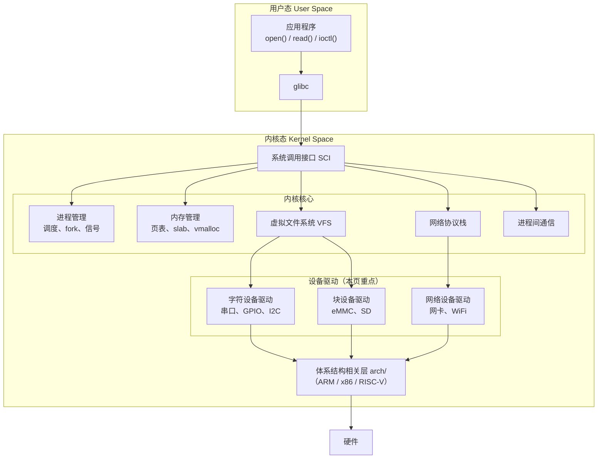
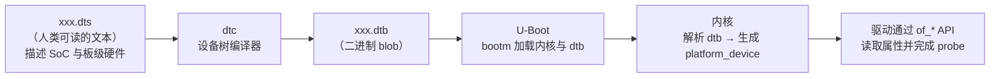
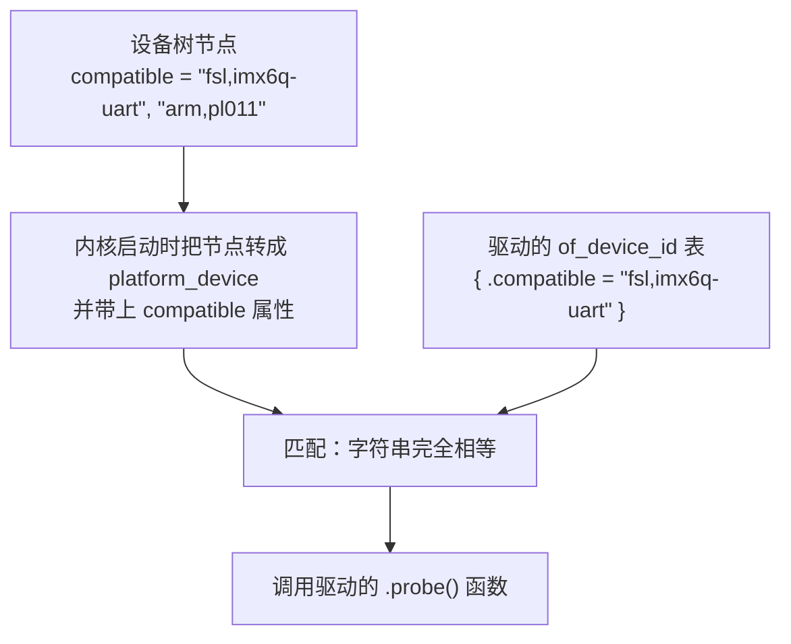

# 01 本页学什么
这一页进入 Linux 最"硬"的部分——**内核空间**。前面的知识都在用户态，从这里开始你要写能直接操作硬件的代码。

- 内核的分层架构，驱动处在哪个位置
- **设备树（Device Tree）到底是什么，为什么 ARM 必须有它**（这是嵌入式 Linux 的标志性设计）
- **字符设备驱动模型**：主次设备号、`cdev`、`file_operations`
- 一个能 `insmod` 的完整内核模块
- `printk` 与内核日志级别
- 内核态编程的**铁律**（没有 libc、不能睡眠的上下文……）

:::warning[本页的实测边界]
本服务器是 **x86_64 虚拟机**，有两个限制必须先说明：

1. **没有设备树**——x86 用 ACPI 描述硬件，`/proc/device-tree` 不存在。所以设备树部分只能讲原理和 `.dts` 语法，**无法在本机实测**。
2. **没有内核头文件**（`/lib/modules/$(uname -r)/build` 不存在），**无法在本机编译内核模块**。模块代码是标准写法示例。

但以下内容是**实测**的：`lsmod`/`modinfo` 的模块依赖关系、`/sys` 与 `/sys/bus` 的真实结构、`printk` 的日志级别数值、内核启动参数、sysfs 设备模型。
:::

## 1. 内核分层架构



**关键理解**：

| 层 | 职责 | 谁写 |
| --- | --- | --- |
| 内核核心 | 与硬件无关的通用机制（调度、内存、VFS） | 内核社区 |
| **设备驱动** | **把具体硬件"翻译"成内核的统一接口** | **你（或者芯片厂商）** |
| 体系结构层 | CPU 相关的底层（中断、页表、上下文切换） | 内核社区 |

**驱动的本质**：实现内核核心定义好的一组"回调函数"，让上层可以用统一的 `open/read/write/ioctl` 访问你的硬件。

## 2. 设备树 Device Tree

### 2.1 它解决了什么问题

**这是嵌入式 Linux 最重要的一个设计，没有之一。**

#### 历史：ARM 的"板级文件地狱"

在设备树出现之前（Linux 3.x 之前），ARM 内核里是这样描述硬件的：

```c
/* arch/arm/mach-omap2/board-omap3beagle.c —— 老内核里的真实代码风格 */
static struct i2c_board_info __initdata beagle_i2c_boardinfo[] = {
    {
        I2C_BOARD_INFO("tps65950", 0x48),
        .irq = INT_34XX_SYS_NIRQ,
    },
};
static struct platform_device beagle_gpio_leds = {
    .name = "leds-gpio",
    .id   = -1,
    .dev  = { .platform_data = &gpio_leds_pdata },
};
MACHINE_START(OMAP3_BEAGLE, "OMAP3 Beagle Board")
    .atag_offset    = 0x100,
    .init_irq       = omap3_beagle_init_irq,
    .init_machine   = omap3_beagle_init,
MACHINE_END
```

每块开发板都有一个这样的 C 文件，**硬编码**了：

- UART 控制器的寄存器物理地址
- I2C 上挂了什么设备、地址是多少
- GPIO 怎么连的 LED

后果：

1. 内核源码里塞了**几百个** board file，绝大多数代码彼此无关
2. **同一颗 SoC 用在 10 块板子上，就要写 10 份几乎重复的代码**
3. 换一个电阻改一个引脚就得**重新编译内核**
4. Linus Torvalds 在 2011 年的邮件里对此爆发了著名的批评（"this whole ARM thing is a f*cking pain in the ass"）

#### 设备树的解法

**把硬件描述从 C 代码里剥离出来，变成一个独立的数据文件**。

- 硬件描述写成 `.dts`（Device Tree Source，可读的文本）
- 编译成 `.dtb`（Device Tree Blob，二进制）
- 由 **bootloader（U-Boot）在启动内核时把 .dtb 传给内核**
- 内核解析 .dtb，从中得知"我跑在什么板子上、有什么硬件"



**结果**：同一份内核二进制 + 不同的 .dtb = 支持不同的板子。**不需要改一行 C 代码**。

:::tip[一句话记住设备树]
设备树就是**硬件的"配置文件"**，把"板子上有什么、连在哪里"从内核代码里搬到了数据文件里。

类比：内核是**程序**，设备树是它的**配置**。改配置不用重编程序。
:::

### 2.2 设备树的文件组织

| 文件 | 作用 |
| --- | --- |
| `.dts` | 板级描述（一个板子一份） |
| `.dtsi` | **SoC 级**公共描述，被多个 `.dts` 用 `/include/` 包含（类似 C 的头文件） |
| `.dtb` | 编译后的二进制 |
| `.dtbo` | **设备树覆盖（overlay）**，运行时叠加（树莓派的 HAT 就是这么识别的） |

典型包含关系：

```
sun8i-h3.dtsi            ← SoC 级（全志 H3 的所有外设控制器）
    ↑ /include/
sun8i-h3-nanopi-neo.dts  ← 板级（NanoPi NEO 用了哪些外设、GPIO 怎么接）
```

### 2.3 .dts 语法示例

```dts
/dts-v1/;
#include "sun8i-h3.dtsi"

/ {
    model = "FriendlyARM NanoPi NEO";
    compatible = "friendlyarm,nanopi-neo", "allwinner,sun8i-h3";

    chosen {
        /* 内核启动参数（U-Boot 也可覆盖） */
        bootargs = "console=ttyS0,115200 root=/dev/mmcblk0p2 rootwait";
        stdout-path = "serial0:115200n8";
    };

    leds {
        compatible = "gpio-leds";
        pwr_led {
            label = "nanopi:green:pwr";
            gpios = <&pio 0 10 GPIO_ACTIVE_HIGH>;  /* PA10 */
            default-state = "on";
        };
    };
};

/* 引用 SoC 里已定义的 UART 控制器，启用它 */
&uart0 {
    status = "okay";
    pinctrl-names = "default";
    pinctrl-0 = <&uart0_pins>;
};

/* 禁用 SoC 里默认启用但本板没接的设备 */
&hdmi {
    status = "disabled";
};
```

**核心语法元素**：

| 元素 | 含义 |
| --- | --- |
| `/ { }` | 根节点 |
| `node@address { }` | 带地址的节点（地址是**寄存器物理地址**） |
| `compatible = "..."` | **最关键的属性**：驱动的匹配依据 |
| `reg = <addr len>` | 寄存器物理地址范围 |
| `interrupts = <...>` | 中断号 |
| `status = "okay"/"disabled"` | 启用/禁用 |
| `&label { }` | **引用并覆盖**已有节点 |
| `phandle` / `<&node>` | 节点间的引用（如上面的 `&pio`） |

### 2.4 compatible：设备树与驱动的桥梁



驱动里声明：

```c
static const struct of_device_id my_uart_of_match[] = {
    { .compatible = "fsl,imx6q-uart", },
    { .compatible = "arm,pl011",     },
    { /* sentinel */ }
};
MODULE_DEVICE_TABLE(of, my_uart_of_match);

static struct platform_driver my_uart_driver = {
    .probe  = my_uart_probe,
    .driver = {
        .name           = "my-uart",
        .of_match_table = my_uart_of_match,
    },
};
```

**匹配成功后内核调用 `.probe()`**，驱动在 probe 里从设备树读出寄存器地址、中断号，然后初始化硬件。

`compatible` 的命名约定：**`"厂商,型号"`**，从具体到通用排列（先匹配最具体的）。

### 2.5 在板子上查看设备树

```bash
# 运行时可以看到内核解析后的设备树
ls /proc/device-tree/          # x86 上不存在，ARM 板子上有
ls /sys/firmware/devicetree/base/

# 查看某个节点的属性
cat /sys/firmware/devicetree/base/model

# 反编译 dtb 回 dts（调试必备）
dtc -I dtb -O dts /boot/sun8i-h3-nanopi-neo.dtb -o /tmp/out.dts
```

:::warning[x86 上没有设备树]
实测确认：

```bash
$ ls -1 /sys/firmware/
acpi dmi memmap
$ ls -1 /proc/device-tree
（无此目录）
```

x86 用 **ACPI** 完成同样的工作（由 BIOS/UEFI 提供）。设备树是 **ARM / RISC-V / PowerPC** 等嵌入式架构的方案。**所以你在 PC 上永远看不到 `/proc/device-tree`**。
:::

---

**翻页**：[下一页 →](./kernel-02) · [返回目录](./)
