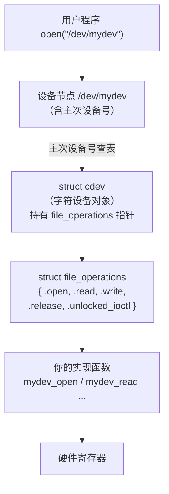

# 02 Linux 设备的三类
| 类型 | 访问方式 | 例子 |
| --- | --- | --- |
| **字符设备** | **按字节流**顺序访问 | 串口 `/dev/ttyS0`、GPIO、I2C、键盘 |
| **块设备** | **按固定大小的块**随机访问 | 硬盘 `/dev/sda`、eMMC `/dev/mmcblk0` |
| **网络设备** | **不走文件接口**，走 socket | `eth0`、`wlan0` |

本页聚焦**字符设备**（嵌入式最常用、最容易上手）。

## 4. 字符设备驱动模型

### 4.1 主设备号与次设备号

```bash
$ ls -l /dev/ | awk '/^c/ {print $5, $6, $NF}' | head -8
10, 235 autofs
10, 234 btrfs-control
5, 1 console
10, 259 cpu_dma_latency
10, 203 cuse
1, 7 full
10, 229 fuse
244, 0 hidraw0
```

| 概念 | 含义 |
| --- | --- |
| **主设备号（major）** | 标识**哪个驱动** |
| **次设备号（minor）** | 标识该驱动管理的**第几个设备** |

例如 `1, 7` 是 `/dev/full`——主设备号 1 是"内存设备"驱动，次设备号 7 区分 `null(3)`、`zero(5)`、`full(7)`、`random(8)` 等。

**内核用这两个号把 `open("/dev/xxx")` 路由到正确的驱动**。

```bash
# 查看系统已分配的主设备号
cat /proc/devices
```

### 4.2 核心数据结构



| 结构体 | 作用 |
| --- | --- |
| `struct cdev` | 内核里的**字符设备对象**，注册到内核后与设备号关联 |
| `struct file_operations` | **回调函数集合**，驱动的核心——实现它就是实现驱动 |
| `struct file` | 每次 `open` 的实例（含 `f_pos` 偏移量、`private_data`） |
| `struct inode` | 文件的静态信息（含设备号） |

### 4.3 file_operations 常用成员

```c
struct file_operations {
    struct module *owner;              /* 通常是 THIS_MODULE */
    int    (*open)    (struct inode *, struct file *);
    int    (*release) (struct inode *, struct file *);
    ssize_t(*read)    (struct file *, char __user *, size_t, loff_t *);
    ssize_t(*write)   (struct file *, const char __user *, size_t, loff_t *);
    loff_t (*llseek)  (struct file *, loff_t, int);
    long   (*unlocked_ioctl)(struct file *, unsigned int, unsigned long);
    __poll_t (*poll)  (struct file *, struct poll_table_struct *);
    int    (*mmap)    (struct file *, struct vm_area_struct *);
};
```

:::danger[演进：ioctl 与 llseek 的接口变更]
- 老教程里的 `.ioctl` 已被 **`.unlocked_ioctl`** 取代（去掉了 BKL 大内核锁）
- 部分回调还多了一个参数（如 `.read` 现在有 `loff_t *`）

**照抄几年前的教程会编译失败**。请以你实际内核的 `include/linux/fs.h` 为准。
:::

---

**翻页**：[← 上一页](./kernel-01) · [下一页 →](./kernel-03) · [返回目录](./)
