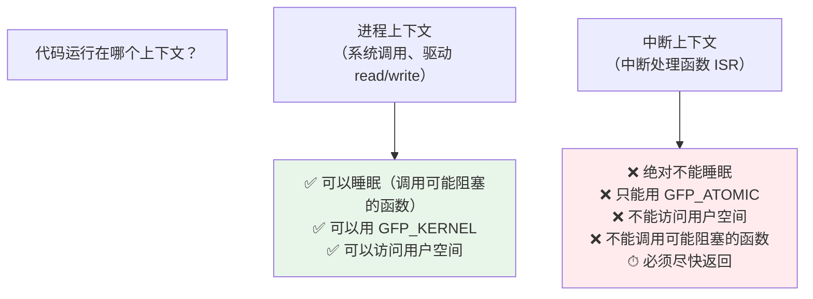

# 04 内核态编程的铁律
这是内核开发和用户态开发**最本质的区别**，也是最常犯的错误来源。

### 6.1 没有 libc

内核**不能链接 glibc**，也没有 `printf`、`malloc`、`memcpy`（部分有等价物）：

| 用户态 | 内核态替代 |
| --- | --- |
| `printf()` | **`printk()`**（或 `pr_info()` 等封装） |
| `malloc()` / `free()` | **`kmalloc()` / `kfree()`**（还有 `vmalloc`、`kzalloc`） |
| `memcpy()` | `memcpy()`（内核有实现） |
| 浮点格式化（`%f`） | **内核不支持浮点运算**（需显式保存 FPU 状态） |
| `sleep()` | `msleep()` / `mdelay()` |
| `pthread_create()` | `kthread_run()` |

### 6.2 栈极小

用户态栈通常 8MB，**内核栈只有 8KB（或 16KB，取决于配置）**。

```c
/* ❌ 内核里绝对不要这样 */
char big_buf[65536];      /* 直接爆栈 → 内核 oops */

/* ✅ 用 kmalloc */
char *buf = kmalloc(65536, GFP_KERNEL);
```

### 6.3 两个上下文：能不能睡眠是关键



**在中断上下文里调用 `kmalloc(GFP_KERNEL)` 会导致内核崩溃**，因为 `GFP_KERNEL` 在内存不足时可能触发页面回收（睡眠），而中断上下文不能被调度走。

正确做法：中断上下文用 `kmalloc(size, GFP_ATOMIC)`（不睡眠，失败立即返回 NULL）。

### 6.4 错误处理：goto 是标准写法

内核里没有 C++ 异常，错误处理的标准范式是 `goto`：

```c
static int mydev_init(void)
{
    int ret;
    ret = alloc_chrdev_region(&devno, 0, 1, DEV_NAME);
    if (ret < 0)
        goto err_region;

    dev_buf = kmalloc(BUF_SIZE, GFP_KERNEL);
    if (!dev_buf) {
        ret = -ENOMEM;
        goto err_alloc;
    }
    return 0;

err_alloc:
    unregister_chrdev_region(devno, 1);
err_region:
    return ret;
}
```

**这是内核代码风格，不是坏味道**——Linus 本人认可这种写法（内核编码风格文档有论述）。

### 6.5 其他要点

| 要点 | 说明 |
| --- | --- |
| **不能有 main()** | 入口是 `module_init()` 注册的初始化函数 |
| **必须声明 LICENSE** | 不写 `MODULE_LICENSE("GPL")` 会导致内核"被污染（tainted）"，且**无法使用 GPL-only 的符号**（如 `EXPORT_SYMBOL_GPL` 导出的） |
| **返回值约定** | 成功返回 0，失败返回**负的 errno**（如 `-ENOMEM`、`-EINVAL`） |
| **并发** | 必须考虑多个进程同时 open/read。用 `mutex`、`spinlock` 保护共享数据 |
| **字节序** | 读硬件寄存器要注意大小端，用 `ioread32`/`iowrite32` 这类 API |

## 7. printk 与内核日志

### 7.1 日志级别

`printk` 需要指定级别：

```c
printk(KERN_ERR "something failed\n");
printk(KERN_INFO "device probed\n");

/* 现代推荐用 pr_* 宏（自动带级别） */
pr_err("something failed\n");
pr_info("device probed\n");
pr_debug("debug info\n");     /* 需要开启 DEBUG 才输出 */
pr_warn("warning\n");
```

八个级别（从高到低）：

| 宏 | 级别值 | 含义 |
| --- | --- | --- |
| `KERN_EMERG` | 0 | 系统不可用 |
| `KERN_ALERT` | 1 | 必须立即处理 |
| `KERN_CRIT` | 2 | 严重错误 |
| `KERN_ERR` | 3 | 错误 |
| `KERN_WARNING` | 4 | 警告 |
| `KERN_NOTICE` | 5 | 正常但重要 |
| `KERN_INFO` | 6 | 信息 |
| `KERN_DEBUG` | 7 | 调试 |

### 7.2 实测：/proc/sys/kernel/printk

```bash
$ cat /proc/sys/kernel/printk
4	4	1	7
```

四个数字：

| 位置 | 含义 | 实测值 |
| --- | --- | --- |
| 1 | **console_loglevel** —— 级别**小于**此值才打印到控制台 | 4 |
| 2 | **default_message_loglevel** —— 没写级别时的默认级别 | 4 |
| 3 | minimum_console_loglevel —— console_loglevel 可设的最小值 | 1 |
| 4 | default_console_loglevel —— 启动时的默认 console 级别 | 7 |

**关键规则**：消息级别 **数字小于** `console_loglevel` 才会在控制台显示。

实测值 4 意味着：只有 `KERN_EMERG(0)` ~ `KERN_ERR(3)` 会打到控制台，`KERN_INFO(6)` 和 `KERN_DEBUG(7)` **不会显示**（但仍进 dmesg 缓冲区）。

:::tip[调试时打开所有日志]
```bash
echo 8 > /proc/sys/kernel/printk       # 全部级别都显示
# 或
dmesg -n 8
```

嵌入式开发时**强烈建议**打开，否则 `pr_debug` 和 `pr_info` 的输出你根本看不到，会误以为代码没执行。

另外注意 `quiet` 内核启动参数会**压低** console_loglevel——实测本机的启动参数里就有 `quiet`（见第 9 页）。
:::

### 7.3 dmesg

```bash
$ dmesg | head -3
[    0.000000] Linux version 6.12.94+deb13-amd64 (debian-kernel@lists.debian.org)
[    0.000000] Command line: BOOT_IMAGE=/boot/vmlinuz-6.12.94+deb13-amd64 root=UUID=... ro quiet
[    0.000000] Disabled fast string operations
```

方括号里的数字是**自启动以来的秒数**（不是墙钟时间）——这在嵌入式上很有用，能看出某件事发生在启动后多久。

常用选项：

```bash
dmesg -w                  # 实时跟踪（像 tail -f）
dmesg -T                  # 显示可读时间戳
dmesg -l err              # 只显示 err 级别（-l 后可接 emerg/alert/crit/err/warn/notice/info/debug）
dmesg -C                  # 清空环形缓冲区
dmesg | grep -i usb       # 过滤
```

:::warning[dmesg_restrict]
实测本机的 `/proc/sys/kernel/dmesg_restrict` 值为 **1**，表示**非 root 用户不能读 dmesg**（防信息泄漏）。

在嵌入式板子上调试时，如果普通用户跑 `dmesg` 报 `Operation not permitted`，就是这个开关。设为 0 可关闭。
:::

### 7.4 sysfs：驱动的另一种出口

除了 `/dev` 设备节点，驱动还通过 **sysfs** 暴露属性（`/sys/class/...`）：

```bash
$ ls -1 /sys/class/ | head -14
accel ata_device ata_link ata_port backlight bdi block bsg devcoredump devfreq devlink dma dma_heap dmi
$ ls -1 /sys/bus/
acpi auxiliary clockevents clocksource container coreboot cpu cxl dax edac event_source gpio hdaudio hid
i2c isa machinecheck mdio_bus memory memory_tiering mipi-dsi node nvmem pci pci_express platform pnp scsi
serial serial-base serio spi usb virtio wmi workqueue xen xen-backend
```

注意里面有 **`gpio`、`i2c`、`spi`** ——这是新一代 GPIO/I2C/SPI 的用户态接口（取代老的 sysfs GPIO）。

驱动里创建 sysfs 属性：

```c
static ssize_t my_attr_show(struct device *dev,
                            struct device_attribute *attr, char *buf)
{
    return sprintf(buf, "%d\n", some_value);
}
static DEVICE_ATTR_RO(my_attr);      /* 只读属性 */

/* 在 probe 里创建 */
device_create_file(&pdev->dev, &dev_attr_my_attr);
```

用户态就能：

```bash
cat /sys/class/myclass/mydev/my_attr
```

:::tip[能用 sysfs 就别用 ioctl]
对于简单的"读一个值/设一个值"的需求，**sysfs 属性比 ioctl 好得多**：

- 不需要写专门的用户态程序，`cat`/`echo` 就能用
- 有标准的文件权限控制
- 可发现（用户能 `ls` 看见有哪些属性）

`ioctl` 适合复杂的、需要传结构体的控制操作。
:::

## 8. 验证

```bash
# === 本机可做的（实测）===

# 1. 模块依赖与信息
lsmod | head -10
modinfo ext4 | grep -E 'depends|softdep|license'

# 2. 模块目录结构
ls /lib/modules/$(uname -r)/
ls /lib/modules/$(uname -r)/kernel/

# 3. printk 级别
cat /proc/sys/kernel/printk

# 4. 设备模型
ls /sys/class/ | head
ls /sys/bus/ | grep -E 'i2c|spi|gpio|platform'

# 5. 设备号
cat /proc/devices
ls -l /dev/ | awk '/^c/' | head

# 6. 内核日志级别调整
dmesg -n 8      # 打开全部日志

# === 需要板子/内核源码（📋 示例，本机无法执行）===
# make -C /path/to/kernel M=$(pwd) modules
# insmod mydev.ko && dmesg | tail
# mknod /dev/mydev c $(grep mydev /proc/devices | awk '{print $1}') 0
```

## 常见坑

| 症状 | 病根 |
| --- | --- |
| `Invalid module format` | 编译模块用的内核源码与**板子上运行的内核不是同一份**（版本或配置不同） |
| `Unknown symbol in module` | 依赖的符号没导出，或依赖模块没先加载。用 `modprobe` 而非 `insmod` |
| `insmod` 成功但 `/dev` 下没有设备节点 | 没有 `class_create`+`device_create`，或 udev/mdev 没运行。可手动 `mknod` |
| 模块卸载不了（`rmmod: Resource temporarily unavailable`） | **引用计数非 0**。查 `lsmod` 的 Used by 列 |
| 内核 oops（崩溃） | 通常是**空指针**或**直接访问用户空间指针**。看 oops 里的 RIP 和 Call trace |
| `copy_from_user` 总是失败 | 检查用户态传的指针和长度；返回非 0 表示有字节没拷成功 |
| 在中断里调 `kmalloc(GFP_KERNEL)` 导致崩溃 | 中断上下文不能睡眠。用 `GFP_ATOMIC` |
| 内核栈溢出（莫名其妙的 oops） | 用了大局部变量（内核栈只有 8KB）。改用 `kmalloc` |
| `printk` 的输出看不到 | 级别高于 `console_loglevel`。`dmesg -n 8` 打开，或改用 `pr_err` |
| 模块编译报 `MODULE_LICENSE` 相关 tainted 警告 | 没声明 `MODULE_LICENSE("GPL")`，且会**失去访问 GPL-only 符号的权限** |
| 驱动 probe 从未被调用 | **设备树 compatible 不匹配**，或 `status` 不是 `"okay"` |
| 设备树改了但没生效 | 没重新编译 dtb，或 U-Boot 加载的是旧的 dtb，**或 `fdt_addr` 环境变量不对** |
| 硬件寄存器读出来是 0xFFFFFFFF | 时钟没开 / 电源域没开 / 引脚复用（pinctrl）没配 |
| 驱动加载成功但读写硬件无反应 | 通常是 **pinctrl 没配**（引脚还在 GPIO 模式）或**时钟未使能** |
| 多进程同时访问设备导致数据错乱 | 没有加锁。用 `mutex`（可睡眠上下文）或 `spinlock`（不可睡眠） |

## 自检清单

- [ ] 说出内核的三类驱动（字符/块/网络）及其访问方式
- [ ] 解释设备树解决了 ARM 的什么问题（硬编码板级信息）
- [ ] 说出 `.dts`、`.dtsi`、`.dtb` 各自的作用
- [ ] 解释 `compatible` 属性如何把设备树与驱动关联起来
- [ ] 说出为什么 x86 上没有 `/proc/device-tree`
- [ ] 说出主设备号与次设备号的作用
- [ ] 说出 `struct cdev` 与 `struct file_operations` 的关系
- [ ] 说出为什么必须用 `copy_to_user`/`copy_from_user` 而不是直接解引用
- [ ] 说出内核态没有 libc 时的替代（`printk`、`kmalloc`）
- [ ] 说出内核栈的大小量级，以及大缓冲该怎么做
- [ ] 区分进程上下文与中断上下文，说出中断上下文的两个禁止项
- [ ] 说出 `GFP_KERNEL` 与 `GFP_ATOMIC` 的使用场景差异
- [ ] 说出 `printk` 的八个级别中最高和最低的
- [ ] 看着 `/proc/sys/kernel/printk` 的四个数字，说出第一个的含义
- [ ] 解释为什么 `pr_info` 的输出可能看不到
- [ ] 说出模块加载失败 `Invalid module format` 的原因
- [ ] 说出 `.ko.xz` 后缀说明什么
- [ ] 说出 sysfs 相比 ioctl 的优势

## 下一步

- [启动流程全链](./boot)——你的内核和 dtb 是怎么被加载起来的
- [根文件系统](./rootfs)——驱动写好了，程序放哪？BusyBox 与 rootfs 构建

---

**翻页**：[← 上一页](./kernel-03) · [返回目录](./)
