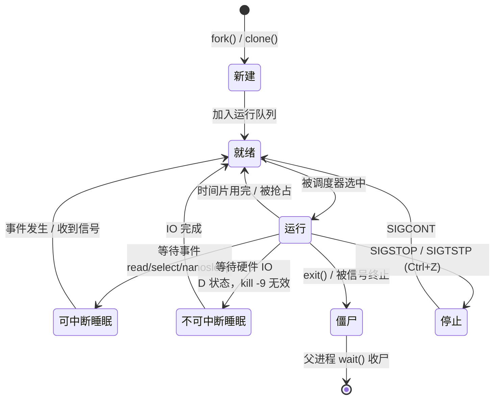

# 01 本页学什么
在单片机上，你的 `main()` 就是世界的起点。在 Linux 上，**你的程序只是内核管理的成百上千个进程之一**。这一页回答：

- 进程到底是什么？内核拿什么描述它？
- `fork()` 之后为什么父子进程的变量会"分家"？（**写时复制 COW**）
- shell 敲一个命令背后的 `fork`+`exec`+`wait` 三部曲
- 僵尸进程和孤儿进程各自是什么、哪个有害
- 信号是什么？为什么 `Ctrl+C` 能杀掉程序而 `kill -9` 一定杀得掉
- 后台运行、`Ctrl+Z`、作业控制是怎么回事
- `nice` 优先级怎么影响调度

:::info[实测环境]
Debian 13 (trixie) / 内核 `6.12.94+deb13-amd64` / x86_64 / gcc 14.2 / glibc 2.41，PID 1 是 `systemd 257`。所有 C 示例代码都在该服务器上编译运行过。
:::

## 1. 进程是什么

### 1.1 两个视角的定义

- **用户视角**：进程 = 一个正在运行的程序实例
- **内核视角**：进程 = 内核里一个 `struct task_struct` 对象 + 它拥有的资源集合

`task_struct`（定义在内核源码 `include/linux/sched.h`）是内核描述进程的核心数据结构，包含：

| 类别 | 字段（概念） | 作用 |
| --- | --- | --- |
| 标识 | `pid`、`tgid` | 进程 ID、线程组 ID |
| 状态 | `state` | 运行/睡眠/僵尸等 |
| 关系 | `parent`、`children` | 父子关系，构成进程树 |
| 内存 | `mm` | 指向地址空间（mm_struct，含页表） |
| 文件 | `files` | 打开的文件描述符表 |
| 文件系统 | `fs` | 根目录、当前工作目录 |
| 信号 | `signal`、`sighand` | 未决信号、信号处理函数 |
| 调度 | `prio`、`se` | 优先级、调度实体 |
| 凭证 | `cred` | uid/gid、capabilities |

:::tip[进程 vs 线程]
在 Linux 内核里**线程和进程用同一个结构体表示**，都是 `task_struct`，区别只在**是否共享地址空间**：

- `fork()` 创建的新任务是**独立地址空间** → 我们叫"进程"
- `pthread_create()` / `clone(CLONE_VM)` 创建的是**共享地址空间** → 我们叫"线程"

内核调度的基本单位叫 **task（任务）**，线程常被称为 **轻量级进程 LWP**。这解释了为什么 `ps -eLf` 里线程也有自己的 PID（其实是 TID）。
:::

### 1.2 每个进程拥有的资源


一个进程"拥有"的东西（也是它退出时要回收的东西）：

1. **独立的虚拟地址空间**（32 位系统是 4GB，x86_64 上是 128TB，通过页表映射到物理内存）
2. **文件描述符表**（fd 0/1/2 及打开的文件）
3. **信号处理程序表**
4. **当前工作目录、根目录**
5. **环境变量副本**
6. **进程凭证**（uid/gid）
7. **CPU 上下文**（寄存器、程序计数器、栈）

注意 **虚拟地址空间是隔离的**：进程 A 的 `0x7ffcd3280128` 和进程 B 的同名地址**是不同的物理内存**。这正是后面 fork COW 实验的基础。

### 1.3 `/proc/<pid>/`：内核把进程内部暴露成文件

```bash
$ ls -1 /proc/self/
arch_status attr autogroup auxv cgroup clear_refs cmdline comm coredump_filter
cpu_resctrl_groups cpuset cwd environ exe fd fdinfo gid_map io ksm_merging_pages
ksm_stat limits loginuid map_files maps mem ...
```

几个高频入口：

| 路径 | 内容 |
| --- | --- |
| `/proc/<pid>/status` | 人类可读的汇总（Name/State/Pid/PPid/VmRSS/Threads） |
| `/proc/<pid>/cmdline` | 启动命令行（NUL 分隔） |
| `/proc/<pid>/cwd` | 符号链接，指向当前工作目录 |
| `/proc/<pid>/exe` | 符号链接，指向可执行文件 |
| `/proc/<pid>/fd/` | 打开的文件描述符 |
| `/proc/<pid>/maps` | 内存映射区域（**查内存泄漏、看库加载地址**） |
| `/proc/<pid>/stat` | 机器可读的统计（空格分隔，ps/top 的数据源） |
| `/proc/<pid>/stack` | 内核栈（需权限，排查卡死） |

实测：

```bash
$ grep -E '^(Name|State|Pid|PPid|Threads|VmRSS)' /proc/self/status
Name:	grep
State:	R (running)
Pid:	694820
PPid:	694766
VmRSS:	    1912 kB
Threads:	1
```

## 2. 进程状态机



| `ps` 的 STAT 字符 | 含义 | 能否被信号打断 |
| --- | --- | --- |
| `R` | Running / Runnable（在运行或就绪队列） | — |
| `S` | Interruptible Sleep（可中断睡眠） | **能** |
| `D` | Uninterruptible Sleep（不可中断睡眠，通常等磁盘/网络 IO） | **不能，连 `kill -9` 都不行** |
| `T` | Stopped（被 SIGSTOP/Ctrl+Z 暂停） | — |
| `Z` | Zombie（僵尸，已退出等待父进程收尸） | 已经死了 |
| `I` | Idle（内核线程空闲） | — |
| `<` | 高优先级（nice 为负） | — |
| `N` | 低优先级（nice 为正） | — |
| `s` | Session leader | — |
| `+` | 前台进程组成员 | — |

实测系统里的进程状态：

```bash
$ ps -eo pid,ppid,stat,comm --no-headers | head -8
      1       0 Ss   systemd
      2       0 S    kthreadd
      3       2 S    pool_workqueue_release
      4       2 I<   kworker/R-kvfree_rcu_reclaim
      5       2 I<   kworker/R-rcu_gp
      6       2 I<   kworker/R-slub_flushwq
      7       2 I<   kworker/R-netns
      8       2 I<   kworker/0:0H-events_highpri
```

- PID 1 是 `systemd`，STAT = `Ss`（睡眠 + session leader）
- PID 2 是 `kthreadd`，**所有内核线程的祖先**
- `kworker/...` 是内核工作队列线程，`I<` = 空闲 + 高优先级

:::danger[D 状态是排查重点]
如果板子上出现 `D` 状态进程且长时间不退出，通常是**存储卡死**（eMMC/SD 卡硬件故障、驱动 bug）或 **NFS 服务端失联**。

**`kill -9` 杀不掉 D 状态进程**，因为它不响应信号。只能等 IO 完成，或者重启。见 [调试与优化](./debug)。
:::

---

**翻页**：[下一页 →](./process-02) · [返回目录](./)
