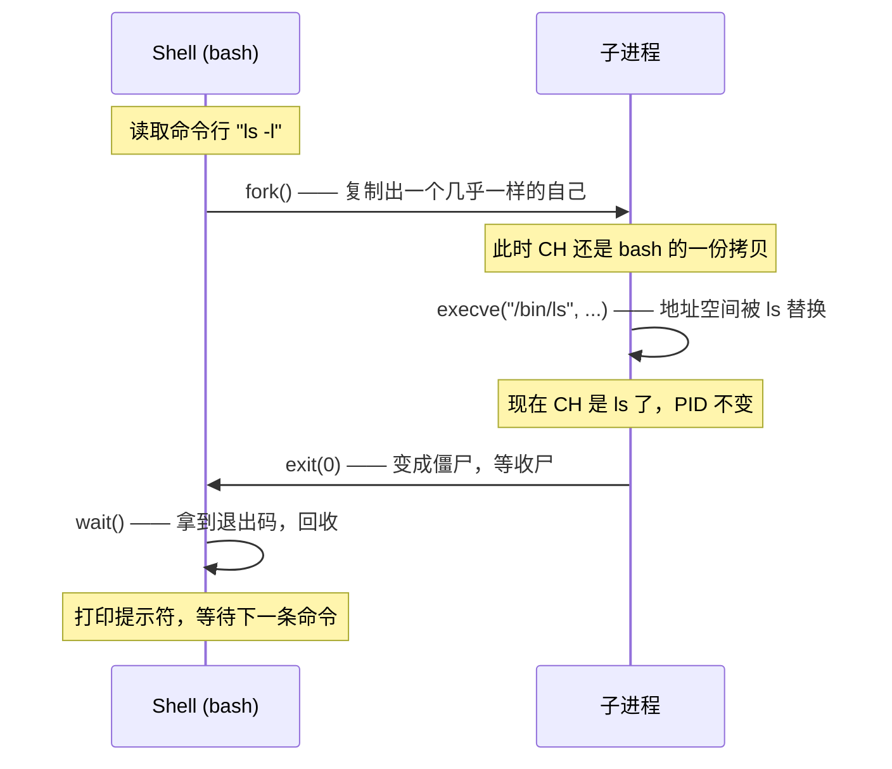

# 02 fork / exec / wait 三部曲
### 3.1 shell 是怎么运行一条命令的

你在 shell 里敲 `ls -l`，背后发生的是：

1. **fork**：shell 复制自己，创建一个子进程
2. **exec**：子进程把 `ls` 的程序加载进来，**替换掉自己的地址空间**
3. **wait**：shell（父进程）等待子进程结束，收集退出状态



**为什么必须分两步（先 fork 再 exec），而不是直接创建进程？**

因为 fork 和 exec 分开，中间那段时间允许你做很多事：

```c
pid_t pid = fork();
if (pid == 0) {
    // 子进程：在 exec 之前可以改自己的东西
    close(1);                       // 关闭标准输出
    open("/tmp/log", O_WRONLY);     // 让 fd 1 指向文件 → 这就实现了 shell 的 > 重定向！
    setuid(1000);                   // 降权
    execl("/bin/ls", "ls", NULL);   // 再加载程序
}
```

**shell 的 `>` 重定向、管道、后台运行，全都是靠"fork 之后、exec 之前"这个窗口实现的**。这是 Unix 设计的精髓。

### 3.2 fork 与写时复制 COW


`fork()` 看起来要"复制整个进程的内存"，如果真这么做，开销巨大（几百 MB 内存要逐字节拷贝）。

Linux 用的是 **COW（Copy-On-Write，写时复制）**：

1. `fork()` 时，内核**只复制页表**（虚拟地址→物理地址的映射表），不复制物理内存
2. 父子进程的页表**指向同一批物理页**，并且这些页被标记为**只读**
3. 当**任何一方**试图写入某页时，CPU 触发**缺页异常（page fault）**
4. 内核发现这是 COW 页，于是**分配一个新的物理页、复制内容、更新写入方的页表为可写**
5. 然后重新执行那条写指令

结果是：**只读的部分始终共享，只有被写的页才会真正复制**。而 fork 之后绝大多数情况立刻 exec，所以几乎不产生拷贝。

#### 实测：同一个虚拟地址，两个不同的值

```c
#include <stdio.h>
#include <stdlib.h>
#include <unistd.h>
#include <sys/wait.h>
int main(void) {
    int shared = 100;
    pid_t pid = fork();
    if (pid < 0) { perror("fork"); return 1; }
    if (pid == 0) {
        shared = 999;
        printf("child  pid=%d ppid=%d shared=%d addr=%p\n",
               getpid(), getppid(), shared, (void *)&shared);
        fflush(stdout);
        _exit(0);
    } else {
        int st; waitpid(pid, &st, 0);
        printf("parent pid=%d child=%d shared=%d addr=%p exit=%d\n",
               getpid(), pid, shared, (void *)&shared, WEXITSTATUS(st));
        fflush(stdout);
    }
    return 0;
}
```

实测输出：

```
child  pid=696791 ppid=696790 shared=999 addr=0x7ffcd3280128
parent pid=696790 child=696791 shared=100 addr=0x7ffcd3280128 exit=0
```

**注意这两行的关键证据**：

- 虚拟地址 `addr` **完全相同**（都是 `0x7ffcd3280128`）
- 但 `shared` 的值**不同**：子进程是 999，父进程是 100

这就是 COW 的直接证据：**虚拟地址一样（因为页表是复制的），但物理页已经分家了（因为子进程写了）**。如果它们是同一块物理内存，父进程看到的必然也是 999。

:::tip[为什么子进程要用 `_exit()` 而不是 `exit()`]
- `exit()` 会**刷新 stdio 缓冲区**并执行 `atexit` 注册的函数
- `_exit()` 直接进内核，**不碰缓冲区**

在 fork 出来的子进程里，stdio 缓冲区是**从父进程复制来的**。如果用 `exit()`，子进程退出时会把父进程缓冲区里的内容**再打印一遍**，造成重复输出。

**规则：fork 后的子进程分支里用 `_exit()`，正常程序结尾用 `exit()`。**
:::

### 3.3 exec：替换地址空间

`execve()` 做的事：

- **加载新的可执行文件**到内存
- **替换掉**代码段、数据段、堆、栈
- **保留**：PID、打开的文件描述符（除非设了 `FD_CLOEXEC`）、信号处理中设为 `SIG_IGN` 的部分

实测：PID 不变，程序变了

```c
#include <stdio.h>
#include <unistd.h>
int main(void) {
    printf("before exec: pid=%d\n", getpid()); fflush(stdout);
    execl("/bin/echo", "echo", "AFTER exec: same pid, new program", (char *)NULL);
    perror("execl failed");
    return 1;
}
```

```
before exec: pid=696816
AFTER exec: same pid, new program
```

`exec` 家族有多个变体，命名规律：

| 函数 | 参数形式 | 是否查 PATH |
| --- | --- | --- |
| `execl` | 参数列表（list） | 否 |
| `execlp` | 列表 | **是** |
| `execv` | 参数数组（vector） | 否 |
| `execvp` | 数组 | **是** |
| `execve` | 数组 + 环境变量 | 否（**唯一真正的系统调用**，其他都是它的封装） |

命名助记：`l`=list、`v`=vector、`p`=PATH、`e`=environment。

### 3.4 wait：收尸与拿退出状态

父进程必须调用 `wait()` / `waitpid()` 来：

1. **回收子进程残留的资源**（内核里的 `task_struct`）
2. **拿到子进程的退出状态**

退出状态是一个 16 位整数，编码了"怎么死的"：

```
位 15......8 | 位 7 | 位 6.....0
  退出码     | core |  信号编号
（正常退出时）      （被信号杀死时）
```

用宏解码（**不要自己移位**）：

| 宏 | 含义 |
| --- | --- |
| `WIFEXITED(st)` | 是否正常退出（exit 或 return） |
| `WEXITSTATUS(st)` | 正常退出时的退出码（低 8 位） |
| `WIFSIGNALED(st)` | 是否被信号杀死 |
| `WTERMSIG(st)` | 杀死它的信号编号 |
| `WCOREDUMP(st)` | 是否产生了 core dump |

实测：

```c
pid_t p1 = fork(); if (p1 == 0) { exit(42); }
pid_t p2 = fork(); if (p2 == 0) { raise(9); }
waitpid(p1, &st, 0);
waitpid(p2, &st, 0);
```

```
exit(42):  WIFEXITED=1 WEXITSTATUS=42
SIGKILL:   WIFSIGNALED=1 WTERMSIG=9
```

:::warning[退出码只有 8 位]
`exit(300)` 实际拿到的是 `300 & 0xFF = 44`。**退出码范围是 0~255**，超过会回绕。这是 shell 里 `$?` 常见困惑的来源。
:::

## 4. 僵尸进程与孤儿进程

这两个概念名字像，但**成因和危害完全不同**。

### 4.1 僵尸进程（Zombie）

**成因**：子进程已经退出，但**父进程没有调用 `wait()`**。

内核必须保留这个子进程的 `task_struct`（里面存着退出状态、CPU 时间统计），等父进程来取。这段时间这个进程就是**僵尸**。

实测（父进程 sleep 20 秒不 wait）：

```bash
$ ps -o pid,ppid,stat,comm -e | grep zombie
    PID    PPID STAT COMMAND
 694425  694400 S    zombie          # 父进程，还在跑
 694427  694425 Z    zombie          # 子进程，STAT=Z，僵尸
```

| 属性 | 僵尸进程 |
| --- | --- |
| STAT | `Z` |
| 占内存吗 | **几乎不占**（地址空间已释放，只剩 `task_struct`） |
| 占 CPU 吗 | 不占 |
| 能被 `kill -9` 杀掉吗 | **不能**，它已经死了 |
| 危害 | **占用 PID**。僵尸太多会耗尽 PID 空间，导致无法创建新进程 |

:::danger[僵尸进程怎么清理]
1. **正确做法**：父进程调用 `wait()` / `waitpid()`
2. **自动做法**：注册 `SIGCHLD` 处理函数，或设 `SIGCHLD` 为 `SIG_IGN`（内核会自动回收）
3. **粗暴做法**：**杀掉父进程**。父进程死了，僵尸变成孤儿，被 PID 1 收养，PID 1 会 `wait` 它们，于是被清理

```bash
# 找出僵尸及其父进程
ps -eo pid,ppid,stat,comm | awk '$3 ~ /Z/'
# 杀父进程（谨慎！）
```
:::

### 4.2 孤儿进程（Orphan）

**成因**：父进程**先于**子进程退出。

这时子进程失去父亲，内核会把它**过继给 PID 1**（systemd 或 init），由 PID 1 负责 `wait` 它。

实测（父进程立即退出，子进程 sleep 2 秒看 ppid 变化）：

```
parent=696823 exiting immediately
[before] child=696824 ppid=696823
[after ] child=696824 ppid=1
```

**`ppid` 从 696823 变成了 1**，这就是 reparent（重新挂载父节点）。

```bash
$ ps -p 1 -o pid,ppid,comm= | cat
    PID    PPID 
      1       0 systemd
```

| 属性 | 孤儿进程 |
| --- | --- |
| 危害 | **基本无害**，这是正常机制 |
| 谁收尸 | PID 1（systemd）会定期 `wait` |
| 典型用途 | **守护进程（daemon）就是故意做成孤儿的** |

:::tip[daemon 的套路]
守护进程的经典写法（"double fork"）：

1. `fork()` 一次，父进程退出 → 子进程成孤儿，脱离原会话
2. 子进程调 `setsid()` → 成为新会话首进程，脱离控制终端
3. （可选）再 `fork()` 一次并退出，确保永远不会重新获得终端
4. 关掉 fd 0/1/2，重定向到 `/dev/null` 或日志文件
5. `chdir("/")` 避免占用可卸载的目录

这就是为什么 daemon 的 PPID 通常是 1。
:::

### 4.3 对比表

| | 僵尸 | 孤儿 |
| --- | --- | --- |
| 谁先死 | **子**进程先死 | **父**进程先死 |
| 状态 | 已死但未被收尸（`Z`） | 活着，只是换了父亲 |
| 父进程 | 还活着，但没 `wait` | 已死，被 PID 1 收养 |
| 有害吗 | **有害**（占 PID） | 无害 |
| 怎么解决 | 父进程 `wait`，或杀父进程 | 不用解决 |

---

**翻页**：[← 上一页](./process-01) · [下一页 →](./process-03) · [返回目录](./)
