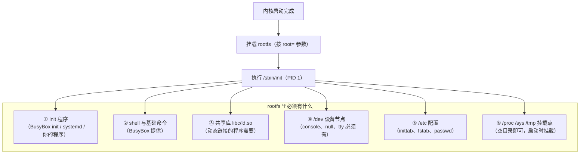
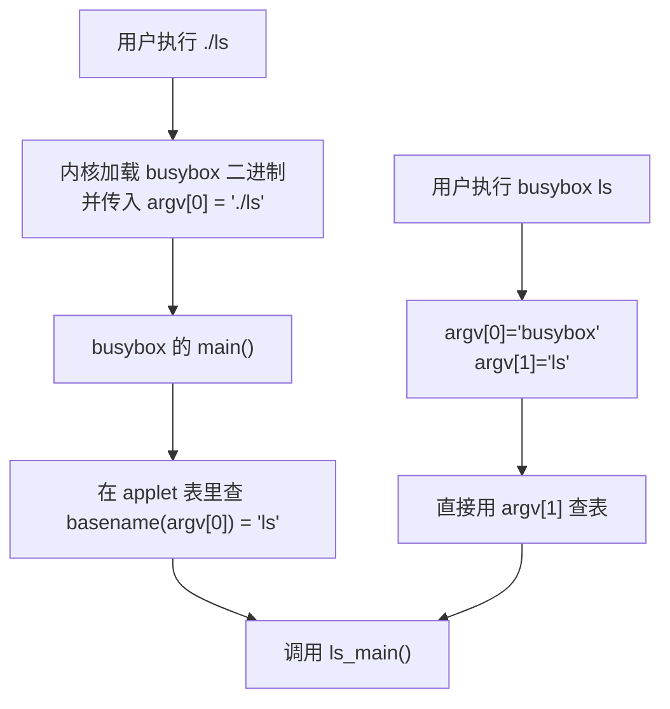

# 01 本页学什么
内核启动到最后一步要**挂载根文件系统**，然后跑 `/sbin/init`。但嵌入式板子上**没有安装程序**——这个 rootfs 得你自己做出来。

- **rootfs 里到底需要哪些东西**（最小集合）
- **BusyBox 是什么，它怎么用一个二进制提供 271 个命令**
- init 系统怎么选：BusyBox init vs systemd（**这是嵌入式的关键取舍**）
- **库依赖怎么放**（最容易漏，漏了就是"命令不存在"或"找不到库"）
- 镜像怎么制作（cpio / ext4 / squashfs）
- **只读根文件系统 + overlayfs**（产品级做法，实测演示）

:::info[实测环境]
Debian 13 / 内核 6.12.94。服务器上有 **BusyBox v1.37.0** 可供实验，**overlayfs 挂载实测成功**（含 whiteout 演示）。
镜像制作工具实测可用性：`mkfs.ext4` ✅、`cpio` ✅、`dd` ✅、`losetup` ✅、`mksquashfs` ❌（未安装）。
:::

## 1. 根文件系统是什么

**rootfs 就是内核启动后挂载到 `/` 的那个文件系统**，里面装着：

- init 程序（PID 1）
- 所有用户态命令（`ls`、`sh`、`mount`……）
- 共享库（glibc 等）
- 配置文件（`/etc`）
- 设备节点（`/dev`）
- 你的应用程序



### 1.1 最小目录集合

```bash
$ ls -d /bin /sbin /etc /dev /proc /sys /tmp /lib /usr /var
/bin /dev /etc /lib /proc /sbin /sys /tmp /usr /var
```

| 目录 | 必需？ | 说明 |
| --- | --- | --- |
| `/bin` `/sbin` | ✅ | 命令（BusyBox 的链接） |
| `/lib` | ✅ | **库，最容易漏** |
| `/etc` | ✅ | 配置文件 |
| `/dev` | ✅ | **设备节点，`console`/`null` 必须有** |
| `/proc` `/sys` | ✅ | 空目录即可（启动时挂载伪文件系统） |
| `/tmp` | 建议 | 常挂 tmpfs |
| `/var` | 建议 | 日志等可变数据 |
| `/usr` | 可选 | 可以合并到 `/` |
| `/root` `/home` | 可选 | 嵌入式常常没有 |

:::danger[缺 /dev/console 的典型症状]
内核启动正常，但最后报：

```
Warning: unable to open an initial console.
```

或者进 shell 后提示：

```
-/bin/sh: can't access tty; job control turned off
```

**原因**：rootfs 里没有 `/dev/console` 设备节点。创建它：

```bash
mknod -m 600 dev/console c 5 1
mknod -m 666 dev/null    c 1 3
mknod -m 666 dev/zero    c 1 5
mknod -m 666 dev/tty     c 5 0
```

实测系统里的这几个节点：

```bash
$ ls -l /dev/console /dev/null /dev/tty
crw------- 1 root root 5, 1 Oct 13 22:48 /dev/console
crw-rw-rw- 1 root root 1, 3 Oct 13 22:48 /dev/null
crw-rw-rw- 1 root tty  5, 0 Oct 13 22:48 /dev/tty
```

**注意**：设备节点是**特殊文件**，不能用 `cp` 从别的地方拷贝，必须用 `mknod` 创建（`cp -a` 可以保留，但跨文件系统时容易出问题）。

现代做法是用 **devtmpfs**（内核自动创建设备节点）或 **udev/mdev**（用户态守护进程管理）。
:::

## 2. BusyBox：一个二进制，几百个命令

### 2.1 它是什么

**BusyBox 被称为"The Swiss Army Knife of Embedded Linux"**——它把 `ls`、`cat`、`sh`、`mount`、`ifconfig`、`vi` 等常用命令**全部塞进一个可执行文件**（约 800KB），靠 **`argv[0]`** 区分要运行哪个功能。

实测：

```bash
$ busybox | head -2
BusyBox v1.37.0 (Debian 1:1.37.0-6+b8) multi-call binary.
BusyBox is copyrighted by many authors between 1998-2015.
$ busybox --list | wc -l
271
$ ls -lh /usr/bin/busybox
-rwxr-xr-x 1 root root 826128 May  9 19:15 /usr/bin/busybox
```

**826KB 的二进制提供 271 个命令**。如果用 GNU coreutils，光 `ls` 就要 140KB，全套要几十 MB。

### 2.2 原理：argv[0] 决定行为

**核心机制**：BusyBox 启动时看 `argv[0]`（也就是你调用它用的名字），然后去内部的 applet 表里查该执行哪个功能。

实测（建立符号链接，用不同名字调用）：

```bash
$ ln -sf /usr/bin/busybox ./ls
$ ln -sf /usr/bin/busybox ./echo
$ ls -l ./ls ./echo
lrwxrwxrwx 1 root root 16 Oct 18 01:09 ./echo -> /usr/bin/busybox
lrwxrwxrwx 1 root root 16 Oct 18 01:09 ./ls -> /usr/bin/busybox

$ ./ls --help
BusyBox v1.37.0 (Debian 1:1.37.0-6+b8) multi-call binary.

Usage: ls [-1AaCxdLHRFplinshrSXvctu] [-w WIDTH] [FILE]...

$ ./echo "hello from busybox echo"
hello from busybox echo
```

**同一个文件，叫 `ls` 就列目录，叫 `echo` 就打印**——这就是 BusyBox 的全部魔法。

也可以显式指定：

```bash
$ busybox echo "explicit applet call"
explicit applet call
```



:::tip[符号链接还是硬链接？]
两者都行：

- **符号链接**（`ln -s busybox ls`）：会额外占一个 inode 存放链接目标路径，但 busybox 本身被删就全废
- **硬链接**（`ln busybox ls`）：更健壮，也不额外占 inode（只多一个目录项）

BusyBox 自带的 `busybox --install -s` 命令会**自动创建所有 applet 的符号链接**：

```bash
busybox --install -s /tmp/myrootfs/bin
```
:::

### 2.3 BusyBox 与 GNU coreutils 的差异

实测对比：

```bash
$ /bin/ls --version | head -1
ls (GNU coreutils) 9.7
$ busybox ls --help | head -3
BusyBox v1.37.0 ... Usage: ls [-1AaCxdLHRFplinshrSXvctu] [-w WIDTH] [FILE]...
```

**关键差异**：BusyBox 的命令是**简化实现**，很多 GNU 选项不支持。

```bash
# GNU ls 支持，busybox ls 可能报 invalid option
ls --color=auto          # 取决于编译配置（CONFIG_FEATURE_LS_COLOR）
grep -P 'regex'          # busybox 的 grep 不支持 PCRE
find -printf '...'       # busybox 可能不支持
```

:::warning[写脚本时注意兼容性]
在 BusyBox 环境下写 shell 脚本，**只用最基础的选项**。一个常见坑：把 PC 上写的脚本拷到板子上，因为用了 GNU 专属选项而失败。

**并且 BusyBox 的 shell 是 `ash`（不是 bash）**：

```bash
$ busybox ash -c 'echo "busybox ash works"; echo $0'
busybox ash works
ash
```

`ash` 不支持 bash 的一些特性（如 `[[ ]]`、数组、`source` 要用 `.`）。脚本首行写 `#!/bin/sh` 而不是 `#!/bin/bash`。
:::

### 2.4 静态 vs 动态 BusyBox

实测本机的 busybox 是**动态链接**的：

```bash
$ file /usr/bin/busybox
/usr/bin/busybox: ELF 64-bit LSB pie executable, x86-64, version 1 (SYSV), dynamically linked, ...
```

**嵌入式通常编译成静态链接**（`CONFIG_STATIC=y`），好处：

- 不依赖 rootfs 里的 glibc，**拷过去就能跑**
- rootfs 制作极其简单

代价：体积变大（但 BusyBox 静态版也才 ~1MB，**仍然远小于**一套动态库）。

:::tip[静态 BusyBox 是新手的最佳起点]
做第一个 rootfs 时，用静态 BusyBox 可以**跳过所有库依赖问题**。等你跑通了，再切回动态链接（为了省空间，让多个程序共享库）。

另外注意 glibc 静态链接的 NSS 警告（见 [交叉编译](./cross-compile)）——用 **musl + 静态** 是最干净的组合。
:::

## 3. 库依赖：最容易漏的一环

### 3.1 动态链接的程序需要什么

实测：

```bash
$ ldd /bin/ls
	linux-vdso.so.1 (0x00007f4aed7d9000)
	libselinux.so.1 => /lib/x86_64-linux-gnu/libselinux.so.1
	libcap.so.2 => /lib/x86_64-linux-gnu/libcap.so.2
	libc.so.6 => /lib/x86_64-linux-gnu/libc.so.6
	libpcre2-8.so.0 => /lib/x86_64-linux-gnu/libpcre2-8.so.0
	/lib64/ld-linux-x86-64.so.2
```

一个 `ls` 就依赖 **5 个文件**（4 个库 + 1 个动态链接器）。漏任何一个，程序就跑不了。

```bash
$ file /bin/ls | grep -o 'interpreter [^,]*'
interpreter /lib64/ld-linux-x86-64.so.2
```

**动态链接器（ld.so）的路径是写死在 ELF 里的**，rootfs 里必须在那个精确路径上有它。

### 3.2 库有多大（决定 rootfs 尺寸）

```bash
$ ls -lh /lib/x86_64-linux-gnu/libc.so.6 /lib/x86_64-linux-gnu/libm.so.6
-rwxr-xr-x 1 root root 2.0M Apr 28 04:09 /lib/x86_64-linux-gnu/libc.so.6
-rw-r--r-- 1 root root 955K Apr 28 04:09 /lib/x86_64-linux-gnu/libm.so.6
$ du -sh /lib/x86_64-linux-gnu/
878M	/lib/x86_64-linux-gnu/
```

**注意这个对比**：

- 单个 `libc.so.6` = **2MB**
- 但整个 `/lib/x86_64-linux-gnu/` = **878MB**（因为里面有大量开发库、调试符号、各种应用的依赖）

**rootfs 里只需要拷用到的那些**，不是整个 `/lib`。这就是 rootfs 裁剪的主要工作。

### 3.3 怎么找出需要哪些库

```bash
# 方法 1：对单个程序
ldd ./myapp

# 方法 2：对整个 rootfs 目录（推荐）
find rootfs/ -type f -executable -exec ldd {} \; 2>/dev/null \
    | grep -o '/[^ ]*\.so[^ ]*' | sort -u
```

:::warning[ldd 在交叉编译时不能直接用于 ARM 程序]
在 x86 主机上 `ldd` 一个 ARM 程序会报"not a dynamic executable"或架构错误。要用**交叉工具链里的 readelf**：

```bash
aarch64-linux-gnu-readelf -d ./myapp | grep NEEDED
```

然后按 NEEDED 列出的名字去 **sysroot** 里找到对应文件拷进 rootfs。
:::

### 3.4 精简库体积

| 方法 | 效果 |
| --- | --- |
| **strip** 去掉符号表 | 通常能减 **30%~50%** |
| 删除 `.a` 静态库（运行时不需要） | 显著 |
| 删除 `pkgconfig/`、`include/` | 只影响开发 |
| 只拷 NEEDED 里的库 | 主要手段 |
| 用 **musl** 替代 glibc | libc 从 2MB 降到几百 KB |

实测 strip 的效果（前面第 7 页的数据）：16056 → 14480 字节。对库文件效果更明显。

---

**翻页**：[下一页 →](./rootfs-02) · [返回目录](./)
