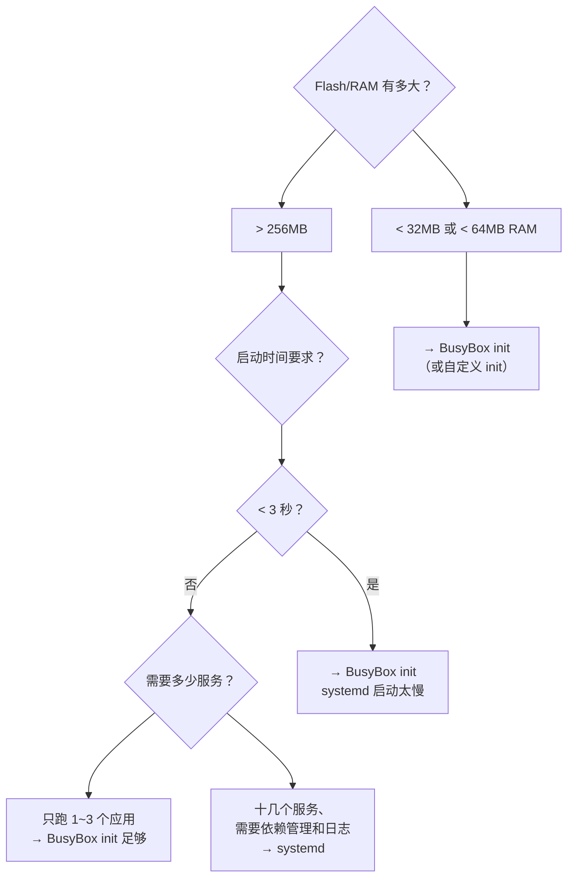

# 02 init 系统对比
### 4.1 init 的职责

PID 1 是**所有进程的祖先**，它要：

1. 挂载伪文件系统（`/proc`、`/sys`）
2. 配置网络、主机名
3. 启动各种服务（daemon）
4. **回收孤儿进程**（这是 PID 1 的**内置职责**，内核强制）
5. 提供登录终端（getty）
6. 管理系统关机/重启

:::info[PID 1 的特殊性]
**PID 1 不能被 `kill -9`**（内核保护）。而且**如果 PID 1 退出，内核立即 panic**。

另外，PID 1 **自动成为所有孤儿进程的养父**——这是内核的硬编码行为，不管你用什么 init 都一样。

所以 init 程序可以非常简单，但**必须不退出**。
:::

### 4.2 三种选择

| init 系统 | 体积 | 启动速度 | 功能 | 适用 |
| --- | --- | --- | --- | --- |
| **BusyBox init** | **极小**（几 KB，含在 busybox 里） | **极快**（`< 1s`） | 简单：读 `/etc/inittab` | 资源紧张、启动要求快、功能简单 |
| **systemd** | **大**（几十 MB） | 较慢（但并行化做得好） | **极强**：依赖管理、socket 激活、cgroup、journald | 复杂产品、需要完整服务管理 |
| **自定义程序** | — | — | — | 单一用途设备，直接跑你的应用当 PID 1 |

### 4.3 BusyBox init 与 /etc/inittab

BusyBox init 读 `/etc/inittab`，格式是：

```
<id>:<runlevels>:<action>:<process>
```

典型内容：

```
::sysinit:/etc/init.d/rcS
::respawn:/sbin/getty -L ttyS0 115200 vt100
::restart:/sbin/init
::ctrlaltdel:/sbin/reboot
::shutdown:/bin/umount -a -r
```

各字段：

| 字段 | 说明 |
| --- | --- |
| `id` | 终端标识（空表示不绑定终端） |
| `runlevels` | BusyBox **忽略**这个字段（保留兼容 SysV） |
| `action` | **何时执行**：见下表 |
| `process` | 要执行的命令 |

常用 action：

| action | 含义 |
| --- | --- |
| **`sysinit`** | **系统初始化时执行**（第一个），通常跑 `/etc/init.d/rcS` |
| **`respawn`** | **进程退出后自动重启**（getty、关键守护进程用） |
| `once` | 只执行一次，不等待 |
| `wait` | 执行一次，**等待它结束** |
| `askfirst` | 先打印 "Please press Enter" 再启动（**嵌入式控制台常用**） |
| `shutdown` | 关机时执行 |
| `restart` | init 收到重启信号时 |
| `ctrlaltdel` | 按下 Ctrl+Alt+Del 时 |

配套脚本 `/etc/init.d/rcS`：

```sh
#!/bin/sh
# 挂载伪文件系统
mount -t proc  proc  /proc
mount -t sysfs sysfs /sys
mount -t tmpfs tmpfs /tmp

# 创建设备节点（或让 mdev 来做）
mdev -s                      # BusyBox 的 mdev，类似 udev

# 网络
ifconfig lo up
ifconfig eth0 192.168.1.100 up

# 启动应用
/usr/bin/myapp &
```

:::tip[sysinit 必须先挂载 /proc 和 /sys]
很多命令（`mount`、`mdev`、`ps`、`ifconfig`）依赖 `/proc` 和 `/sys`。如果 rcS 里不先挂载它们，后面的命令会失败。

**这是 BusyBox init 最常见的错误**——rcS 里第一条就该是挂载伪文件系统。
:::

### 4.4 systemd（实测本机）

```bash
$ ps -p 1 -o comm=
systemd
$ readlink /proc/1/exe
/usr/lib/systemd/systemd
$ ls -l /sbin/init
lrwxrwxrwx 1 root root 22 Apr 14  2026 /sbin/init -> ../lib/systemd/systemd
$ systemctl get-default
graphical.target
```

systemd 用 **unit 文件**而不是脚本：

```ini
# /etc/systemd/system/myapp.service
[Unit]
Description=My Application
After=network.target

[Service]
Type=simple
ExecStart=/usr/bin/myapp
Restart=always
RestartSec=5

[Install]
WantedBy=multi-user.target
```

常用命令：

```bash
systemctl start|stop|restart|status myapp
systemctl enable|disable myapp        # 开机自启
systemctl list-units --failed         # 看失败的服务
journalctl -u myapp -f                # 看日志
systemd-analyze blame                 # 启动耗时（详见启动流程页）
```

unit 目录（实测）：

```bash
$ ls -1d /etc/systemd/system /lib/systemd/system /usr/lib/systemd/system
/etc/systemd/system
/lib/systemd/system
/usr/lib/systemd/system
```

**优先级**：`/etc/systemd/system`（管理员）高于 `/usr/lib/systemd/system`（发行版提供）

### 4.5 选型建议



:::info[务实建议]
- **学习阶段 / 小型项目**：BusyBox init，几 KB，逻辑清晰，**你能完全看懂发生了什么**
- **产品化 / 复杂应用**：用 **Buildroot 或 Yocto** 生成（它们默认用 BusyBox init，也可选 systemd）
- **直接用 Debian/Ubuntu rootfs**（如树莓派）：已经自带 systemd，顺着用即可

**不要为了"现代"而在 64MB 的板子上塞 systemd**——它光二进制就要几十 MB，且启动慢。
:::

## 5. 镜像制作

rootfs 做好是一个目录，要烧到板子上需要做成**镜像文件**。

### 5.1 工具可用性（实测）

```bash
$ for t in mksquashfs mkfs.ext4 genext2fs cpio dd losetup; do ... done
mksquashfs   MISSING
mkfs.ext4    /usr/sbin/mkfs.ext4
genext2fs    MISSING
cpio         /usr/bin/cpio
dd           /usr/bin/dd
losetup      /usr/sbin/losetup
```

### 5.2 三种常见格式

| 格式 | 制作命令 | 特点 |
| --- | --- | --- |
| **ext4 镜像** | `mkfs.ext4` + loop 挂载拷贝 | **可读写**，最常见 |
| **squashfs** | `mksquashfs` | **只读 + 压缩**，省空间，配 overlay |
| **cpio（initramfs）** | `cpio` + gzip | **编译进内核**或作 initramfs |

#### ext4 镜像（📋 标准流程）

```bash
# 1. 创建一个空文件
dd if=/dev/zero of=rootfs.ext4 bs=1M count=64

# 2. 格式化为 ext4
mkfs.ext4 -F rootfs.ext4

# 3. 用 loop 设备挂载
mkdir -p /mnt/rootfs
sudo mount -o loop rootfs.ext4 /mnt/rootfs

# 4. 拷贝内容
sudo cp -a rootfs/* /mnt/rootfs/
sudo umount /mnt/rootfs
```

**写入 SD 卡**：

```bash
# ⚠️ 确认 /dev/sdX 是你的 SD 卡，写错会毁掉硬盘！
sudo dd if=rootfs.ext4 of=/dev/sdX bs=4M status=progress
sync
```

#### squashfs（📋 需安装 squashfs-tools）

```bash
mksquashfs rootfs/ rootfs.squashfs -comp xz -noappend
```

#### initramfs/cpio

```bash
cd rootfs && find . | cpio -o -H newc | gzip > ../rootfs.cpio.gz
```

### 5.3 完整 SD 卡镜像的布局

一个可启动的 SD 卡镜像通常有**分区表 + 多个分区**：

```
偏移 0          : 分区表（MBR/GPT）
偏移 8KB        : SPL + U-Boot（不在任何分区里，直接写在扇区上）
分区 1 (FAT32)  : boot —— zImage / uImage、*.dtb、boot.scr、uEnv.txt
分区 2 (ext4)   : rootfs —— 根文件系统
```

:::tip[为什么 bootloader 要写在分区之外]
因为 **BootROM 不认识文件系统**。它只会从某个固定的物理偏移（如 SD 卡第 8KB）读取固定长度的数据。

所以 U-Boot 必须用 `dd` 写到**裸扇区**，而不是拷到 FAT 分区里：

```bash
sudo dd if=u-boot-sunxi-with-spl.bin of=/dev/sdX bs=1024 seek=8
```
:::

---

**翻页**：[← 上一页](./rootfs-01) · [下一页 →](./rootfs-03) · [返回目录](./)
