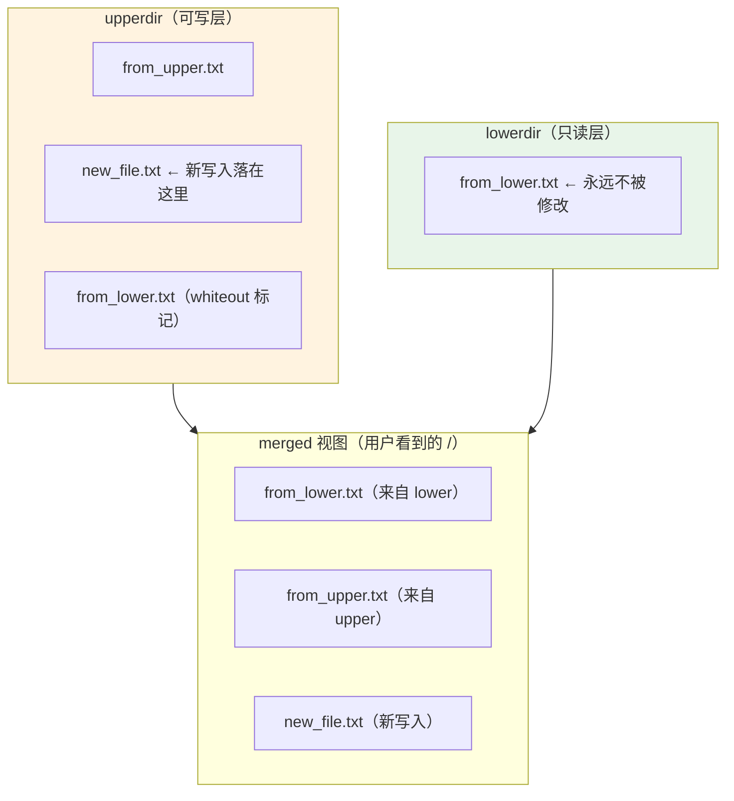

# 03 只读根文件系统 + overlayfs
**这是产品级设备的标准做法**（路由器、IoT 设备都这么干）。

### 6.1 为什么

| 问题 | 只读根的解法 |
| --- | --- |
| 掉电损坏文件系统 | **根永远只读**，不会损坏 |
| Flash 磨损 | 不写入，寿命延长 |
| 系统被意外改坏 | 改不了 |
| OTA 升级 | 整块替换只读层，原子性好 |

**但程序需要写文件怎么办**（日志、配置、临时数据）？→ **overlayfs** 提供一个可写层。

### 6.2 overlayfs 原理

**overlayfs 把两个目录"叠加"成一个视图**：

- **lowerdir**（下层）：**只读**，通常是 squashfs 挂载的固件
- **upperdir**（上层）：**可写**，所有写入都落在这里
- **workdir**：内部工作目录（必须与 upperdir 同一文件系统）
- **merged**（合并视图）：用户看到的 `/`



**查找规则**：先查 upperdir，找不到再查 lowerdir。
**写入规则**：**永远写入 upperdir**（copy-up：如果要改 lower 的文件，先复制到 upper 再改）。
**删除规则**：在 upperdir 创建 **whiteout** 文件（一个特殊字符设备）来"遮住" lower 的文件。

### 6.3 实测：overlayfs 完整演示

```bash
$ mkdir -p /tmp/ovl/{lower,upper,work,merged}
$ echo "lower-content" > /tmp/ovl/lower/from_lower.txt
$ echo "upper-content" > /tmp/ovl/upper/from_upper.txt

$ mount -t overlay overlay \
    -o lowerdir=/tmp/ovl/lower,upperdir=/tmp/ovl/upper,workdir=/tmp/ovl/work \
    /tmp/ovl/merged
overlay mounted OK
```

**① 合并视图（两层内容都可见）**：

```bash
$ ls -1 /tmp/ovl/merged/
from_lower.txt
from_upper.txt
```

**② 写入只落到 upper**：

```bash
$ echo "new" > /tmp/ovl/merged/new_file.txt
$ ls -1 /tmp/ovl/merged/          # merged 视图
from_lower.txt
from_upper.txt
new_file.txt
$ ls -1 /tmp/ovl/upper/           # upper 里多了新文件
from_upper.txt
new_file.txt
$ ls -1 /tmp/ovl/lower/           # ★ lower 完全没变
from_lower.txt
```

**③ 删除 lower 的文件 → whiteout**：

```bash
$ rm /tmp/ovl/merged/from_lower.txt
$ ls -1 /tmp/ovl/merged/          # 从视图中消失了
from_upper.txt
new_file.txt
$ ls -1 /tmp/ovl/lower/           # ★ lower 里的文件还在！
from_lower.txt
$ ls -la /tmp/ovl/upper/          # upper 里出现 whiteout
c--------- 2 root root 0, 0 Oct 18 01:09 from_lower.txt      ← whiteout
-rw-r--r-- 1 root root   14 Oct 18 01:09 from_upper.txt
-rw-r--r-- 1 root root    4 Oct 18 01:09 new_file.txt
```

**注意 whiteout 的形态**：`c--------- 0, 0`——一个**主次设备号都是 0 的字符设备**。这是个"标记文件"，overlayfs 用它表示"下层这个文件被删了"。

:::tip[这套机制的实用价值]
- **恢复出厂设置** = 清空 upperdir（lower 的固件原封不动）
- **OTA 升级** = 替换 lowerdir 的镜像
- **掉电安全** = 只读层永远一致，最多丢 upper 的临时数据

这就是为什么你的路由器"恢复出厂设置"后系统完好如初。
:::

### 6.4 内核必须支持

```bash
$ grep overlay /proc/filesystems
nodev	overlay
```

若没有输出，说明内核没编 overlayfs（`CONFIG_OVERLAY_FS`）。

### 6.5 典型挂载方案

```bash
# 固件（只读）
mount -t squashfs /dev/mmcblk0p2 /mnt/rom

# 可写层（可以是 tmpfs 内存，也可以是 Flash 上的一个分区）
mount -t tmpfs tmpfs /mnt/rw
# 或者：mount -t ext4 /dev/mmcblk0p3 /mnt/rw

mkdir -p /mnt/rw/upper /mnt/rw/work

# 叠加成新的根
mount -t overlay overlay \
  -o lowerdir=/mnt/rom,upperdir=/mnt/rw/upper,workdir=/mnt/rw/work /mnt/root

# 切换根
switch_root /mnt/root /sbin/init
```

:::warning[workdir 与 upperdir 必须同一文件系统]
这是 overlayfs 的硬性要求。如果 upperdir 在 tmpfs 而 workdir 在 ext4，挂载会失败。

另外：**不能直接把 overlay 的 upper 和 lower 交换**，必须是"上可写下只读"。
:::

## 7. 用 Buildroot / Yocto 自动生成

手工做 rootfs 能学到全部细节，但**产品化应该自动化**：

| 工具 | 定位 | 输出 |
| --- | --- | --- |
| **Buildroot** | **简单**，Makefile 风格，快速出结果 | 工具链 + rootfs + 内核 + bootloader 镜像 |
| **Yocto / OpenEmbedded** | **强大复杂**，配方（recipe）系统 | 完整的定制发行版 |
| **OpenWrt** | 针对**路由器** | 路由器固件 |
| **Debian/Ubuntu rootfs**（debootstrap） | 直接用桌面发行版 | 完整的 Debian 环境（体积大） |

:::tip[学习路径建议]
1. **先手工做一次最小 rootfs**（用静态 BusyBox）——理解每个成分
2. **再用 Buildroot**——体会自动化，并对比你手工做的有什么不同
3. 项目复杂后再考虑 Yocto

**跳过第 1 步直接用 Buildroot，你会不理解它为什么这么做，出问题时无法排查。**
:::

## 8. 验证

```bash
# === 本机可做（实测）===

# 1. BusyBox 的 argv[0] 机制
mkdir -p /tmp/bbdemo && cd /tmp/bbdemo
ln -sf /usr/bin/busybox ./ls
ln -sf /usr/bin/busybox ./echo
./ls --help | head -2
./echo "hello"
busybox --list | wc -l

# 2. 库依赖分析
ldd /bin/ls
file /bin/ls | grep -o 'interpreter [^,]*'
ls -lh /lib/x86_64-linux-gnu/libc.so.6

# 3. overlayfs 完整演示（见 6.3 节，已实测成功）
mkdir -p /tmp/ovl/{lower,upper,work,merged}
mount -t overlay overlay -o lowerdir=...,upperdir=...,workdir=... /tmp/ovl/merged

# 4. 内核支持的文件系统
cat /proc/filesystems | tr '\n' ' '

# 5. init 系统
ps -p 1 -o comm=
readlink /proc/1/exe

# === 需要权限/工具（📋 示例）===
# mkfs.ext4、mksquashfs、cpio 制作镜像
```

## 常见坑

| 症状 | 病根 |
| --- | --- |
| `Warning: unable to open an initial console` | rootfs 缺 `/dev/console`。用 `mknod` 创建 |
| `can't access tty; job control turned off` | 同上，或 `/dev/tty` 缺失 |
| `No working init found` | 没有 `/sbin/init`，或 `init=` 指向的文件不存在 |
| 进了 shell 但 `ls` 等命令不存在 | BusyBox 的符号链接没建（`busybox --install -s`） |
| `ls: not found` 但 busybox 在 | **动态链接的 busybox 缺库**。改用静态 busybox |
| `error while loading shared libraries: libc.so.6` | 库没拷进 rootfs，或拷到了错误路径 |
| `-bash: ./app: No such file or directory` | 缺**动态链接器 ld.so**（路径写死在 ELF 里） |
| 用 `cp` 拷 `/dev` 的设备节点后失效 | 设备节点必须用 `mknod` 创建，`cp` 拷出来是普通文件 |
| rcS 脚本里 `mount` 命令失败 | **没先挂载 `/proc`**（很多命令依赖它） |
| BusyBox 环境里脚本报 `syntax error` | 用了 bash 特性。BusyBox 的 shell 是 **ash**，脚本用 `#!/bin/sh` |
| `ls --color` 报 invalid option | BusyBox 是简化实现，且很多选项要在编译时开启（如 `CONFIG_FEATURE_LS_COLOR`） |
| overlayfs 挂载失败 "invalid argument" | `workdir` 与 `upperdir` 不在同一文件系统 |
| 只读根上程序无法写日志 | 需要 overlayfs，或把 `/var/log` 挂成 tmpfs |
| rootfs 镜像太大 | 没 strip、拷了整个 `/lib`、拷了 `.a` 静态库和头文件 |
| 交叉编译的程序拷进 rootfs 跑不了 | 库用交叉 readelf 查 NEEDED，从 **sysroot** 拷贝 |
| rootfs 做好但板子启动报 VFS 错误 | `root=` 参数错，或镜像没烧对分区 |
| ARM 程序在 x86 上 `ldd` 报错 | 正常，要用交叉工具链的 `*-readelf -d` |

## 自检清单

- [ ] 列出最小 rootfs 需要的目录
- [ ] 说出为什么 `/dev/console` 必须存在，以及怎么创建
- [ ] 解释 BusyBox 用一个二进制提供几百个命令的原理（`argv[0]`）
- [ ] 说出 BusyBox 的 shell 是 ash 而不是 bash，以及脚本注意事项
- [ ] 说出静态 BusyBox 的优缺点，以及为什么推荐新手用
- [ ] 说出一个动态链接程序需要哪些文件才能运行
- [ ] 说出动态链接器路径存在哪里（ELF 的哪个段）
- [ ] 说出精简库体积的两种方法
- [ ] 说出 PID 1 的三个特殊性
- [ ] 说出 BusyBox init 的 inittab 里 `sysinit` 和 `respawn` 的区别
- [ ] 说出 rcS 脚本里第一条应该做什么
- [ ] 对比 BusyBox init 与 systemd 的适用场景
- [ ] 说出 squashfs / ext4 / cpio 各自的特点与用途
- [ ] 解释为什么 bootloader 要写在 SD 卡的裸扇区而非分区里
- [ ] 解释 overlayfs 的 lower/upper/work/merged 四个部分
- [ ] 说出 overlayfs 的写入规则和删除规则（copy-up 与 whiteout）
- [ ] 看着 `c--------- 0, 0` 能认出这是 whiteout 文件
- [ ] 说出只读根 + overlay 的三个好处（掉电安全、寿命、恢复出厂）

## 下一步

- [调试与优化](./debug)——板子做出来了，出问题怎么查
- [启动流程全链](./boot)——回顾 rootfs 在整个启动链中的位置

---

**翻页**：[← 上一页](./rootfs-02) · [返回目录](./)
