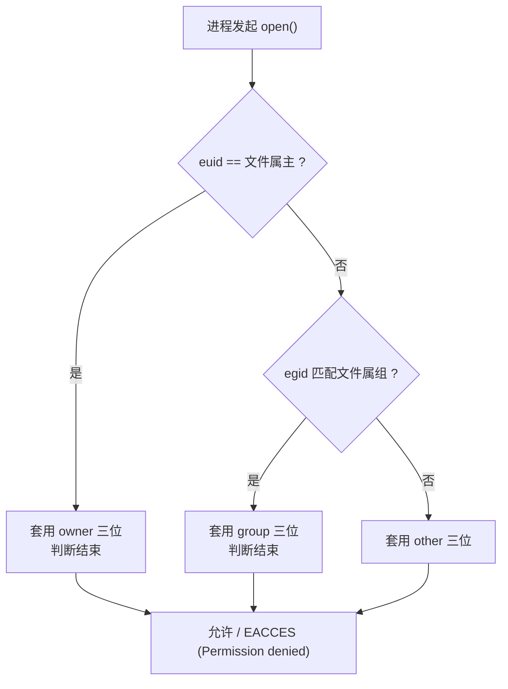

# 02 权限位：文件与目录的语义完全不同
### 2.1 先看长格式输出

```bash
$ ls -l f1
-rw-r----- 1 root root 0 Oct 18 00:31 f1
$ stat -c 'mode=%a type=%F links=%h inode=%i size=%s' f1
mode=640 type=regular empty file links=1 inode=31050 size=0
```

拆解第一列 `-rw-r-----`（10 个字符）：

```
位置:  0        1 2 3        4 5 6        7 8 9
       -        r w -        r - -        - - -
       │        └─┬┘         └─┬┘         └─┬┘
       │          │            │            │
     文件类型   owner 权限   group 权限   other 权限
     (-普通文件  rw- = 6      r-- = 4      --- = 0
      d目录
      l符号链接
      c字符设备
      b块设备
      p管道
      s套接字)
```

八进制换算：`r=4`、`w=2`、`x=1`，三位一组相加。

| 八进制 | 符号 | 二进制 |
| --- | --- | --- |
| `7` | `rwx` | 111 |
| `6` | `rw-` | 110 |
| `5` | `r-x` | 101 |
| `4` | `r--` | 100 |
| `0` | `---` | 000 |

### 2.2 重点：目录的 rwx 和文件的 rwx 含义不同

**这是本节最重要的内容**，也是初学者最容易搞混的地方。

| 权限 | 对**普通文件** | 对**目录** |
| --- | --- | --- |
| `r`（读） | 能读文件内容 | 能**列出目录里有哪些条目**（`ls` 能跑） |
| `w`（写） | 能改文件内容 | 能**在目录里新建/删除/重命名条目** |
| `x`（执行） | 能把它当程序执行 | 能**进入该目录**（`cd` 进去、访问里面的文件） |

关键差异在 `w` 和 `x`：

- **文件的 `w` 是"改内容"**，目录的 `w` 是"改条目列表"
- **目录的 `x` 其实是"搜索"权限**：没有 `x`，即使有 `r` 你也只能看到文件名，`cat` 里面的内容会失败

:::warning[实测：目录没有 x 会怎样]
```bash
$ mkdir -p /tmp/permtest && touch /tmp/permtest/inside && chmod 600 /tmp/permtest
$ ls -l /tmp/permtest
total 0
-rw-r--r-- 1 root root 0 Oct 18 00:45 inside
$ cat /tmp/permtest/inside
cat: /tmp/permtest/inside: Permission denied
```

`ls` 能列出名字（因为有 `r`），但 **`cat` 读内容失败**（因为没有 `x`，穿不过去）。

**这组输出要用普通用户复现**：root 有 `CAP_DAC_OVERRIDE`，会绕过上面这套检查（见 2.5）。
:::

:::caution[删除一个文件需要的是目录的 w 权限，不是文件的]
这是个反直觉但很重要的结论：**你能否删除 `a.txt`，取决于 `a.txt` 所在目录有没有 `w`，与 `a.txt` 自身的权限无关**。

所以 `/tmp` 是 `drwxrwxrwt`（人人可写），任何用户都能删掉别人的临时文件——**所以才需要 sticky 位**（见 2.4）。
:::

### 2.3 umask：新建文件的默认权限

新建文件/目录时，程序会用一个"基准权限"再**减去 umask**：

- 文件基准：`666`（`rw-rw-rw-`，**没有 x**，因为普通文件默认不该可执行）
- 目录基准：`777`（`rwxrwxrwx`）

umask 里写着的位就是**要屏蔽掉的位**。计算方式是 `基准 & ~umask`。

实测对照：

```bash
$ umask
0022
$ (umask 022; touch a022; mkdir d022)
$ (umask 077; touch a077; mkdir d077)
$ ls -l a022 a077
-rw-r--r-- 1 root root 0 Oct 18 00:31 a022      # 666 & ~022 = 644
-rw------- 1 root root 0 Oct 18 00:31 a077      # 666 & ~077 = 600
$ ls -ld d022 d077
drwxr-xr-x 2 root root 40 Oct 18 00:31 d022    # 777 & ~022 = 755
drwx------ 2 root root 40 Oct 18 00:31 d077    # 777 & ~077 = 700
$ (umask 0027; touch x; stat -c '%a' x)
640                                              # 666 & ~027 = 640
```

常见 umask 值速查：

| umask | 新建文件 | 新建目录 | 场景 |
| --- | --- | --- | --- |
| `022`（默认） | `644` | `755` | 通用默认，同组和其他人可读 |
| `077` | `600` | `700` | **私密**，只有自己能访问 |
| `002` | `664` | `775` | 组内共享 |
| `027` | `640` | `750` | 组内读、其他人无权限 |

:::tip[umask 只对新建生效]
已经存在的文件的权限**不会被 umask 改变**。实测：

```bash
$ chmod 600 f1; touch f1; stat -c '%a %n' f1
600 f1         # touch 一个已存在的文件，权限保持 600 不变
```

很多人误以为改了 umask 再 touch 就能"修正"已有文件权限——不能，要用 `chmod`。
:::

### 2.4 三个特殊位：setuid / setgid / sticky

除了 `rwx`，还有三个特殊位（占用 `x` 的位置显示）：

| 位 | 对文件 | 对目录 | 八进制 |
| --- | --- | --- | --- |
| **setuid** | 执行时以**文件属主**的身份运行 | （无意义） | `4000` |
| **setgid** | 执行时以**文件属组**身份运行 | 目录内新建的文件**继承目录的属组** | `2000` |
| **sticky** | （历史遗留） | 只有**文件属主或 root** 才能删除目录内的文件 | `1000` |

实测系统里的真实例子：

```bash
$ ls -l /usr/bin/passwd /usr/bin/newgrp
-rwsr-xr-x 1 root root 118168 /usr/bin/passwd
-rwsr-xr-x 1 root root  18816 /usr/bin/newgrp
$ ls -ld /tmp /var/mail
drwxrwxrwt 15 root root  760 Oct 18 00:31 /tmp
drwxrwsr-x  2 root mail 4096 Oct 18 00:31 /var/mail
```

逐条解读：

- `/usr/bin/passwd` 的属主位是 `rws`（`s` 而不是 `x`）= **setuid**。普通用户执行 `passwd` 改自己密码时需要写 `/etc/shadow`（只有 root 能写），靠的就是 setuid 让程序临时获得 root 身份。
- `/tmp` 的其他人位是 `rwt`（`t` 而不是 `x`）= **sticky**。人人可写，但**只能删自己的文件**。
- `/var/mail` 的属组位是 `rws` = **setgid 目录**。新建的邮件文件自动归属 `mail` 组。

:::danger[setuid 是安全风险]
setuid 程序是提权攻击的头号目标。**不要给自己的程序随便加 setuid**。另外，**shell 脚本上的 setuid 在 Linux 上是被忽略的**（内核不允许解释型脚本 setuid，因为竞态风险）——这个坑很多人踩过。

设置方法：`chmod u+s file`、`chmod g+s dir`、`chmod +t dir`，或八进制 `chmod 4755 file`。
:::

### 2.5 权限检查的实际顺序

当进程访问文件时，内核按这个顺序判定（**不是"取最宽松的"**）：

1. 如果进程的 **euid == 文件属主** → 只看 owner 三位，**结束了**（即使 owner 位是 `---` 也不再看后面）
2. 否则如果进程的 egid（或附加组）匹配文件属组 → 只看 group 三位
3. 否则 → 只看 other 三位



:::warning[这个顺序有个反直觉的后果]
root 用户（uid 0）**不受这套限制**——root 几乎能访问任何文件（除非有 ACL、只读挂载或 capability 限制）。

实测中我们以 root 身份操作，所以很多"没权限"的演示跑不出来。**用普通用户账号复现权限实验才能得到教科书式的 `Permission denied`**。
:::

---

**翻页**：[← 上一页](./shell-01) · [下一页 →](./shell-03) · [返回目录](./)
