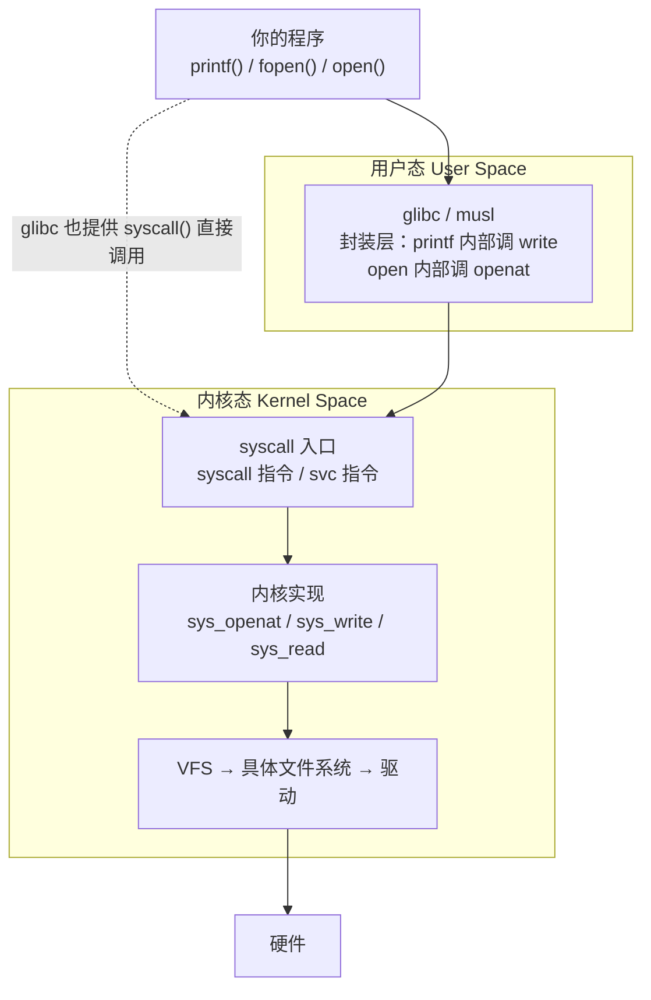

# 01 本页学什么
前面几页都是"用"Linux，这一页开始**写** Linux 程序。重点：

- 系统调用到底是什么？为什么 `printf` 和 `write` 不是一回事
- **文件描述符 fd 的本质**（它不是"文件"，而是一个下标）
- `open/read/write/lseek` 的正确用法与返回值陷阱
- stdio 的**三种缓冲模式**，以及它制造的"程序输出不见了"经典谜题
- 没有 `strace` 时怎么追踪系统调用（**本服务器就没装**）
- **select → poll → epoll 的演进**，为什么 epoll 快，以及 **LT/ET 两种触发模式的实测差异**

:::info[实测环境]
Debian 13 (trixie) / 内核 6.12.94 / x86_64 / gcc 14.2 / glibc 2.41 / gdb 16.3。
**注意：本服务器没有安装 `strace` 和 `ltrace`**，所以系统调用追踪用 **gdb 的 `catch syscall`** 演示（已验证可行）。
:::

## 1. 系统调用：用户态进入内核的唯一入口

### 1.1 分层关系



**关键概念**：

- CPU 有两种特权级别：**用户态（ring 3）** 和 **内核态（ring 0）**。用户态程序**不能直接访问硬件、不能访问内核内存**
- 要访问硬件（读写文件、发网络包、分配内存），必须通过**系统调用**陷入内核
- 陷入的具体指令因架构而异：x86_64 是 `syscall`，ARM64 是 `svc #0`，ARM32 是 `swi`
- glibc 把系统调用封装成 C 函数，所以你写 `open()` 时通常不知道底下发生了什么

:::tip[为什么要有这层隔离]
如果任何程序都能直接操作磁盘控制器或任意物理内存，那一个 bug 就能让整台机器崩溃。**系统调用 + 特权级隔离是操作系统存在的根本理由**。

代价是：一次系统调用大约有**几百纳秒到微秒级**的开销（要切换栈、保存寄存器、权限检查）。这也是后面讲缓冲的意义——**减少系统调用次数**。
:::

### 1.2 用 gdb 观察系统调用（strace 的替代方案）

本服务器没有 `strace`。有两种办法：

**办法一（推荐，需权限）**：安装 strace

```bash
apt install strace        # Debian/Ubuntu
yum install strace        # RHEL/CentOS
```

**办法二（零安装）**：用 gdb 的 `catch syscall`。实测如下：

```bash
$ cat > gdbcmd.txt <<'EOF'
set pagination off
catch syscall openat
catch syscall write
run
bt 1
continue
bt 1
continue
quit
EOF

$ timeout 60 gdb -q -batch -x gdbcmd.txt ./io
Catchpoint 1 (syscall 'openat' [257])
Catchpoint 2 (syscall 'write' [1])
Catchpoint 1 (call to syscall openat), 0x00007ffff7fe9e8a in ?? () from /lib64/ld-linux-x86-64.so.2
Catchpoint 1 (returned from syscall openat), 0x00007ffff7fe9e8a in ?? () from /lib64/ld-linux-x86-64.so.2
Catchpoint 1 (call to syscall openat), 0x00007ffff7fe9e8a in ?? () from /lib64/ld-linux-x86-64.so.2
```

**三个重要观察**：

1. `openat` 的 syscall 编号是 **257**（x86_64 上）——注意地址 `0x7ffff7fe9e8a` 在 `ld-linux-x86-64.so.2` 里，说明程序启动阶段的 open 来自**动态链接器**（加载共享库）
2. 每个系统调用被捕获两次：**调用时（call to）** 和 **返回时（returned from）**
3. `write` 的编号是 1

:::danger[syscall 编号是架构相关的]
这张表说明为什么**交叉调试时不能照抄 syscall 号**：

| syscall | x86_64 | ARM64 (aarch64) | ARM32 (EABI) |
| --- | --- | --- | --- |
| `write` | 1 | 64 | 4 |
| `openat` | 257 | 56 | 322 |
| `read` | 0 | 63 | 3 |
| `close` | 3 | 57 | 6 |
| `ioctl` | 16 | 29 | 54 |

**结论**：写跨平台代码时永远用 glibc 封装（`write()`），不要自己内联汇编传 syscall 号。
:::

---

**翻页**：[下一页 →](./sysprog-02) · [返回目录](./)
