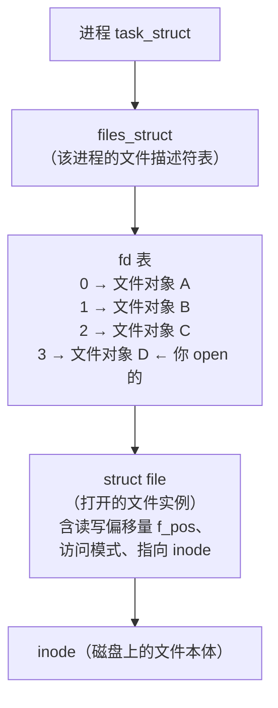
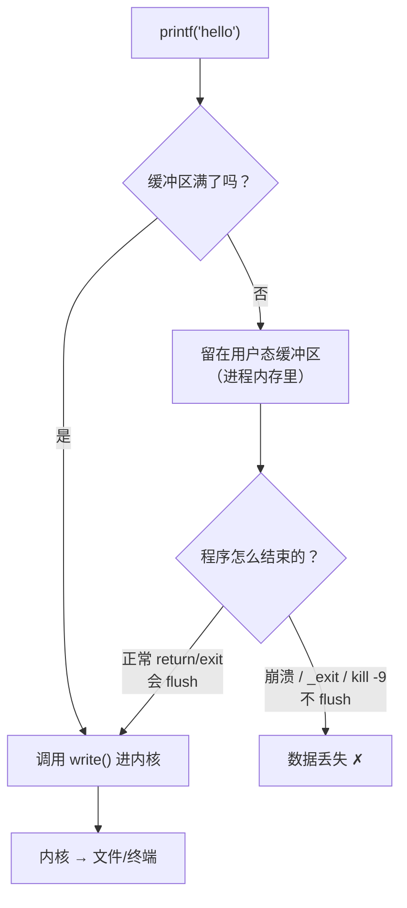

# 02 文件 IO：open / read / write / lseek / close
### 2.1 文件描述符 fd 的本质


`open()` 返回一个**非负整数**叫文件描述符。它是什么？

**fd 是当前进程"打开文件表"的一个下标（index）。**



**重要推论**：

- fd 是**进程局部**的。你的 fd 3 和另一个进程的 fd 3 完全无关
- fd 0/1/2 是启动时就开好的：**stdin / stdout / stderr**
- 每次 `open` 后拿到的是**当前最小可用的** fd 编号
- 一个文件可以被 `open` 多次，每次得到**独立的 fd 和独立的文件偏移量**

实测：看进程的 fd 表

```bash
$ ls -l /proc/self/fd
total 0
lr-x------ 1 root root 64 Oct 18 00:34 0 -> pipe:[2980869]
l-wx------ 1 root root 64 Oct 18 00:34 1 -> pipe:[2979438]
l-wx------ 1 root root 64 Oct 18 00:34 2 -> pipe:[2978513]
lr-x------ 1 root root 64 Oct 18 00:34 3 -> /proc/694858/fd
```

前三个是标准流（这里因为通过 SSH 管道执行，所以指向 `pipe:`）。

```bash
$ bash -c 'exec 7</etc/hostname; ls -l /proc/$$/fd | grep " 7 ->"'
lr-x------ 1 root root 64 Oct 18 00:34 7 -> /etc/hostname
```

`exec 7<file` 是 shell 里手动打开 fd 的语法——**这证明 fd 就是个下标，你可以直接指定编号**。

### 2.2 open：flags 与 mode

```c
#include <fcntl.h>
int fd = open(const char *pathname, int flags, mode_t mode);
```

`flags`（可组合，用 `|`）必须**三选一**指定访问模式：

| 访问模式（三选一） | 含义 |
| --- | --- |
| `O_RDONLY` | 只读 |
| `O_WRONLY` | 只写 |
| `O_RDWR` | 读写 |

常用可选标志：

| 标志 | 作用 |
| --- | --- |
| `O_CREAT` | 不存在则**创建**（此时必须传第三个参数 `mode`） |
| `O_EXCL` | 配合 `O_CREAT`，**文件已存在则失败**（用于安全地创建，避免竞态） |
| `O_TRUNC` | 若已存在且可写，则**截断为 0 长度** |
| `O_APPEND` | 追加模式，每次写前自动移到文件尾 |
| `O_NONBLOCK` | 非阻塞（对 FIFO、设备、socket 关键） |
| `O_CLOEXEC` | exec 时自动关闭（**避免 fd 泄漏到子进程**，现代代码应默认加） |

实测 `O_CREAT|O_EXCL` 的原子性：

```c
int fd = open("/tmp/labQ/created.txt", O_WRONLY|O_CREAT|O_EXCL, 0644);
```

```
O_CREAT|O_EXCL first: fd=3 errno=0
O_CREAT|O_EXCL again: fd=-1 errno=17 (File exists)
```

第二次返回 `-1` 且 `errno=17`。**`O_EXCL` 保证了"检查是否存在"和"创建"是一个原子操作**——这是实现文件锁（lock file）的正确方式。

:::warning[open 失败返回 -1，不是 0]
`open` 成功返回**非负 fd**（可能是 0！），失败返回 **-1** 并设置 `errno`。

**正确的判错写法是 `if (fd < 0)`，不是 `if (fd == 0)` 也不是 `if (!fd)`**。
:::

### 2.3 errno：错误码的正确用法

```c
#include <errno.h>       // errno 变量
#include <string.h>      // strerror()
int fd = open("/no/such/file", O_RDONLY);
if (fd < 0) {
    fprintf(stderr, "open failed: errno=%d (%s)\n", errno, strerror(errno));
    // 或者更简洁：perror("open");
}
```

实测：

```
open failed: errno=2 (No such file or directory)
```

**errno 的两条铁律**：

1. **只在函数返回错误时才有意义**。成功的函数也可能**顺手修改** errno，不要凭 errno 判断成败
2. **errno 是线程局部的**（每个线程有独立副本），所以多线程下安全

常见 errno：

| errno | 值 | 含义 |
| --- | --- | --- |
| `EPERM` | 1 | 权限不足 |
| `ENOENT` | 2 | 文件或目录不存在 |
| `EINTR` | 4 | 被信号打断（**慢系统调用常见，需重试**） |
| `EAGAIN` | 11 | 非阻塞下"暂时无数据"（与 `EWOULDBLOCK` 通常同值） |
| `EACCES` | 13 | Permission denied |
| `EEXIST` | 17 | 文件已存在 |
| `EINVAL` | 22 | 无效参数 |

### 2.4 read / write 的返回值陷阱

```c
ssize_t read(int fd, void *buf, size_t count);
```

返回值 `ssize_t`（**有符号**）：

| 返回值 | 含义 |
| --- | --- |
| `> 0` | 实际读到的字节数。**可能小于你要求的 count！** |
| `0` | **到达文件末尾（EOF）**（对 socket 表示对方关闭连接） |
| `-1` | 出错，查 errno |

实测：

```c
write(fd, "abc", 3);
lseek(fd, 0, SEEK_SET);
ssize_t n = read(fd, b, 10);   // 请求 10 字节，只有 3 字节
n = read(fd, b, 10);           // 再次读
```

```
read -> 3 (bytes available)
read at EOF -> 0 (0 means EOF)
```

:::danger["短读"是常态，不是异常]
`read(fd, buf, 4096)` **不保证**返回 4096。它可能因为：

- 文件只剩 3 字节 → 返回 3
- 网络包只到了一部分 → 返回部分
- 被信号打断 → 返回 -1/EINTR

**正确写法是循环读**，尤其是网络编程：

```c
ssize_t read_full(int fd, void *buf, size_t count) {
    size_t got = 0;
    while (got < count) {
        ssize_t n = read(fd, (char *)buf + got, count - got);
        if (n < 0) {
            if (errno == EINTR) continue;   // 被信号打断，重试
            return -1;
        }
        if (n == 0) break;                  // EOF
        got += n;
    }
    return got;
}
```
:::

### 2.5 lseek：移动文件偏移量

```c
off_t lseek(int fd, off_t offset, int whence);
```

| `whence` | 含义 |
| --- | --- |
| `SEEK_SET` | 从文件开头算 |
| `SEEK_CUR` | 从当前位置算 |
| `SEEK_END` | 从文件末尾算 |

实测：

```c
int fd = open("seek.txt", O_RDWR|O_CREAT|O_TRUNC, 0644);
write(fd, "ABCDEFGH", 8);
// 写完后偏移量自动前进
```

```
after write  off=8
read 4 -> ABCD off=4
SEEK_END off=8
```

**要点**：`write` 和 `read` 都会**自动推进文件偏移量**。这就是为什么连续 `read` 会读到后续内容，而不需要你手动 seek。

特殊用法：

```c
lseek(fd, 0, SEEK_END);          // 获取文件大小（返回值就是大小）
off_t hole = lseek(fd, 1000000, SEEK_END);  // 可以 seek 到文件末尾之后，制造"空洞"（稀疏文件）
```

## 3. 标准 IO 与缓冲

### 3.1 三层关系

| 层次 | API | 特点 |
| --- | --- | --- |
| 系统调用 | `open` `read` `write` `close` | 无缓冲，每次调用进内核 |
| **标准 IO（stdio）** | `fopen` `fread` `fwrite` `printf` `fprintf` | **带缓冲**，减少系统调用次数 |
| fd 层 | `fdopen` `fileno` | 两者互转 |

标准 IO 的核心价值：**缓冲**。写 1000 次 1 字节，系统调用版要进内核 1000 次；stdio 版攒够缓冲区（通常 4096 字节）才 flush 一次。

### 3.2 三种缓冲模式

| 模式 | 何时真正写入 | 典型对象 |
| --- | --- | --- |
| **全缓冲 `_IOFBF`** | 缓冲区满，或显式 `fflush` | **普通文件**（重定向到文件时） |
| **行缓冲 `_IOLBF`** | 遇到 `\n`，或缓冲区满 | **终端**（tty） |
| **无缓冲 `_IONBF`** | 立即写 | **stderr**（默认） |

**并且这个模式是自动切换的**：`stdout` 连到终端时是行缓冲，重定向到文件/管道时变成**全缓冲**。

实测三种模式：

```c
#include <stdio.h>
#include <unistd.h>
int main(void) {
    setvbuf(stdout, NULL, _IONBF, 0);      /* 无缓冲 */
    printf("[unbuffered]");
    setvbuf(stdout, NULL, _IOLBF, 0);      /* 行缓冲 */
    printf("[line]\n");
    setvbuf(stdout, NULL, _IOFBF, 0);      /* 全缓冲 */
    printf("[full-no-newline]");
    fflush(stdout);
    printf("[full-flushed]\n");
    return 0;
}
```

```
[unbuffered][line]
[full-no-newline][full-flushed]
```

### 3.3 经典谜题：程序输出"不见了"

**场景**：板子上跑一个程序，串口能看到输出；但你把它重定向到文件，文件里**空的**。或者反过来：程序崩溃了，日志里少了最后几句。

**原因**：`printf` 是全缓冲（重定向到文件时），缓冲区没满也没 `fflush` 时，数据还在用户态内存里没进内核。程序若异常终止（`_exit`、`abort`、被 `kill -9`），**缓冲区数据就丢了**。



**解决方案**：

1. 关键日志后加 `fflush(stdout)`
2. 设为无缓冲：`setvbuf(stdout, NULL, _IONBF, 0)`
3. 用 `stderr`（默认无缓冲）写日志
4. 用行缓冲：`setvbuf(stdout, NULL, _IOLBF, 0)`

:::tip[嵌入式调试建议]
板子上调试用串口时，如果 printf 输出看着"延迟"或"缺尾部"，**第一件事就是加 `fflush(stdout)` 或改用 `stderr`**。这个问题在嵌入式上特别常见，因为很多程序是"跑着跑着被断电"的。

写 daemon 时更要注意：**不要用 printf 写日志而不 flush**，用 `syslog` 或显式 `fflush`。
:::

### 3.4 stderr 为什么默认无缓冲

**为了错误信息不丢**。程序崩溃时，你最需要的就是错误信息，如果它还在缓冲区里就本末倒置了。

实测（前面出现过的现象）：

```bash
$ ./buf
no newline
[stderr unbuffered]
```

注意 stderr 的内容虽然写在后面，但**先出现**（因为它立即输出，而 stdout 的内容是程序退出时才 flush 的）。

---

**翻页**：[← 上一页](./sysprog-01) · [下一页 →](./sysprog-03) · [返回目录](./)
