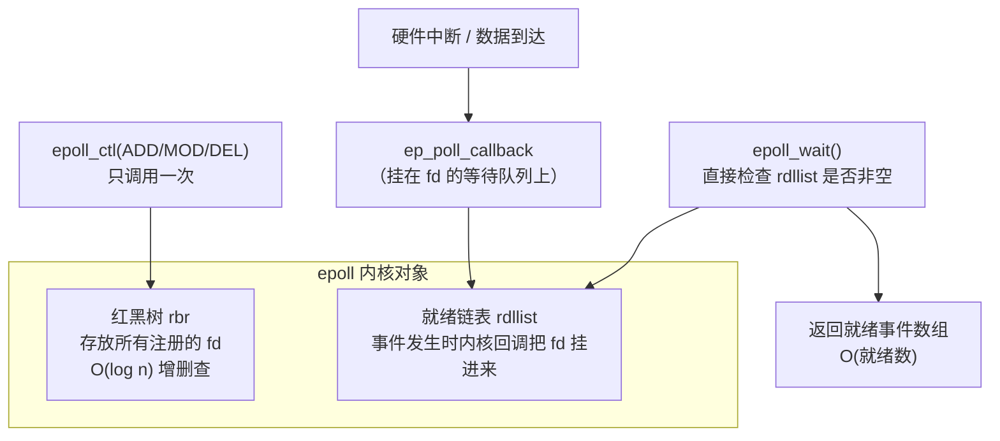

# 03 多路复用 IO：select / poll / epoll 的演进
### 4.1 问题：怎么同时监听多个 fd

写一个服务器要同时处理多个客户端，或者一个嵌入式程序要同时监听**串口 + 网络 + 按键**，怎么办？

| 方案 | 问题 |
| --- | --- |
| 每个 fd 一个进程/线程 | 开销大，线程多了调度成本上升 |
| **非阻塞 + 轮询（busy loop）** | CPU 100% 空转 |
| **多路复用（select/poll/epoll）** | ✅ 一个线程监听多个 fd，有事件才唤醒 |

### 4.2 select：最老的方案

```c
fd_set readfds;
FD_ZERO(&readfds);
FD_SET(fd1, &readfds);
FD_SET(fd2, &readfds);
struct timeval tv = { .tv_sec = 1, .tv_usec = 0 };
int n = select(maxfd + 1, &readfds, NULL, NULL, &tv);
if (FD_ISSET(fd1, &readfds)) { /* fd1 可读 */ }
```

**select 的三个致命缺点**：

1. **fd 数量有硬上限 `FD_SETSIZE`（1024）**
2. **每次调用都要把 fd 集合从用户态拷贝到内核态**（`fd_set` 是位图）
3. **返回后你不知道哪些就绪，必须从头到尾遍历所有 fd**（`FD_ISSET` 一个个问）

实测 `fd_set` 的大小：

```
sizeof(fd_set)=128 -> FD_SETSIZE=1024
```

128 字节 × 8 bit = 1024 位 = **最多监听 1024 个 fd**。这是编译期固定的，**改不了**（除非重编内核和 glibc）。

### 4.3 poll：去掉了数量限制

```c
struct pollfd fds[2];
fds[0].fd = fd1; fds[0].events = POLLIN;
fds[1].fd = fd2; fds[1].events = POLLIN;
int n = poll(fds, 2, 1000);          // 超时 1000ms
if (fds[0].revents & POLLIN) { /* fd1 可读 */ }
```

改进：

- ✅ **没有 1024 限制**（用数组）
- ✅ 用 `revents` 分离"关注的事件"和"发生的事件"，不用每次重建集合
- ❌ **仍然要每次拷贝整个数组到内核**
- ❌ **返回后仍要线性扫描**（O(n)）

实测：

```
poll(1 fd)   -> 1 revents=0x1
```

`revents=0x1` 就是 `POLLIN`。

### 4.4 epoll：真正的 O(就绪数)


epoll 把"注册"和"等待"**分开**：

```c
int ep = epoll_create1(0);                     // 1. 创建 epoll 实例（内核里建红黑树 + 就绪链表）
struct epoll_event ev = { .events = EPOLLIN, .data.fd = fd1 };
epoll_ctl(ep, EPOLL_CTL_ADD, fd1, &ev);        // 2. 注册关注的 fd（只需一次！）

struct epoll_event out[8];
int n = epoll_wait(ep, out, 8, 100);           // 3. 等待，返回就绪的事件
for (int i = 0; i < n; i++) {                  //    只需遍历就绪的 n 个
    handle(out[i].data.fd);
}
```

**epoll 为什么快？**

| 方面 | select/poll | epoll |
| --- | --- | --- |
| 注册 | **每次调用都要传全部 fd 集合** | **注册一次**（`epoll_ctl`），内核记在红黑树里 |
| 内核查找 | 每次线性扫描所有 fd | 红黑树 O(log n) 查找 |
| 就绪通知 | 全量扫描才知道谁就绪 | **就绪链表**直接给出就绪的 fd |
| 返回后 | 要遍历**所有** fd 找就绪的 | 只遍历**就绪的** n 个 |
| 复杂度 | **O(n)**（n = 监听的 fd 总数） | **O(就绪数)** |
| fd 上限 | 1024（select） | 受 `ulimit -n` 限制，通常十万级 |



**关键洞察**：epoll 不需要"轮询检查"，而是**事件驱动**——数据到达时硬件中断触发内核回调，把对应 fd 挂进就绪链表。`epoll_wait` 只需要看链表空不空。

实测三者对比：

```
select(1 fd) -> 1
poll(1 fd)   -> 1 revents=0x1
epoll fd=3 -> 0 events
sizeof(fd_set)=128 -> FD_SETSIZE=1024
sizeof(struct epoll_event)=12
```

### 4.5 epoll 事件常量（实测值）

```
EPOLLIN=0x1 EPOLLOUT=0x4 EPOLLERR=0x8 EPOLLHUP=0x10
EPOLLET=0x80000000 EPOLLONESHOT=0x40000000 EPOLLRDHUP=0x2000
EPOLL_CTL_ADD=1 DEL=2 MOD=3
```

| 常量 | 含义 |
| --- | --- |
| `EPOLLIN` | 可读（有数据或对方关闭） |
| `EPOLLOUT` | 可写（发送缓冲区有空间） |
| `EPOLLRDHUP` | **对端关闭了写（半关闭）**。（Linux 2.6.17 起） |
| `EPOLLERR` | 出错（**即使没注册也会返回**） |
| `EPOLLHUP` | 挂断 |
| `EPOLLET` | **边沿触发**模式 |
| `EPOLLONESHOT` | 只触发一次，之后需重新注册（多线程场景用） |

### 4.6 LT vs ET：实测差异（重点）

- **LT（Level Triggered，水平触发）**：**默认模式**。只要 fd 处于"可读"状态，每次 `epoll_wait` 都会通知你。你这次没读完？**下次还会再通知**。
- **ET（Edge Triggered，边沿触发）**：只在**状态发生变化**时通知一次（比如"从不可读变成可读"）。如果你这次没读完，**不会再通知**。

实测程序：向 pipe 写入 10 字节，但每次只读 4 字节，观察 epoll 是否继续通知。

```c
static void run(int edge) {
    int pfd[2];
    pipe(pfd);
    set_nonblock(pfd[0]);
    int ep = epoll_create1(0);
    struct epoll_event ev;
    ev.events = EPOLLIN | (edge ? EPOLLET : 0);
    ev.data.fd = pfd[0];
    epoll_ctl(ep, EPOLL_CTL_ADD, pfd[0], &ev);

    write(pfd[1], "0123456789", 10);   /* 写入 10 字节，但只读 4 字节 */

    struct epoll_event out[4];
    for (int round = 1; round <= 3; round++) {
        int n = epoll_wait(ep, out, 4, 100);
        if (n <= 0) { printf("  round %d: epoll_wait -> %d (timeout/end)\n", round, n); break; }
        char buf[5];
        ssize_t r = read(out[0].data.fd, buf, 4);
        buf[r > 0 ? r : 0] = 0;
        printf("  round %d: epoll_wait -> %d, read %zd bytes: \"%s\"\n", round, n, r, buf);
    }
}
```

**实测输出**：

```
LT (level-triggered, 默认):
  round 1: epoll_wait -> 1, read 4 bytes: "0123"
  round 2: epoll_wait -> 1, read 4 bytes: "4567"
  round 3: epoll_wait -> 1, read 2 bytes: "89"
ET (edge-triggered, EPOLLET):
  round 1: epoll_wait -> 1, read 4 bytes: "0123"
  round 2: epoll_wait -> 0 (timeout/end)
```

**对比极其清晰**：

- **LT**：三次 `epoll_wait` 都返回 1，把 10 字节分三次读完（4+4+2）
- **ET**：第一次返回 1，读走 4 字节；第二次**超时返回 0**——剩下的 6 字节**永远不会被通知**

:::danger[ET 模式的铁律：必须一次读完]
如果你用 ET 模式，**收到通知后必须循环读到 `EAGAIN`**，否则剩下的数据会"卡死"（除非有新数据到达再次触发边沿）。

```c
// ET 模式下的正确读法
while (1) {
    ssize_t n = read(fd, buf, sizeof buf);
    if (n > 0) { process(buf, n); continue; }
    if (n < 0 && errno == EAGAIN) break;   // 读完了
    if (n == 0) { /* 对端关闭 */ break; }
    // 其他错误
}
```

**并且 ET 模式必须配合非阻塞 fd**（`O_NONBLOCK`），否则最后一次 `read` 会阻塞住整个循环。
:::

:::tip[什么时候用 ET？]
- **LT 是默认，也是绝大多数场景的正确选择**：更简单、更安全
- **ET 的优势**：减少事件触发次数，在高并发下略省开销（nginx 用了 ET）
- 代价是代码复杂度大幅上升，漏读一次就是难以排查的 bug

**建议**：除非你明确知道自己在做什么并且有性能压测数据，否则用 LT。
:::

## 5. 其他常用系统调用

### 5.1 ioctl：设备的万能接口

`read/write` 只能传数据流，设备还需要"控制"操作（设置波特率、查询 GPIO 方向、获取屏幕分辨率），这些走 `ioctl`：

```c
int ioctl(int fd, unsigned long request, ...);
```

- 每个设备驱动定义自己的 `request` 命令码
- 这是"一切皆文件"里**不优雅但必需**的补充

嵌入式例子：I2C 通过 `/dev/i2c-0` + `ioctl(I2C_RDWR)` 通信；SPI 通过 `/dev/spidev0.0` + `ioctl(SPI_IOC_MESSAGE)`。

### 5.2 mmap：把文件映射到内存

```c
void *addr = mmap(NULL, length, PROT_READ|PROT_WRITE, MAP_SHARED, fd, offset);
```

映射后**像访问内存数组一样访问文件内容**，省去 read/write 的拷贝。嵌入式上常用于：

- 访问**硬件寄存器**（把 `/dev/mem` 的物理地址映射进来，用户态直接操作寄存器）
- 大文件随机访问
- 进程间共享内存（`MAP_SHARED` + 匿名映射）

:::warning[mmap 硬件寄存器不是好做法]
用户态 mmap `/dev/mem` 直接操作寄存器虽然方便，但**绕过了内核驱动的所有保护**，多个进程互相打架，且不可移植。

正确做法是**写内核驱动**（见 [内核与驱动入门](./kernel)），用户态只通过 `read/write/ioctl` 交互。只有快速原型验证时才用 mmap 寄存器。
:::

### 5.3 动态加载：dlopen / dlsym

运行时加载共享库（插件机制的底层）。实测：

```c
void *h = dlopen("/tmp/labM/libadd.so", RTLD_NOW);
int (*add)(int, int) = dlsym(h, "add");
printf("dlsym add -> %p, add(3,4)=%d\n", (void*)add, add(3,4));
```

```
dlsym add -> 0x7f0f319e70f9, add(3,4)=7
```

编译时**不需要**链接该库，但要加 `-ldl`。

### 5.4 资源限制 ulimit

```bash
$ ulimit -a | head -8
real-time non-blocking time  (microseconds, -R) unlimited
core file size              (blocks, -c) 0
data seg size               (kbytes, -d) unlimited
scheduling priority                 (-e) 0
file size                   (blocks, -f) unlimited
pending signals                     (-i) 15417
max locked memory           (kbytes, -l) 8192
max memory size             (kbytes, -m) unlimited
```

嵌入式上最常调的是：

| 项 | 意义 |
| --- | --- |
| `-n`（open files） | **最大打开文件数**，高并发服务器必调，也是 epoll 能监听的 fd 上限 |
| `-c`（core file） | core dump 大小，**调试段错误时要 `ulimit -c unlimited`** |
| `-s`（stack size） | 栈大小 |

注意上面 `core file size` 是 **0**，意味着**崩溃时不产生 core 文件**——这是 Debian 默认，调试时要手动打开。

---

**翻页**：[← 上一页](./sysprog-02) · [下一页 →](./sysprog-04) · [返回目录](./)
