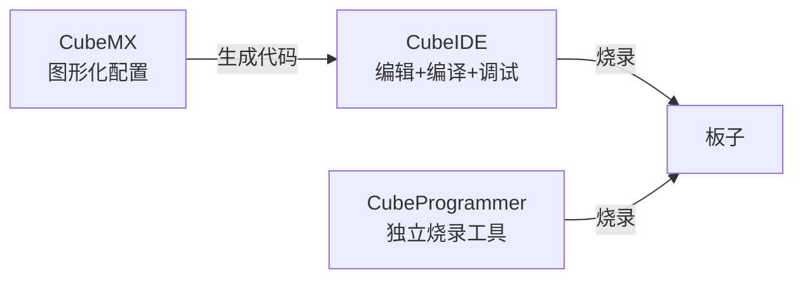

# 05 装工具链

**本课目标**：装好 STM32 的开发环境，知道每个工具干什么。

## 三个工具的关系



| 工具 | 作用 | 必需 |
| --- | --- | --- |
| **STM32CubeMX** | **图形化配置引脚/时钟/外设，生成初始化代码** | ✅ 强烈推荐 |
| **STM32CubeIDE** | 编辑、编译、调试（基于 Eclipse + GCC） | ✅ 推荐 |
| STM32CubeProgrammer | 独立烧录/擦除/读保护设置 | ⭐ 建议装 |

:::tip[好消息：CubeIDE 已内置 CubeMX]
**新版 STM32CubeIDE 里面就带 CubeMX 功能**（新建工程时可以直接图形化配置）。

**所以最省事的方案：只装 STM32CubeIDE**，一步到位。

**本线以 CubeIDE 为主**，因为它免费、跨平台、不用破解。
:::

## 方案对比：装什么

| 方案 | 组成 | 优点 | 缺点 |
| --- | --- | --- | --- |
| **A（推荐）** | **CubeIDE** | 免费、全集成、官方 | 体积大（2~3 GB）、启动慢 |
| B | CubeMX + Keil MDK | Keil 编译快、调试体验好 | **Keil 收费**、Windows only |
| C | CubeMX + VSCode + arm-gcc | 轻量、可定制 | 要自己配，新手劝退 |
| D | CubeMX + Makefile + arm-gcc | 了解底层构建 | 纯命令行 |

:::danger[Keil 的授权问题]
Keil MDK 是收费软件（**免费版限制 32 KB 代码**）。

**HAL 库 + 点灯就超 32 KB 了**，所以免费版基本没法用。

**别一开始就折腾 Keil**——先用免费的 CubeIDE 学。
:::

## 安装 STM32CubeIDE

### 步骤

1. 打开 **st.com** → 搜索 "STM32CubeIDE" → 下载对应系统版本
2. 运行安装包，一路下一步（会要求登录 ST 账号，注册免费）
3. **安装路径用纯英文**，比如 `C:\ST\STM32CubeIDE`
4. 安装过程会自动下载器件支持包（**需要联网，可能很慢**）
5. 装完启动，选一个工作目录（**也用纯英文**）

:::warning[需要 ST 账号]
ST 官网下载要登录（免费注册）。

**如果注册/登录有问题**，可以在网上找别人分享的安装包（注意杀毒扫描），但**优先用官方**。
:::

:::danger[安装路径和工作目录都不能有中文]
```text
C:\ST\STM32CubeIDE          ✅
D:\我的工程\stm32            ❌ 中文路径 → 编译可能失败
```

**这是和 Mind+ 一样的坑**（[ESP32 第 5 课](../esp-basics/05-dev-options)）。

**另外路径也别太深**（避免超过 Windows 260 字符限制）。
:::

### 首次启动会下载器件包

```text
Help → Manage Embedded Software Packages
```

这里要装 **STM32F1** 系列的软件包（如果你用 F103）。

:::tip[离线安装器件包]
下载网速慢的话，可以单独下 `.pack` 文件，然后：

```text
Help → Manage Embedded Software Packages → From Local...
```

选你下好的包即可。
:::

## 验证安装

:::tip[三件事验证环境正常]
**① 新建一个空工程**

`File → New → STM32 Project` → 选芯片（搜索 `STM32F103C8`）→ 命名 → Finish

**② 能生成代码**

`Project → Generate Code`（或快捷键），看到生成成功。

**③ 能编译**

`Project → Build Project`（或 Ctrl+B），控制台出现：

```text
Build Finished. 0 errors, 0 warnings
```

**编译通过就说明工具链没问题了**（还不需要板子）。
:::

## 认识 CubeIDE 界面

| 区域 | 作用 |
| --- | --- |
| **左侧 Project Explorer** | 文件树（`Core/`、`Drivers/`） |
| **中间编辑区** | 代码编辑 |
| **右上角引脚图** | 图形化配置（`.ioc` 文件） |
| **下方 Console** | 编译输出 |
| **工具栏小虫子/播放键** | 调试 / 运行 |

:::tip[`.ioc` 文件是配置的核心]
```text
MyProject.ioc        ← 双击它打开图形配置界面
```

**所有引脚、时钟、外设配置都存在这个文件里。**

**改了配置 → 重新生成代码 → 你的业务代码会被保留**（在特定注释之间）。

（[第 7 课](./07-understand-code)讲这个"保留机制"。）
:::

## 第一个工程怎么起步

:::danger[不要从"空工程"开始学]
新手常见错误：新建一个空工程，然后自己想怎么写 `main`。

**正确做法：用 CubeMX 配置 + 生成代码**，你只在生成好的框架里填空。

**理由**：STM32 的初始化（时钟、外设时钟、GPIO 模式）**手写几乎必错**，而且错了不报错、只是不工作。
:::

### 推荐流程

```text
① New STM32 Project
② 搜芯片型号 → 选中 → Next
③ 填工程名（英文）→ Finish
④ 在弹出的引脚图里点选外设（比如 PC13 设为 GPIO_Output）
⑤ 配时钟树（Project → 或 Clock Configuration 页）
⑥ Generate Code
⑦ 在 main.c 的 while(1) 里写业务
⑧ Build → Run/Debug
```

**第 ①~⑥ 步下一课详细走一遍。**

## STM32CubeProgrammer（建议装）

独立的小工具，用来：

| 用途 | 说明 |
| --- | --- |
| **烧录 .hex / .bin** | 不通过 IDE |
| **全片擦除** | 芯片被锁时救回来 |
| **设置读保护** | 保护固件 |
| **看芯片信息** | 型号、Flash 大小、UID |
| **升级 ST-Link 固件** | 解决"固件太老"问题 |

:::tip[它是"救命工具"]
IDE 连不上芯片时，用 CubeProgrammer 的 **Full chip erase** 通常能救回来。

**建议装一个备用**（免费，体积比 IDE 小得多）。
:::

## 常见安装问题

| 问题 | 原因 | 解决 |
| --- | --- | --- |
| 安装时报错 | 路径含中文/空格 | 换纯英文路径 |
| 下载器件包卡住 | 网络问题 | 挂代理或用离线包 |
| 启动报 Java 错误 | 依赖缺失/位数不对 | 重装，别用精简版系统 |
| 编译报 `arm-none-eabi-gcc not found` | 工具链没装好 | 重装 IDE |
| 找不到芯片型号 | 没装对应器件包 | Help → Manage Packages |
| ST-Link 连不上 | 驱动/接线 | 见[第 4 课](./04-hardware) |
| 工程打不开 | 版本不兼容 | 用同版本 IDE |
| 中文注释乱码 | 编码设置 | 窗口 → 首选项 → 编码改 UTF-8 |

:::danger[编码乱码要第一时间改]
```text
Window → Preferences → General → Workspace → Text file encoding
→ 选 UTF-8
```

**不改的话，中文注释会变成乱码，而且可能影响编译**（某些情况下注释里的乱字符会破坏语法）。
:::

## 本课自检

- [ ] 知道 CubeMX / CubeIDE / CubeProgrammer 各自的作用
- [ ] **知道 CubeIDE 已内置 CubeMX，只装它最省事**
- [ ] **知道 Keil 收费且免费版限 32KB，入门别用**
- [ ] 会装 CubeIDE，**路径用纯英文且不太深**
- [ ] 会下载器件支持包
- [ ] **会用"新建空工程 + 编译通过"来验证环境**
- [ ] 知道 `.ioc` 文件是配置核心
- [ ] **知道不要从空工程手写初始化，要用 CubeMX 生成**
- [ ] 知道 CubeProgrammer 能全片擦除救砖、升级 ST-Link 固件
- [ ] **知道要第一时间把编码改成 UTF-8**

## 第一阶段小结

你现在已经：

- 知道 STM32 是什么、怎么读型号
- **知道和 ESP32 的六大区别**（工具链、入口、库、时钟、引脚、内存）
- 买了对的板子和下载器
- **接好了 SWD 和串口，电脑能认出 ST-Link**
- 装好了工具链，能编译通过

**接下来真正开始写代码。**

## 下一步

[06 第一个工程：CubeMX 生成](./06-first-project) —— 一步一步走完从零到点灯。
