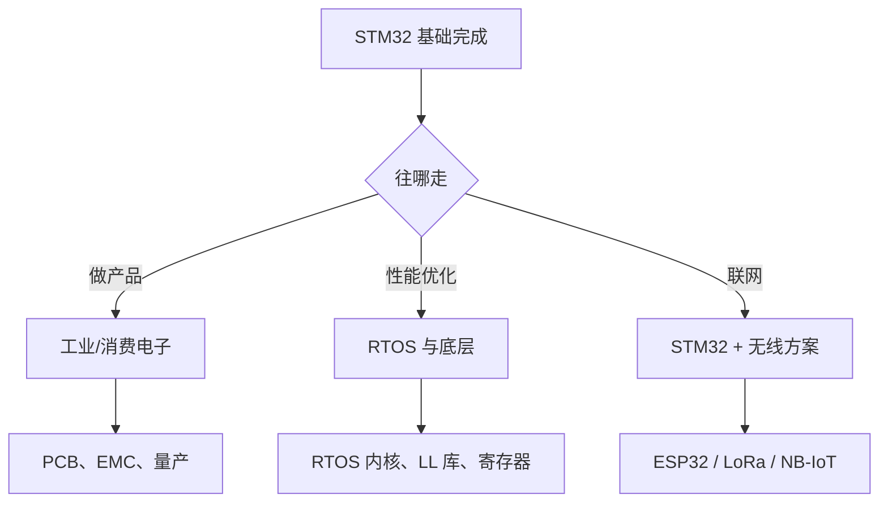

# 20 调试、排错与下一步

**本课目标**：会用调试器查问题，知道接下来往哪走。

## SWD 调试的核心优势

:::tip[这是 STM32 比 Arduino 强最多的地方]
| 能力 | 打印日志 | **SWD 调试** |
| --- | --- | --- |
| 看变量 | 要加 `printf` | **随时看，不改代码** |
| 看执行流 | 猜 | **单步执行** |
| 停住程序 | ❌ | **断点** |
| 看寄存器 | ❌ | ✅ |
| 改值测试 | 要改代码重烧 | **运行时直接改** |
| 时序影响 | **printf 会改变时序** | 几乎无影响 |

**"打印不出来"的时候，只有调试器能救你。**
:::

## 五种必会的调试技巧

### ① 断点 + 看变量

```text
双击行号左侧 → 出现蓝点 = 断点
程序跑到这里会暂停
```

然后**鼠标悬停在变量上**就能看到值，或在 **Expressions/Watch** 窗口添加。

### ② 条件断点

```text
右键断点 → Breakpoint Properties → 勾选 Conditional
输入：cnt == 100
```

**只在满足条件时停**——排查"第 N 次循环才出问题"的 bug 特别有用。

### ③ 数据观察点（Watchpoint）

```text
右键变量 → Add Watchpoint
```

**当这个变量被修改时程序暂停**。

:::tip[找"谁改了我的变量"的神器]
代码里某个变量莫名其妙变了，加打印找不出来？

**用 watchpoint**——程序会在写入的那一刻停下，**调用栈直接告诉你是谁改的**。
:::

### ④ 看外设寄存器

```text
Window → Show View → Registers
```

能看 `GPIOA->ODR`、`TIM2->CCR1` 等所有寄存器的实时值。

**排查"外设到底有没有配上"最快的方法。**

### ⑤ HardFault 定位

程序崩溃进 `HardFault_Handler` 时：

```text
调试器暂停 → 看 Call Stack（调用栈）
```

**调用栈会显示崩溃前执行的最后一个函数**。

:::warning[Release 优化后调用栈可能失真]
`-O2`/`-Os` 优化会内联函数、重排代码，**调用栈可能不准**。

**排查崩溃时先用 `-O0`（Debug 配置）复现。**
:::

## 常见故障速查表

| 现象 | 最可能原因 | 先查什么 |
| --- | --- | --- |
| **烧不进去** | SWD 接线/驱动 | 见[第 4 课](./04-hardware) |
| **程序不跑（灯不闪）** | 卡在 `Error_Handler` | 断点停在 `Error_Handler` |
| **时钟慢** | 没配 `SystemClock_Config` | 看 `SystemCoreClock` |
| **串口乱码** | 波特率/时钟 | 两边都 115200，确认用 HSE |
| **GPIO 没反应** | 没开外设时钟 | 看 `RCC->APB2ENR` 寄存器 |
| **PWM 没波形** | 忘了 `HAL_TIM_PWM_Start` | 检查引脚是否"复用"模式 |
| **ADC 读 0** | 忘了 `HAL_ADC_Start` | 或采样时间太短 |
| **中断不进** | NVIC 没使能 | CubeMX 里勾 Enabled |
| **I2C 失败** | 地址没左移 | 先写扫描程序 |
| **SPI 失败** | 模式/CS | 试 Mode 0/3，检查 CS |
| **随机崩溃** | 栈溢出 / 空指针 | 加大栈，看调用栈 |
| **程序卡死** | ISR 里 `HAL_Delay`/`printf` | 检查中断代码 |
| **重新生成丢了代码** | 写在 USER CODE 外 | 挪进区块 |
| **连不上芯片** | 程序把 SWD 引脚复用了 | Connect under reset |

:::danger[遇到问题时最重要的一步]
**先加断点，看程序到底停在哪。**

很多人一上来就改代码、猜原因——**而调试器 3 秒就能告诉你在哪卡住了**。

**这是 STM32 相比 ESP32 最大的优势，一定要用起来。**
:::

## 三条深入路线



### 路线 A：工业产品开发

| 要学 | 说明 |
| --- | --- |
| **PCB 设计** | 立创 EDA / KiCad，自己画板 |
| **EMC/EMI** | 过认证（CE/FCC） |
| **Modbus / CAN** | 工业通信协议 |
| **看门狗** | 独立看门狗 IWDG + 窗口看门狗 WWDG |
| **Bootloader** | 自己实现 IAP 升级 |
| **量产测试** | 测试工装、烧录治具 |

### 路线 B：RTOS 与底层性能

| 要学 | 说明 |
| --- | --- |
| **FreeRTOS 内核原理** | 调度算法、上下文切换、TCB |
| **LL 库 / 寄存器编程** | 摆脱 HAL 的中间层 |
| **中断向量表** | 理解启动流程 |
| **链接脚本** | 控制代码/数据放哪 |
| **DMA + 双缓冲** | 高性能数据采集 |

**起步**：用寄存器重写一遍点灯和串口，对比 HAL 版本看差异。

### 路线 C：给 STM32 加无线

STM32 自己没有 WiFi/BLE，但可以：

| 方案 | 说明 |
| --- | --- |
| **ESP32 做 AT 模块** | 串口发 AT 命令联网，最简单 |
| **ESP8266** | 更便宜，但只支持 WiFi |
| **LoRa 模块** | 远距离低功耗（几公里） |
| **NB-IoT** | 运营商网络，适合表计 |
| **nRF24L01** | 私有 2.4G 协议 |

:::tip[最常用的做法]
**STM32 负责实时控制和采集，ESP32 负责联网**——各司其职。

两者用**串口**通信，协议自己定（简单 JSON 或自制二进制）。

**这是工业产品的常见架构。**
:::

## 该补的基础

:::tip[想深入一定要补这几块]
| 主题 | 为什么 |
| --- | --- |
| **C 语言** | 指针、内存、位运算（[C 零基础](../../software/c-basics/)） |
| **数字电路基础** | 看懂原理图、上下拉、电平 |
| **ARM Cortex-M 架构** | 理解 NVIC、SysTick、异常模型 |
| **数据手册阅读** | 查寄存器、查引脚复用 |

**数据手册是最好的老师**——STM32F103 的 Reference Manual（RM0008）有 1100 多页，遇到问题先查它。
:::

## 推荐的进阶项目

| 项目 | 练什么 |
| --- | --- |
| 按键控制 PWM 调光 | GPIO + 定时器 |
| OLED 显示传感器数据 | I2C + ADC |
| 串口命令行（收命令改参数） | 串口 + 状态机 |
| 用 DMA 做示波器 | ADC+DMA+屏幕 |
| 直流电机闭环调速 | PWM + 编码器 + PID |
| Bootloader（串口升级） | Flash 操作 + 跳转 |
| FreeRTOS 多任务采集系统 | RTOS + 队列 |

:::tip[选一个"你真正想做的"]
**做自己会用的东西，动力最足。**

比如：鱼缸控制器、温控风扇、电子秤、电机调速器……
:::

## 一份持续学习清单

| 资源 | 用途 |
| --- | --- |
| **STM32 Reference Manual**（RM0008 等） | **最权威**，查寄存器首选 |
| **数据手册（Datasheet）** | 引脚定义、电气参数 |
| **CubeMX 的 Examples** | 官方示例 |
| ST 社区 / GitHub | 查具体问题 |
| 本站 [STM32 进阶](../../chips/stm32/) | 家族全景与生态 |

## 最后一句话

**STM32 学习的难点不在写代码，在"配置"。**

时钟、引脚复用、外设使能、中断优先级——**这些配错了代码能编译、能烧录，就是不工作**。

:::tip[但你已经有了一套可靠的方法]
```text
① 断点看停在哪
② 看寄存器确认配置生效
③ 量电压确认硬件
④ 缩小范围（改回上一个能跑的版本）
```

**这四步能解决绝大多数问题。**

**剩下的就是多用。**
:::

## 本课自检

- [ ] 知道 SWD 调试的五种技巧（断点/条件断点/watchpoint/寄存器/调用栈）
- [ ] **知道 watchpoint 能找"谁改了我的变量"**
- [ ] 知道 Release 优化后调用栈可能失真
- [ ] 能对照速查表定位常见故障
- [ ] **知道"先断点看停在哪"比猜快得多**
- [ ] 知道自己该走产品/底层/加无线哪条路线
- [ ] 知道 STM32 加无线最常用"STM32 控 + ESP32 联网"
- [ ] 知道要补 C、数字电路、Cortex-M 架构
- [ ] 收藏了 Reference Manual 和 Datasheet
- [ ] 有一份具体的进阶项目计划

---

**回到**：[STM32 零基础教程目录](./) · [硬件开发总览](../)
