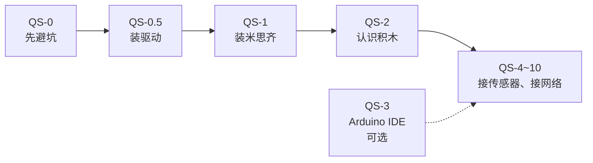

# 快速上手

**这套教程只解决一件事：让你会用。**

**全程用米思齐（Mixly）拖积木，不写代码。** 不讲芯片原理、不讲寄存器、不讲操作系统。你只需要知道**怎么接线、积木怎么拼、怎么把它调通**。

## 适合谁

- 完全没碰过单片机，但想做个东西出来
- 有一堆零件和一个比赛/项目 deadline
- 不想学代码，或者学了代码也没学进去

## 你需要准备的东西（学校都有，电脑最好用自己的，学校的电脑一言难尽）

| 东西 | 说明 |
| --- | --- |
| 开发板 | ESP32-S3-WROOM-1 开发板 |
| 数据线 | Type-C，**必须能传数据**，充电线不行 |
| 电脑 | Windows / macOS / Linux 都行 |
| 软件 | [米思齐离线版](https://mixly.cn)，一个就够 |
| 零件 | 面包板、杜邦线、LED、按键、传感器，后面逐节加 |

## 软件和两处要检查的设置

装 [米思齐离线客户端](https://mixly.cn)我群里发的那个也行（后面 10 节都用它）。打开之后检查这两处，否则传不进去或者串口全是乱码：

| 位置 | 应该是 | 说明 |
| --- | --- | --- |
| **右上角**的开发板 | `ESP32S3 Dev Module` | ⚠️ 默认是 `ESP32 Dev Module`，**那是老款 ESP32，不是你的板子，必须改** |
| **串口窗口右下角**的波特率 | `9600` | 默认就是 9600，确认没被改过就行；和程序里的不一致串口就全是乱码 |

详细说明见 [QS-1](./mixly-setup)。

:::danger[装之前先看这两条，能省掉一半的求助]
1. **米思齐必须装到短路径**，例如 `D:\mixly`。装在桌面或带中文、带空格的目录里，后面编译会报一些完全看不出原因的错。详见 [QS-1](./mixly-setup)
2. **插上板子没出现 COM 口**，先查驱动，别急着换线。详见 [QS-0.5](./driver-setup)
:::

## 学习路线

| 章节 | 内容 | 学完你会 |
| --- | --- | --- |
| [QS-0 开始前必须知道的几件事](./board) | USB 口、禁用引脚、下载模式、供电 | 不再怀疑板子坏了 |
| [QS-0.5 装驱动，让电脑认出板子](./driver-setup) | 看设备管理器、装 CH340/CP210x 驱动 | 电脑能认到板子，出现 COM 口 |
| [QS-1 装米思齐，跑通第一个程序](./mixly-setup) | 装软件（注意路径）、选板卡、拖积木、上传 | 灯在闪，串口有输出 |
| [QS-2 米思齐入门](./mixly) | 界面分区、积木分类、必会积木 | 能自己拼出按键控制灯 |
| [QS-3 Arduino IDE](./arduino-ide) | **可选**，纯图形化可跳过 | 需要交源码时才用 |
| [QS-4 GPIO 与按键](./arduino-basics) | 引脚模式、按键、消抖 | 按键控制灯 |
| [QS-5 串口与调试](./debug) | 打印、抓启动信息、内存 | 出问题知道从哪查 |
| [QS-6 ADC 与 DAC](./adc-dac) | 读传感器、输出电压 | 电位器控制蜂鸣器 |
| [QS-7 PWM 与执行器](./pwm) | 调亮度、调速、转角度 | 电机舵机灯带都能控 |
| [QS-8 总线 I2C/UART](./bus) | 接屏幕和串口模块 | OLED 上显示数据 |
| [QS-9 WiFi 联网](./wifi) | 连 WiFi、拿 IP、现场配网 | 设备联网成功 |
| [QS-10 MQTT 上云](./mqtt) | 数据发到云端、远程控制 | 数据上云并能反向控制 |

## 三条学习建议

1. **照着做，别跳步**。每节都是上一节的地基，跳过去后面会连锁报错
2. **看到预期现象再去下一节**。看不到就回到那节的"常见坑"，别硬扛
3. **每加一个功能就加一行 `Serial 打印`**。板子在干什么全靠它，出问题时这行字能救命

## 关于代码

快速上手的每一节**都以积木为主线**。页面里出现的代码块就是米思齐「混合」模式里显示的内容，**只读、不能编辑、不需要看懂、不需要抄**。

真到需要写代码的那一天（比赛要求交源码、或者你想搞懂原理），再看[完整教程](../course/)。

## 版本

| 项 | 版本 |
| --- | --- |
| 米思齐 Mixly | 3.x 离线客户端（[mixly.cn](https://mixly.cn) 下载，教程截图基于 3.0） |
| 板卡 | ESP32-S3 |

米思齐**在线版只有 MicroPython 模式**，接实物板子要用离线客户端。