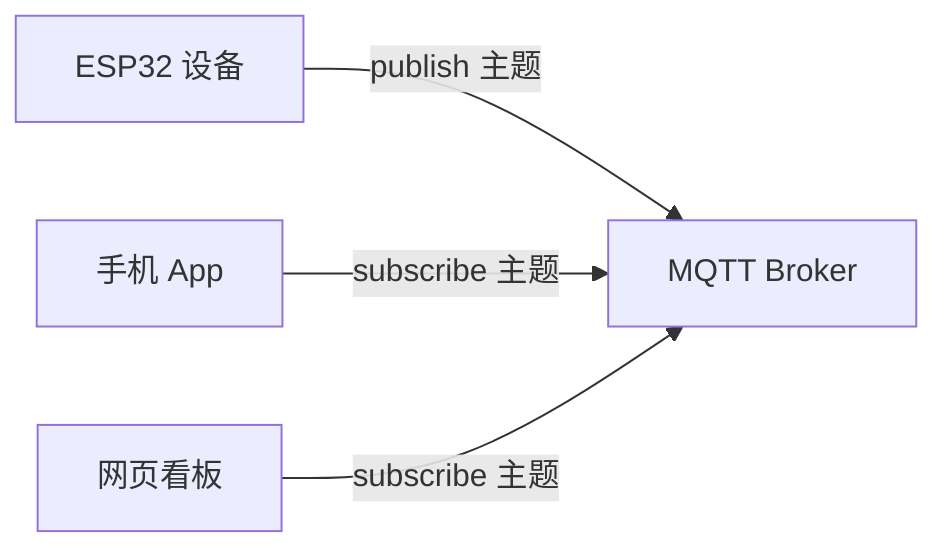

# QS-10 MQTT 上云

**时长 90 分钟 · 产出：设备数据实时上报到平台，网页/App 能看到并控制设备**

:::tip[串口波特率]
所有示例程序里的串口都初始化成 9600（米思齐的默认值）。
在米思齐里点开串口窗口，把右下角的波特率也选成 `9600`，两边不一致串口就是乱码。
:::

:::tip[这一页的代码块要不要看]
不用看，也不用抄。这些代码就是米思齐「混合」模式里显示的内容，只读、不能编辑。
你要做的事只有两个：照着接线，照着拖积木。
出问题时看不懂代码没关系，把当时的串口打印贴出来就行。
:::

几乎所有 IoT 赛题的"数据上传"评分项都落在 MQTT 上。这一节要吃透。

## MQTT 是什么

一个**发布/订阅**的消息协议。设备不需要知道服务器地址，只需要知道一个"主题名"，就能收发数据。



四个核心概念：

| 概念 | 是什么 | 类比 |
| --- | --- | --- |
| **Broker** | 中间服务器，1883 端口 | 邮局 |
| **Topic** | 消息地址，如 `esp32s3/dev1/temp` | 邮箱地址 |
| **Publish** | 发布消息 | 寄信 |
| **Subscribe** | 订阅主题 | 订阅邮箱 |

消息服务质量（QoS）：

| QoS | 保证 | 用在哪 |
| --- | --- | --- |
| 0 | 不保证，可能丢 | 高频传感数据，丢了无所谓 |
| 1 | 至少送达一次 | 控制指令（默认选这个） |
| 2 | 恰好一次，最可靠但慢 | 计费、关键状态 |

## 积木实战：连上 MQTT，能发能收

「网络 → MQTT」子分类里积木是现成的，先做积木版，体会"发布/订阅"是什么意思：

```text
初始化
  ├─ 设置Wi-Fi 名称 "你的WiFi名字" 密码 "你的密码"        ← 先联网（上一节）
  └─ MQTT服务器 地址 "test.mosquitto.org" 端口 1883
        用户名 "…" 密码 "…" 项目 ID "esp32-dev1"
MQTT发送消息 <模拟输入 管脚# 1> 到 主题 "esp32/dev1/data"   ← 每 5 秒报一次读数
延时 5000 毫秒
当 主题收到 "esp32/dev1/cmd" 执行                          ← 帽子积木，收到指令就跑
  └─ Serial 打印 自动换行 <主题 值>
```

| 积木 | 在哪个分类 | 说明 |
| --- | --- | --- |
| MQTT服务器 | 网络 → MQTT | 地址/端口/用户名一套，填你的 broker 信息 |
| MQTT发送消息 … 到 主题 … | 网络 → MQTT | 消息槽可以嵌变量、读数、文本 |
| 当 主题收到 … 执行 | 网络 → MQTT | 订阅：收到这个主题的消息就执行里面的积木 |

验证：手机装个 MQTT App（如 IoT MQTT Panel）连同一个 broker，订阅 `esp32/dev1/data` 看数据，往 `esp32/dev1/cmd` 发条消息，串口里就打印出来了。

:::tip[公网测试 broker]
`test.mosquitto.org` 是免费的公共测试服务器，任何人都能看到你的消息——**别发敏感内容，比赛/正式项目用自己的 broker**（下一节有自建方案）。
:::

## 进阶对照：PubSubClient 完整写法

积木版够做演示了。要设备身份、断线自动重连、大报文这些工程细节时，用代码版（先在库管理器安装 **PubSubClient by Nick O'Leary**）：

```cpp
#include <WiFi.h>
#include <PubSubClient.h>

WiFiClient net;
PubSubClient client(net);

// 设备身份：芯片 MAC 后 6 位，全球唯一
String deviceId() {
  uint8_t mac[6];
  WiFi.macAddress(mac);
  char id[16];
  snprintf(id, sizeof(id), "%02X%02X%02X", mac[3], mac[4], mac[5]);
  return String(id);
}

String topicTemp;
String topicCmd;
unsigned long lastPub = 0;

void setup() {
  Serial.begin(9600);
  WiFi.mode(WIFI_STA);
  WiFi.begin("你的WiFi", "密码");
  while (WiFi.status() != WL_CONNECTED) delay(500);

  topicTemp = "esp32/" + deviceId() + "/temp";
  topicCmd  = "esp32/" + deviceId() + "/cmd";

  client.setServer("test.mosquitto.org", 1883);   // 公网免费 broker，仅供测试
  client.setCallback(onMessage);
  client.setBufferSize(256);                     // 默认 256，大报文要调大
  client.connect("esp32-" + deviceId());

  if (client.connected()) {
    client.subscribe(topicCmd.c_str());          // 订阅控制主题
    Serial.printf("MQTT 已连接, 上报主题: %s\n", topicTemp.c_str());
  } else {
    Serial.printf("MQTT 连接失败, state=%d\n", client.state());
  }

  pinMode(4, OUTPUT);
}

void onMessage(char* topic, byte* payload, unsigned int len) {
  String msg;
  for (unsigned int i = 0; i < len; i++) msg += (char)payload[i];
  Serial.printf("收到 [%s]: %s\n", topic, msg.c_str());

  if (String(topic) == topicCmd) {
    if (msg == "on")       digitalWrite(4, HIGH);
    else if (msg == "off") digitalWrite(4, LOW);
  }
}

void loop() {
  if (!client.connected()) {
    Serial.println("MQTT 断开，重连中...");
    client.connect("esp32-" + deviceId());
    client.subscribe(topicCmd.c_str());
  }
  client.loop();     // ⚠️ 必须高频调用，否则会掉线

  // 每秒上报一次温度
  if (millis() - lastPub > 1000) {
    lastPub = millis();
    float volt = analogRead(1) * 3.3f / 4095.0f;
    char buf[32];
    snprintf(buf, sizeof(buf), "{\"volt\":%.2f,\"heap\":%u}", volt, ESP.getFreeHeap());
    client.publish(topicTemp.c_str(), buf);
  }
}
```

:::danger[`client.loop()` 是头号坑]
`client.loop()` 必须**被频繁调用**（Arduino 里建议每轮都调），它负责收发心跳和 ACK。不调或者调得太少，连接会被 broker 判定为掉线。往 `loop()` 里塞 `delay(5000)` 的代码，MQTT 必掉线。
:::

## 断线重连

掉线重连写不写，现场演示时是天壤之别。积木版：主循环里定期看连接状态，断开就把「MQTT服务器」积木重新执行一次。代码版在 PubSubClient 里是 `client.connected()` 为假时重新 `client.connect()` 并重新 `subscribe()`——上面进阶对照里已经带了。完整讲解放 [L5 · WiFi/MQTT](../course/l5-wireless/wifi)。

## 三个平台怎么选

| 平台 | 地址 | 特点 | 适合 |
| --- | --- | --- | --- |
| **公网测试 broker** | `test.mosquitto.org:1883` | 免费、无需注册 | 本地调试，**不要在比赛正式提交里用** |
| **巴法云** | `bemfa.com` | 国内、注册简单、有现成 App | 比赛首选，中文文档 |
| **EMQX Cloud / EMQX 自建** | 云服务 / 本机 | 企业级、支持大量连接 | 答辩演示、多设备 |
| **阿里云 IoT / ThingsBoard** | 各平台 | 功能全、鉴权完善 | 项目答辩 |

国内建议自建 EMQX，Docker 一条命令，答辩现场不依赖外网：

```bash
docker run -d --name emqx -p 1883:1883 -p 18083:18083 emqx/emqx
# Web 控制台 http://服务器IP:18083  默认 admin / public
```

## 本地闭环调试（重要）

不要直接连公网平台调试。用本地 broker + MQTT Explorer，闭环反馈只要 1 秒：

1. 在你的电脑（或局域网服务器）上跑 `docker run -d -p 1883:1883 -p 18083:18083 emqx/emqx`
2. ESP32 连**这台电脑/服务器的局域网 IP**（`ipconfig`/`ifconfig` 能查到，形如 `192.168.1.100`；下文都以它举例，换成你自己的）
3. 本机装 [MQTT Explorer](http://mqtt-explorer.com/) 或用命令行：

```bash
# 订阅（终端 A）
mosquitto_sub -h 192.168.1.100 -p 1883 -t 'esp32/#' -v

# 发布控制指令（终端 B）
mosquitto_pub -h 192.168.1.100 -p 1883 -t 'esp32/XXXXXX/cmd' -m 'on'
```

看到自己设备的数据实时出现在终端里，调试效率提升一个量级。

## 数据格式

- **小数据**：直接发字符串 `"25.3"`，最简单
- **结构化**：发 JSON，`{"temp":25.3,"hum":60,"ts":1700000000}`
- **二进制**：自定义二进制包，带宽最省但可读性差、调试痛苦。除非有明确的带宽/时延要求，否则别用

比赛报告要贴数据的话，JSON 或 CSV 最好看。

## 验证

- [ ] 设备连上 broker，`mosquitto_sub` 能收到每秒的数据
- [ ] 从外部 `mosquitto_pub` 发 `cmd=on`，设备灯亮
- [ ] 拔掉网线再插上，30 秒内自动恢复连接**并恢复订阅**
- [ ] 在 `loop()` 里故意加 `delay(3000)`，观察多久掉线（理解 `client.loop()` 的重要性）

## 常见坑

| 现象 | 原因 |
| --- | --- |
| 连接一会儿就断 | `client.loop()` 调得太少 / 里面有长 `delay` |
| 能连上但收不到控制消息 | 重连后忘了重新 `subscribe` |
| `state = -4` | 连接超时：地址写错、端口不通、网络够不着 broker，先在电脑上 `ping` 一下 broker 的 IP |
| `state = 4` | broker 拒绝连接：客户端 ID 被占用或账号没过认证，换个唯一 ID、检查用户名密码 |
| 报文发不出去 | 默认缓冲 256 字节，大消息要 `setBufferSize(1024)` |
| 公网 broker 不稳 | 国内网络访问境外 broker 不稳定，用国内平台或自建 |
| 主题名带中文/斜杠结尾 | 部分 broker 不接受，主题只用字母数字下划线 |

## 之后想深入？

上面的做法是**能用的最小方案**，照着做就能出东西。

等你把东西做出来、开始好奇"为什么"的时候，这些地方讲得更透：

去 [完整教程 · OTA 远程升级](../course/l5-wireless/ota) 和 [安全](../course/l6-system/security)

## 下一步

全部学完了 → [赛事实战](./competition)，看看怎么把学到的东西拼成一个完整作品。