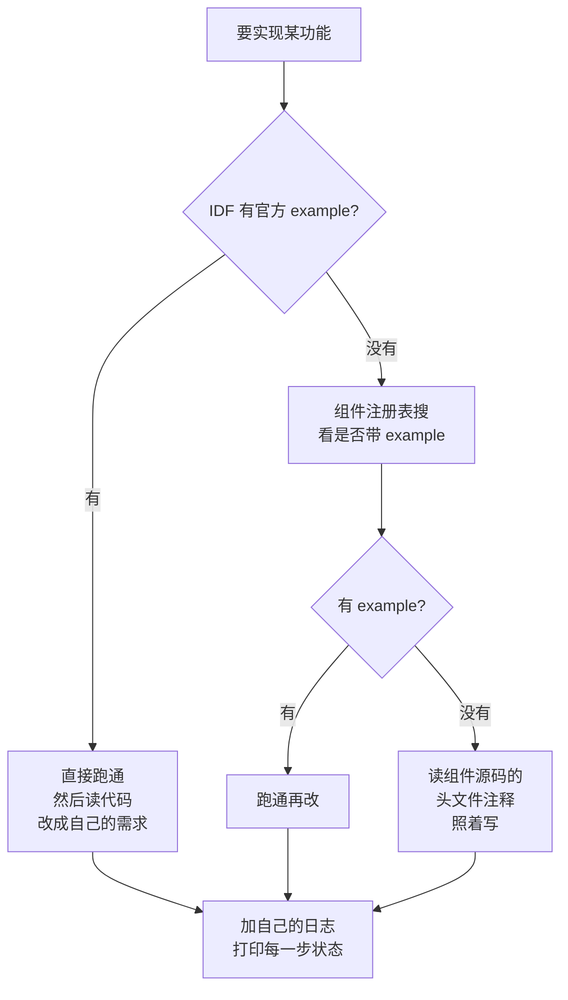

# 参考示例库

写不出代码时，不要硬想，去官方的 examples 里找一个最接近的改。

## 1. 官方示例（首选）

| 仓库 | 内容 | 链接 |
| --- | --- | --- |
| **ESP-IDF Examples** | **所有外设的权威例程** | [github.com/espressif/esp-idf/tree/master/examples](https://github.com/espressif/esp-idf/tree/master/examples) |
| Arduino ESP32 Examples | 库自带例程 | [github.com/espressif/arduino-esp32/tree/master/libraries](https://github.com/espressif/arduino-esp32/tree/master/libraries) |
| Arduino-ESP32 官方示例 | `examples` 目录，200+ 个 | [github.com/espressif/arduino-esp32/tree/master/examples](https://github.com/espressif/arduino-esp32/tree/master/examples) |

**本地已装的话不用上网**：

```bash
ls $IDF_PATH/examples/peripherals/     # 所有外设例程
ls $IDF_PATH/examples/wifi/            # WiFi 例程
ls ~/Documents/Arduino/libraries/      # Arduino 库自带例程
```

值得先跑的几个：

| 例程 | 路径 | 学什么 |
| --- | --- | --- |
| `gpio/` | examples/peripherals/gpio | GPIO 全部用法、中断 |
| `adc/` | examples/peripherals/adc | ADC 单次/连续/校准 |
| `ledc/` | examples/peripherals/ledc | PWM 全配置 |
| `i2c/` | examples/peripherals/i2c | I2C 主机/从机/扫描 |
| `spi_master/` | examples/peripherals/spi | SPI 事务/DMA |
| `i2s/` | examples/peripheral/i2s | 音频收发 |
| `wifi/` | examples/wifi | STA/AP/配网/省电 |
| `espnow/` | examples/wifi/espnow | 点对点传输 |
| `bluedroid/bleprph/` | examples/bluetooth | BLE 外设 |
| `system/ota/` | examples/system/ota | OTA 完整流程 |
| `esp_wifi/` | examples/wifi/getting_started | WiFi 事件模型 |

## 2. 官方仓库

| 项目 | 用途 |
| --- | --- |
| [esp-idf](https://github.com/espressif/esp-idf) | SDK 源码 + examples |
| [esp-dev-kits](https://github.com/espressif/esp-dev-kits) | 开发板原理图 + 硬件文档 |
| [esp-at](https://github.com/espressif/esp-at) | AT 指令固件（用串口控制 ESP32，不写代码） |
| [esp-modem](https://github.com/espressif/esp-modem) | 4G/蜂窝模块 AT 驱动 |
| [esp-dl](https://github.com/espressif/esp-dl) | AI 模型库 |
| [esp-sr](https://github.com/espressif/esp-sr) | 语音唤醒 |
| [esp-adf](https://github.com/espressif/esp-adf) | 音频框架 |
| [esp-usb](https://github.com/espressif/esp-usb) | USB 设备类库 |
| [esp-protocols](https://github.com/espressif/esp-protocols) | 各种协议组件 |
| [esp-bsp](https://github.com/espressif/esp-bsp) | 官方开发板 BSP |
| [esp-mqtt / esp-modem / esp-mesh](https://components.espressif.com) | 组件注册表 |

## 3. 在线资源

| 站点 | 用途 | 链接 |
| --- | --- | --- |
| **ESP-IDF 编程指南（中文）** | 官方文档，最权威 | [docs.espressif.com/projects/esp-idf/zh_CN/v5.5/esp32s3](https://docs.espressif.com/projects/esp-idf/zh_CN/v5.5/esp32s3/) |
| 开发板用户指南 | 原理图、引脚表 | [docs.espressif.com/projects/esp-dev-kits](https://docs.espressif.com/projects/esp-dev-kits/) |
| **组件注册表** | 找第三方组件 | [components.espressif.com](https://components.espressif.com/) |
| **Wokwi 在线模拟** | 无硬件先验证逻辑 | [wokwi.com](https://wokwi.com) |
| ESP Web Tools | 浏览器烧录 + 串口 | [esp-web-tools](https://github.com/espressif/esp-web-tools/releases) |
| MQTT Explorer | 图形化调 MQTT | [mqtt-explorer.com](http://mqtt-explorer.com/) |
| 巴法云 | 国内 IoT 云平台 | [bemf.com](https://bemf.com/) |
| EMQX | 自建 MQTT Broker | [github.com/emqx/emqx](https://github.com/emqx/emqx) |

## 4. 竞赛 / 社区项目

| 平台 | 链接 | 特点 |
| --- | --- | --- |
| GitHub Topic: esp32 | [github.com/topics/esp32](https://github.com/topics/esp32) | 海量项目，按星数筛 |
| GitHub Topic: esp32s3 | [github.com/topics/esp32s3](https://github.com/topics/esp32s3) | S3 专属项目 |
| GitHub Topic: iot-competition | [github.com/topics/iot-competition](https://github.com/topics/iot-competition) | 参赛作品开源 |
| Awesome ESP32 | [github.com/elhigu/awesome-esp32](https://github.com/elhigu/awesome-esp32) | 资源汇总 |
| 立创开源 | [oshwhub.com](https://oshwhub.com/) | 硬件方案 + PCB |
| CSDN / 博客园 | 搜 "ESP32-S3 项目" | 中文踩坑记录多 |

**检索技巧**：用 `site:github.com esp32-s3 lvgl` 这样的组合词，比泛泛搜"ESP32 教程"精准得多。

## 5. 直接可抄的整板项目

| 项目 | 说明 |
| --- | --- |
| **ESP32-S3-LCD-EV-BOARD** | 官方带屏开发板，含 LVGL/摄像头例程 |
| **ESP-VoCat** | 官方 AI 摄像头板，含人脸/手势例程 |
| **esp-now 群控** | 一主多从的灯控/传感网络 |
| **M5Stack / M5CoreS3** | 社区整机方案，代码开源量大 |
| **Tasmota / ESPHome** | 通用智能家居固件，适配大量传感器 |

## 6. 找例程的实用流程



**读例程的正确姿势**：先看 `README.md` 了解它演示什么，然后**只跑起来**，最后**逐行加自己的打印**，理解每一步在干什么。直接从头读代码效率很低。