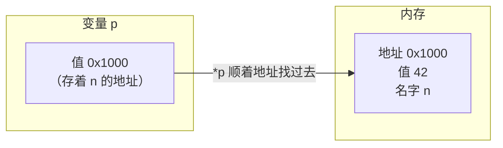

# 17 指针入门

**本课目标**：理解指针是什么，会用 `&` 和 `*`，不被星号搞晕。

:::tip[别怕指针]
指针被传得神乎其神，但它的核心只有一句话：

> **指针就是一个存"地址"的变量。**

地址是什么？就是内存的门牌号。你的变量住在某个门牌号上，指针就是一张写着门牌号的纸条。
:::

## 先理解：变量住在内存里

```c
int n = 42;
```

在内存里大概是这样：

```text
地址:   0x7ffd1234
内容:   [ 42 ]
名字:    n
```

**每个变量都有一个地址**，就像每个房子都有门牌号。

## `&`：取地址

```c
int n = 42;
printf("%p\n", (void*)&n);      /* 打印 n 的地址 */
```

输出示例（每次运行可能不同）：

```text
0000003016D9F6D8
```

`&n` 的意思是"n 的地址"。

:::info[为什么要 `(void*)` 转换]
`%p` 期望的参数是 `void *`。直接传 `&n`（`int *`）在技术上类型不匹配，严格编译器会警告。

**加 `(void*)` 是规范做法**，能避免警告。
:::

## `*`：声明指针 + 解引用

`*` 有两种完全不同的用法，这是初学者最晕的地方：

```c
int *p = &n;        /* ① 声明时：表示 p 是"指向 int 的指针" */
printf("%d", *p);   /* ② 使用时：表示"取出 p 指向的值" */
```

| 位置 | 含义 | 读法 |
| --- | --- | --- |
| **声明中** `int *p` | p 的类型是"int 指针" | "p 是一个指针，指向 int" |
| **表达式中** `*p` | 解引用，取值 | "p 指向的那个值" |

:::tip[怎么区分]
**看它在声明里还是表达式里。**

```c
int *p;         /* 声明：p 是指针 */
*p = 10;        /* 表达式：往 p 指向的地方写 10 */
```

**记忆口诀**：声明时 `*` 是"类型的一部分"，使用时 `*` 是"动作"。
:::

## 完整例子

```c
#include <stdio.h>

int main(void) {
    int n = 42;
    int *p = &n;            /* p 存 n 的地址 */

    printf("n 的值   = %d\n", n);
    printf("n 的地址 = %p\n", (void*)&n);
    printf("p 的值   = %p\n", (void*)p);        /* 和上面一样 */
    printf("p 指向的值 = %d\n", *p);            /* 42 */

    *p = 99;                /* 通过指针改 n */
    printf("改后 n = %d\n", n);                 /* 99 */

    return 0;
}
```

本机实测输出：

```text
n 的值   = 42
n 的地址 = 0000003016D9F6D8
p 的值   = 0000003016D9F6D8
p 指向的值 = 42
改后 n = 99
```

**关键观察**：`&n` 和 `p` 的值**完全相同**——因为 `p` 存的就是 `n` 的地址。

## 用图理解




- `p` 本身也是一个变量，它住在别的地方（比如 0x2000）
- `p` 的**内容**是 `0x1000`（n 的地址）
- `*p` 表示"顺着 0x1000 找过去，拿到 42"

:::tip[指针对初学者的经典比喻]
**指针 = 写着门牌号的纸条**

- `&n` = 抄下 n 的门牌号
- `p` = 一张纸条，上面写着那个门牌号
- `*p` = 按纸条上的门牌号找过去，看那户人家

**注意**：纸条本身也有地址（指针变量自己的地址），这就是"二级指针"的来源。
:::

## 指针的类型很重要

```c
int *pi;
char *pc;
double *pd;
```

**指针必须指明指向什么类型**，因为：

1. **解引用时要读几个字节**：`int *` 读 4 字节，`char *` 读 1 字节
2. **指针运算时步长不同**：`pi + 1` 前进 4 字节，`pc + 1` 前进 1 字节

本机实测：**所有指针大小都是 8 字节**（64 位系统）：

```c
printf("sizeof(int*)=%zu\n", sizeof(int*));      /* 8 */
printf("sizeof(char*)=%zu\n", sizeof(char*));    /* 8 */
```

**指针大小和指向的类型无关**，只和系统位数有关。但**指针运算的步长和类型有关**。

## NULL：空指针

```c
int *p = NULL;          /* 不指向任何东西 */
```

`NULL` 是一个特殊值（通常是 `0`），表示"这个指针不指向任何地方"。

```c
printf("%p\n", (void*)NULL);        /* 0000000000000000 */
```

:::danger[解引用 NULL 会导致崩溃]
```c
int *p = NULL;
printf("%d\n", *p);        /* ❌ 段错误 (Segmentation fault) */
```

访问地址 0 是非法的——那是操作系统的保护区。

**用法**：指针在没指向有效内存前，先设成 `NULL`：

```c
int *p = NULL;
/* ... 后面再赋值 ... */
if (p != NULL) {
    printf("%d\n", *p);    /* 确认非空才用 */
}
```

**这是防御性编程的基本习惯。**
:::

:::warning[`NULL` 和 `0` 的关系]
`NULL` 在 C 里就是 `0`（或 `((void*)0)`）。

```c
int *p = NULL;
if (p == NULL) { }      /* ✅ */
if (!p) { }             /* ✅ 等价，更简洁 */
if (p == 0) { }         /* ✅ 也合法，但不推荐 */
```

推荐用 `NULL`——**语义更清楚**，一看就知道是"空指针"而不是"数字 0"。
:::

## 指针的指针（二级指针）

```c
int n = 42;
int *p = &n;        /* 一级：p 存 n 的地址 */
int **pp = &p;      /* 二级：pp 存 p 的地址 */
```

本机实测：

```c
printf("%d\n", **pp);       /* 42 */
**pp = 7;                   /* 通过二级指针修改 n */
printf("%d\n", n);          /* 7 */
```

| 表达式 | 含义 |
| --- | --- |
| `n` | 42 |
| `p` | n 的地址 |
| `*p` | 42（n 的值） |
| `pp` | p 的地址 |
| `*pp` | p（即 n 的地址） |
| `**pp` | 42（n 的值） |

**每多一个 `*`，就"顺着地址多跳一次"。**

二级指针的典型用途：让函数修改"指针本身"（第 22 课详细讲）。

## 指针与 const

`const` 放在不同位置，含义完全不同：

```c
int v = 5;

const int *p1 = &v;      /* 不能通过 p1 改 v（指向的内容只读） */
int *const p2 = &v;      /* p2 不能改指向，但能改 v */
```

| 写法 | 含义 | 记忆 |
| --- | --- | --- |
| `const int *p` | 指向的内容不能改 | `*` 在 `const` 右边 |
| `int *const p` | 指针本身不能改 | `p` 紧挨 `const` |
| `const int *const p` | 都不能改 | 两个都限制 |

:::tip[读 const 指针的技巧：从右往左读]
```c
const int *p;       /* p is a pointer to const int */
int *const p;       /* p is a const pointer to int */
```

**从变量名开始往右读，然后往左读**：

- `p` 是（`*`）指针，指向 `const int` → 内容不可改
- `p` 是（`const`）常量，是（`*`）指针，指向 `int` → 指针不可改

**最简单的记法**：`const` 在 `*` **左边**就限制值，在 `*` **右边**就限制指针。
:::

## 指针的运算

```c
int arr[5] = {10, 20, 30, 40, 50};
int *q = arr;           /* 指向第一个元素 */

printf("%d\n", *q);         /* 10 */
printf("%d\n", *(q + 1));   /* 20 */
printf("%d\n", *(q + 4));   /* 50 */
```

**`q + 1` 不是"地址加 1 字节"，而是"前进一个元素"**（4 字节）。

本机实测指针差：

```c
printf("%td\n", &arr[4] - &arr[0]);     /* 4，不是 16 */
```

**指针相减得到的是"元素个数"，不是字节数。**

:::tip[这是 C 的巧妙设计]
指针运算自动按类型调整步长，你不用手动乘 `sizeof(int)`。

```c
int *p;
p + 1        /* 地址实际 +4 */
p + 2        /* 地址实际 +8 */

char *c;
c + 1        /* 地址实际 +1 */
```

**这正是第 18 课要讲的"指针与数组"的基础。**
:::

## 常见错误

| 错误 | 现象 | 原因 | 解决 |
| --- | --- | --- | --- |
| 声明了没初始化就用 | 崩溃或乱写内存 | **野指针** | 声明时设 `NULL` |
| 解引用 NULL | 段错误 | 指向 0 | 先判断非空 |
| `*p = 10` 但 p 没指向有效内存 | 崩溃 | p 是垃圾值 | 先 `p = &某变量` |
| `printf("%d", p)` 而不是 `*p` | 打印地址 | 少了 `*` | 加 `*` |
| `int *p = 42;` | 把 42 当地址 | 缺 `&` | `int *p = &n;` |
| 指针类型不匹配 | 读错字节 | 类型不一致 | 类型要对上 |

:::danger[野指针（wild pointer）是最危险的情况]
```c
int *p;             /* 未初始化，值是垃圾 */
*p = 10;            /* ❌ 往一个随机地址写数据 */
```

**后果完全不可预测**：

- 可能崩溃
- 可能悄悄改了别的变量
- **可能什么都没发生**（最可怕，bug 隐藏了）

**规矩：指针声明时就初始化为 `NULL`。**

```c
int *p = NULL;      /* ✅ 至少能被检查出来 */
```
:::

## 完整示例

```c
#include <stdio.h>

/* 用指针让函数能修改外部变量 */
void set_to_zero(int *p) {
    if (p != NULL) {          /* 防御性检查 */
        *p = 0;
    }
}

/* 用指针"返回"多个值 */
void min_max(const int arr[], int n, int *out_min, int *out_max) {
    if (n <= 0) return;

    *out_min = arr[0];
    *out_max = arr[0];

    for (int i = 1; i < n; i++) {
        if (arr[i] < *out_min) *out_min = arr[i];
        if (arr[i] > *out_max) *out_max = arr[i];
    }
}

int main(void) {
    int n = 42;
    int *p = &n;

    printf("原始值：%d\n", n);

    set_to_zero(p);
    printf("清零后：%d\n", n);

    int scores[] = {85, 92, 78, 95, 88};
    int count = sizeof(scores) / sizeof(scores[0]);
    int lo, hi;

    min_max(scores, count, &lo, &hi);
    printf("最低 %d，最高 %d\n", lo, hi);

    return 0;
}
```

输出：

```text
原始值：42
清零后：0
最低 78，最高 95
```

:::tip[`min_max` 展示了指针的典型用途]
C 的函数只能 `return` 一个值。想"返回"多个结果，就让调用者传指针进来，函数往指针指向的地方写。

```c
min_max(scores, count, &lo, &hi);     /* lo、hi 被函数填好 */
```

**这是 C 里非常常见的模式**，标准库也这么用（比如 `scanf`）。
:::

## 本课自检

- [ ] 能用一句话解释"指针是存地址的变量"
- [ ] 会用 `&` 取地址
- [ ] **分清声明中的 `*` 和表达式中的 `*`**
- [ ] 知道 `*p` 是"取出 p 指向的值"
- [ ] 知道所有指针大小相同（8 字节 on 64 位）
- [ ] 知道指针类型决定解引用读几个字节、运算步长多少
- [ ] **知道 NULL 用于表示"不指向任何地方"，解引用会崩溃**
- [ ] 会声明指针时初始化为 `NULL`
- [ ] 能看懂二级指针 `**pp`
- [ ] 分清 `const int *` 和 `int *const`
- [ ] 知道 `p + 1` 是前进一个元素不是一字节

## 下一步

[18 指针与数组](./18-pointer-array) —— 搞清这两者的微妙关系，很多 C 代码才看得懂。
