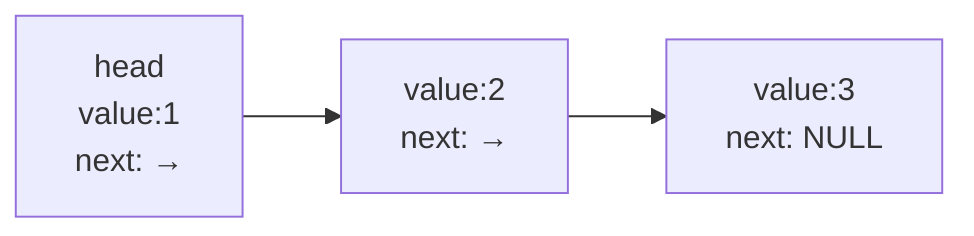

# 22 结构体与指针

**本课目标**：会用结构体+指针做链表，理解"自引用结构体"。

## 自引用结构体

链表的核心是**结构体里有指向自己的指针**：

```c
typedef struct Node {
    int value;
    struct Node *next;      /* 指向下一个同类型节点 */
} Node;
```

:::warning[这里必须写 `struct Node *`，不能写 `Node *`]
```c
typedef struct Node {
    int value;
    Node *next;             /* ❌ 此时 Node 这个名字还不存在 */
    struct Node *next;      /* ✅ 用完整写法 */
} Node;
```

因为 `typedef` 的别名 **`Node` 要到整个声明结束才生效**，结构体内部还不能用它。

**这是自引用结构体的固定写法，记住就行。**
:::

## 链表长什么样




每个节点存一个值 + 一个指向下一节点的指针。最后一个节点的 `next` 是 `NULL`，表示结束。

**和数组的区别**：

| | 数组 | 链表 |
| --- | --- | --- |
| 内存 | 连续 | 分散（靠指针串起来） |
| 随机访问 | O(1) `a[i]` | O(n) 要逐个走 |
| 插入/删除 | O(n) 要挪数据 | O(1) 改指针 |
| 大小 | 固定 | 动态 |

## 创建节点

```c
Node *create_node(int value) {
    Node *n = malloc(sizeof(Node));
    if (n == NULL) return NULL;

    n->value = value;
    n->next = NULL;          /* 必须有，否则是野指针 */
    return n;
}
```

:::danger[`next` 一定要初始化为 NULL]
```c
Node *n = malloc(sizeof(Node));
n->value = 42;
/* 忘了 n->next = NULL */
```

`malloc` 不清零，`n->next` 是**垃圾指针**。之后遍历链表会跳到随机地址 → 崩溃。

**规矩：新节点的 `next` 必须显式设成 `NULL`。**
:::

## 头插法：最简单

```c
Node *push_front(Node *head, int value) {
    Node *n = create_node(value);
    if (n == NULL) return head;      /* 分配失败，返回原链表 */

    n->next = head;                  /* 新节点指向原头 */
    return n;                        /* 新节点成为新头 */
}
```

```c
Node *head = NULL;
for (int i = 1; i <= 4; i++) {
    head = push_front(head, i);
}
```

本机实测输出：

```text
4->3->2->1->NULL
```

:::tip[为什么是倒序]
每次新节点都插在**最前面**，所以最后插入的 4 在最前。

**这是头插法的特点**：O(1)，但顺序反了。要正序可以用尾插（需要维护 tail 指针）。
:::

## 遍历

```c
void print_list(Node *head) {
    for (Node *p = head; p != NULL; p = p->next) {
        printf("%d->", p->value);
    }
    printf("NULL\n");
}
```

:::warning[遍历的循环条件]
```c
for (Node *p = head; p != NULL; p = p->next)     /* ✅ */
for (Node *p = head; p->next != NULL; p = p->next)  /* ⚠️ 会漏掉最后一个 */
```

用 `p != NULL` 才能把最后一个节点也处理到。
:::

## 求长度

```c
int list_length(Node *head) {
    int count = 0;
    for (Node *p = head; p != NULL; p = p->next) {
        count++;
    }
    return count;
}
```

本机实测：`长度=4`。

## 查找

```c
Node *find(Node *head, int value) {
    for (Node *p = head; p != NULL; p = p->next) {
        if (p->value == value) return p;
    }
    return NULL;            /* 没找到 */
}
```

**返回节点指针**而不是值，这样调用者还能拿到 `next` 等信息。

## 反转链表

这是**面试高频题**，也是理解指针的好练习：

```c
Node *reverse(Node *head) {
    Node *prev = NULL;
    Node *curr = head;

    while (curr != NULL) {
        Node *next = curr->next;     /* ① 先记住下一个 */
        curr->next = prev;           /* ② 当前节点指向前面 */
        prev = curr;                 /* ③ prev 前移 */
        curr = next;                 /* ④ curr 前移 */
    }
    return prev;                     /* 新的头 */
}
```

本机实测：

```text
反转前: 4->3->2->1->NULL
反转后: 1->2->3->4->NULL
```

:::tip[反转的关键是"先存 next"]
必须**先把 `curr->next` 存到临时变量**，因为第②步会把它覆盖掉。

如果直接写 `curr->next = prev; curr = curr->next;` 就丢了后续链表的入口。
:::

## 删除节点：二级指针的妙用

**朴素写法**要特殊处理头节点：

```c
Node *remove_value_naive(Node *head, int value) {
    /* 头节点要单独处理，很啰嗦 */
    while (head && head->value == value) {
        Node *d = head;
        head = head->next;
        free(d);
    }
    Node *p = head;
    while (p && p->next) {
        if (p->next->value == value) {
            Node *d = p->next;
            p->next = d->next;
            free(d);
        } else {
            p = p->next;
        }
    }
    return head;
}
```

**用二级指针**，头节点和中间节点统一处理：

```c
Node *remove_value(Node *head, int value) {
    Node **pp = &head;               /* 指向"指向当前节点的指针" */

    while (*pp != NULL) {
        if ((*pp)->value == value) {
            Node *dead = *pp;
            *pp = dead->next;        /* 让前驱的 next 跳过它 */
            free(dead);
        } else {
            pp = &(*pp)->next;       /* 移动到下一个"指针的位置" */
        }
    }
    return head;
}
```

本机实测：

```text
删除前: 1->2->3->4->NULL
删 2 后: 1->3->4->NULL
```

:::tip[二级指针为什么能统一处理]
`pp` 指向的是「**存放当前节点地址的那个指针**」：

- 一开始 `pp = &head`（`head` 这个变量本身）
- 后续 `pp = &(*pp)->next`

所以 `*pp = dead->next` 这一句，**对头节点就是改 `head`，对中间节点就是改前驱的 `next`**——同一句代码搞定两种情况。

**这就是二级指针的经典价值。**
:::

## 释放整个链表

:::danger[释放必须先存 next]
```c
void free_list_wrong(Node *head) {
    while (head) {
        free(head);
        head = head->next;       /* ❌ head 已经被 free 了！ */
    }
}
```

**`free(head)` 之后 `head->next` 是未定义行为**（内存已归还）。

**正确写法**：

```c
void free_list(Node *head) {
    while (head != NULL) {
        Node *next = head->next;     /* ① 先存下一个 */
        free(head);                  /* ② 再释放当前 */
        head = next;                 /* ③ 前进 */
    }
}
```
:::

## 完整示例

```c
#include <stdio.h>
#include <stdlib.h>

typedef struct Node {
    int value;
    struct Node *next;
} Node;

Node *create_node(int value) {
    Node *n = malloc(sizeof(Node));
    if (n == NULL) return NULL;
    n->value = value;
    n->next = NULL;
    return n;
}

Node *push_front(Node *head, int value) {
    Node *n = create_node(value);
    if (n == NULL) return head;
    n->next = head;
    return n;
}

void print_list(const Node *head) {
    for (const Node *p = head; p != NULL; p = p->next) {
        printf("%d", p->value);
        if (p->next) printf(" -> ");
    }
    printf("\n");
}

int list_length(const Node *head) {
    int n = 0;
    for (const Node *p = head; p != NULL; p = p->next) n++;
    return n;
}

Node *reverse(Node *head) {
    Node *prev = NULL, *curr = head;
    while (curr != NULL) {
        Node *next = curr->next;
        curr->next = prev;
        prev = curr;
        curr = next;
    }
    return prev;
}

Node *remove_value(Node *head, int value) {
    Node **pp = &head;
    while (*pp != NULL) {
        if ((*pp)->value == value) {
            Node *dead = *pp;
            *pp = dead->next;
            free(dead);
        } else {
            pp = &(*pp)->next;
        }
    }
    return head;
}

void free_list(Node *head) {
    while (head != NULL) {
        Node *next = head->next;
        free(head);
        head = next;
    }
}

int main(void) {
    Node *head = NULL;

    for (int i = 1; i <= 4; i++) {
        head = push_front(head, i);
    }

    printf("构建（头插）: ");
    print_list(head);
    printf("长度: %d\n", list_length(head));

    head = reverse(head);
    printf("反转后:       ");
    print_list(head);

    head = remove_value(head, 2);
    printf("删除 2 后:    ");
    print_list(head);

    free_list(head);
    printf("已全部释放\n");

    return 0;
}
```

输出：

```text
构建（头插）: 4 -> 3 -> 2 -> 1
长度: 4
反转后:       1 -> 2 -> 3 -> 4
删除 2 后:    1 -> 3 -> 4
已全部释放
```

## 常见错误

| 错误 | 现象 | 原因 | 解决 |
| --- | --- | --- | --- |
| 新节点 `next` 没设 NULL | 遍历时崩溃 | 垃圾指针 | 创建时设 `NULL` |
| free 后还用 `->next` | 崩溃 | 内存已归还 | 先存 next |
| 空链表没处理 | 崩溃 | `head` 是 NULL | 先判空 |
| 遍历用 `p->next != NULL` | 漏最后一个 | 条件太严 | 用 `p != NULL` |
| 忘 `free` | 内存泄漏 | 没释放 | 写 `free_list` |
| 自引用写 `Node *next` | 编译错 | 别名还没生效 | `struct Node *next` |

:::danger[空链表是最容易漏的边界]
```c
printf("%d\n", head->value);        /* ❌ head 是 NULL 时崩溃 */
```

**每个操作链表开头都该想：如果 `head` 是 NULL 会怎样？**

```c
if (head == NULL) {
    printf("链表为空\n");
    return;
}
```
:::

## 本课自检

- [ ] 会写自引用结构体（知道要写 `struct Node *next`）
- [ ] 理解链表和数组的取舍
- [ ] 会创建节点，**知道 next 必须初始化**
- [ ] 会头插法
- [ ] 会遍历（条件是 `p != NULL`）
- [ ] 会求长度、查找
- [ ] **会反转链表（知道要先存 next）**
- [ ] **理解用二级指针删除节点为什么能统一处理**
- [ ] 会正确释放链表（先存 next 再 free）
- [ ] 知道每个操作都要考虑空链表

## 下一步

[23 枚举、联合体、typedef](./23-enum-union) —— 补齐自定义类型，你的工具箱就完整了。
