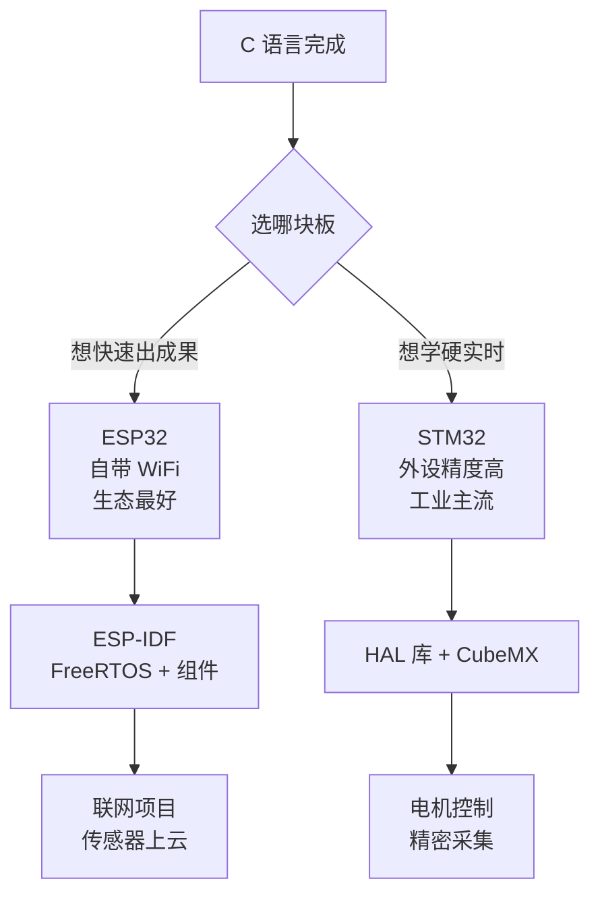

# 31 下一步：走向嵌入式

**本课目标**：知道自己现在在什么位置，以及接下来该学什么。

## 你现在会什么

31 节课走完，你掌握了：

| 能力 | 说明 |
| --- | --- |
| 编译链接 | 知道 `.c` 到可执行文件发生了什么 |
| 语法 | 变量、类型、运算、条件、循环、数组、字符串 |
| 指针 | 地址、解引用、指针运算、函数指针、多级指针 |
| 内存 | `malloc`/`free`、栈与堆、内存泄漏 |
| 结构体 | 组织数据、内存对齐、链表 |
| 工程 | 多文件、头文件、Makefile |
| 底层 | 位运算、字节序 |
| 调试 | ASan、gdb、崩溃排查 |

**这是一份完整的 C 基础。** 接下来要做的不是继续学 C，而是**把 C 用到具体领域**。

## 嵌入式还缺什么

:::warning[C 语言本身不是嵌入式的全部]
**你现在会写 C 程序了，但还不会写嵌入式程序。** 缺的是这三块：
:::

### 缺块一：硬件知识

| 要知道 | 为什么 |
| --- | --- |
| **电压、电流、电阻** | 接错线会烧芯片 |
| **上拉/下拉电阻** | 按键、I2C 必须用 |
| **时序图怎么读** | SPI/I2C 通信全靠它 |
| **原理图怎么看** | 知道引脚连到哪 |

**这些不是软件知识，但不学就没法调试硬件问题。**

### 缺块二：MCU 架构

| 概念 | 说明 |
| --- | --- |
| **寄存器** | 控制硬件的方式，通过地址读写 |
| **中断** | 硬件事件打断主程序 |
| **时钟树** | 每个外设的工作频率从哪来 |
| **内存映射** | 外设被映射成内存地址 |
| **启动流程** | 上电后第一条指令在哪 |

**第 28 课的位运算就是为操作寄存器准备的。**

### 缺块三：RTOS 与生态

| 内容 | 说明 |
| --- | --- |
| **FreeRTOS** | 任务、队列、信号量、优先级 |
| **厂商 SDK** | ESP-IDF / STM32 HAL |
| **通信协议** | UART、I2C、SPI、WiFi、BLE |

## 两条路线



### 路线 A：ESP32（推荐入门）

**适合**：想快速做出能联网的东西、参加比赛、做智能家居。

| 优势 | 说明 |
| --- | --- |
| 自带 WiFi + 蓝牙 | 不用外挂模块 |
| 一根 USB 线就能烧录 | 不需要额外调试器 |
| 生态极好 | 例程多、社区活跃 |
| 便宜 | 二三十块一块板 |

**起步**：

1. 买一块 **ESP32-S3 开发板**（N16R8）
2. 走 [快速上手](../../quickstart/) 把环境跑通（装驱动、装米思齐、点灯）
3. 然后学 [ESP 系列](../../hardware/esp/) 的完整教程（L0~L7）

:::tip[先跑通再学原理]
很多人一上来就啃 FreeRTOS 文档，两天就放弃了。

**正确顺序**：先用米思齐拖积木点个灯（半天），建立"我真的能控制硬件"的信心，再回头学原理。
:::

### 路线 B：STM32（推荐进阶）

**适合**：要做硬实时控制、精密采集、或者想进工业/汽车电子行业。

| 优势 | 说明 |
| --- | --- |
| 外设精度高 | ADC/定时器比 ESP32 好 |
| 实时性强 | 中断响应确定性高 |
| 型号丰富 | 几千种，可按需选 |
| 工业界用量大 | 求职有优势 |

**起步**：

1. 买 **STM32F103C8T6 最小系统板**（十几块）+ **ST-Link V2**（二十元）
2. 学 [STM 系列](../../hardware/stm/) 的教程

:::danger[STM32 必须有调试器]
不像 ESP32 一根 USB 线就能烧，STM32 通常要 **ST-Link**。

**没有调试器你只能"烧进去看现象"**，出了问题完全不知道代码停在哪。

**这二十块不能省。**
:::

## 一个具体的学习计划

以 ESP32 为例，8 周：

| 周 | 目标 | 产出 |
| --- | --- | --- |
| 1 | 装环境、点灯、看串口 | 板载灯会闪，串口能打印 |
| 2 | GPIO 输入输出、按键消抖 | 按键控制灯 |
| 3 | 串口通信、printf 调试 | 能用串口排查问题 |
| 4 | ADC/PWM | 电位器调亮度 |
| 5 | I2C/SPI 接屏幕传感器 | OLED 显示数据 |
| 6 | WiFi 联网 | 设备拿到 IP |
| 7 | MQTT / HTTP 上报 | 数据上云 |
| 8 | 综合项目 | 一个完整可演示的东西 |

**每周都有能看见的产出**——这是保持动力的关键。

## 需要补的 C 知识（进阶）

学嵌入式过程中，你会遇到这些 C 进阶主题：

| 主题 | 什么时候需要 |
| --- | --- |
| `volatile` | 操作寄存器和中断共享变量时**必须**用 |
| `const` 深入 | 把常量放进 Flash 省 RAM |
| 位域 | 理解 SDK 里的寄存器定义 |
| `inline` | 性能敏感的内联函数 |
| 链接脚本 | 控制代码/数据放在哪块内存 |
| 启动文件 | 上电后第一段汇编 |

**这些在 [C 语言进阶教程](../c/) 里有详细讲解。**

:::danger[`volatile` 是最关键的一个]
```c
volatile int flag = 0;

/* 中断里改 flag，主循环里检查 */
while (!flag) { }        /* 没有 volatile，编译器会把循环优化掉 */
```

**没加 `volatile`，编译器认为 `flag` 不会变，直接把循环删了**——程序看起来"卡死"。

**规则：中断和主程序共享的变量、硬件寄存器，一律加 `volatile`。**
:::

## 推荐的硬件清单

| 东西 | 大概价格 | 用途 |
| --- | --- | --- |
| ESP32-S3 开发板 | 25~40 元 | 主力开发板 |
| 面包板 + 杜邦线 | 15 元 | 接线 |
| LED + 电阻套装 | 10 元 | 点灯 |
| 按键 | 5 元 | 输入 |
| 电位器 | 3 元 | ADC 实验 |
| OLED（SSD1306，I2C） | 15 元 | 显示 |
| DHT11/DHT22 | 10 元 | 温湿度 |
| 万用表 | 30 元 | **排查供电必备** |

**总计约 120 元，足够走完整个入门路线。**

:::tip[万用表别省]
怀疑供电不足时，**量一下电压**比换十根线都快。

"板子莫名其妙重启"里，至少一半是供电问题。
:::

## 学习建议

:::tip[四条经验]
**① 有问题先看串口**

板子不会说话，所有信息都靠串口。**加打印是最高效的调试手段**。

**② 一步一步来，别一次改太多**

改一处、烧一次、看现象。一次改五处，出问题不知道是哪处。

**③ 保存能跑的版本**

用 git 或者手动复制。改崩了能回到上一个能跑的状态。

**④ 别怕看数据手册**

英文文档看着吓人，但**寄存器表就是一张对照表**，查着用就行。
:::

:::danger[三个会让板子废掉的操作]
1. **5V 接到 3.3V 的引脚**——当场烧
2. **电源正负极接反**——当场烧
3. **带电插拔杜邦线**——容易短路

**改接线一定先断电。上电前用万用表确认电压。**
:::

## 回到学习站

| 想做什么 | 去哪 |
| --- | --- |
| 快速跑通第一个程序 | [快速上手](../../quickstart/) |
| 系统学 ESP32 | [ESP 系列](../../hardware/esp/) |
| 学 STM32 | [STM 系列](../../hardware/stm/) |
| 学 Linux 开发板 | [Linux 系列](../../hardware/linux/) |
| 补 C 的进阶（volatile、链接脚本） | [C 语言进阶](../c/) |
| 学 C++（很多嵌入式框架用它） | [C++ 教程](../cpp/) |
| 查 API 和错误码 | [速查表](../../reference/) |

## 最后一句话

**C 语言的难点不在语法，在于"你必须知道自己在干什么"。**

指针指向哪、内存谁负责释放、这个越界会不会出事——这些都要你自己想清楚。

**这种"必须想清楚"的要求，正是它让人变强的原因。**

学完 C 再去学其他语言，你会发现很多"魔法"都不再神秘。

## 本课自检

- [ ] 知道 C 学完还缺硬件、MCU 架构、RTOS 三块
- [ ] 知道自己该走 ESP32 还是 STM32 路线
- [ ] 有一份具体到周的学习计划
- [ ] 知道 `volatile` 为什么必须学
- [ ] 准备好基本的硬件清单
- [ ] 记住三个会烧板子的操作

---

**回到**：[C 零基础教程目录](./) · [软件编程总览](../)
