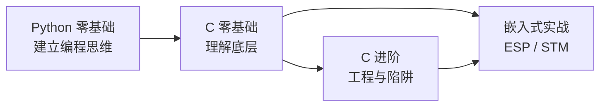

# C 语言零基础完整教程

**这条线假设你从没写过代码。** 不知道什么是编译、什么是变量、终端在哪——都没关系。

如果你已经会写程序（比如会 Python），只是想学 C，可以直接从[第 11 课](#第三阶段指针与内存10-节)开始，但**建议还是先扫一遍 05~10 课**——C 的语法细节和 Python 差别很大。

## 为什么值得学 C

| 理由 | 说明 |
| --- | --- |
| **它是嵌入式的地基** | ESP32、STM32 的固件都是 C。想真正玩硬件，绕不过去 |
| **它让你理解计算机** | 内存、指针、栈、堆——这些概念在 C 里是"看得见"的 |
| **它影响后来所有语言** | Python、Java、C++、Go 的语法都能看到 C 的影子 |
| **它小而完整** | 关键字只有 32 个，却足够写操作系统 |

:::warning[C 也会让人痛苦]
诚实地说清楚：

- **没有自动内存管理**，忘了 `free` 就是内存泄漏
- **越界不报错**，数组写超了程序可能"看起来正常"，也可能随机崩溃
- **报错信息不友好**，一个漏掉的分号可能报出十几个错误

但这些痛苦**恰好是你理解底层的代价**。学会在 C 里不犯错，你在其他语言里会格外清醒。
:::

## 和 Python 主线的关系

**推荐路线**：

- **完全零基础** → 先走 [Python 零基础](../python-basics/)，建立"程序怎么跑"的直觉，再来学 C。直接用 C 入门，十有八九会卡在指针上放弃
- **想直接玩硬件** → 直接学 C，但要做好多花时间的准备
- **已有编程经验** → 可以跳过 01~10，从指针开始

## 这条线的设计

| 特点 | 说明 |
| --- | --- |
| **每节只讲一件事** | 150~300 行，15 分钟能读完 |
| **每个例子都真编译真运行** | 输出是实际运行结果，不是编的 |
| **讲清"为什么"** | 不只是语法，还有编译器/内存层面发生了什么 |
| **先能跑，再深入** | 原理放进「深入一点」折叠块，第一遍可跳过 |

## 全部 31 节

### 第一阶段：把 C 程序跑起来（4 节）

| # | 课 | 你会做出什么 |
| --- | --- | --- |
| 01 | [C 语言是什么](./01-what-is-c) | 知道 C 能干什么、为什么嵌入式用它 |
| 02 | [安装编译器](./02-install) | 电脑上能编译运行 C 程序 |
| 03 | [编译与运行：四个阶段](./03-compile) | 理解从 .c 到 .exe 发生了什么 |
| 04 | [第一个完整程序](./04-first-program) | 看懂 `#include`、`main`、`printf` |

### 第二阶段：语法与数据（10 节）

| # | 课 | 你会做出什么 |
| --- | --- | --- |
| 05 | [变量与数据类型](./05-variables) | 会声明变量，理解类型为什么必须写明 |
| 06 | [整数：范围与溢出](./06-integers) | 知道 `int` 有多大、为什么会溢出 |
| 07 | [浮点数](./07-float) | 会算小数，知道精度问题 |
| 08 | [格式化输出 printf](./08-printf) | 会按格式打印各种类型 |
| 09 | [运算符与类型转换](./09-operators) | 会算数，知道隐式转换的坑 |
| 10 | [条件判断 if / switch](./10-if) | 程序会做选择 |
| 11 | [循环 for / while](./11-loops) | 程序会重复 |
| 12 | [数组](./12-array) | 存一组同类型数据 |
| 13 | [字符串](./13-string) | 处理文本（C 的字符串很特别） |
| 14 | [阶段实战：猜数字](./14-project-guess) | 串起前 9 课 |

### 第三阶段：指针与内存（10 节）

**这是 C 最难也最有价值的部分，不要跳。**

| # | 课 | 你会做出什么 |
| --- | --- | --- |
| 15 | [函数](./15-functions) | 把代码打包复用 |
| 16 | [作用域与存储期](./16-scope) | 知道变量活多久、在哪能用 |
| 17 | [指针入门](./17-pointers) | 理解"地址"是什么 |
| 18 | [指针与数组](./18-pointer-array) | 搞清两者微妙的关系 |
| 19 | [指针进阶](./19-pointer-advanced) | 多级指针、函数指针 |
| 20 | [动态内存 malloc/free](./20-malloc) | 运行时申请内存 |
| 21 | [结构体](./21-struct) | 把不同类型打包在一起 |
| 22 | [结构体与指针](./22-struct-pointer) | 链表的基础 |
| 23 | [枚举、联合体、typedef](./23-enum-union) | 补齐自定义类型 |
| 24 | [阶段实战：通讯录](./24-project-contacts) | 用结构体+动态内存做完整应用 |

### 第四阶段：进阶与实战（7 节）

| # | 课 | 你会做出什么 |
| --- | --- | --- |
| 25 | [文件读写](./25-files) | 数据能保存下来 |
| 26 | [预处理器与宏](./26-preprocessor) | 看懂 `#define`、头文件 |
| 27 | [多文件工程](./27-multi-file) | 把程序拆成多个文件 |
| 28 | [位运算](./28-bitops) | 操作单个比特（嵌入式必学） |
| 29 | [调试技巧与常见错误](./29-debug) | 段错误、内存泄漏怎么查 |
| 30 | [实战：学生成绩管理](./30-project-scores) | 综合运用全部知识 |
| 31 | [下一步：走向嵌入式](./31-next) | 知道该学什么、往哪走 |

## 学完之后

- 想深入 C 的工程与陷阱 → [C 语言教程（进阶）](../c/)
- 想玩硬件 → [ESP 系列](../../hardware/esp/) · [STM 系列](../../hardware/stm/)
- 想学 C++ → [C++ 教程](../cpp/)

## 学习建议

1. **每个例子都自己敲一遍编译运行**。C 的报错信息很直接，看多了就会读了
2. **不理解就画内存图**。C 里的一切都能画成"内存格子 + 地址"
3. **不要跳过指针**。跳过指针等于没学 C
4. **卡住超过 30 分钟先跳**，回头再看往往就通了
