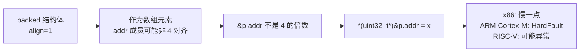

# 01 复合类型
**本页学什么**

- 结构体在内存里到底怎么排布——用 `offsetof` 和 `sizeof` **实测**每一个字节
- padding 的三条规则，以及**重排成员省 33% 内存**的实测
- `#pragma pack` / `__attribute__((packed))` 的效果与代价
- 联合体的真实用途，以及它是 C 中**合法的类型双关**手段
- 位域的布局是**实现定义的**，实测告诉你本机会怎么排
- `typedef` 的三类用法，尤其函数指针 `typedef`

这页的所有数字都是本机 `offsetof` 实测输出，不是推算的。

## 一、结构体的内存布局

结构体成员**按声明顺序**在内存中排列，但要满足每条的对齐要求，中间会插入 padding。

### 实测：三种排列的完整对比

```c
#include <stdio.h>
#include <stddef.h>
#include <stdint.h>

struct Packed3    { uint8_t a; uint32_t b; uint16_t c; };
struct Reordered3 { uint32_t b; uint16_t c; uint8_t  a; };

#pragma pack(push, 1)
struct Packed1    { uint8_t a; uint32_t b; uint16_t c; };
#pragma pack(pop)

int main(void) {
    printf("Packed3    : size=%zu align=%zu  a@%zu b@%zu c@%zu\n",
           sizeof(struct Packed3), _Alignof(struct Packed3),
           offsetof(struct Packed3, a), offsetof(struct Packed3, b), offsetof(struct Packed3, c));
    printf("Reordered3 : size=%zu align=%zu  b@%zu c@%zu a@%zu\n",
           sizeof(struct Reordered3), _Alignof(struct Reordered3),
           offsetof(struct Reordered3, b), offsetof(struct Reordered3, c), offsetof(struct Reordered3, a));
    printf("Packed1    : size=%zu align=%zu  a@%zu b@%zu c@%zu\n",
           sizeof(struct Packed1), _Alignof(struct Packed1),
           offsetof(struct Packed1, a), offsetof(struct Packed1, b), offsetof(struct Packed1, c));
    return 0;
}
```

```bash
gcc -std=c17 -Wall agg.c -o agg.exe && ./agg.exe
```

```text
=== padding comparison ===
Packed3    : size=12 align=4  a@0 b@4 c@8
Reordered3 : size=8 align=4  b@0 c@4 a@6
Packed1    : size=7 align=1  a@0 b@1 c@5
```

三个结构体**成员完全一样**（1 个 `uint8_t` + 1 个 `uint32_t` + 1 个 `uint16_t`，理论最小 7 字节），大小却是 **12 / 8 / 7**。

### 逐个画出布局

下图**每个格子就是一个字节**，宽度按真实字节数等比绘制——这是看懂 padding 的关键，别把它当示意图：


三个结构体的对比一眼就能看出：**改成员声明顺序，白送你 33% 的内存**。


**`Packed3`（声明顺序 a,b,c）→ 12 字节**

- `a` 在 0（对齐 1）
- `b` 需要对齐 4 → 跳过 1~3，放在 4
- `c` 需要对齐 2 → 8 正好是 2 的倍数，放在 8
- 总大小当前是 10，但结构体对齐是 4（最大成员 `uint32_t`），**向上取整到 12**

**`Reordered3`（按对齐从大到小 b,c,a）→ 8 字节**

- `b` 在 0
- `c` 在 4（对齐 2，满足）
- `a` 在 6（对齐 1）
- 当前 7，向上取整到 8

**省了 4 字节（33%）**——仅仅改变了声明顺序。

**`Packed1`（`#pragma pack(1)`）→ 7 字节**

- 所有 padding 被移除，`a@0 b@1 c@5`
- **但 `_Alignof` 变成了 1**——整个结构体的对齐要求降级了

### padding 的三条规则（总结）

1. **成员偏移**：每个成员放在**满足其对齐要求的第一个可用偏移**
2. **成员间 padding**：为满足上一条插入的空隙
3. **尾部 padding**：结构体总大小向上取整到**最大成员对齐值**的整数倍

第三条为什么必要？因为数组：

```c
struct S { char c; int i; };   /* size = 8 */
struct S arr[2];
/* arr[1].i 必须在 4 的倍数上 → arr[1] 起始偏移必须是 8，不是 5 */
```

如果没有尾部 padding（`size=5`），`arr[1]` 在偏移 5，`arr[1].i` 在偏移 6——不是 4 的倍数，违反对齐。

:::tip[省内存的实用准则]
**按成员对齐值从大到小声明。**

```c
/* 坏：12 字节 */
struct Bad  { uint8_t a; uint32_t b; uint16_t c; };

/* 好：8 字节 */
struct Good { uint32_t b; uint16_t c; uint8_t a; };
```

在 ESP32 上，一个有几万个实例的结构体省下 4 字节就是几十 KB。ESP-IDF 的源码里成员顺序就是按这个原则排的。

**验证手段**：用 `_Static_assert` 把期望大小钉死：
```c
_Static_assert(sizeof(struct Good) == 8, "layout changed!");
```
这样以后有人改动成员顺序会被立刻发现。
:::

## 二、`#pragma pack` 与 `__attribute__((packed))`

两种方式都能消除 padding：

```c
/* MSVC / gcc / clang 都支持（gcc 方言扩展） */
#pragma pack(push, 1)
struct Wire { uint8_t cmd; uint32_t addr; uint16_t len; };
#pragma pack(pop)

/* GCC / Clang 风格 */
struct __attribute__((packed)) Wire2 { uint8_t cmd; uint32_t addr; uint16_t len; };
```

:::warning[`#pragma pack` 和 `packed` 都不是标准 C]
`#pragma` 本身就是**实现定义**的机制（标准只规定：未识别的 `#pragma` 必须被忽略，不能报错）。`#pragma pack` 是 MSVC 起源、gcc/clang 兼容的方言扩展。

`__attribute__((packed))` 是 GCC 扩展，clang 支持，MSVC 不支持。

**跨平台代码要包一层宏**：
```c
#if defined(__GNUC__)
#  define PACKED __attribute__((packed))
#elif defined(_MSC_VER)
#  define PACKED /* 用 #pragma pack 替代 */
#else
#  error "unsupported compiler"
#endif
```
:::

### packed 的真实代价

实测对比显示 `Packed1` 的 `_Alignof` 从 4 变成了 **1**。这意味着：



:::danger[不要取 packed 结构体成员的地址]
```c
struct __attribute__((packed)) P { uint8_t a; uint32_t b; };
struct P p;
p.b = 1;            /* 安全：编译器知道它非对齐，会生成安全的访问序列 */
uint32_t *bp = &p.b;  /* 危险：指针类型是 uint32_t*，编译器假设它 4 对齐 */
*bp = 1;            /* 可能崩 */
```

编译器会警告（`-Waddress-of-packed-member`）。

**正确用法**：packed 只用于**精确匹配外部二进制格式**（网络报文头、Flash 存储结构、硬件寄存器映射），访问时用 `memcpy` 搬运：

```c
uint32_t val;
memcpy(&val, &p.b, sizeof(val));   /* 安全，编译器会优化成一条指令 */
```
:::

### 什么时候该用 packed

| 场景 | 该不该用 |
| --- | --- |
| 网络协议报文头（如 TCP/IP 头） | **该用**——字节布局必须精确 |
| 持久化到 Flash/EEPROM 的数据结构 | **该用**——否则换编译器后布局可能变 |
| 硬件寄存器映射结构体 | **该用**（配合 `volatile`）——详见 [嵌入式 C](./embedded) |
| 普通内存中的数据结构 | **不该用**——重排成员即可，无副作用 |
| 需要跨编译器 ABI 兼容的结构体 | 该用（但更要注意大小端和类型宽度） |

## 三、联合体（union）

联合体的所有成员**共享同一块内存**，大小等于**最大成员的大小**（并向上取整到最大对齐值）。

### 实测

```c
union U {
    uint32_t u32;
    uint16_t u16[2];
    uint8_t  u8[4];
    float    f;
};

union U u;
u.u32 = 0x01020304u;
printf("union size=%zu\n", sizeof(union U));
printf("u32=0x%08X  u16[0]=0x%04X u16[1]=0x%04X\n", u.u32, u.u16[0], u.u16[1]);
printf("u8 = %02X %02X %02X %02X\n", u.u8[0], u.u8[1], u.u8[2], u.u8[3]);
```

```text
=== union ===
union size=4
u32=0x01020304  u16[0]=0x0304 u16[1]=0x0102
u8 = 04 03 02 01
```

三条实测结论：

1. **`sizeof(union U)` 是 4**——等于最大成员 `uint32_t`/`float` 的大小，不是所有成员之和（那会是 4+4+4+4=16）
2. **`u8 = 04 03 02 01`**——本机的字节序是**小端**（little-endian）：`0x01020304` 的最低有效字节 `0x04` 存在最低地址
3. `u16[0] = 0x0304` 也印证了小端

### 联合体的三种正当用途

#### 1. 节省内存（互斥成员）

```c
struct Event {
    int type;
    union {
        int      ival;
        float    fval;
        char    *sval;
        struct { uint8_t x, y; } coord;
    } data;    /* 只占最大成员的空间，不是累加 */
};
```

一个事件要么是 int 要么是 float 要么是指针，不同时存在——用 union 省空间。

#### 2. 类型双关（type punning）——**合法**的做法

[指针页](./pointers)说过：`*(unsigned int *)&float_var` 违反严格别名规则，是 UB。**union 是标准的替代方案**：

```c
union FloatBits { float f; uint32_t u; };
union FloatBits fb;
fb.f = 3.14f;
printf("0x%08X\n", fb.u);   /* 合法 */
```

:::info[标准怎么说]
C99 的 TC3（技术勘误 3）和 C11 明确加了脚注：**通过 union 的一个成员写入、通过另一个成员读取"位模式重新解释"的部分，是实现定义的行为**（不是 UB）。

严格说它仍是"实现定义"，但比 UB 好得多，且所有主流编译器都按"重新解释位模式"实现。这是嵌入式里查看浮点位表示、拆分/组合字节的标准手法。

另一种**完全可移植**的做法是 `memcpy`（[指针页](./pointers)实测过）。两者选一即可，`memcpy` 更严格安全，union 更直观。
:::

#### 3. 检测字节序

```c
union { uint16_t v; uint8_t b[2]; } e;
e.v = 0x0102;
if (e.b[0] == 0x02) { /* little-endian */ }
```

这是经典的运行时字节序检测。详见 [位运算页](./bitops)。

### 使用联合体要注意

:::caution[联合体不记录"当前哪个成员有效"]
```c
union U u;
u.u32 = 0x01020304;
float f = u.f;    /* 合法读取，但值是"把 0x01020304 的位模式当 float 解释" */
```
编译器不知道你存的是哪个成员，也不会检查。**必须自己用一个外部标签记录**（就是"标签联合"/tagged union 模式）：

```c
struct Value {
    enum { V_INT, V_FLOAT, V_STR } kind;   /* 标签 */
    union { int i; float f; char *s; } v;
};
```
:::

另外：
- **读取一个从未写入的成员**是 UB（如果读的是"陷阱表示"）
- union 的初始化只能用**第一个成员**的值，或用**指定初始化器**
- C11 起支持**匿名 union**（成员直接暴露在外层作用域）

---

**翻页**：[下一页 →](./aggregate-02) · [返回目录](./)
