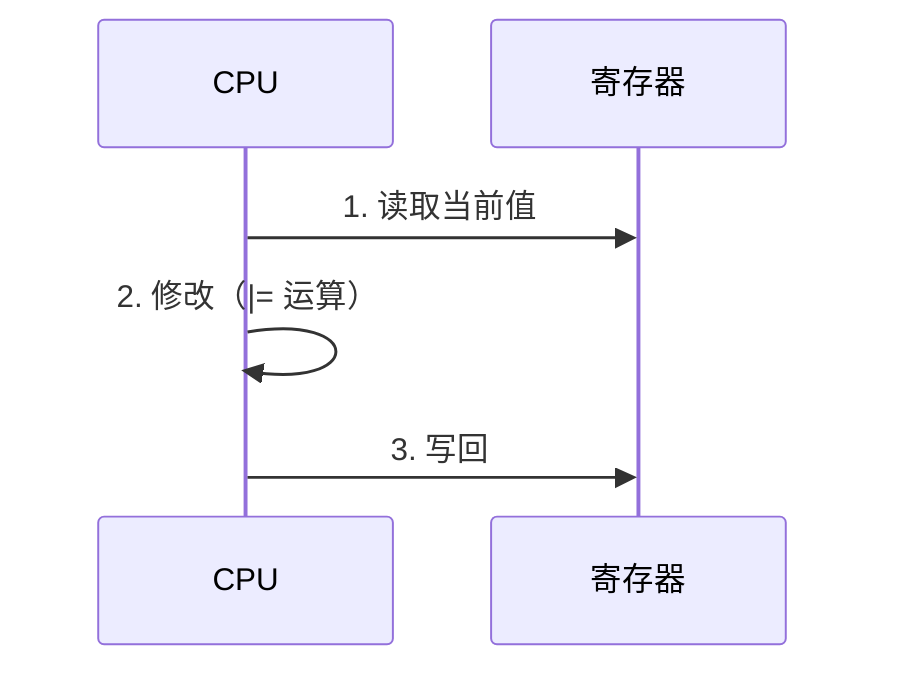
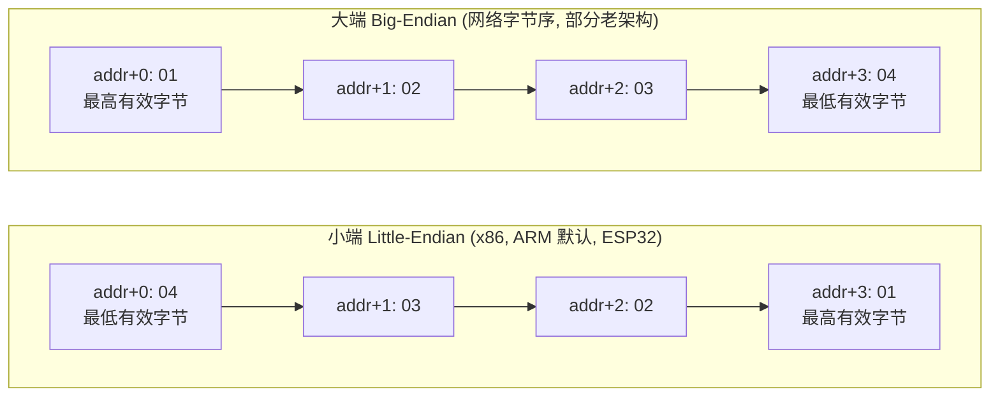

# 02 位域 vs 位掩码
[复合类型页](./aggregate)讲过位域，这里做实战对比。

### 实测回顾

```c
struct BitsWide {
    uint32_t low  : 4;
    uint32_t mid  : 16;
    uint32_t high : 12;
};
```

```text
BitsWide  : size=4
BitsWide packed raw = 0xCDEBEEFA
```

位域确实能紧凑打包——`low=0xA`、`mid=0xBEEF`、`high=0xCDE` 塞进了一个 `uint32_t`。

### 但硬件寄存器必须用掩码

:::danger[寄存器不用位域的三个理由]
1. **布局是实现定义的**——换编译器位序可能变，代码就错了
2. **访问宽度不可控**——编译器可能生成 8 位/16 位访问再合并，而**很多硬件寄存器不支持字节访问**（会触发总线错误）
3. **特殊语义无法表达**——比如"写 1 清零"（W1C）寄存器，用位域写会变成读改写，可能清掉不该清的标志

**硬件寄存器一律用位掩码 + 显式的定宽访问。**
:::

### 对比表

| 维度 | 位域 | 位掩码 |
| --- | --- | --- |
| 硬件寄存器 | **不适用** | **推荐** |
| 纯内存的紧凑标志 | 可以 | 可以 |
| 跨编译器二进制格式 | **不适用** | 可以 |
| 访问宽度控制 | 不可控 | 完全可控 |
| 可读性 | 高 | 中（配合好的宏名也很清晰） |

## 四、寄存器操作：读改写（read-modify-write）

### 内存映射 IO 的写法

硬件寄存器是**固定地址上的内存**。用指针访问：

```c
#define GPIO_BASE      0x3FF44000u
#define GPIO_OUT_REG   (*(volatile uint32_t *)(GPIO_BASE + 0x04u))
```

拆解这个宏：


三个要素缺一不可：

1. **`volatile`**：告诉编译器"这个地址的内容可能被硬件改变，不要优化掉访问"——详见 [嵌入式 C](./embedded)
2. **`uint32_t`**：定宽类型，保证 32 位访问宽度
3. **最外层 `*`**：解引用，让宏用起来像变量

### 实测：完整的寄存器操作

为了能在 PC 上跑，用一个普通变量模拟寄存器：

```c
static uint32_t fake_out = 0x00000000u;
#define FAKE_OUT (*(volatile uint32_t *)&fake_out)

static void set_pin(int pin)     { FAKE_OUT |=  (1u << pin); }
static void clear_pin(int pin)   { FAKE_OUT &= ~(1u << pin); }
static void toggle_pin(int pin)  { FAKE_OUT ^=  (1u << pin); }
static int  read_pin(int pin)    { return (FAKE_OUT >> pin) & 1u; }
```

```text
=== read-modify-write on register ===
after set_pin(2)   : 0x00000004
after set_pin(5)   : 0x00000024
after clear_pin(2) : 0x00000020
after toggle_pin(5): 0x00000000
read_pin(5) = 0
```

每一步都验证了：`set_pin(2)` 置 bit2 → `0x04`；再 `set_pin(5)` → `0x24`（bit2+bit5）；`clear_pin(2)` → `0x20`；`toggle_pin(5)` → `0x00`。

### 读改写的本质与风险

`reg |= (1u << n)` **不是**一条指令，而是三步：



问题：**在这三步之间，寄存器的值可能已经被别人改了**。

```text
初始: reg = 0x00
任务A: 读 reg → 0x00
任务B: 读 reg → 0x00
任务A: 改 → 0x01，写回 → reg = 0x01
任务B: 改 → 0x02，写回 → reg = 0x02   ← 任务A 的修改丢了！
```

这叫**丢失更新（lost update）**。在以下场景会发生：

| 场景 | 后果 |
| --- | --- |
| 主循环和中断同时操作同一寄存器 | 中断里的修改可能被主循环覆盖 |
| 两个 FreeRTOS 任务操作同一寄存器 | 数据竞争 |
| 多核（ESP32 双核） | 两个核同时改 |

:::danger[两个寄存器共享一个 GPIO 端口时最典型]
`set_pin(2)` 和 `set_pin(5)` 都操作**同一个** `GPIO_OUT_REG`。如果它们在中断和主循环里并发执行，就会互相覆盖。

这不是理论问题——这是 GPIO 驱动最常见的 bug 来源之一。
:::

### 解决方案

| 方案 | 原理 | 适用 |
| --- | --- | --- |
| **硬件专用寄存器** | 很多 MCU 提供 `GPIO_OUT_SET` / `GPIO_OUT_CLEAR`（写 1 生效，写 0 无效），只需**单次写**，无读改写 | **首选**，ESP32/STM32 都有 |
| **临界区/关中断** | 操作期间禁止打断 | 单核裸机 |
| **互斥锁** | FreeRTOS 的 `mutex` | 多任务 |
| **原子操作** | `<stdatomic.h>`（C11）的 `atomic_fetch_or` | 内存变量（**不适用于 MMIO 寄存器**） |
| **自旋锁** | ESP32 的 `portENTER_CRITICAL` / `spinlock` | 多核 |

:::tip[优先用硬件提供的原子寄存器]
ESP32 有 `GPIO.out_w1ts`（write 1 to set）和 `GPIO.out_w1tc`（write 1 to clear）：

```c
GPIO.out_w1ts = (1u << pin);   /* 置位：单次写，天然原子 */
GPIO.out_w1tc = (1u << pin);   /* 清位：单次写，天然原子 */
```

STM32 有 `GPIOx->BSRR`（高位清、低位置）。

**这类寄存器只需要一次写操作，不需要"读→改→写"，因此不存在丢失更新。** 这是驱动设计上的最优解。
:::

:::caution[`volatile` 不解决原子性]
`volatile` 只保证"每次都真的去访问内存"，**不保证**这三步是不可分割的。详见 [嵌入式 C](./embedded)。
:::

## 五、字节序（endianness）

### 实测判定

```c
uint32_t e = 0x01020304u;
unsigned char *bytes = (unsigned char *)&e;
printf("bytes in memory order: %02X %02X %02X %02X -> %s\n",
       bytes[0], bytes[1], bytes[2], bytes[3],
       (bytes[0] == 0x04) ? "little-endian" : "big-endian");
```

```text
=== endianness ===
bytes in memory order: 04 03 02 01 -> little-endian
union check host order = 16909060
```

**本机（x86-64）是小端**：`0x01020304` 的最低有效字节 `0x04` 存在**最低地址**。



`16909060` = `0x01020304`——这是把内存按"主机序"重新解释回整数，证明往返一致。

### 什么时候需要关心字节序

| 场景 | 要不要关心 |
| --- | --- |
| 同一台机器上纯内存操作 | **不需要** |
| 网络传输（TCP/IP） | **必须**——网络字节序是大端 |
| 文件格式（PNG、WAV 等） | 必须——格式规定了字节序 |
| 跨设备通信（串口协议、SPI 传感器） | 必须——双方要约定 |
| 直接读写 Flash/EEPROM 的多字节数据 | 必须——换平台要兼容 |
| 访问硬件寄存器 | **查阅手册**——有些外设的寄存器是大端排列 |

:::tip[网络字节序转换]
标准做法是 `<arpa/inet.h>` 的 `htons`/`htonl`/`ntohs`/`ntohl`（POSIX，非标准 C）。

手动实现（实测）：

```c
uint32_t h = 0x01020304u;
uint32_t n2 = ((h & 0x000000FFu) << 24) | ((h & 0x0000FF00u) << 8) |
              ((h & 0x00FF0000u) >> 8)  | ((h & 0xFF000000u) >> 24);
printf("host 0x%08X -> network 0x%08X\n", h, n2);
```

```text
=== htonl-style manual swap ===
host 0x01020304 -> network 0x04030201
```

在小端机器上，`htonl(0x01020304)` = `0x04030201`——字节完全反转。
:::

### 可移植的序列化写法

最稳妥的方式是**不依赖字节序**，逐字节显式组装：

```c
/* 写一个 32 位整数到缓冲区，明确小端格式 */
void put_u32_le(uint8_t *buf, uint32_t v) {
    buf[0] = (uint8_t)(v & 0xFFu);
    buf[1] = (uint8_t)((v >> 8)  & 0xFFu);
    buf[2] = (uint8_t)((v >> 16) & 0xFFu);
    buf[3] = (uint8_t)((v >> 24) & 0xFFu);
}

/* 读回来 */
uint32_t get_u32_le(const uint8_t *buf) {
    return ((uint32_t)buf[0])       | ((uint32_t)buf[1] << 8) |
           ((uint32_t)buf[2] << 16) | ((uint32_t)buf[3] << 24);
}
```

这样**在任何字节序的机器上都得到相同的结果**。协议代码就该这么写。

:::warning[不要直接把结构体写到网络/Flash]
```c
/* 危险 */
struct Msg { uint32_t a; uint16_t b; };
send(fd, &msg, sizeof(msg), 0);   /* 字节序 + padding + 对齐都可能不兼容 */
```

三个问题同时存在：字节序、padding 布局、类型宽度。

**正确做法：显式序列化**（如上），或用 `#pragma pack` + 定宽类型 + 明确的字节序（仍然有风险）。
:::

---

**翻页**：[← 上一页](./bitops-01) · [下一页 →](./bitops-03) · [返回目录](./)
