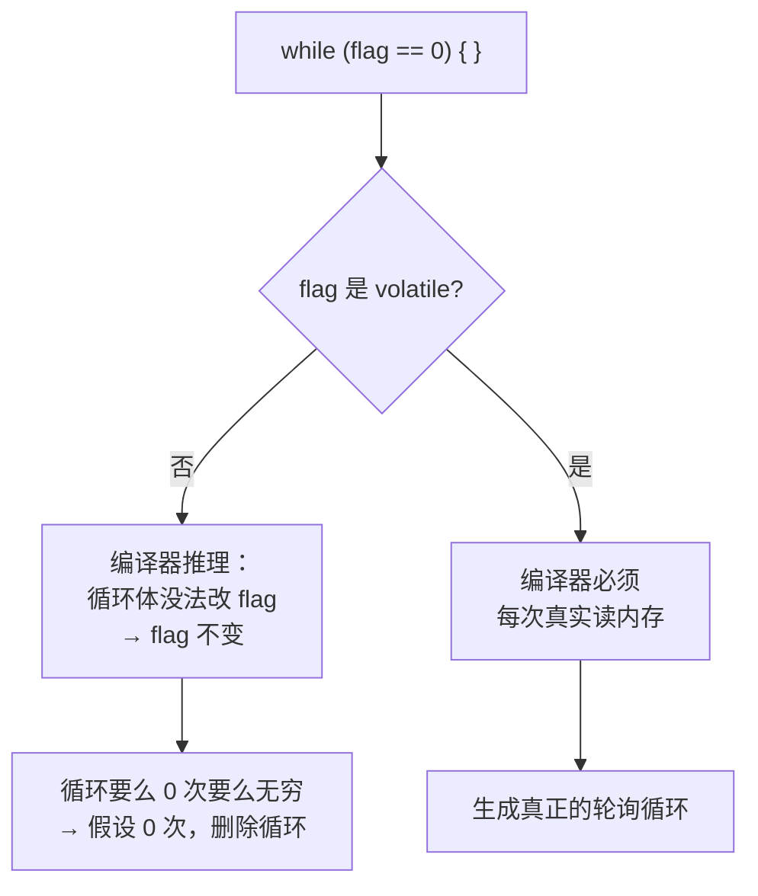

# 01 嵌入式 C 关键
**本页学什么**

- `volatile` **到底保证什么、不保证什么**——用 `-O2` 汇编实测证明
- `const` 在嵌入式的双重含义（只读 vs 放进 Flash）
- 内存映射 IO 的完整写法
- 中断服务程序（ISR）的约束
- 可重入性（reentrancy）
- 栈溢出的成因与检测
- 启动文件与链接脚本的基础

这页把前面所有知识汇合成"能写驱动"的能力。**`volatile` 那节是重点，会用实测汇编证明编译器真的删掉了循环。**

## 一、`volatile` 的真实含义

:::danger[先说结论：`volatile` 不保证原子性，也不保证跨核/跨线程的可见性]
这是 C 语言最大的误解之一。很多人以为 `volatile` 是"线程同步工具"——**它不是**。

`volatile` 只做一件事：**告诉编译器，这个对象的值可能以编译器无法预知的方式被改变，因此每一次读写都必须真实地访问内存，不能被优化掉或重排。**
:::

### 实测证明：编译器真的会删掉循环

```c
#include <stdio.h>

int flag = 0;
volatile int vflag = 0;

void spin_plain(void) {
    while (flag == 0) {
    }
    puts("spin_plain done");
}

void spin_volatile(void) {
    while (vflag == 0) {
    }
    puts("spin_volatile done");
}
```

用 `-O2` 编译成汇编：

```bash
gcc -std=c17 -O2 -S vol.c -o vol.s
```

**非 `volatile` 版本：**

```text
spin_plain:                             # @spin_plain
# %bb.0:
	leaq	.L.str(%rip), %rcx
	jmp	puts                            # TAILCALL
                                        # -- End function
```

**循环被整个删掉了！** 只剩一句"直接调用 `puts`"。

**`volatile` 版本：**

```text
spin_volatile:                          # @spin_volatile
# %bb.0:
	.p2align	4
.LBB1_1:                                # =>This Inner Loop Header: Depth=1
	cmpl	$0, vflag(%rip)
	je	.LBB1_1
# %bb.2:
	leaq	.L.str.1(%rip), %rcx
	jmp	puts                            # TAILCALL
```

**循环保留了**：`cmpl $0, vflag(%rip)` + `je` 跳回自己——真正的轮询。

### 为什么编译器敢删掉第一个循环

编译器的推理是合法的：

1. `flag` 是普通变量，不是 `volatile`
2. 循环体是空的，没有任何代码会改 `flag`
3. 也没有任何"外部可见的副作用"依赖 `flag`
4. 所以：**`flag` 的值在循环期间不可能改变**
5. 因此循环要么永不执行（`flag != 0`），要么永远执行（`flag == 0`，无限循环）
6. 编译器选择"既然进入循环时就要判断一次，那我假设它不为 0"——直接跳过

这不是 bug，是**编译器利用"数据竞争是 UB"这条规则做的合法优化**。



### `volatile` 保证什么

标准（C17 6.7.3p7 附近）的说法是：对 `volatile` 对象的访问，**必须严格按照抽象机器的语义求值**——即：

1. **不被优化掉**：每次读都真的从内存读，每次写都真的写回内存
2. **不被重排**：多个 `volatile` 访问之间的**相对顺序**必须保持
3. **不被合并**：两次连续的 `volatile` 读不能被合并成一次

```c
/* 没有 volatile 会被优化成：一次读，或直接常量折叠 */
uint32_t a = *REG_STATUS;
uint32_t b = *REG_STATUS;   /* 有 volatile：两次真实的读，可能得到不同值 */
```

### `volatile` **不**保证什么

:::danger[四条明确的"不保证"]
1. **不保证原子性**
   `volatile uint32_t counter; counter++;` 仍是非原子的读-改-写（三步）。两个核/中断同时 `++` 会丢失更新。

2. **不保证跨核/跨线程的内存可见性**
   `volatile` 不生成任何**内存屏障（memory barrier）**。在有乱序执行和多级缓存的现代 CPU（包括 **ESP32 的双核 Xtensa**）上：
   - 写操作可能停留在本核的 store buffer 里，另一个核看不到
   - 读操作可能命中过期的 cache line
   - CPU 可能乱序执行相邻的访问

3. **不保证顺序（相对于非 volatile 访问）**
   只保证 `volatile` **彼此之间**的顺序。编译器可以把非 `volatile` 的访问挪到 `volatile` 访问之前或之后。

4. **不解决数据竞争**
   在 C11 内存模型里，`volatile` **不建立 happens-before 关系**。一个线程写 `volatile` 变量、另一个读，仍然是**数据竞争**，仍然是 UB。
:::

:::caution[WG14 自己的文档也承认这一点]
C 标准委员会的文档 **N1956《volatile semantics for lvalues》** 指出：尽管 `volatile` 被广泛用于多线程/硬件访问场景，**C 标准实际上缺乏支撑这个惯用法所需的保证**。

也就是说：`volatile` 在硬件寄存器访问上是有效的（因为编译器确实会生成真实的访存指令），但在**线程同步**上，标准并未给你需要的保证。

**正确的同步工具**：
- 线程/任务间：互斥锁、信号量、条件变量
- 真正的原子操作：C11 的 `<stdatomic.h>`（`atomic_int`、`atomic_fetch_add`）
- 多核/中断共享：临界区（关中断/自旋锁）+ 原子操作
:::

### `volatile` 的正确使用场景

| 场景 | 该用吗 | 说明 |
| --- | --- | --- |
| **内存映射的硬件寄存器** | **该用** | 值由硬件改变，编译器不知道 |
| **被中断服务程序修改的变量** | **该用** | ISR 不在编译器的控制流分析内 |
| **被另一个线程/核修改的变量** | **该用，但不够** | 还需要锁或原子操作 |
| **被 DMA 修改的内存缓冲区** | **该用** | DMA 控制器在 CPU 之外改内存 |
| 普通的线程间标志 | 不该单独用 | 用 `<stdatomic.h>` 或锁 |
| 想让代码"慢一点" | **不该** | 这不是 `volatile` 的用途 |
| 想防止编译器优化掉"无用"代码 | 可以用（但 `asm volatile("")` 更合适） | 基准测试场景 |

### `volatile` 的三种写法

```c
volatile uint32_t *reg;        /* 指针指向 volatile 数据（最常见） */
uint32_t * volatile reg;       /* 指针本身是 volatile */
volatile uint32_t * volatile reg;  /* 都是 */
```

**你要的几乎总是第一种**——"指向 volatile 数据的指针"。寄存器地址本身不变，变的是它指向的内容。

:::tip[看 `volatile` 在 `*` 的哪一侧]
和 `const` 一样的读法：`volatile` 在 `*` **左边** → 数据是 volatile；在 `*` **右边** → 指针本身是 volatile。

`volatile uint32_t *` = `uint32_t volatile *`（等价）
:::

## 二、`const` 在嵌入式里的双重含义

### 含义 1：类型层面的"只读"

```c
const int x = 5;
x = 6;              /* 编译错误 */
int *p = &x;        /* 警告：丢弃 const 限定 */
*p = 6;             /* UB：修改声明为 const 的对象 */
```

这是标准的、所有平台一致的语义。

### 含义 2：实现层面——可能放进 Flash/ROM

在嵌入式上，`const` 的**文件作用域**对象常常被链接器放进 **Flash（只读存储器）** 而不是 RAM。

```c
const uint8_t logo_bitmap[1024] = { ... };   /* 存在 Flash，不占宝贵的 RAM */
```

这在 RAM 只有几十 KB 的 MCU 上是**关键优化**。

:::warning[这是实现行为，不是标准保证]
标准只说"修改它是 UB"，**没说**它必须被放进只读存储器。

是否真的放入 Flash 取决于：
- 编译器和链接器配置
- 目标平台（哈佛架构 vs 冯诺依曼架构）
- 链接脚本

在 **ESP32（Xtensa）** 上：
- 默认的 `const` 全局数据在 Flash 里，通过 cache 映射访问
- 需要放在 DRAM 时必须显式加 `DRAM_ATTR` 或用 `EXT_RAM_ATTR`
- 访问 Flash 里的 `const` 数据比访问 DRAM 慢（走 cache，可能 miss）

在 **STM32（ARM Cortex-M）** 上：`const` 全局数据在 Flash，直接通过 Flash 总线访问。

**如果 ISR 或高频代码要访问 `const` 查表，注意它可能在慢速 Flash 上**——ESP-IDF 提供 `DRAM_ATTR` 强制放 DRAM。
:::

### `const` 与指针的组合（回顾）

| 声明 | 含义 |
| --- | --- |
| `const uint8_t *p` | 指向只读数据（不能改 `*p`，能改 `p`） |
| `uint8_t * const p` | 只读指针（不能改 `p`，能改 `*p`） |
| `const uint8_t * const p` | 都只读 |

**硬件寄存器的"只读"寄存器**就该用第一种：

```c
#define UART_STATUS_REG (*(const volatile uint32_t *)(UART_BASE + 0x1Cu))
```

注意 **`const volatile` 同时出现**——`const` 表示你的代码不该写它，`volatile` 表示它的值会自己变。这两个限定符不冲突，组合使用是合法的且常见的。

## 三、内存映射 IO（MMIO）

### 完整写法

```c
#include <stdint.h>

#define GPIO_BASE        0x3FF44000u
#define GPIO_OUT_REG     (*(volatile uint32_t *)(GPIO_BASE + 0x04u))
#define GPIO_OUT_W1TS    (*(volatile uint32_t *)(GPIO_BASE + 0x08u))  /* write 1 to set */
#define GPIO_OUT_W1TC    (*(volatile uint32_t *)(GPIO_BASE + 0x0Cu))  /* write 1 to clear */
#define GPIO_ENABLE_REG  (*(volatile uint32_t *)(GPIO_BASE + 0x20u))
```

四个要素：

| 要素 | 作用 |
| --- | --- |
| 定宽类型 `uint32_t` | 保证访问宽度是 32 位（**不能**用 `int`，它的宽度不确定） |
| `volatile` | 保证每次真实访存 |
| 地址强制转换 | 整数地址 → 指针 |
| 最外层解引用 | 让宏用起来像变量 |

```c
GPIO_OUT_W1TS = (1u << 5);    /* 置位 GPIO5 —— 单次写，原子 */
GPIO_OUT_W1TC = (1u << 5);    /* 清位 GPIO5 */
uint32_t val = GPIO_OUT_REG;  /* 读 */
```

### 用结构体映射寄存器块

```c
typedef struct {
    volatile uint32_t out;        /* 0x00 */
    volatile uint32_t out_w1ts;   /* 0x04 */
    volatile uint32_t out_w1tc;   /* 0x08 */
    volatile uint32_t enable;     /* 0x0C */
} gpio_dev_t;

#define GPIO ((gpio_dev_t *)0x3FF44000u)

GPIO->out_w1ts = (1u << 5);
```

:::danger[结构体映射必须验证布局]
1. 每个成员都必须是 `volatile`
2. 成员顺序和偏移必须**精确匹配手册**——用 `offsetof` + `_Static_assert` 验证：

```c
_Static_assert(offsetof(gpio_dev_t, out)      == 0x00, "reg offset mismatch");
_Static_assert(offsetof(gpio_dev_t, out_w1ts) == 0x04, "reg offset mismatch");
_Static_assert(sizeof(gpio_dev_t) == 16, "reg block size mismatch");
```

3. **不要用位域**（[位运算页](./bitops)讲过：布局实现定义 + 访问宽度不可控）
4. 不要加 padding —— 上面例子里成员都是 `uint32_t`，天然无 padding。如果手册里有保留地址（reserved），**必须显式写出占位成员**：

```c
typedef struct {
    volatile uint32_t out;
    volatile uint32_t reserved1[3];   /* 0x04-0x0C reserved */
    volatile uint32_t enable;         /* 0x10 */
} gpio_dev_t;
```
:::

:::warning[ESP32 的特殊要求：对齐与非缓存访问]
ESP32 上访问 MMIO 还有额外约束：

- 某些寄存器要求 **32 位对齐的单次访问**，不能拆成字节访问
- 某些场景需要**绕过 cache**（用 `volatile` 不够，需要特殊的地址窗口）
- ESP-IDF 的 `REG_READ`/`REG_WRITE` 宏封装了这些细节

**建议：优先用厂商提供的寄存器定义宏**，自己定义时要仔细对照手册和 SDK 源码。
:::

---

**翻页**：[下一页 →](./embedded-02) · [返回目录](./)
