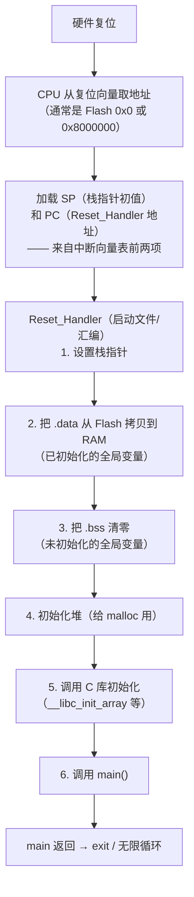

# 03 启动文件与链接脚本
从复位到 `main()` 之间发生了什么？



### 为什么需要这段

C 语言规定：
- 静态存储期对象必须**零初始化**或按初始化器初始化
- 但 **RAM 上电后内容是随机的**

所以必须有一段代码把：

1. **`.data`** 从 Flash（非易失）**拷贝**到 RAM——因为初始值存在 Flash 里
2. **`.bss`** **清零**——[内存页](./memory)说过，静态变量保证是 0

**这段代码在 `main` 之前运行**，通常叫启动文件（`startup_xxx.s`）或 crt0。

:::info[这解释了两个现象]
1. **为什么大 `static` 数组会拖慢启动**——要清零的字节越多，启动越慢
2. **为什么 `main` 里全局变量已经有正确初值**——是启动代码搬的
:::

### 链接脚本（linker script）

链接脚本告诉链接器：**每个段放在哪个地址**。

典型的简化片段：

```text
MEMORY
{
    FLASH (rx) : ORIGIN = 0x08000000, LENGTH = 512K
    RAM   (rwx): ORIGIN = 0x20000000, LENGTH = 128K
}

SECTIONS
{
    .text : { *(.text*) *(.rodata*) } > FLASH
    .data : { *(.data*) } > RAM AT > FLASH    /* 加载地址在 Flash，运行地址在 RAM */
    .bss  : { *(.bss*)  } > RAM
    .stack (NOLOAD) : { . = . + 4K; } > RAM
}
```

三个关键概念：

| 概念 | 含义 |
| --- | --- |
| **VMA**（virtual memory address） | 运行时的地址 |
| **LMA**（load memory address） | 加载时存放的地址 |
| **`AT > FLASH`** | `.data` 的 LMA 在 Flash，VMA 在 RAM |

`.data` 段是**双地址**的：初始值烧录在 Flash 里（LMA），运行时在 RAM 里（VMA）——启动代码负责搬运，它需要的源/目的/长度三个参数由链接脚本导出的符号提供。

:::warning[链接脚本是工具链特定的]
GNU ld、LLVM lld、ARM 的 armlink 各有自己的语法。**本页的例子是 GNU ld 语法**（最通用）。

实际项目里通常用厂商提供的模板（STM32CubeMX 生成、ESP-IDF 提供），只做少量修改。
:::

### ESP32 的特殊之处

ESP32 的链接布局比传统 MCU 复杂：

| 区域 | 用途 |
| --- | --- |
| **IRAM** | 必须常驻的代码（ISR、Flash 驱动本身） |
| **DRAM** | 数据、堆、栈 |
| **Flash（映射）** | 大部分代码和 `const` 数据，通过 MMU + cache 访问 |
| **RTC memory** | 深度睡眠保留的数据 |
| **PSRAM**（外扩） | 大缓冲区，比 DRAM 慢 |

ESP-IDF 用 `DRAM_ATTR`、`IRAM_ATTR`、`EXT_RAM_ATTR` 等宏控制放置，链接脚本由 IDF 提供。

## 常见坑

| 陷阱 | 现象 | 原因 | 正确做法 |
| --- | --- | --- | --- |
| 以为 `volatile` 保证原子 | 计数丢失 | volatile 只是"真实访存" | 用临界区/原子操作/硬件 W1S 寄存器 |
| 以为 `volatile` 能同步线程 | 偶发错乱 | 不建立 happens-before | 用锁或 `<stdatomic.h>` |
| 寄存器忘了 `volatile` | `-O2` 下轮询循环被删 | 编译器认为值不变 | 所有 MMIO 指针加 `volatile` |
| 只读寄存器没加 `const` | 误写导致硬件异常 | 类型不表达意图 | `const volatile uint32_t *` |
| 寄存器用 `int` | 访问宽度错 | `int` 宽度不确定 | 用 `uint32_t` |
| 寄存器结构体用位域 | 换编译器错/访问宽度错 | 布局实现定义 | 用掩码 + `_Static_assert` 验偏移 |
| ISR 里 `printf` | 卡死或丢数据 | printf 可能阻塞/慢 | 用队列交给任务处理 |
| ISR 里调用非 FromISR 的 RTOS API | 崩溃 | 会阻塞 | 用 `xxxFromISR` 版本 |
| ESP32 ISR 没加 `IRAM_ATTR` | Flash 写操作时崩溃 | cache 禁用时代码不可执行 | 加 `IRAM_ATTR`（含其调用的函数） |
| ISR 太长 | 丢中断、延迟高 | 中断被屏蔽 | 只做最少的事，其余交任务 |
| 共享变量只加 `volatile` | 仍丢数据 | 读改写非原子 | 加临界区 |
| 返回静态缓冲区 | 结果被覆盖 | 不可重入 | 调用方提供缓冲区（`xxx_r` 风格） |
| ISR 与主循环共用缓冲区 | 数据错乱 | 逻辑竞争 | 队列/双缓冲/临界区 |
| 大局部数组 | 栈溢出（MCU 上静默） | 栈只有几 KB | 用 `static`/全局/堆 |
| MCU 上深递归 | 栈溢出 | 每帧消耗栈 | 改循环 |
| 用 VLA | 栈用量不可静态分析 | 大小运行时决定 | 禁用（MISRA） |
| 以为 MCU 栈溢出会崩 | 静默破坏数据 | 无 MMU 保护 | 用栈水位监控 + 溢出钩子 |

## 自检清单

- [ ] 能用实测汇编说明 `volatile` 的作用吗？（非 volatile 的循环被整个删除）
- [ ] 能说出 `volatile` **不**保证的四件事吗？
- [ ] 知道为什么 `volatile` 不能用于线程同步吗？正确的工具是什么？
- [ ] 能说出 `volatile` 的四个正确使用场景吗？
- [ ] `volatile uint32_t *` 和 `uint32_t * volatile` 有什么区别？
- [ ] `const volatile` 组合是什么意思？用在什么场景？
- [ ] 能写出完整的 MMIO 寄存器宏吗？四个要素是什么？
- [ ] 用结构体映射寄存器块要注意什么？
- [ ] 能列出 ISR 的六条约束吗？
- [ ] 知道 ESP32 上 `IRAM_ATTR` 的必要性吗？
- [ ] 能解释什么是可重入吗？能举出不可重入的例子吗？
- [ ] 可重入和线程安全是什么关系？
- [ ] 知道 MCU 上栈溢出的表现为什么比 PC 上危险吗？
- [ ] 能说出至少三种栈溢出检测手段吗？
- [ ] 能描述从上电到 `main()` 的启动流程吗？
- [ ] 知道 `.data` 为什么要从 Flash 拷贝到 RAM 吗？什么是 LMA/VMA？

## 下一步

- [未定义行为与陷阱](./pitfalls) —— 把所有 UB 系统收网
- [位运算与寄存器](./bitops) —— 寄存器操作的完整技法
- [内存模型](./memory) —— 栈/堆/静态区的详细布局
- [指针专章](./pointers) —— `volatile` 指针与地址转换
- [回到导读](./)

---

**翻页**：[← 上一页](./embedded-02) · [返回目录](./)
