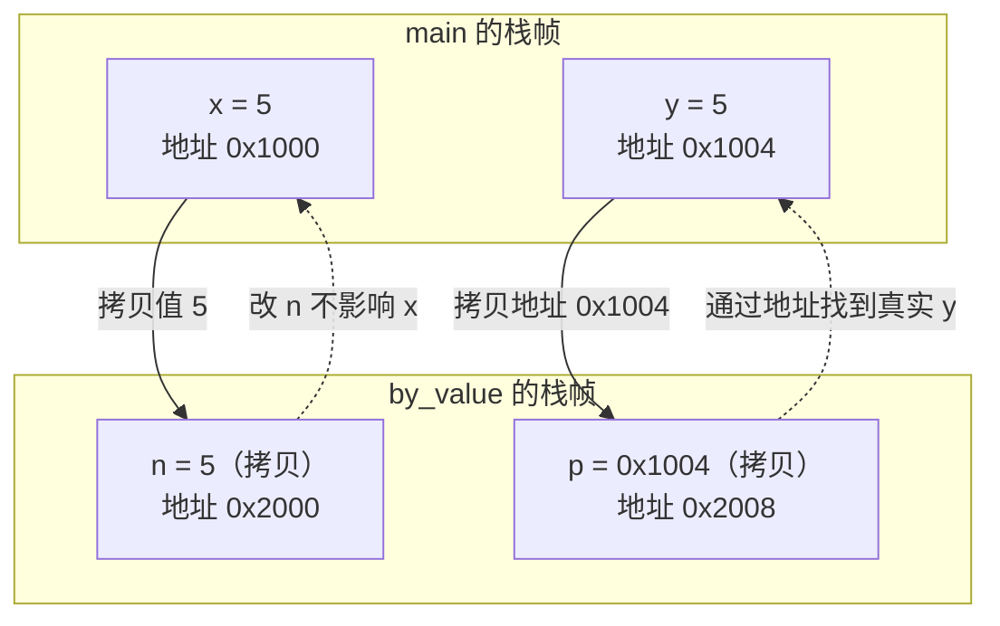
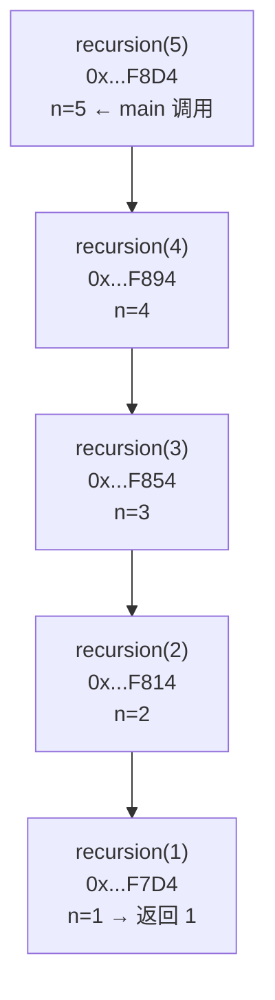

# 01 函数
**本页学什么**

- "值传递"到底拷贝了什么——为什么改不了调用方的变量
- 递归时栈帧的真实地址和每帧开销
- `va_list` 可变参数的原理与**默认实参提升**陷阱
- 作用域、链接属性、`static`/`extern` 的完整规则
- `inline` 的真实语义（C99 和 gcc 的行为差异是个大坑）

函数是"值传递"的，这是 C 唯一的传参方式。理解这句话的真正含义，是理解指针参数、结构体传参、`**` 参数的前提。

## 一、值传递的真相

:::danger[C 只有值传递，没有引用传递]
**C 的每一次函数调用，实参都会被拷贝一份给形参。** 没有例外。

很多人以为"传指针就是引用传递"——**不是**。传指针时，被拷贝的是**指针的值（那个地址）**。正因为你拿到了地址的副本，你才能通过这个地址去修改它指向的那个对象。

关键区分：
- **改不了**：形参变量本身（它是实参的副本）
- **能改**：形参指向的对象（副本和原指针指向同一处）
:::

### 实测

```c
#include <stdio.h>

void by_value(int n, int *p) {
    n = 999;        /* 改的是副本 */
    if (p) *p = 999; /* 改的是 p 指向的对象 */
}

int main(void) {
    int x = 5, y = 5;
    by_value(x, &y);
    printf("x=%d (unchanged)  y=%d (changed via pointer)\n", x, y);
    return 0;
}
```

```bash
gcc -std=c17 -Wall funcs.c -o funcs.exe && ./funcs.exe
```

```text
=== pass by value ===
x=5 (unchanged)  y=999 (changed via pointer)
```

`x` 没变，`y` 变了。差别只在于：**`y` 的地址被传进去了，函数通过那个地址找到了 `y` 本身。**



### 由此推出的一条准则

:::tip[要改什么，就传什么的地址]
| 想修改的东西 | 参数类型 | 调用写法 |
| --- | --- | --- |
| `int` | `int *` | `f(&x)` |
| `int *`（让它指向新内存） | `int **` | `f(&p)` |
| 结构体 | `struct S *` | `f(&s)` |
| 结构体里的某个字段 | 整个结构体指针 | `f(&s)` |
| 只读的大结构体 | `const struct S *` | `f(&s)` |

这条准则解释了为什么 [指针页](./pointers) 里的 `alloc_ok` 要用 `int **`。
:::

### 结构体传参的代价

实测：

```c
struct Big { char buf[64]; };
printf("sizeof(struct Big)=%zu\n", sizeof(struct Big));
```

```text
sizeof(struct Big)=64
```

值传递这个结构体会把 **64 字节**拷到栈上。嵌入式上通常用指针 + `const`：

```c
void process(const struct Big *s);   /* 只拷 8 字节指针，且保证不修改 */
```

:::info[返回值也是值拷贝]
```c
struct Big make(void);
struct Big b = make();   /* 返回值被拷贝 */
```
现代编译器用**返回值优化（RVO）**消除这次拷贝，但标准不保证。大结构体通常用"输出参数"模式代替：

```c
void make(struct Big *out);   /* 调用方提供缓冲区 */
```
这在嵌入式里更常见，因为它**避免了一次拷贝且由调用方控制内存来源**。
:::

## 二、栈帧与递归

每次函数调用会在栈上创建一个**栈帧**（stack frame），存放：返回地址、寄存器保存、局部变量、参数。

### 实测：递归的栈帧地址

```c
#include <stdio.h>

static int depth = 0;

int recursion(int n) {
    depth++;
    int r = (n <= 1) ? 1 : n * recursion(n - 1);
    printf("  depth=%d n=%d &n=%p\n", depth, n, (void *)&n);
    depth--;
    return r;
}

int main(void) {
    printf("fact(5) = %d\n", recursion(5));
    return 0;
}
```

```text
=== recursion stack frames ===
  depth=5 n=1 &n=0000002E0913F7D4
  depth=4 n=2 &n=0000002E0913F814
  depth=3 n=3 &n=0000002E0913F854
  depth=2 n=4 &n=0000002E0913F894
  depth=1 n=5 &n=0000002E0913F8D4
fact(5) = 120
max depth reached = 5
```

注意：

1. **打印顺序是 depth=5 先出现**——因为 `printf` 在递归调用**之后**，最深的帧最先返回并打印
2. **地址递减**：`F8D4 → F894 → F854 → F814 → F7D4`，每层相差 **`0x40` = 64 字节**

**每层递归消耗 64 字节栈空间**（含对齐）。这是本实现本例的具体数字，不同函数不同。



### 栈空间估算

递归的总栈消耗 ≈ 深度 × 每帧大小。

| 场景 | 每帧 | 深度 | 总消耗 |
| --- | --- | --- | --- |
| 本例 `recursion` | 64 B | 5 | 320 B |
| 本例深度 1000 | 64 B | 1000 | 64 KB |
| 带 1KB 局部数组的递归 | ~1 KB | 1000 | **1 MB** ← 爆栈 |

:::danger[嵌入式上避免深递归]
FreeRTOS 任务栈典型只有 **2~8 KB**。一个带 256 字节局部数组的函数，递归 20 层就用掉 5 KB。

**准则**：
1. MCU 上递归深度必须**可证明有界**（最好写成循环）
2. 不在递归函数里放数组/大结构体
3. 用 `uxTaskGetStackHighWaterMark()` 实测栈水位

栈溢出的后果见 [内存页](./memory)——MCU 上没有保护，会静默破坏数据。
:::

### 尾递归不算优化保证

```c
int fact_tail(int n, int acc) {
    return (n <= 1) ? acc : fact_tail(n - 1, acc * n);   /* 尾递归 */
}
```

理论上尾递归可以复用栈帧（尾调用优化），但 **C 标准不保证**。gcc/clang 在 `-O2` 下通常会做，但**不能依赖**——嵌入式上要自己写成循环。

## 三、可变参数 `va_list`

### 用法

```c
#include <stdarg.h>

int sum_all(int count, ...) {
    va_list ap;
    va_start(ap, count);
    int total = 0;
    for (int i = 0; i < count; i++) {
        total += va_arg(ap, int);
    }
    va_end(ap);
    return total;
}
```

实测：

```text
=== va_list ===
sum_all(4, 1,2,3,4) = 10
sum_all(2, 10,20)   = 30
sizeof(va_list)=8
```

要点：

1. **至少需要一个具名参数**（这里是 `count`），`va_start` 需要它定位后续参数的起始位置
2. **`va_arg(ap, TYPE)` 必须传入正确的类型**——`va_list` 里**没有任何类型信息**，你告诉它什么类型它就按什么类型读。传错类型是 UB
3. **`va_start` 必须和 `va_end` 配对**，且在同一个函数内
4. `va_list` 可以拷贝（C99 有 `va_copy`），用于多次遍历

:::warning[可变参数没有类型检查]
编译器**不会**检查你传的实参类型是否匹配 `va_arg` 的类型。

```c
printf("%d", 3.14);   /* UB：%d 期待 int，实际是 double */
```

这就是 `printf` 格式串错误如此危险的原因。gcc/clang 有 `-Wformat` 专门检查**已知的**格式函数，自定义的可变参数函数可以用 `__attribute__((format(printf, 1, 2)))` 获得同样检查。

**嵌入式建议**：`-Werror=format` 加上，ESP-IDF 大量使用 `ESP_LOGx` 宏（内部是 `printf` 家族）。
:::

### 默认实参提升（default argument promotions）

**这是可变参数最容易踩的坑。**

对于可变参数部分（即 `...` 对应的实参），会先做**默认实参提升**：

- 比 `int` 窄的整型（`char`、`short`、位域、`enum`）→ 提升为 **`int`**（或 `unsigned int`）
- `float` → 提升为 **`double`**

实测：

```text
=== default argument promotion ===
(char)'A' promoted to int: 65
float promoted to double: sizeof(1.5f in vararg)=8 vs sizeof(float)=4
promoted value = 1.5
```

:::danger[所以 `va_arg` 里永远不该写 `float` 或 `char`]
```c
/* 错误 */
float f = va_arg(ap, float);    /* UB！实际传进来的是 double */
char  c = va_arg(ap, char);     /* UB！实际传进来的是 int */

/* 正确 */
double d = va_arg(ap, double);
int    i = va_arg(ap, int);
```

`float` 被提升成 `double`（8 字节），你按 `float`（4 字节）读，不仅值错，后续所有参数的偏移全乱了。
:::

### 转发可变参数：`vprintf` 系列

要写一个自己的 `printf` 包装，用 `v` 版本：

```c
#include <stdarg.h>
#include <stdio.h>

void my_printf(const char *fmt, ...) {
    va_list ap;
    va_start(ap, fmt);
    vprintf(fmt, ap);      /* 把 va_list 交给 vprintf */
    va_end(ap);
}
```

实测：

```text
my_printf: a=1 ok
```

`printf`/`vprintf`、`sprintf`/`vsprintf`、`snprintf`/`vsnprintf` 都是这样的配对。

:::tip[嵌入式日志系统的标准写法]
ESP-IDF 的 `ESP_LOGI` 等宏最终都汇聚到 `esp_log_write`，内部用 `vprintf` 类函数。自己封装日志时：

```c
void log_impl(const char *tag, const char *fmt, ...) {
    va_list ap;
    va_start(ap, fmt);
    printf("[%s] ", tag);
    vprintf(fmt, ap);
    va_end(ap);
}
```

注意 `va_list` **只能遍历一次**——需要遍历两次就用 `va_copy`（C99）。
:::

---

**翻页**：[下一页 →](./functions-02) · [返回目录](./)
