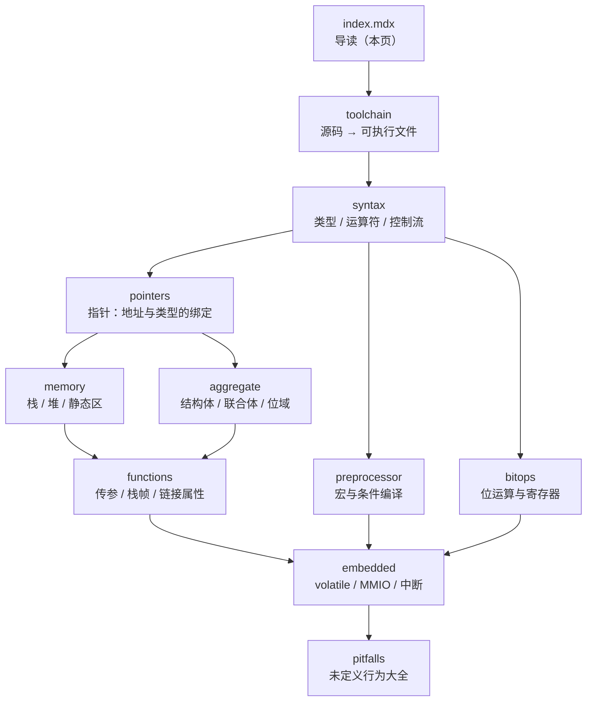

# C 语言主线

**这条线解决一个问题：让你有能力读懂并修改 ESP32 / STM32 的驱动源码。**

C 不是"更好写的语言"，它是**离机器最近的可移植语言**。你在 C 里写的每一个变量、每一次赋值，都直接对应内存里的一段字节和几条机器指令。这种"所见即所得"正是嵌入式的刚需——因为你要操作的是寄存器，而寄存器就是一个固定地址上的 32 个 bit。

本站主打分硬件（[硬件开发](../../hardware/)），而硬件的地基是 C。你会在 ESP-IDF 里看到大量这样的代码：

```c
#define GPIO_OUT_REG  (*(volatile uint32_t *)(GPIO_BASE + 0x04))
```

看懂这行需要同时理解：宏、指针类型转换、`volatile`、定宽整型、内存映射 IO。**这五个东西分散在本线的五个页面里**——这就是这条主线存在的理由。

## 本页学什么

- 这条线的 11 个页面分别解决什么，按什么顺序读
- 为什么嵌入式必须把 C 学"深"而不是学"快"
- 本站的实测环境是什么，你该怎么复现每一个实验
- 学习路线的取舍建议

## 为什么 C 要学到"通透"才够用

大部分教程教你"能跑起来就行"。在应用层开发里这够了，在嵌入式里不够：

| 场景 | 只学"能跑"你会怎样 | 学"通透"你能怎样 |
| --- | --- | --- |
| 结构体指针传给驱动 | 传错了编译照样过，运行时数据错位 | 一眼看出对齐和生命周期问题 |
| 中断里改一个全局变量 | 偶尔丢数据，查三个月查不出来 | 立刻知道缺 `volatile` 和临界区 |
| 读芯片手册配寄存器 | 照抄例程，换个引脚就失效 | 自己算出掩码，任意引脚都能配 |
| 程序跑飞、HardFault | 只能重启、烧录、猜 | 用栈帧和符号表定位到行 |
| 内存越来越少直到死机 | 怀疑芯片坏了 | 用 ASan 或堆水位定位泄漏点 |

**关键区别**：嵌入式里的 bug 往往不是"报错"，而是"偶尔不对"。这种 bug 只能靠理解原理来预防，靠调试技巧来定位——两者都需要你真正懂内存模型。

## 11 个页面的阅读顺序



顺序背后的逻辑：

1. **toolchain → syntax**：先知道代码怎么变成机器指令，再看语法，就不会把"编译报错"当成玄学
2. **pointers 是分水岭**：指针没过，后面全卡住。过了指针，内存和结构体是自然延伸
3. **aggregate 放在 memory 之后**：结构体的 padding 本质是对齐问题，得先有内存布局的直觉
4. **bitops 和 embedded 是本线的落点**：前面所有知识在这两页汇合成"能写驱动"
5. **pitfalls 放最后**：它是对前 10 页的复盘——未定义行为散落在每一页，最后统一收网

:::tip[如果你只想挑几页读]
时间紧的话，优先级是 **pointers → memory → bitops → embedded**。这四页覆盖了嵌入式 80% 的实际需求。但 `pitfalls` 建议你一定读——它解释的是那些"查不出来"的 bug。
:::

## 页面一览

| # | 页面 | 核心问题 | 学完的标志 |
| --- | --- | --- | --- |
| 2 | [从源码到可执行文件](./toolchain) | `gcc main.c` 到底干了什么 | 能看懂 `nm` 输出的符号表，能自己打包静态库 |
| 3 | [语法基础](./syntax) | 类型到底占几个字节 | 不用查表就知道 `size_t`、`uint32_t` 该用哪个 |
| 4 | [指针专章](./pointers) | 指针和地址是什么关系 | 能解释为什么 `p + 1` 加的不是 1 |
| 5 | [内存模型](./memory) | 变量存在哪里，何时失效 | 能画出栈/堆/静态区，知道每种指针什么时候悬垂 |
| 6 | [复合类型](./aggregate) | 结构体为什么比预期大 | 能重排成员省内存，能算位域布局 |
| 7 | [函数](./functions) | 参数是怎么传进去的 | 能解释为什么改不了调用方的变量 |
| 8 | [预处理器](./preprocessor) | 宏展开后是什么 | 能预判宏的坑，会用 X-Macro |
| 9 | [位运算与寄存器](./bitops) | 怎么只改一个 bit | 能对着手册算出任意寄存器的掩码 |
| 10 | [嵌入式 C 关键](./embedded) | `volatile` 到底保证什么 | 知道 `volatile` **不**保证原子性，知道 ISR 的约束 |
| 11 | [未定义行为与陷阱](./pitfalls) | 哪些写法是"未定义" | 见到就能认出 UB，会用 UBSan/ASan 验证 |

## 关于"实测输出"

本站的每一个结论都尽量在本机编译运行过，输出**原样粘贴**。这是本线区别于普通教程的核心价值——你会看到真实的大小、真实的地址、真实的报错原文。

### 实测环境

```bash
gcc --version
```

```text
clang version 23.1.1 (https://github.com/llvm/llvm-project.git 6dfe1677ab8dffbc6ec13d53a1e0215d75147689)
Target: x86_64-w64-windows-gnu
Thread model: posix
InstalledDir: C:/Users/chq20/AppData/Local/Microsoft/WinGet/Packages/MartinStorsjo.LLVM-MinGW.UCRT_Microsoft.Winget.Source_8wekyb3d8bbwe/llvm-mingw-20260908-ucrt-x86_64/bin
```

```bash
gcc -dumpmachine
```

```text
x86_64-w64-windows-gnu
```

:::warning[你的机器可能不一样]
这是 **Windows x86-64 的 MinGW (UCRT) 环境**，和你的结果可能有三处差异：

1. **数据模型**：Windows x86-64 是 **LLP64**，`long` 是 4 字节；Linux/macOS x86-64 是 **LP64**，`long` 是 8 字节。涉及 `long` 的结论要重新实测
2. **目标文件格式**：MinGW 产出 **PE/COFF**，Linux 产出 **ELF**。所以 `readelf -h` 在这里报 `Format: COFF-x86-64`，动态库是 `.dll` 而不是 `.so`
3. **编译器版本**：不同版本的优化和报错措辞不同

**所有地址值每次运行都可能变**（ASLR），但偏移量、大小、差值是可复现的。教程里引用地址时关注的是相对关系，不是绝对值。
:::

### 怎么复现

每个页面的代码块都是可以直接保存编译的。以 Linux 或 Windows 为例：

```bash
# 保存代码为 probe.c 后
gcc -std=c17 -Wall -Wextra probe.c -o probe
./probe
```

嵌入式交叉编译时把 `gcc` 换成 `xtensa-esp32-elf-gcc` 或 `arm-none-eabi-gcc` 即可——**语言层面的结论完全一致**，只有目标格式和库不同。

:::info[本站推荐的固定编译选项]
教程里默认用 `-std=c17 -Wall -Wextra`：

- `-std=c17`：明确指定 C17 标准，避免编译器用默认方言掩盖问题。**C17 是 C11 的缺陷修正版，没有新增语言特性**
- `-Wall -Wextra`：打开常用警告。嵌入式开发里警告应该当成错误处理

更严格的做法是加 `-Werror -Wpedantic`，把警告升级为错误。
:::

## C 标准的三个版本要分清

教程里会频繁出现版本标注，先在这里说清楚：

| 版本 | 年份 | 关键特性 | 现状 |
| --- | --- | --- | --- |
| C99 | 1999 | `//` 注释、混合声明、`stdint.h`、`long long`、柔性数组成员、`restrict`、变长数组 | 嵌入式广泛支持 |
| C11 | 2011 | `_Static_assert`、`_Generic`、`<stdatomic.h>`、`<threads.h>`、匿名结构体/联合体 | 主流，ESP-IDF 常用 |
| C17 | 2017 | **无新增语言特性**，只是 C11 的缺陷修正（DR 报告） | 事实上的默认值 |
| C23 | 2023 | `static_assert` 去掉下划线、`typeof`、`constexpr`、`nullptr`、`bool` 成为关键字 | 工具链支持还不普及 |

:::caution[最容易记错的一条]
`_Static_assert` 是 **C11** 引入的关键字；`static_assert`（不带下划线）是 **C23** 才有的。C11/C17 里 `static_assert` 只是 `<assert.h>` 提供的一个宏，展开成 `_Static_assert`。写代码时用 `_Static_assert` 最稳妥。
:::

## 三条学习原则

### 1. 先预测，再运行

看到示例代码时，**先在脑子里算出输出，再运行对照**。预测错了就是最宝贵的学习时刻——说明你的模型是错的。

这条比多读三倍内容有用。

### 2. 每个"为什么"都要追到内存层面

不要停在"`p + 1` 指向下一个元素"。要问：为什么加的是 4 而不是 1？答案是**指针的算术单位由被指向类型的大小决定，这是编译期就绑定的**。追到这一层，多级指针、数组传参退化、结构体对齐全都会通。

### 3. 区分"标准规定的""实现定义的""未定义的"

这是本线贯穿始终的分类法：

| 类别 | 含义 | 例子 | 能不能依赖 |
| --- | --- | --- | --- |
| **标准规定** | 所有符合标准的实现都必须如此 | `sizeof(char) == 1`；无符号整数回绕 | 可以 |
| **实现定义** | 标准允许不同，但实现必须**文档化**且**自洽** | `char` 有无符号；`int` 的大小；右移负数是算术还是逻辑 | 可以在**特定平台**依赖，但要写 `_Static_assert` 守住 |
| **未指定** | 标准给了几个选项，实现不必文档化 | 函数实参求值顺序；结构体 padding 字节数 | 不能依赖具体值 |
| **未定义 (UB)** | 标准没有任何要求，编译器可以**做任何事** | 有符号溢出、越界访问、悬垂指针、序列点违规 | **绝对不能依赖** |

:::danger[UB 不是"结果不确定"，是"程序不再有意义"]
很多人把 UB 理解成"会得到一个奇怪的值"。实际上更严重：**编译器有权假设 UB 永不发生**，并基于这个假设做优化。所以一个 UB 程序可能在你调试时正常，加了 `-O2` 后行为完全不同，甚至让**之前已经执行过的代码**表现异常。

本站的 [未定义行为专页](./pitfalls) 会用 UBSan 的实测输出证明这一点。
:::

## 常见坑

| 陷阱 | 现象 | 原因 | 正确做法 |
| --- | --- | --- | --- |
| 把本站地址当绝对值 | 自己跑出来地址对不上 | ASLR 让栈/堆地址每次运行都变 | 只比对**偏移量和差值**，不比对绝对地址 |
| `long` 当 8 字节用 | 从 Linux 教程抄代码到 Windows 出错 | Windows 是 LLP64，Linux 是 LP64 | 用 `stdint.h` 的 `int64_t` / `uint64_t` |
| 编译不加 `-Wall` | 明显 bug 静默通过 | 默认警告级别很低 | 固定用 `-Wall -Wextra`，量产加 `-Werror` |
| 不指定 `-std=` | 换台机器编译行为就变 | 编译器默认方言可能不同（gnu17 / gnu23） | 显式写 `-std=c17` |
| 以为 `sizeof` 是函数 | 写 `sizeof(int)` 能过就以为它是函数 | `sizeof` 是**运算符**，作用于类型时**才**需要括号 | `sizeof x` 合法；`sizeof(int)` 的括号是类型名的一部分 |
| 把警告当噪音 | 放过 `-Wuninitialized` 继续写 | 警告往往是真 bug 的第一个信号 | 逐条读警告，读懂再决定要不要忽略 |
| 混合复制不同教程的宏 | 展开结果和预期不符 | 宏是纯文本替换，没有类型和作用域 | 用 `gcc -E` 看真实展开结果 |

## 自检清单

读完本页，你应该能回答：

- [ ] 为什么嵌入式开发必须把 C 学到"内存模型"这一层，而不是"能跑就行"？
- [ ] 这条线 11 个页面的推荐阅读顺序是什么？为什么 `pointers` 是分水岭？
- [ ] 本站的实测环境是什么数据模型（LLP64 还是 LP64）？`long` 几个字节？
- [ ] "标准规定""实现定义""未指定""未定义"四类行为的区别是什么？各举一个例子
- [ ] `_Static_assert` 是哪个标准引入的？`static_assert` 呢？
- [ ] 复现本线实验的固定编译选项是什么？为什么必须显式指定 `-std=`？
- [ ] 为什么教程里的地址不能当绝对值对照？应该对照什么？

## 下一步

按推荐顺序开始：

1. [从源码到可执行文件](./toolchain) —— 先搞懂 `gcc` 干了什么
2. [语法基础](./syntax) —— 类型系统是最容易埋雷的地方
3. [指针专章](./pointers) —— 分水岭，过不去后面全卡住

其他相关主线：

- 想先建立编程直觉 → [Python 主线](../python/)
- 有 C 基础想学现代抽象 → [C++ 主线](../cpp/)
- 想直接玩板子 → [硬件开发](../../hardware/)
- 想看本站的速查资料 → [速查表](../../reference/)

---

**本线全部页面**：[导读](./) · [工具链](./toolchain) · [语法](./syntax) · [指针](./pointers) · [内存](./memory) · [复合类型](./aggregate) · [函数](./functions) · [预处理器](./preprocessor) · [位运算](./bitops) · [嵌入式 C](./embedded) · [陷阱](./pitfalls)
