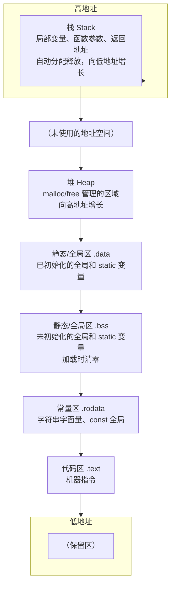

# 01 内存模型
**本页学什么**

- C 程序的四个内存区域，以及**用真实地址证明**它们确实分开
- 每种存储期（automatic / static / allocated）对应的区域和失效时机
- `malloc`/`free` 背后真正在发生什么（arena、brk、mmap）
- 内存对齐与 padding 的成因和实测
- 内存泄漏、double free、use-after-free 的成因与检测

这页决定你能不能回答一个关键问题：**这个指针现在还有效吗？**

## 一、四个区域


栈向**低地址**增长、堆向**高地址**增长，两者相向而行——这也是为什么无限递归（栈溢出）和无限 malloc（堆耗尽）会从两端把可用空间吃光。



:::warning[这个图是典型布局，不是标准要求]
**C 标准完全没有规定内存区域的布局**——它只规定了**存储期**（storage duration），不规定这些对象放在哪里。

上图是主流平台（Linux/Windows + gcc/clang）的实际布局，但具体排列因平台、ASLR、线程数而异。**嵌入式上差异更大**：ESP32 有 IRAM/DRAM/Flash 映射区之分，STM32 的 `.data` 从 Flash 加载到 RAM。

本页所有地址都是**本机实测**，你的机器会不同（ASLR），但**相对关系和差值**是可复现的。
:::

### 与上一页的对应

[工具链页](./toolchain)里 `size` 命令输出的 `text`/`data`/`bss` 三段，就是这里的：

- `text` → 代码区
- `data` → 静态区的已初始化部分
- `bss` → 静态区的未初始化部分（**不占文件空间**，加载时由系统清零）

## 二、实测：四个区域的真实地址

```c
#include <stdio.h>
#include <stdlib.h>

int g_init = 42;          /* .data */
int g_zero;               /* .bss */
static int g_static = 7;  /* .data */
const int g_const = 99;   /* .rodata */

int main(void) {
    int stack_var = 1;             /* 栈 */
    static int s_local = 5;        /* .data（注意！static 局部变量不在栈上） */
    int *heap = malloc(sizeof(int));
    char *lit = "abc";             /* .rodata */

    printf("stack_var %p\n", (void *)&stack_var);
    printf("heap      %p\n", (void *)heap);
    printf("g_init    %p\n", (void *)&g_init);
    printf("g_zero    %p\n", (void *)&g_zero);
    printf("g_const   %p\n", (void *)&g_const);
    printf("s_local   %p\n", (void *)&s_local);
    printf("literal   %p\n", (void *)lit);
    printf("main      %p\n", (void *)&main);
    free(heap);
    return 0;
}
```

```bash
gcc -std=c17 -Wall layout.c -o layout.exe && ./layout.exe
```

```text
=== segment addresses ===
stack_var 0000009B612FFC18
heap      00000233C7141360
g_init    00007FF732585000
g_zero    00007FF732585078
g_const   00007FF732583078
s_local   00007FF732585004
literal   00007FF73258307C
main      00007FF732581460
```

分组看：

| 地址前缀 | 区域 | 变量 |
| --- | --- | --- |
| `0000009B6...` | **栈** | `stack_var` |
| `00000233C...` | **堆** | `heap` |
| `00007FF732585...` | **静态区 `.data`** | `g_init`、`g_zero`、`s_local` |
| `00007FF73258**3**...` | **常量区 `.rodata`** | `g_const`、`literal` |
| `00007FF732581...` | **代码区 `.text`** | `main` |

三条实测结论：

1. **栈和堆离得非常远**（`0000009B6` vs `00000233C`），中间是巨大的未使用地址空间
2. **`static` 局部变量 `s_local` 在静态区，不在栈上**——它和全局变量 `g_init` 紧挨着（`...5000` 和 `...5004`）。这直接证明了 "static 改变存储期"
3. **`g_const` 和字符串字面量 `literal` 在常量区**（`...3078` 和 `...307C` 相邻），且与 `.data` 区（`...5000`）分开

:::info[`const` 局部变量不在此列]
注意这里是**文件作用域**的 `const`。函数内的 `const int x = 5;` 通常在栈上（可能被优化成立即数），只是"不能写"而已，不在 `.rodata`。

是否真的落到 `.rodata` 是实现细节：标准只说"修改它是 UB"。
:::

### 实测：栈向低地址增长

```c
void g(int d) {
    int local;
    printf("depth %d: &local=%p\n", d, (void *)&local);
    if (d < 4) g(d + 1);
}
int main(void) { int m; printf("main &m=%p\n", (void *)&m); g(1); return 0; }
```

```text
main &m=0000002ED3EFFD48
depth 1: &local=0000002ED3EFFD10
depth 2: &local=0000002ED3EFFCE0
depth 3: &local=0000002ED3EFFCB0
depth 4: &local=0000002ED3EFFC80
```

地址**递减**：`FD48 → FD10 → FCE0 → FCB0 → FC80`。每深一层，地址减少 `0x38`（56）或 `0x30`（48）字节——这就是栈帧大小。

**栈向低地址增长**是 x86/ARM/RISC-V 的普遍做法（但标准没规定，也有向高地址增长的架构）。这解释了为什么"数组越界写"可能覆盖其他局部变量——越界是往高地址走，会踩到先入栈的变量。

## 三、三种存储期

标准规定了**四种存储期**，对应不同的生命周期和区域：

| 存储期 | 声明方式 | 所在区域 | 生命周期 | 初值 |
| --- | --- | --- | --- | --- |
| **自动** (automatic) | 块内非 `static` 变量 | 栈 | 进入块 → 离开块 | **未初始化**（垃圾值） |
| **静态** (static) | 文件作用域变量，或 `static` 局部变量 | `.data` / `.bss` | 程序开始 → 程序结束 | **零初始化** |
| **线程** (thread) | `_Thread_local`（C11） | 每线程一份 | 线程开始 → 线程结束 | 零初始化 |
| **分配** (allocated) | `malloc`/`calloc`/`realloc` | 堆 | `malloc` → `free` | **未初始化**（`calloc` 除外） |

### 最容易记错的两条

:::caution[1. 静态存储期一定零初始化]
```c
int g;              /* 一定是 0，不是垃圾值 */
static int s;       /* 一定是 0 */
static char buf[100]; /* 全部是 0 */
```
这是**标准保证**的。而自动存储期的局部变量**不初始化**——读它是 UB（读未初始化值）。

实测编译器会警告：
```text
warning: variable 'x' is uninitialized when used here [-Wuninitialized]
```

**不要把"零初始化"当免费午餐在嵌入式上滥用**——一个大 `static` 数组需要在启动时被清零，这个时间计入启动耗时。
:::

:::caution[2. `static` 局部变量只在第一次执行时初始化一次]
```c
void counter(void) {
    static int n = 0;   /* 只执行一次！不是每次调用都置 0 */
    n++;
    printf("%d\n", n);
}
/* 连续调用输出 1 2 3 4 ... */
```

而且 C 规定 `static` 局部变量的初始化器必须是**常量表达式**（不能用运行时值）。
:::

### 生命周期速查：什么时候指针失效

| 指针指向 | 何时失效 | 典型错误 |
| --- | --- | --- |
| 栈上的局部变量 | 函数返回 | 返回局部变量地址 |
| 栈上的数组 | 离开块 | 返回数组首元素地址 |
| `static` 变量 | **永不失效**（程序结束前） | 无（但要注意可重入） |
| 字符串字面量 | **永不失效** | 试图修改它（UB） |
| `malloc` 的内存 | `free` 之后 | use-after-free |
| 结构体成员 | 结构体本身失效时 | 持有已释放结构体的成员指针 |

---

**翻页**：[下一页 →](./memory-02) · [返回目录](./)
