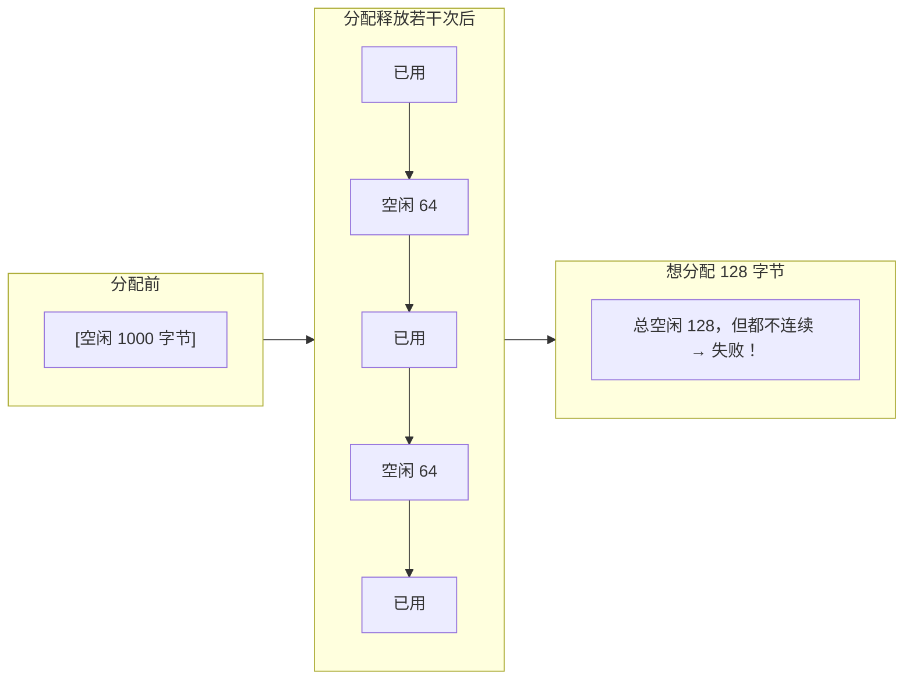

# 02 `malloc` / `free` 的实现原理
### 标准只规定接口，不规定实现

C 标准只说：`malloc(n)` 返回至少 `n` 字节**对齐到任何基础类型**的空间，失败返回 `NULL`；`free` 归还它。**内部怎么做完全是实现的事**。

下面讲 glibc 的做法（Linux 事实标准），Windows 的 CRT 堆原理类似但实现不同。

### 两个系统调用：`brk` 和 `mmap`

glibc 的 `malloc` 从操作系统要内存有两条路：


:::info[为什么分两条路]
- **`brk`**：抬高"程序断点"，线性扩展堆区。快，但**只能从顶部收缩**——如果堆中间有一块还在用，顶部就降不下来。这就是为什么程序 `free` 了大量内存后，RSS（实际占用物理内存）常常不下降
- **`mmap`**：每次要一块独立的映射区域，`free` 时立刻 `munmap` 归还。**大块内存走这条路**，避免"一块小的没释放导致几 MB 堆降不下去"

`MMAP_THRESHOLD` 默认 128KB，且是**动态调整**的：一旦有一块 mmap 来的内存被 free，阈值会调到那块的大小（上限 32MB）。
:::

### 实测：大块分配的地址行为

```c
void *a = malloc(64);
void *b = malloc(64);
void *c = malloc(64);
void *big1 = malloc(1024 * 1024);
void *big2 = malloc(1024 * 1024);
```

```text
=== heap growth direction ===
a=000002638AFD1500
b=000002638AFD1730
c=000002638AFD17D0
b-a=560  c-b=160

=== large allocation (mmap threshold) ===
big1=000002638B1A6040
big2=000002638B2BB040
big2-big1=1134592
```

注意：**小块 `a`、`b`、`c` 彼此相差几百字节**（同一个 arena 内连续切分，但注意 `b-a=560` 说明中间还有别的东西——这是 ASan 关闭时 CRT 堆自己的布局，含分配器元数据和对齐）。

**两个 1MB 大块相差 1134592 字节**（约 1.08 MB），而且和 `a/b/c` 完全不在同一区域——这是独立的映射区域。

:::warning[本机是 Windows CRT 堆，不是 glibc]
本页实测环境是 **Windows MinGW (UCRT)**，它的堆管理器用的是 Windows 的 `HeapAlloc`/`VirtualAlloc`，**不是 glibc 的 `brk`/`mmap`**。所以：

- 上面的 `brk`/`mmap` 机制是 **glibc（Linux）** 的行为，作为原理讲解
- 实测输出是 **Windows CRT 堆**的行为
- 两者的**共同点**是：小块从一个预分配的区域切分，大块走独立映射——这个设计思想是通用的

在 **ESP32 上情况又不同**：ESP-IDF 有自己的 heap 实现（`heap_caps_malloc`），区分 DRAM/IRAM/PSRAM，没有操作系统提供 `brk`，而是启动时把一段静态划定的内存交给 heap 管理。详见 [嵌入式 C](./embedded)。
:::

### `malloc` 返回的比你请求的多

实测（Windows CRT）：

```text
request   1 -> ptr 000002638AFD0E10
request   2 -> ptr 000002638AFD0E10
request   4 -> ptr 000002638AFD0E10
request   8 -> ptr 000002638AFD0E10
request  16 -> ptr 000002638AFD9280
```

关键观察：**请求 1/2/4/8 字节时，free 后重新分配得到了同一个地址 `...0E10`**——说明分配器有一个最小粒度（通常 16 字节或 32 字节，加上对齐要求）。

每个块前面还有**元数据**（chunk header，记录大小和标志），这部分对用户不可见。所以：

```c
void *p = malloc(1);
/* 实际消耗可能是 16 字节头 + 对齐到 16 的倍数 */
```

:::danger[这就是为什么嵌入式要小心小对象]
在 ESP32 上频繁 `malloc(8)` 会浪费大量内存：每个块有 8 字节头 + 对齐填充。1000 个 8 字节对象可能吃掉 16KB 而不是 8KB。

**嵌入式准则**：能用静态数组或内存池就不用 `malloc`；必须用时，尽量**少量、大块、长期**分配，避免频繁的小块分配释放（会碎片化）。
:::

### 内存碎片



**外部碎片**：总空闲量够，但没有一块连续的够大。长时间运行的嵌入式设备最终死机，往往就是这个原因——不是泄漏，是碎片。

对策：
- 用**固定大小的内存池**（FreeRTOS 的 `heap_4.c` 有合并算法缓解，`heap_1.c`/`heap_2.c` 更简单）
- 避免在长时间运行的代码路径上反复分配释放
- 启动时一次性分配好，运行期不再分配

### 实测：`malloc(0)` 和 `realloc(NULL, n)`

```text
malloc(0) = 000002638AFD1350
realloc(NULL,32) = 000002638AFD42C0
```

:::caution[`malloc(0)` 是"实现定义"的]
标准说 `malloc(0)` **可以**返回 `NULL`，**也可以**返回一个唯一指针（不能解引用，但要能被 `free`）。实测本机返回了非空指针。

**不要依赖任何一种行为**，也不要写 `if (malloc(0) == NULL) { /* 失败 */ }`。

`realloc(NULL, n)` 是标准明确保证的：**等价于 `malloc(n)`**。实测确认返回了有效指针。
:::

### `calloc` vs `malloc`

实测：

```c
int *m = (int *)malloc(4 * sizeof(int));
int *c = (int *)calloc(4, sizeof(int));
printf("malloc[0..3]: %d %d %d %d\n", m[0], m[1], m[2], m[3]);
printf("calloc[0..3]: %d %d %d %d\n", c[0], c[1], c[2], c[3]);
```

```text
malloc[0..3]: 0 0 0 0
calloc[0..3]: 0 0 0 0
```

:::warning[这个实测结果是巧合，不要当结论]
两者都打印了 0，但**只有 `calloc` 保证是 0**。

`malloc` 返回的内存内容是**未指定的**——这次恰好是 0（因为程序刚启动，堆还是全新的，操作系统给的页被清零了）。运行一段时候再 `malloc`，你会拿到之前用过的数据残留。

**要清零就用 `calloc`，或者 `malloc` 后 `memset`。** 永远不要假设 `malloc` 给的是零。

`calloc(n, size)` 还有一个额外好处：它会检查 `n * size` 是否溢出（很多实现会），比手写 `malloc(n * size)` 安全。
:::

### 实测：`realloc` 的行为

```c
int *r = (int *)malloc(2 * sizeof(int));
r[0] = 11; r[1] = 22;
int *r2 = (int *)realloc(r, 8 * sizeof(int));
printf("before realloc: addr=%p [0]=%d\n", (void *)r, r[0]);
printf("after  realloc: addr=%p [0]=%d [1]=%d\n", (void *)r2, r2[0], r2[1]);
```

```text
before realloc: addr=000002850BBE0E30 [0]=11
after  realloc: addr=000002850BBE0E30 [0]=11 [1]=22
```

这次地址没变（原地扩展成功），**原数据保留**。

:::danger[`realloc` 的经典错误写法]
```c
p = realloc(p, new_size);   /* 错误！失败时原指针丢失 */
```

`realloc` 失败时返回 `NULL`，**原块仍然有效且未移动**。上面这句把 `NULL` 赋给 `p`，原来的内存就再也找不回来了——**内存泄漏**。

正确写法：
```c
void *tmp = realloc(p, new_size);
if (tmp == NULL) {
    /* 失败：p 仍指向原来的块，可以继续使用或 free */
    free(p);
    return -1;
}
p = tmp;   /* 成功才赋值 */
```
:::

## 五、内存对齐与 padding

### 为什么需要对齐

CPU 访问内存不是逐字节的，而是按**总线宽度**批量读取。如果数据跨越了边界，可能需要两次访存再拼接——慢，甚至在某些架构上**直接触发硬件异常**。

所以编译器保证：**每个类型的起始地址是它的对齐要求的整数倍**。

对齐规则（主流实现）：

```text
T 的对齐要求 = sizeof(T) 的最大基础成员对齐值
char      → 1
short     → 2
int       → 4
long      → 4 (Windows) / 8 (Linux)
float     → 4
double    → 8 (常见；Windows x64 也是 8)
指针      → 4 (32位) / 8 (64位)
```

C11 提供 `_Alignof(T)` 查询，C23 有 `alignof`。

### 实测：padding 让结构体变大

```c
#include <stddef.h>
struct A { char c; int i; char d; };
struct B { int i; char c; char d; };
struct C { char c; double d; char e; };

printf("A: size=%zu align=%zu c=%zu i=%zu d=%zu\n",
       sizeof(struct A), _Alignof(struct A),
       offsetof(struct A, c), offsetof(struct A, i), offsetof(struct A, d));
```

```text
A: size=12 align=4 c=0 i=4 d=8
B: size=8 align=4 i=0 c=4 d=5
C: size=24 align=8 c=0 d=8 e=16
```

逐个分析：


**三条规则**：

1. **成员按声明顺序排列**，每个成员放在它对齐要求满足的第一个位置
2. **成员之间插入 padding** 满足对齐
3. **结构体总大小向上取整**到最大成员对齐值的整数倍——这样**数组里每个元素都满足对齐**（否则第二个元素的 `int` 就错位了）

`struct A` 的尾部 3 字节 padding 就是规则 3 的产物：没有它，`struct A arr[2]` 的 `arr[1].i` 会在偏移 9，不是 4 的倍数。

### 优化：重排成员

`struct A`（12 字节）和 `struct B`（8 字节）**成员完全一样**，只是顺序不同。**按对齐从大到小排列**能省 33%。

这是嵌入式里最实用的省内存技巧之一——详见 [复合类型](./aggregate) 的详细实测（那里有 12 → 8 字节的完整对比和 `#pragma pack` 的效果）。

### 对齐的代价与收益

| 操作 | 效果 | 代价 |
| --- | --- | --- |
| 重排成员 | 无代价省内存 | 改变成员顺序（可读性略降） |
| `#pragma pack(1)` / `__attribute__((packed))` | 消除所有 padding | **可能触发非对齐访问**，ARM/RISC-V 上 crash 或变慢；且成员指针可能不对齐 |
| `_Alignas(N)` （C11） | 强制更大对齐 | 可能增加大小，用于 DMA/缓存行对齐 |

:::danger[`packed` 的陷阱]
```c
struct __attribute__((packed)) P {
    uint8_t  a;
    uint32_t b;
};
struct P p;
uint32_t *bp = &p.b;   /* b 的地址不是 4 的倍数！ */
*bp = 1;               /* 在非对齐访问会异常的架构上崩溃 */
```

在 x86 上非对齐访问只是慢一点（硬件处理），在 **ARM Cortex-M 上会 HardFault**，在 RISC-V 上可能陷入异常循环。ESP32 (Xtensa) 非对齐访问有惩罚但可用。

**packed 只应用于"内存布局必须精确匹配"的场景**（网络报文头、Flash 存储格式），并且**永远不要用指针直接访问其成员**，而是用 `memcpy` 搬运。
:::

---

**翻页**：[← 上一页](./memory-01) · [下一页 →](./memory-03) · [返回目录](./)
