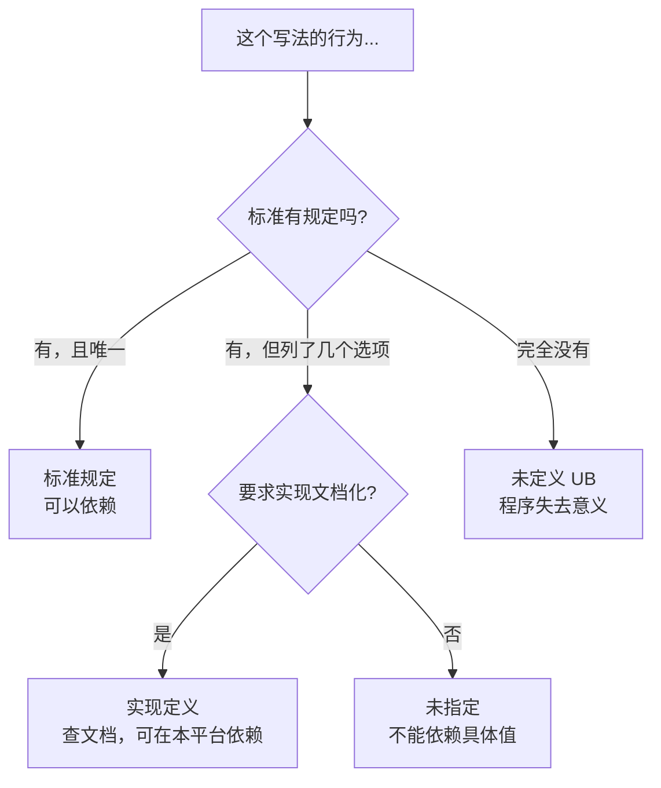

# 01 未定义行为与经典陷阱
**本页学什么**

- 什么叫**未定义行为（UB）**，以及为什么它比"结果不确定"严重得多
- 六类高频 UB，每类都配 **UBSan/ASan 的真实报错输出**
- 实现定义 vs 未指定 vs 未定义——三者的精确区分
- 一套能实际执行的检测工具链

这页是前 10 页的收网。**读到这里你应该能"看见" UB**——不是记住清单，而是建立起"这个写法编译器有权做任何事"的直觉。

## 一、UB 到底是什么

### 标准定义

C17 标准 3.4.3 对 **undefined behavior** 的定义大意是：

> 使用不可移植的或错误的程序构造、错误的数据时的行为，**本国际标准对此没有任何要求**。

关键词是**"没有任何要求"**。

:::danger[UB 不是"得到奇怪的值"]
三个层次的误解，逐级加深：

| 误解 | 真相 |
| --- | --- |
| "UB 就是结果不确定" | 不只是——**程序整体不再有意义** |
| "UB 只影响那一行" | 错误——**编译器可以基于"UB 不发生"的假设，改变已经执行过的代码的行为** |
| "调试时正常就没事" | 错误——加 `-O2`、换编译器、甚至改一行无关代码都可能改变结果 |
:::

### 实测证明：编译器真的会利用 UB

```c
#include <stdio.h>
#include <limits.h>

static int add_wrap(int a, int b) { return a + b; }

int main(void) {
    int r = add_wrap(INT_MAX, 1);
    printf("INT_MAX + 1 = %d\n", r);
    if (r < 0) printf("negative!\n");
    return 0;
}
```

`-O0` 和 `-O2` 都打印了：

```text
INT_MAX + 1 = -2147483648
negative!
```

看起来"正常"？但用 UBSan 编译运行：

```bash
clang -fsanitize=undefined -fno-sanitize-recover=all -g -O0 sovf.c -o sovf_u.exe
./sovf_u.exe
```

```text
C:\cprobe\sovf.c:4:46: runtime error: signed integer overflow: 2147483647 + 1 cannot be represented in type 'int'
SUMMARY: UndefinedBehaviorSanitizer: undefined-behavior C:\cprobe\sovf.c:4:46
```

**UBSan 明确说这是 UB。** 而普通编译下"看起来正常"只是因为编译器恰好用了二补数回绕指令——**这不是保证**。

一个真实的例子：某些编译器会把 `if (x + 1 > x)` 直接优化成 `if (true)`（假设 `x+1` 不会溢出），于是溢出检测代码被整个删掉。

### 四类行为分类法（贯穿全站）

| 类别 | 标准怎么说 | 能否依赖 | 例子 |
| --- | --- | --- | --- |
| **标准规定** | 所有实现必须如此 | **可以** | `sizeof(char)==1`；无符号回绕；`free(NULL)` 安全 |
| **实现定义** | 允许不同，但实现必须**文档化**且**自洽** | 可在**特定平台**依赖，用 `_Static_assert` 守住 | `char` 的符号性；`int` 的宽度；右移负数；`sizeof(enum)` |
| **未指定** | 标准给了几个选项，实现**不必**文档化 | **不能依赖具体值**（但结果必须是选项之一） | 函数实参求值顺序；结构体 padding 字节数 |
| **未定义 (UB)** | **没有任何要求** | **绝对不能依赖** | 有符号溢出、越界、悬垂指针、序列点违规 |



## 二、UB 1：有符号整数溢出

```c
int r = INT_MAX + 1;      /* UB */
unsigned u = UINT_MAX + 1u;  /* 合法，回绕为 0 */
```

### 实测

```text
UINT_MAX + 1 = 0
```

无符号回绕是**标准规定的**（模 2^N），可以依赖。实测确认。

有符号溢出是 UB，UBSan 报告见上。

### 危险的具体形式

```c
/* 1. 直接溢出 */
int a = INT_MAX + 1;

/* 2. 循环里悄悄溢出 —— 无符号不会，有符号会 */
for (int i = 0; i <= N; i++) { }   /* i 到 INT_MAX 后溢出 */

/* 3. 中间结果溢出 */
int avg = (a + b) / 2;      /* a+b 可能溢出，即使结果在范围内 */
int avg_ok = a + (b - a) / 2;   /* 安全写法 */

/* 4. abs(INT_MIN) */
int bad = abs(INT_MIN);      /* UB！结果无法表示 */

/* 5. INT_MIN / -1 */
int q = INT_MIN / -1;        /* UB！在 x86 上会触发 SIGFPE 陷阱 */
```

实测里我们特意**跳过**了 `INT_MIN / -1` 的实际执行：

```text
INT_MIN / -1 -> skipped (trap on x86)
```

因为在 x86 上这个除法会触发 **CPU 的除法异常**（不是"返回某个值"，是真的崩溃）。

### 检测方法

```bash
# UBSan 抓有符号溢出
clang -fsanitize=signed-integer-overflow -fno-sanitize-recover=all src.c -o out
```

```c
/* 或者用编译器内建做安全的溢出检测（gcc/clang 5+） */
int r;
if (__builtin_add_overflow(a, b, &r)) {
    /* 溢出，处理 */
}
```

`__builtin_add_overflow`/`__builtin_mul_overflow` 是编译器扩展（C23 有标准化的 `<stdckdint.h>`），**强烈推荐在嵌入式里使用**。

## 三、UB 2：越界访问

### 数组越界

```c
int arr[3] = {1, 2, 3};
printf("arr[5] = %d\n", arr[5]);
```

编译器（`-Wall -Wextra`）能抓到**常量索引**的越界：

```text
C:\cprobe\warn.c:7:29: warning: array index 5 is past the end of the array (that has type 'int[3]') [-Warray-bounds]
```

但**运行时索引**编译器抓不到，要靠 ASan：

```c
int *p = malloc(4);
p[5] = 1;
```

```bash
clang -fsanitize=address -g -O0 asan.c -o asan.exe && ./asan.exe
```

```text
==15196==ERROR: AddressSanitizer: heap-buffer-overflow on address 0x12751d5a0044 at pc 0x7ff6046714ce bp 0x00e8a2d7f6b0 sp 0x00e8a2d7f6f8
WRITE of size 4 at 0x12751d5a0044 thread T0
    #0 0x7ff6046714cd in main C:\cprobe/asan.c:2:38
0x12751d5a0044 is located 16 bytes after 4-byte region [0x12751d5a0030,0x12751d5a0034)
allocated by thread T0 here:
    #1 0x7ff60467148d in main C:\cprobe/asan.c:2:23
SUMMARY: AddressSanitizer: heap-buffer-overflow C:\cprobe/asan.c:2:38 in main
```

ASan 给出了：越界地址、操作类型（WRITE）、大小、所属区域边界、分配位置。**这是排查内存 bug 最有力的工具。**

### 字符串越界

```c
char buf[8];
strcpy(buf, "this string is way too long");   /* 缓冲区溢出 */
```

**这是安全漏洞的头号来源**（栈溢出攻击）。用安全版本：

```c
snprintf(buf, sizeof(buf), "%s", src);
strncpy(buf, src, sizeof(buf) - 1); buf[sizeof(buf)-1] = '\0';
```

:::caution[`strncpy` 不保证结尾有 `\0`]
如果源字符串长度 >= `n`，`strncpy` **不会**补 `'\0'`。必须手动补，如上例。

更推荐 `snprintf` 或 `memcpy` + 手动置零。
:::

### 指针算术越界

```c
int arr[5];
int *p = arr + 10;     /* UB：超出"末尾后一个" */
int *q = arr - 1;      /* UB */
```

合法的只有 `arr + 0` 到 `arr + 5`（`arr+5` 是"末尾后一个"，可比较不可解引用）。

## 四、UB 3：悬垂指针与生命周期

### 返回局部变量的地址

```c
int *bad(void) {
    int x = 5;
    return &x;      /* 栈帧销毁后，这个地址无效 */
}
```

编译器会警告（`-Wreturn-stack-address` 或类似）。

### use-after-free

```c
int *p = (int *)malloc(4 * sizeof(int));
for (int i = 0; i < 4; i++) p[i] = i;
free(p);
printf("use after free: p[0] = %d\n", p[0]);
```

ASan：

```text
==10336==ERROR: AddressSanitizer: heap-use-after-free on address 0x121010aa0030 at pc 0x7ff6ee34153f bp 0x000f5ddafbb0 sp 0x000f5ddafbf8
READ of size 4 at 0x121010aa0030 thread T0
    #0 0x7ff6ee34153e in main C:\cprobe/uaf.c:8:43
0x121010aa0030 is located 0 bytes inside of 16-byte region [0x121010aa0030,0x121010aa0040)
freed by thread T0 here:
    #1 0x7ff6ee341506 in main C:\cprobe/uaf.c:7:5
```

### double free

```c
int *p = (int *)malloc(16);
free(p);
free(p);
```

ASan：

```text
==19016==ERROR: AddressSanitizer: attempting double-free on 0x1258745a0030 in thread T0:
    #0 0x7ffde893d8c1 in free .../asan_malloc_win.cpp:78:3
    #1 0x7ff738e21548 in main C:\cprobe/df.c:10:5
0x1258745a0030 is located 0 bytes inside of 16-byte region [0x1258745a0030,0x1258745a0040)
freed by thread T0 here:
    #1 0x7ff738e21533 in main C:\cprobe/df.c:8:5
```

注意 ASan **同时指出了第一次和第二次释放的位置**——这正是你排查需要的。

### `free` 非堆指针

```c
int x;
free(&x);         /* UB：不是 malloc 返回的 */
free(p + 1);      /* UB：必须是 malloc 返回的那个地址 */
```

**`free` 只能接受 `malloc`/`calloc`/`realloc` 返回的（或 `NULL`）指针，且必须是原始的起始地址。**

### 修改字符串字面量

```c
char *s = "hello";
s[0] = 'H';       /* UB！字符串字面量不可修改 */
```

实测 [内存页](./memory) 显示字符串字面量在 `.rodata`（只读段）。修改它是 UB，在现代系统上通常是段错误。

**正确写法**：`const char *s = "hello";`（让类型帮你挡住）或 `char s[] = "hello";`（拷贝到栈上，可修改）。

---

**翻页**：[下一页 →](./pitfalls-02) · [返回目录](./)
