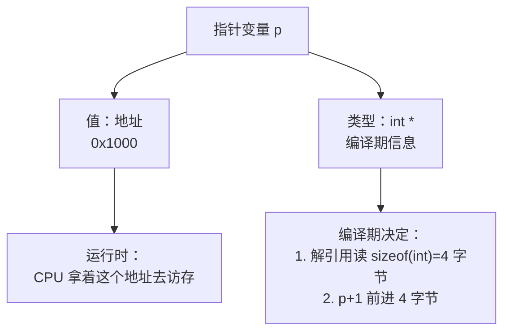
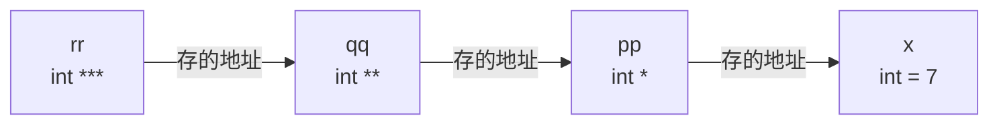

# 01 指针专章
**本页学什么**

- 指针的值是什么，类型又在管什么——**地址与类型是绑定的**
- 指针运算为什么 `p + 1` 加的不是 1
- 数组和指针的根本区别（以及为什么 `sizeof` 会暴露它）
- 多级指针到底在表达什么
- 函数指针的语法与用途（回调、跳转表）
- `restrict` 的真实语义（C99）

指针是 C 的分水岭。但指针本身不难，难的是**没讲清楚"类型在指针里扮演什么角色"**。本页就从这个点切入。

## 一、指针的本质：地址 + 类型的绑定

一个指针变量里装的是**一个地址**（一个整数）。但指针的**类型**决定了两件编译期的事：

1. 解引用时**读多少字节**、怎么解释这些字节
2. 做算术时**步长是多少**



:::tip[核心直觉]
**地址是运行时的，类型是编译期的。** 指针类型不占任何存储空间——`int *` 和 `char *` 和 `void *` 的 `sizeof` 完全一样（本机都是 8）。类型信息只在编译期存在，用来生成正确的取字节数和步长。

这就是为什么 `void *` 不能做算术也不能解引用——它没有类型信息，编译器不知道步长和字节数。
:::

### 实测：步长由类型决定

```c
#include <stdio.h>

int main(void) {
    int arr[5] = {10, 20, 30, 40, 50};
    int *p = arr;
    char *cp = (char *)arr;

    printf("p        = %p\n", (void *)p);
    printf("p+1      = %p  (delta=%td bytes)\n", (void *)(p + 1), (char *)(p + 1) - (char *)p);
    printf("cp+1     = %p  (delta=%td bytes)\n", (void *)(cp + 1), (cp + 1) - cp);
    return 0;
}
```

```bash
gcc -std=c17 -Wall ptr.c -o ptr.exe && ./ptr.exe
```

```text
p+1      = 0000006E939EF964  (delta=4 bytes)
cp+1     = 0000006E939EF961  (delta=1 bytes)
```

**同一个地址，不同的类型，加 1 前进的距离完全不同。** `int *` 前进 4，`char *` 前进 1。

`p + n` 的真实地址计算是：

```text
addr(p + n) = addr(p) + n * sizeof(*p)
```

这个乘法是**编译器插入的**，你写的 `p + 1` 编译出来可能是 `lea rax, [rdx + 4]`。

## 二、指针运算的合法范围

标准规定：指针算术只在**同一个数组对象内**（或刚好越一个末尾位置）有意义。

```c
int arr[5];
int *p = arr;

p + 0  ...  p + 4    /* 合法：指向 arr[0..4] */
p + 5                /* 合法：指向"末尾后一个"，可以比较，不能解引用 */
p + 6                /* UB */
p - 1                /* UB */
```

:::warning[越一个末尾是允许的，但不能解引用]
`&arr[5]`（或 `arr + 5`）是**合法**的指针值——标准允许指向数组末尾之后一个位置，这样 `for (p = arr; p < arr + 5; p++)` 才能正确工作。但**解引用它是 UB**。

指向不同数组的两个指针做**减法**是 UB，做比较（`<`、`>`）也是 UB。只有 `==`/`!=` 可以跨对象比较。
:::

### 实测：指针相减

```c
int *a = &arr[1];
int *b = &arr[4];
printf("b - a = %td\n", b - a);
printf("(char*)b - (char*)a = %td\n", (char *)b - (char *)a);
```

```text
b - a = 3
(char*)b - (char*)a = 12
```

`b - a` 的结果是**元素个数**（3），不是字节数。转成 `char *` 后才得到字节数（12）——这是计算两个指针间距的标准技巧。

差值类型是 `ptrdiff_t`（有符号，来自 `<stddef.h>`），`printf` 用 `%td`。

## 三、数组与指针：必须分清的三件事

![数组名不是指针：sizeof(arr) 是 20 而 sizeof(&arr[0]) 是 8，数组传参会退化成指针丢失长度信息](/img/diagrams/c-pointer-array-detail.svg)


这是 C 最经典的混淆点。先看一张图：


先给结论：

:::danger[数组不是指针]
**数组是数组，指针是指针。** 它们是两种不同的类型。

混淆的来源是**一条转换规则**：在**大多数**表达式里，数组名会**退化（decay）**成指向其首元素的指针。这条规则让人以为"数组就是指针"，但两者在很多场景下表现完全不同。
:::

### 实测：`sizeof` 暴露真相

```c
int arr[5] = {10, 20, 30, 40, 50};
int *p = arr;

printf("sizeof(arr) = %zu\n", sizeof(arr));
printf("sizeof(p)   = %zu\n", sizeof(p));
printf("&arr        = %p\n", (void *)&arr);
printf("&arr+1      = %p  (delta=%td)\n", (void *)(&arr + 1), (char *)(&arr + 1) - (char *)&arr);
```

```text
sizeof(arr) = 20
sizeof(p)   = 8
&arr        = 0000006E939EF960
&arr+1      = 0000006E939EF974  (delta=20)
```

三条铁证：

1. **`sizeof(arr)` 是 20**（整个数组的字节数），而 `sizeof(p)` 是 8（指针本身的大小）。如果数组"就是"指针，两者应该相等
2. **`&arr + 1` 前进 20 字节**（整个数组），而不是 4 字节。因为 `&arr` 的类型是 `int (*)[5]`——**指向整个数组的指针**，不是 `int *`
3. 数组名不能赋值（`arr = p;` 是语法错误），指针可以

### 三种写法对照

| 表达式 | 类型 | 含义 | `+1` 前进 |
| --- | --- | --- | --- |
| `arr`（退化后） | `int *` | 指向首元素 | 4 字节 |
| `&arr[0]` | `int *` | 指向首元素 | 4 字节 |
| `&arr` | `int (*)[5]` | 指向整个数组 | 20 字节 |

### 什么时候数组**不**退化

数组名在以下四种情况下**保持数组类型**，不退化为指针：

1. 作为 `sizeof` 的操作数 → `sizeof(arr)` = 20
2. 作为 `&` 的操作数 → `&arr` 类型是 `int (*)[5]`
3. 作为字符串字面量初始化字符数组 → `char s[] = "abc";`
4. 作为 `_Alignof` 的操作数

### 实测：数组传参退化

```c
void f(int arr[5]) {        /* 其实等价于 void f(int *arr) */
    printf("%zu\n", sizeof(arr));   /* 打印 8，不是 20！ */
}
```

**函数参数里的 `int arr[5]` 就是 `int *arr`**——那个 `5` 完全是装饰性的，编译器忽略。这是最坑的一点：你以为传了数组，实际传了个指针，`sizeof` 拿不到长度。

:::warning[数组传参必须额外传长度]
```c
void process(const uint8_t *data, size_t len);   /* 正确：长度单独传 */
```
任何"函数内部用 `sizeof` 算传入数组长度"的写法都是错的。

ESP-IDF 的 API 全是这个风格：`esp_err_t spi_device_transmit(spi_device_handle_t handle, spi_transaction_t *trans)` 之类，缓冲区都配套长度参数。
:::

### 下标运算符是可交换的

实测：

```c
printf("*(p+2)   = %d   p[2]=%d   2[p]=%d\n", *(p + 2), p[2], 2[p]);
```

```text
*(p+2)   = 30   p[2]=30   2[p]=30
```

`2[p]` 也能用！因为标准定义 `E1[E2]` **等价于** `*((E1) + (E2))`，加法可交换。**这是语言趣闻，实际代码里永远不要写**——可读性为零。

## 四、`const` 与指针

`const` 修饰的位置不同，含义完全不同。读法：**从右往左读**。

| 声明 | 读法 | 什么不能改 |
| --- | --- | --- |
| `const int *p` | p 是指针，指向 const int | **不能改 `*p`**，能改 `p` |
| `int const *p` | 同上（等价写法） | 同上 |
| `int * const p` | p 是 const 指针，指向 int | **不能改 `p`**，能改 `*p` |
| `const int * const p` | const 指针指向 const int | 都不能改 |

记忆法：看 `const` 在 `*` 的哪一侧。
- `const` 在 `*` **左边** → 指向的数据是常量
- `const` 在 `*` **右边** → 指针本身是常量

```c
const char *s = "hello";     /* 字符串字面量的正确类型 */
*s = 'H';                    /* 错误！—— 字符串字面量不可修改，且是 UB */
```

### 指针转换与 `const` 的警告

把 `char *` 赋给 `const char *` 是安全的（加限定），隐式允许。反过来（去掉 `const`）需要显式转换且通常意味着你做错了：

```c
const int x = 5;
int *p = (int *)&x;   /* 强制去 const —— 编译器允许，但 */
*p = 10;              /* 这是 UB！修改原本声明为 const 的对象 */
```

标准明确规定：修改一个原本声明为 `const` 的对象是 **UB**（即使你强转掉了 `const`）。

## 五、多级指针

多级指针的本质就是"指向指针的指针"——**每一级都要一次解引用才能到达最终的值**。

### 实测

```c
int x = 7;
int *pp = &x;
int **qq = &pp;
int ***rr = &qq;
printf("x=%d  *pp=%d  **qq=%d  ***rr=%d\n", x, *pp, **qq, ***rr);
printf("sizeof(rr)=%zu\n", sizeof(rr));
```

```text
x=7  *pp=7  **qq=7  ***rr=7
sizeof(rr)=8
```

注意 `sizeof(rr)` 仍然是 8——**不管几级指针，它本身都是个地址**。



### 什么时候真正需要 `**`

最常见的一个场景：**函数要修改调用方的指针变量**。

```c
/* 错误：传值，改不到调用方的 p */
void alloc_bad(int *p) {
    p = malloc(sizeof(int));   /* 只改了局部副本 */
}

/* 正确：传指针的地址 */
void alloc_ok(int **p) {
    *p = malloc(sizeof(int));
}

int main(void) {
    int *ptr = NULL;
    alloc_ok(&ptr);   /* ptr 现在指向新分配的内存 */
    free(ptr);
}
```

这是 [函数页](./functions) "值传递真相"的延伸：**要改什么，就传什么的地址**。要改 `int`，传 `int *`；要改 `int *`，传 `int **`。

嵌入式里另一个常见场景：**指针数组**（如字符串表、驱动注册表），数组名退化后就是二级指针。

```c
const char *names[] = {"uart", "spi", "i2c"};
/* names 的类型是 const char *[3]，退化后是 const char ** */
```

---

**翻页**：[下一页 →](./pointers-02) · [返回目录](./)
