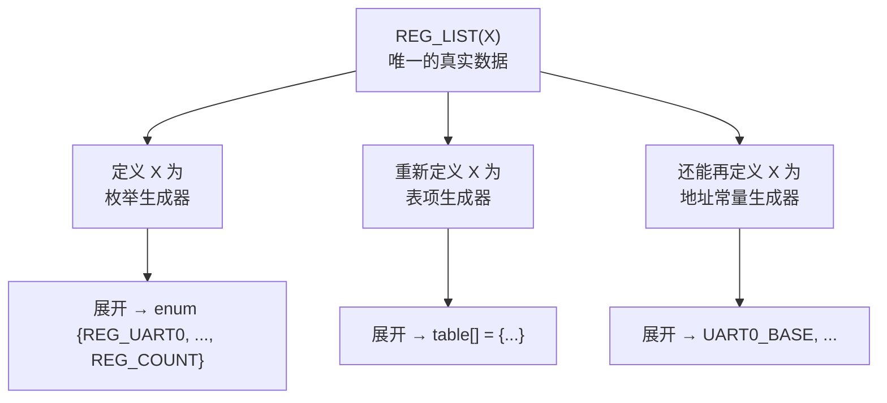

# 03 X-Macro：一份定义，多处生成
**问题**：你要维护一张寄存器表，同时需要：一个枚举（索引）、一个名字数组（打印用）、一个地址数组（访问用）。手写三份必然不同步。

**X-Macro 解法**：把数据只写一次，用不同的 `X` 宏展开成不同结构。

### 实测代码

```c
#include <stdio.h>
#include <stdint.h>

#define REG_LIST(X)      \
    X(UART0, 0x40000000) \
    X(UART1, 0x40001000) \
    X(SPI0,  0x40002000) \
    X(I2C0,  0x40003000)

/* 1. 生成枚举 */
typedef enum {
#define X(name, addr) REG_##name,
    REG_LIST(X)
#undef X
    REG_COUNT
} reg_id_t;

/* 2. 生成名字+地址表 */
static const struct {
    const char *name;
    unsigned long addr;
} reg_table[] = {
#define X(name, addr) { #name, addr },
    REG_LIST(X)
#undef X
};

int main(void) {
    printf("REG_COUNT = %d\n", REG_COUNT);
    printf("REG_UART0=%d REG_SPI0=%d\n", REG_UART0, REG_SPI0);
    for (int i = 0; i < REG_COUNT; i++) {
        printf("  %-6s -> 0x%08lX\n", reg_table[i].name, reg_table[i].addr);
    }
    return 0;
}
```

### 实测输出

```bash
gcc -std=c17 -Wall xmacro.c -o xmacro.exe && ./xmacro.exe
```

```text
=== X-Macro generated enum ===
REG_COUNT = 4
REG_UART0=0 REG_SPI0=2

=== X-Macro generated table ===
  UART0  -> 0x40000000
  UART1  -> 0x40001000
  SPI0   -> 0x40002000
  I2C0   -> 0x40003000
```

### 工作原理



关键机制：

1. `REG_LIST(X)` 里的 `X` **不是固定函数**，而是一个"稍后由使用者定义"的回调宏
2. 每次使用前 `#define X(...)` 成不同形式，用完 `#undef X`
3. 数据只写一处，所有派生结构**必然同步**

### X-Macro 的优缺点

:::info[优点]
- 消除重复数据，杜绝"枚举和表不同步"
- `REG_COUNT` 自动正确
- 加一个寄存器只改一行
:::

:::caution[缺点]
- 可读性差（初见很难懂）
- 调试困难——错误信息指向展开后的位置
- IDE 的代码补全/跳转常常失效

**适用**：确实有多处派生结构需要严格同步的场景（寄存器表、错误码表、命令表、配置项）。**不要滥用**——普通的常量定义用普通枚举就行。
:::

## 十、宏 vs 其他机制的选择

| 需求 | 推荐方案 |
| --- | --- |
| 类型安全的"函数" | `static inline` 函数 |
| 编译期常量 | `enum` 或 `static const` |
| 条件编译（平台/调试） | `#if` |
| 生成重复代码结构 | X-Macro |
| 字符串化名字 | `#` 运算符 |
| 断言 | 宏（必须用宏才能拿到 `__LINE__` 和表达式文本） |
| 日志 | 宏（同样需要 `__FILE__`/`__LINE__`） |

:::warning[能用别的方式就别用宏]
宏没有作用域、没有类型、展开后不可调试。**只有在确实需要"文本级"操作时才用宏**——主要是需要 `__FILE__`/`__LINE__`/字符串化/条件编译的场景。
:::

## 常见坑

| 陷阱 | 现象 | 原因 | 正确做法 |
| --- | --- | --- | --- |
| 宏体不加括号 | `BAD_SQUARE(1+2)` = 5 | 优先级 | 参数和整体都加括号 |
| 参数带 `++` | 值错、`i` 多加了几次 | 参数多次求值（UB） | 不在宏参数里用副作用表达式；改用 `inline` 函数 |
| `MAX(a++, b++)` | `b` 加了两次 | 同上 | 同上 |
| `#define M (a)` 多了空格 | 变成对象式宏 | 左括号必须紧贴宏名 | `M(a)` 不加空格 |
| `STR(VERSION)` 得到宏名 | 想得值却得名字 | `#` 阻止展开 | 包两层 `XSTR` |
| 多行宏 `\` 后有空格 | 续行失效 | `\` 必须是行尾最后字符 | 检查不可见字符 |
| 多语句宏用在 `if` 后 | 只有第一句受 `if` 管 | 宏是文本替换 | 用 `do {} while(0)` |
| 可变参数宏零参数 | 多了个逗号，语法错 | `__VA_ARGS__` 为空 | 用 `##__VA_ARGS__`（GNU 扩展） |
| guard 宏名重复 | 头文件被跳过，符号找不到 | 拷贝粘贴忘改名 | 用 `#pragma once` |
| `#pragma once` 遇符号链接 | 重复包含 | 靠文件身份识别 | 用 include guard |
| 拼错宏名用在 `#if` | 静默变成 0 | 未定义标识符在 `#if` 里是 0 | 用 `#ifdef` 检查或 `#error` 强制 |
| 依赖 `#pragma` 生效 | 老编译器上静默失效 | 未识别的 `#pragma` 必须忽略 | 关键逻辑不要依赖 pragma |

## 自检清单

- [ ] 知道预处理在编译流程中的位置吗？它理解 C 语法吗？
- [ ] 能说出函数式宏的三个陷阱吗？
- [ ] 能用 `gcc -E` 查看宏的真实展开吗？
- [ ] 知道为什么 `STR(VERSION)` 和 `XSTR(VERSION)` 结果不同吗？
- [ ] `##` 有什么用？它也阻止展开吗？
- [ ] 为什么多语句宏要包在 `do {} while(0)` 里？
- [ ] 可变参数宏怎么解决零参数问题？
- [ ] 能列出 6 个标准预定义宏吗？`__STDC_VERSION__` 在 C17 下是多少？
- [ ] 未定义的标识符在 `#if` 里等于什么？
- [ ] include guard 和 `#pragma once` 各有什么优缺点？你该选哪个？
- [ ] 未识别的 `#pragma` 会怎样？（必须被忽略，不能报错）
- [ ] 能用 X-Macro 从一个列表同时生成枚举和表吗？
- [ ] 知道什么时候不该用宏吗？

## 下一步

- [函数](./functions) —— `static inline` 作为宏的安全替代
- [位运算与寄存器](./bitops) —— 宏在寄存器定义里的实际应用
- [工具链](./toolchain) —— `gcc -E` 的完整用法与 `-D` 参数
- [嵌入式 C](./embedded) —— 内存映射 IO 的宏写法
- [回到导读](./)

---

**翻页**：[← 上一页](./preprocessor-02) · [返回目录](./)
