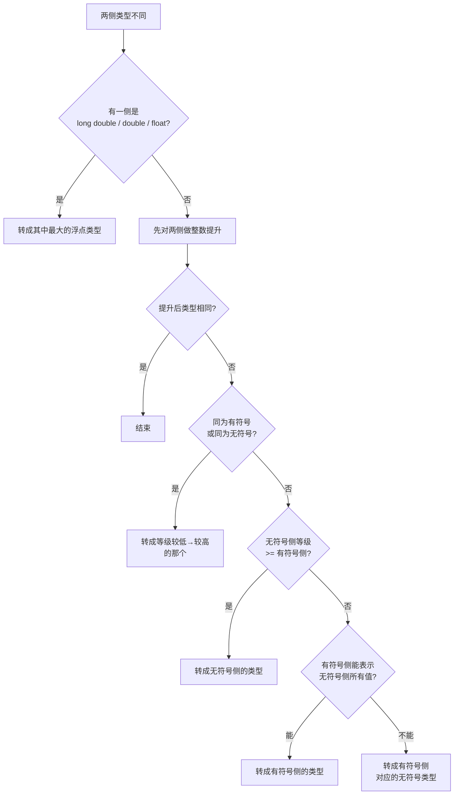

# 01 语法基础
**本页学什么**

- C 的类型系统到底由什么决定——为什么 `int` 的大小"不一定"
- `stdint.h` 定宽类型为什么是嵌入式的必需品
- 整数提升（integer promotion）和常规算术转换（usual arithmetic conversions）的真实规则
- 全部运算符与优先级表
- 控制流，以及 `switch` 的四个陷阱
- 哪些行为是"实现定义的"、哪些是"未定义的"

这页看起来是"基础"，但它是**最容易埋雷的地方**。因为 C 的类型系统有大量"看起来能过、实际是错的"写法——尤其是隐式转换。

## 一、类型系统的第一原则：C 不规定具体大小

这是 C 和 Java/C# 最根本的区别：**C 标准不规定 `int` 占几个字节**，只规定最小范围和大小关系。

标准（C17 5.2.4.2.1 附近的实现定义限制）要求的最小值：

| 类型 | 标准保证的最小范围 | 常见实现 |
| --- | --- | --- |
| `char` | 至少 8 位 | 8 位 |
| `short` | 至少 16 位 | 16 位 |
| `int` | 至少 16 位 | **32 位**（现代几乎都是） |
| `long` | 至少 32 位 | **Windows 32 位 / Linux 64 位** |
| `long long` | 至少 64 位 | 64 位 |
| 指针 | 不保证与任何整型等宽 | 32/64 位 |

标准只保证大小关系：

```text
sizeof(char) <= sizeof(short) <= sizeof(int) <= sizeof(long) <= sizeof(long long)
```

以及 `sizeof(char) == 1`（**这是标准唯一保证的绝对大小**，注意单位是字节不是位）。

### 实测：本机各类型大小

```bash
gcc -std=c17 -Wall layout.c -o layout.exe && ./layout.exe
```

```text
char=1 short=2 int=4 long=4 longlong=8 ptr=8 float=4 double=8
```

以及定宽类型：

```text
int8=1 uint8=1 int16=2 int32=4 int64=8
intptr=8 size_t=8 intmax=8
```

:::danger[`long` 是跨平台头号陷阱]
本机（Windows x86-64，**LLP64** 数据模型）`long` 是 **4 字节**。
Linux/macOS x86-64（**LP64**）`long` 是 **8 字节**。

```c
long x = 1L << 40;   /* Windows 上溢出，Linux 上正常 */
```

**永远不要用 `long` 表示"64 位整数"。** 用 `int64_t`。

ESP32 (Xtensa) 是 32 位，`long` 是 4 字节；ESP32-C3 等 RISC-V 也是 32 位。**在嵌入式上 `int` 和 `long` 常常都是 4 字节**，这又是另一种组合。
:::

### 数据模型速查

| 模型 | `int` | `long` | 指针 | 典型平台 |
| --- | --- | --- | --- | --- |
| ILP32 | 32 | 32 | 32 | 32 位 MCU、ESP32 |
| LP64 | 32 | 64 | 64 | Linux/macOS x86-64 |
| **LLP64** | 32 | **32** | 64 | **Windows x86-64（本机）** |

## 二、`stdint.h`：嵌入式的定宽类型

因为 C 不保证大小，C99 引入了 `<stdint.h>`，提供**保证宽度**的类型。

### 精确宽度类型（可选，但主流平台全都有）

`int8_t` `int16_t` `int32_t` `int64_t`
`uint8_t` `uint16_t` `uint32_t` `uint64_t`

标准说这些是**可选**的——只有在实现确实有对应宽度的类型时才提供。但现代平台（含所有 ESP32/STM32 工具链）都有，可以放心用。

### 最小宽度类型（保证存在）

`int_least8_t` ... `int_least64_t`：至少这么宽，可能更宽。

### 最快宽度类型

`int_fast8_t` ... `int_fast64_t`：**最快**的、至少这么宽的类型。在 32 位 MCU 上 `int_fast8_t` 常常就是 32 位的 `int`——因为 CPU 处理 32 位最快。

### 指针宽度整型

- `intptr_t` / `uintptr_t`：能**无损存放一个 void 指针**的整型
- `intmax_t` / `uintmax_t`：最宽的整型

### 极限值宏

`INT8_MIN` `INT8_MAX` `UINT8_MAX` `INT32_MAX` `UINT32_MAX` `INT64_MAX` ...

实测：

```text
INT_MAX=2147483647 INT_MIN=-2147483648 UINT_MAX=4294967295
CHAR_BIT=8 sizeof(int)=4
```

`CHAR_BIT` 来自 `<limits.h>`，是"一个字节有多少位"——绝大多数平台是 8，但标准允许更大。**DSP 等特殊硬件上可能是 16 或 32。**

:::tip[嵌入式类型选用准则]
1. **需要确定宽度时（寄存器、协议报文、持久化数据）→ 用 `uint32_t` 等定宽类型**，绝不用 `int`/`long`
2. **循环计数、数组下标 → 用 `size_t`**（它是 `sizeof` 的结果类型，无符号）
3. **只是临时计算、不关心宽度 → 用 `int`**（它是"自然字长"，通常最快）
4. **存放指针值的整数 → 用 `uintptr_t`**，不要 `unsigned long`
5. **不要对 `size_t` 做减法比较**（见 [陷阱页](./pitfalls)）

ESP-IDF 源码里 `uint32_t`、`size_t`、`int` 占绝大多数，偶尔见 `uint8_t`。`long` 基本不出现。
:::

### `char` 的符号性是实现定义的

这是最容易忽略的一条：**`char` 到底是有符号还是无符号，标准没规定**。

- x86（gcc/clang/MSVC）：`char` **有符号**（范围 -128 ~ 127）
- ARM：历史上**无符号**，但现代 ARM 编译器（armclang、arm-none-eabi-gcc）默认**有符号**
- ESP32 (Xtensa gcc)：**有符号**

```c
char c = 200;      /* 有符号平台上变成 -56 */
if (c > 100) { }   /* 有符号平台上为假！ */
```

**正确做法**：需要数值运算时显式写 `signed char` 或 `unsigned char`。处理字节流（串口、网络报文、Flash 数据）一律用 `uint8_t`。

实测字节序时就用 `unsigned char *` 读内存，正是这个原因。

## 三、字符字面量：C 和 C++ 不同

实测：

```text
sizeof(char)       = 1
sizeof('a')        = 4  <-- C char literal is int!
sizeof("abc")      = 4 (includes NUL)
```

:::warning[C 的字符常量是 `int` 不是 `char`]
在 C 里 `'a'` 的类型是 **`int`**，所以 `sizeof('a') == 4`（本机）。这和 C++ 不同——C++ 里 `sizeof('a') == 1`。

这条在写跨 C/C++ 的头文件时会造成实际差异，`_Generic` 或模板代码里尤其要小心。
:::

另外 `"abc"` 是**字符串字面量**，类型是 `char[4]`（含结尾的 `'\0'`），所以 `sizeof("abc") == 4`。而 `strlen("abc") == 3`。

## 四、整数提升与常规算术转换

这是 C 类型系统里**最重要也最反直觉**的部分。

### 整数提升（integer promotion）

规则：任何表达式中，**比 `int` 窄的整型（`char`、`short`、位域、`enum`、以及它们的 signed/unsigned 版本）会先被转换成 `int`**；如果 `int` 装不下所有值，则转成 `unsigned int`。

```c
uint8_t a = 200, b = 100;
uint8_t c = a + b;      /* 实际按 int 计算 300，再截断赋回 uint8_t → 44 */
```

`a + b` 的类型是 **`int`** 而不是 `uint8_t`。所以运算不会在 8 位处回绕，而是在赋值回 `uint8_t` 时才截断。

### 常规算术转换（usual arithmetic conversions）

当二元运算符两侧类型不同时，按这个顺序对齐：



**关键结论**：只要表达式里混进了无符号类型，结果就极可能变成无符号。

### 实测：混用有符号与无符号

```c
int i = -1;
unsigned int ui = 1;
printf("-1 < 1u        ? %s\n", (-1 < 1u) ? "true" : "false");
printf("-1 > 0u        ? %s\n", (-1 > 0u) ? "true" : "false");
printf("i < ui         ? %s\n", (i < ui) ? "true" : "false");
```

```text
-1 < 1u        ? false  (because -1 converts to huge unsigned)
(int)(-1 < 1u) = 0
-1 > 0u        ? true
i < ui        ? false
```

**`-1 < 1u` 是 false！** 因为 `-1` 被转换成 `unsigned int`，变成 4294967295。

:::danger[`sizeof` 与负数比较的经典坑]
```c
int n = -1;
if (sizeof(int) > n) { /* ... */ }
```
实测输出：`if (sizeof(int) > n) -> false`

因为 `sizeof` 的结果是 `size_t`（无符号），`n` 被转换成 `size_t` 变成巨值，`4 > 巨大值` 为假。

**正确写法**：`if ((int)sizeof(int) > n)` 或 `if (sizeof(int) > (size_t)n)` 并确认 `n >= 0`。最稳妥是先保证 `n` 非负再用 `size_t`。
:::

### 实测：哪些溢出是定义的

```c
unsigned int u = UINT_MAX;
printf("UINT_MAX + 1 = %u\n", u + 1u);
```

```text
UINT_MAX + 1 = 0
```

**无符号整数回绕是标准明确规定的**（模 2^N），可以依赖。

而有符号溢出是 **UB**：

```c
#include <limits.h>
static int add_wrap(int a, int b) { return a + b; }
int main(void) {
    int r = add_wrap(INT_MAX, 1);
    printf("INT_MAX + 1 = %d\n", r);
}
```

在本机 `-O0` 和 `-O2` 下都打印了：

```text
INT_MAX + 1 = -2147483648
negative!
```

但用 UBSan 编译后运行：

```bash
clang -fsanitize=undefined -fno-sanitize-recover=all -g -O0 sovf.c -o sovf_u.exe
./sovf_u.exe
```

```text
C:\cprobe\sovf.c:4:46: runtime error: signed integer overflow: 2147483647 + 1 cannot be represented in type 'int'
SUMMARY: UndefinedBehaviorSanitizer: undefined-behavior C:\cprobe\sovf.c:4:46
```

:::caution[别被"看起来正确"骗了]
上面 `-O0`/`-O2` 都打印了 `-2147483648`，这**只是本实现的偶然行为**（编译器恰好用了二补数回绕指令）。标准说的是 UB，编译器完全有权：

- 让这段代码返回任意值
- 假设它永不发生，从而删掉依赖它的分支
- 让程序崩溃

**不要依赖它。** 需要回绕语义就用无符号类型；需要检测溢出就在运算前判断或用 `__builtin_add_overflow`。
:::

---

**翻页**：[下一页 →](./syntax-02) · [返回目录](./)
