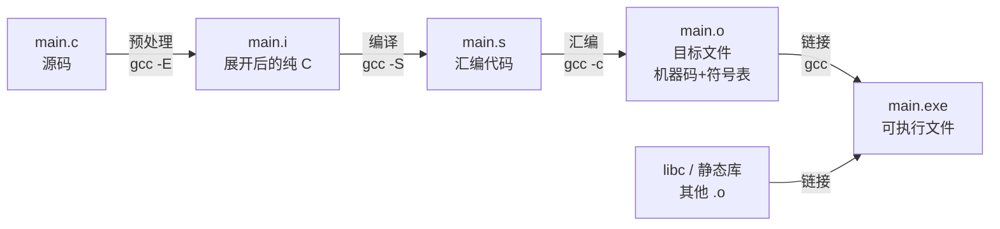

# 01 从源码到可执行文件
**本页学什么**

- `gcc main.c -o main` 这一行命令背后实际发生的四个阶段
- 每个阶段的产物长什么样（能自己停下来看中间文件）
- 目标文件里的符号表是什么，`nm` 输出的 `T`/`t`/`U`/`D`/`d` 分别代表什么
- `static` 关键字如何影响链接属性
- 静态库和动态库的区别，以及各自在什么场景下用
- 一套能直接复用的编译选项

你会在这页建立起一个关键直觉：**编译不是"翻译"，而是"多轮独立加工 + 最后拼装"**。理解这一点，链接错误（`undefined reference`、`duplicate symbol`）就不再是玄学。

## 一、为什么必须理解编译流程

初学者把 `gcc` 当成一个黑盒：输入 `.c`，输出可执行文件。这在写单文件小程序时够用，一旦项目变成多个文件、开始用第三方库，就会遇到这些错误：

```text
undefined reference to `foo'
ld.lld: error: duplicate symbol: public_var
```

这两条报错**完全无法从 C 语法角度理解**——因为它们根本不是编译器的错，是链接器的错。要读懂它们，必须先知道：编译是按**文件**为单位进行的，而链接是把所有文件拼起来的那一步。

:::info[最重要的心智模型]
**编译器一次只看到一个文件。** 你在 `a.c` 里调用 `b.c` 定义的函数，编译器并不知道 `b.c` 存在——它只看到你写了一句声明，于是记下一笔"欠账"。最后**链接器**负责把所有文件的欠账还上。

这个"记账—还账"模型解释了本页所有的现象。
:::

## 二、四阶段流水线



四个阶段各自独立，可以**任意停下来**检查中间产物。这是排查问题最重要的手段。

| 阶段 | 命令 | 输入 → 输出 | 干什么 | 能不能看懂产物 |
| --- | --- | --- | --- | --- |
| 预处理 | `gcc -E` | `.c` → `.i` | 展开宏、插入头文件、处理条件编译 | 能，仍是 C 代码 |
| 编译 | `gcc -S` | `.i` → `.s` | 语法分析、语义分析、优化、生成汇编 | 能，是汇编 |
| 汇编 | `gcc -c` | `.s` → `.o` | 汇编指令逐条翻译成机器码，建立符号表 | 需工具（`nm`/`objdump`） |
| 链接 | `gcc` | `.o` + 库 → 可执行文件 | 符号解析 + 地址重定位 | 需工具 |

### 实测：完整走一遍四阶段

源文件 `stage.c`：

```c
#include <stdio.h>
#define GREET "hi"

int add(int a, int b) { return a + b; }

int main(void) {
    printf("%s %d\n", GREET, add(2, 3));
    return 0;
}
```

**第 1 步：预处理**

```bash
gcc -E stage.c -o stage.i
```

看产物的末尾（前面是 `stdio.h` 展开出来的几百行声明）：

```text
# 2 "C:\\cprobe\\stage.c" 2


int add(int a, int b) { return a + b; }

int main(void) {
    printf("%s %d\n", "hi", add(2, 3));
    return 0;
}
```

注意三点：

1. `#include <stdio.h>` **消失了**——它已经被整个插入进来（在产物开头，几百行 `printf` 等函数的声明）
2. `GREET` **被替换成了 `"hi"`**——宏是纯文本替换
3. 以 `#` 开头的行是**行标记**（line marker），告诉后续阶段和调试器"下面这行原本来自哪个文件的第几行"。用 `-E -P` 可以去掉它们

:::tip[`-E` 是调试宏的第一工具]
宏写得对不对，别猜，直接 `gcc -E` 看展开结果。这比读标准文档快十倍。详见 [预处理器](./preprocessor)。
:::

**第 2 步：编译成汇编**

```bash
gcc -S -O0 stage.i -o stage.s
```

产物 105 行，开头部分：

```text
	.def	@feat.00;
	.scl	3;
	.type	0;
	.endef
	.globl	@feat.00
@feat.00 = 0
	.att_syntax
	.file	"stage.c"
	.def	add;
	.scl	2;
	.type	32;
	.endef
	.text
	.globl	add                             # -- Begin function add
```

`.text` 是代码段的开始，`.globl add` 声明 `add` 是全局符号（外部可见）。

**第 3 步：汇编成目标文件**

```bash
gcc -c stage.s -o stage.o
```

退出码 0，产物 1193 字节。这一步之后文件就**不再是文本**了，必须用专门的工具读。

**第 4 步：链接**

```bash
gcc stage.o -o stage.exe
```

运行：

```bash
./stage.exe
```

```text
hi 5
```

:::warning[不要手写 `ld` 链接]
理论上第 4 步可以直接调用链接器 `ld`，但实际**永远不要这么做**——链接一个可执行文件还需要 C 运行时启动代码（crt）、初始化/清理代码、默认库搜索路径等一大堆参数。用 `gcc` 驱动，它会替你把这些参数补齐。

想知道 `gcc` 到底传了什么给链接器？加 `-v` 看完整命令行。
:::

### 一步到位 vs 分步

日常开发当然直接：

```bash
gcc -std=c17 -Wall -Wextra stage.c -o stage.exe
```

中间文件被放在临时目录后自动删除。但**遇到奇怪问题时，拆开跑**往往一眼看出问题出在哪个阶段：

| 症状 | 出错阶段 | 排查命令 |
| --- | --- | --- |
| 找不到头文件 / 宏展开不对 | 预处理 | `gcc -E -P file.c \| tail -40` |
| 语法错误、类型不匹配 | 编译 | `gcc -c file.c`，读报错 |
| 汇编报错（基本不会遇到） | 汇编 | `gcc -c file.s` |
| `undefined reference` | 链接 | `nm file.o` 看符号 |
| `duplicate symbol` | 链接 | `nm *.o` 对比符号 |

## 三、目标文件与符号表

目标文件（`.o`）里装了三样东西：

1. **机器码**（分节存放：`.text` 代码、`.data` 已初始化数据、`.bss` 未初始化数据、`.rodata` 只读数据）
2. **符号表**（我定义了什么、我还欠着什么）
3. **重定位信息**（哪些地方的地址还没定，链接时要填）

### 实测：看符号表

```bash
nm stage.o
```

```text
00000000 a @feat.00
         U __main
00000000 T add
00000020 T main
         U printf
```

逐列解读：左边是**地址**（此时还是相对偏移，链接后才变成真正的地址），中间是**符号类型字母**，右边是**符号名**。

| 字母 | 含义 | 说明 |
| --- | --- | --- |
| `T` | text 段，全局（外部链接） | 函数，别的文件能调用 |
| `t` | text 段，局部（内部链接） | 被 `static` 修饰的函数 |
| `D` | data 段，全局 | 已初始化的全局变量 |
| `d` | data 段，局部 | 被 `static` 修饰的全局变量 |
| `B` | bss 段，全局 | 未初始化的全局变量 |
| `b` | bss 段，局部 | 被 `static` 修饰的未初始化变量 |
| `R` / `r` | 只读数据段 | 全局 / 局部的 `const` |
| `U` | **undefined，未定义** | 本文件用了但没定义，**欠账，等链接器还** |
| `a` | absolute，绝对符号 | 汇编器产生的绝对符号，忽略即可 |

:::tip[大写=外部链接，小写=内部链接]
这是 `nm` 输出最有用的一条规律。记住：**大写字母 = 别人能看到；小写字母 = 只有本文件能看到**。而 `static` 的作用正是把一个符号从大写变成小写。
:::

上面输出里 `U printf` 就是关键——`printf` 在 `stdio.h` 里只声明未定义，真正定义在 C 库里。编译器记下欠账，链接时从库中补上。

### 实测：看各段大小

```bash
size stage.o
```

```text
   text	   data	    bss	    dec	    hex	filename
     99	    210	      0	    309	    135	C:\cprobe\stage.o
```

- `text` 99 字节：机器指令
- `data` 210 字节：已初始化数据
- `bss` 0：本例没有未初始化全局变量

`dec`/`hex` 是三者总和的十进制/十六进制。**注意 `bss` 不占目标文件的实际磁盘空间**——它只记录"需要多少字节"，加载时由系统清零。这就是为什么一个 `char buf[1024*1024]` 的全局数组不会让 `.o` 文件变大 1MB。

### 实测：看反汇编

```bash
llvm-objdump -d stage.o
```

第一个函数：

```text
0000000000000000 <add>:
       0: 50                           	pushq	%rax
       1: 89 4c 24 04                  	movl	%ecx, 0x4(%rsp)
       5: 89 14 24                     	movl	%edx, (%rsp)
       8: 8b 44 24 04                  	movl	0x4(%rsp), %eax
       c: 03 04 24                     	addl	(%rsp), %eax
       f: 59                           	popq	%rcx
      10: c3                           	retq
```

这是 x86-64 的 AT&T 语法。`-O0`（不优化）下代码很啰嗦：参数先进栈又取出来。加 `-O2` 后 `add` 会被内联或大幅简化。

:::info[交叉编译时换 objdump]
本机的 `objdump` 只能读本机格式。要反汇编 ESP32 的固件，用对应的工具：

```bash
xtensa-esp32-elf-objdump -d build/my_app.elf
arm-none-eabi-objdump -d firmware.elf
```

这是分析 HardFault 和看编译器实际生成什么的重要手段。
:::

### 目标文件格式：PE/COFF vs ELF

```bash
readelf -h stage.o
```

```text
File: C:\cprobe\stage.o
Format: COFF-x86-64
Arch: x86_64
AddressSize: 64bit
ImageFileHeader {
  Machine: IMAGE_FILE_MACHINE_AMD64 (0x8664)
  SectionCount: 8
```

:::warning[平台差异]
本机是 MinGW 环境，产出 **PE/COFF** 格式（Windows 用）。Linux 产出 **ELF**。两者都是"带分节和符号表的目标文件"，概念完全一致，但：

- Linux 动态库是 `.so`，Windows 是 `.dll`（外加一个 `.lib` 导入库）
- Linux 可执行文件没有扩展名，Windows 是 `.exe`
- 交叉编译到 ESP32 时产出 ELF，用 `xtensa-esp32-elf-*` 系列工具分析

**语言层面的结论两边通用**，只有工具命令和文件后缀不同。
:::

---

**翻页**：[下一页 →](./toolchain-02) · [返回目录](./)
