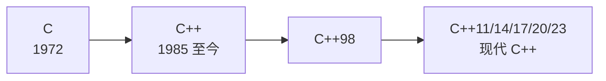

# 01 C++ 是什么

**本课目标**：知道 C++ 是什么、和 C 的关系、以及它到底解决了什么问题。不用动手。

## 一句话

**C++ 是「带抽象能力的 C」。**

它在保持 C 的性能和控制力的同时，加入了**类、模板、标准库**，让你能写出更安全、更简洁的代码。

## 和 C 的关系



:::info[C++ 基本是 C 的超集]
```cpp
// C 的代码，在 C++ 里几乎都能直接编译
#include <stdio.h>
int main(void) {
    printf("hello\n");
    return 0;
}
```

**但这不代表你该这么写。** 用 C++ 就该用 C++ 的方式（后面会反复强调）。
:::

## C++ 解决了 C 的什么问题

这是理解 C++ 价值的最好角度——**每个 C++ 特性都在解决 C 的一个痛点**：

| C 的痛点 | C++ 的解法 |
| --- | --- |
| 手动 `malloc`/`free`，容易泄漏 | **RAII**：对象析构自动释放 |
| 字符串要自己管长度和 `\0` | **`std::string`** |
| 数组大小固定，扩容麻烦 | **`std::vector`** |
| 函数只能返回一个值 | **引用参数 / `std::tuple`** |
| 同一逻辑要针对不同类型重写 | **模板**（泛型） |
| 函数名不能重复 | **函数重载** |
| 大型项目命名冲突 | **命名空间** |
| 错误靠返回值传递，容易被忽略 | **异常** |

:::tip[一个具体对比：动态数组]
**C 的写法**（[C 零基础第 20 课](../c-basics/20-malloc)教过）：

```c
int *arr = malloc(n * sizeof(int));
if (arr == NULL) { /* 处理失败 */ }
/* ... 使用 ... */
free(arr);          /* 忘了就泄漏 */
```

**C++ 的写法**：

```cpp
std::vector<int> arr(n);
// 用完自动释放，不用管
```

**后者不泄漏、不溢出、不用检查 NULL——因为编译器帮你做了。**
:::

## C++ 的核心哲学：零开销抽象

:::tip[什么叫「零开销」]
> **你不用的东西，你不为它付出代价。**

意思是：C++ 的高级特性**不会拖慢程序**。

```cpp
std::vector<int> v = {1, 2, 3};
```

看起来"高级"，但编译后生成的机器码和手写的 C 数组操作**几乎一样快**。

**这是 C++ 和 Java/Python 最大的区别**：那些语言的抽象有运行时开销（垃圾回收、类型检查），C++ 尽量把开销移到编译期。
:::

## C++ 难在哪

:::warning[诚实地说]
| 难点 | 说明 |
| --- | --- |
| **语法庞杂** | 标准文档 1800+ 页 |
| **同一件事多种写法** | 新手容易纠结选哪个 |
| **报错信息冗长** | 模板错误可能几百行 |
| **未定义行为** | 和 C 一样，写错了不报错 |
| **历史包袱** | 老写法和新写法混在一起 |

**所以：只学「够用」的部分。** 这条线就按这个原则组织。
:::

## 什么时候该用 C++

| 场景 | 适合 | 原因 |
| --- | --- | --- |
| 游戏引擎 | ✅ | 性能 + 抽象能力 |
| 桌面应用 | ✅ | Qt 等成熟框架 |
| 高频交易 | ✅ | 极致性能 |
| 嵌入式（中高端） | ✅ | 有类、模板，但要注意开销 |
| 单片机（资源极紧） | ⚠️ | 部分项目禁用异常和 RTTI |
| 简单脚本 | ❌ | 用 Python |
| Web 后端 | ⚠️ | 能用，但 Go/Java 更省事 |

## 学之前需要什么

:::danger[强烈建议先学 C]
C++ 的**指针、内存、编译链接**这些概念和 C 完全相同。如果你完全零基础直接学 C++：

- 会被「指针 + 引用 + 智能指针」三套概念同时压垮
- 分不清「这是 C 的问题还是 C++ 的」

**推荐路径**：先走完 [C 零基础](../c-basics/) 的前 20 课（到指针和结构体），再回来学 C++。

**如果你已经会 C**，那可以直接开始，前 5 课会很快。
:::

## 本课自检

- [ ] 知道 C++ 基本是 C 的超集
- [ ] 能说出 C++ 解决了 C 的至少 4 个痛点
- [ ] 理解「零开销抽象」的含义
- [ ] 知道 C++ 的难点在哪
- [ ] 知道自己该不该先补 C

## 下一步

[02 第一个 C++ 程序](./02-first-program) —— 跑通环境，认识 `cout`。
