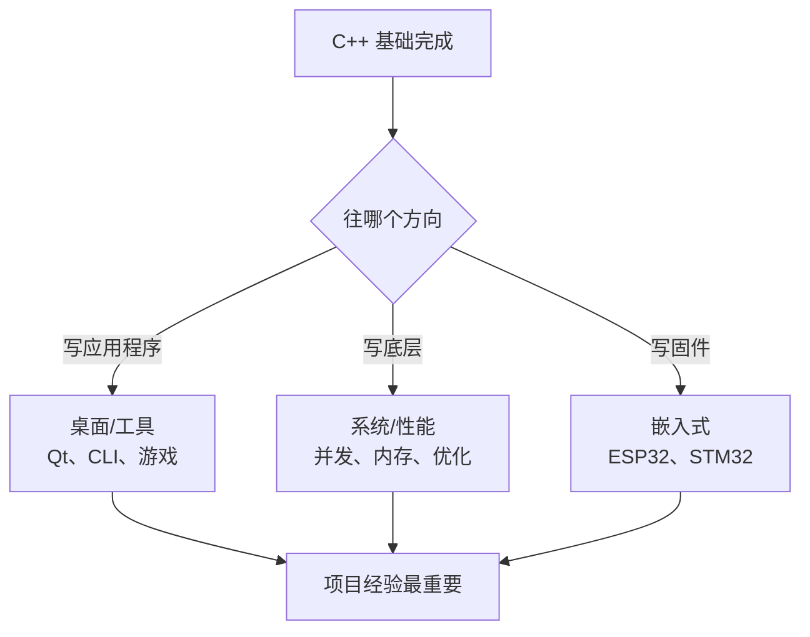

# 30 下一步

**本课目标**：知道自己现在在什么位置，以及接下来该做什么。

## 你现在会什么

30 节课走完，你掌握了：

| 能力 | 说明 |
| --- | --- |
| 基础语法 | 引用、`auto`、范围 for、重载 |
| 面向对象 | 类、构造析构、拷贝语义、运算符重载、继承多态 |
| **RAII** | 资源自动管理（C++ 最重要的思想） |
| 标准库 | `string`、`vector`、智能指针、容器、算法 |
| 移动语义 | 避免不必要的深拷贝 |
| 错误处理 | 异常、异常安全 |
| 工程 | 命名空间、头文件、CMake、编译链接 |
| 底层 | 名字修饰、ODR、内存布局、UB |

**这份基础已经够写真正有用的程序了。**

## 三条深入路线



### 路线 A：桌面 / 工具开发

**适合**：想做能看见的软件。

| 要学 | 说明 |
| --- | --- |
| **Qt** | 最主流的 C++ GUI 框架 |
| **文件与网络** | `<filesystem>`、socket、HTTP 客户端 |
| **JSON/配置** | nlohmann/json、toml++ |
| **测试** | Catch2 / GoogleTest |

**第一步**：用 Qt 写一个能用的记事本或计算器。

### 路线 B：系统 / 性能

**适合**：想搞懂底层、做高性能程序。

| 要学 | 说明 |
| --- | --- |
| **并发** | `std::thread`、`mutex`、`atomic`、内存序 |
| **性能分析** | `perf`、VTune、benchmark |
| **内存模型** | 缓存、对齐、false sharing |
| **网络编程** | epoll/io_uring、asio |

**第一步**：写一个多线程的下载器或简易服务器。

### 路线 C：嵌入式

**适合**：想玩硬件。

| 要学 | 说明 |
| --- | --- |
| **ESP32** | ESP-IDF（C 为主，但支持 C++） |
| **STM32** | HAL 库 + C++ 封装 |
| **RTOS** | FreeRTOS 任务/队列/信号量 |
| **无堆编程** | 静态分配、`std::array` |

**第一步**：买一块 ESP32-S3，用 C++ 写一个点灯+串口输出的程序。

（本站有 [ESP 系列](../../hardware/esp/) 和 [STM 系列](../../hardware/stm/) 教程。）

## 值得深入的主题

按优先级：

:::tip[第一优先：并发]
```cpp
#include <thread>
#include <mutex>
#include <atomic>
```

**为什么优先**：现代程序几乎都涉及多线程，而且**并发 bug 最难查**（数据竞争、死锁、内存序）。

**学习顺序**：

1. `std::thread` 基础
2. `std::mutex` + `lock_guard`（RAII 已学过）
3. `std::atomic` 与内存序
4. 条件变量
5. 线程池 / 任务队列
:::

:::tip[第二优先：性能分析]
**会用工具比会背优化技巧重要。**

```bash
# Linux
perf record ./prog && perf report

# 用 Google Benchmark 做微基准
```

**记住**：不测就优化 = 瞎猜。
:::

:::tip[第三优先：调试与测试]
- **gdb / lldb** 深入用法（watchpoint、条件断点）
- **单元测试**（Catch2 很小巧）
- **ASan/UBSan/TSan**（ThreadSanitizer 抓数据竞争）
:::

## 真正提升的方法

:::danger[只看教程不会变强]
**C++ 的能力来自"踩坑 + 复盘"，不是"看完"。**

**有效的循环**：

```
写一个有点难度的东西
    ↓ 卡住
查文档 / 搜索 / 读别人的代码
    ↓ 解决
想清楚"为什么之前不行"
    ↓
下一个更难的东西
```
:::

### 具体建议

| 做法 | 效果 |
| --- | --- |
| **每个概念都写代码验证** | 避免"以为懂了" |
| **读优秀开源代码** | 学工程实践（推荐 fmt、spdlog、nlohmann/json） |
| **用 `-Wall -Wextra -Wpedantic` 编译** | 让编译器教你 |
| **开发期开 ASan/UBSan** | 抓隐藏 bug |
| **每个项目用 CMake** | 养成工程习惯 |
| **写测试** | 重构才有底气 |

## 推荐的入门项目

按难度递增：

| 项目 | 练什么 |
| --- | --- |
| 命令行待办清单（JSON 存储） | 文件、`std::string`、`vector`、算法 |
| 简易计算器（支持括号、优先级） | 栈、解析、错误处理 |
| 单词频率统计 | `map`、文件读取、排序 |
| 矩阵运算库 | 类、运算符重载、模板 |
| 简易 HTTP 客户端 | 网络、异常、RAII |
| 多线程下载器 | 并发、线程池、同步 |
| 俄罗斯方块 / 贪吃蛇 | 状态机、循环、渲染 |
| 简易 JSON 解析器 | 递归下降、`string_view`、`optional` |

:::tip[选一个你"真的想用"的]
**做自己会用的工具，动力最足。**

比如：批量重命名脚本、日志分析器、Markdown 目录生成器……

**做完比做完美重要。**
:::

## 常见误区

:::danger[四个常见的停滞原因]
**① 一直在学语法，从不做项目**

C++ 语法是学不完的。**够用就去写东西。**

**② 追求"最现代"的写法**

能用 C++11 解决就别纠结 C++20 的写法。**清晰 > 时髦。**

**③ 不用工具**

不用 CMake、不用 ASan、不用格式化工具 → 手工劳动占了大半时间。

**④ 不读别人的代码**

只看自己写的 → 学不到工程实践。
:::

## 一份持续学习清单

| 资源 | 用途 |
| --- | --- |
| cppreference.com | **最权威的参考手册**（查 API 首选） |
| C++ Core Guidelines | 官方最佳实践清单 |
| Compiler Explorer (godbolt.org) | **看代码编译成什么汇编** |
| cppinsights.io | 看编译器把语法糖展开成什么 |

:::tip[godbolt 和 cppinsights 特别值钱]
**godbolt**：直观看到"这个抽象有没有开销"（[第 27 课](./27-performance)的结论就能自己验证）。

**cppinsights**：看到范围 for、lambda、结构化绑定**到底展开成什么代码**——理解"零开销"的最好工具。
:::

## 回到学习站

| 想做什么 | 去哪 |
| --- | --- |
| 补 C 的底层细节 | [C 零基础](../c-basics/) |
| C++ 更深入（vtable、模板元编程） | [C++ 进阶](../cpp/) |
| 学 Python（做工具/数据处理更快） | [Python 零基础](../python-basics/) |
| 玩硬件 | [ESP 系列](../../hardware/esp/) · [STM 系列](../../hardware/stm/) |
| 学 Linux 开发板 | [Linux 系列](../../hardware/linux/) |
| 查 API | [速查表](../../reference/) |

## 最后一句话

**C++ 给你的不是"更多语法"，而是"更多控制权"。**

你可以精确决定内存怎么分配、对象什么时候销毁、虚函数走不走间接跳转。

**这份控制权既是能力，也是责任**——它要求你比写 Python 时更清楚自己在干什么。

:::tip[但记住最重要的一条]
**用 RAII 管理资源，你就避开了 C++ 90% 的坑。**

`std::string`、`std::vector`、`std::unique_ptr`——这三个足够支撑绝大多数项目。

**剩下的交给标准库和编译器。**
:::

## 本课自检

- [ ] 能列出自己已掌握的能力清单
- [ ] 知道自己该走哪条路线（应用/系统/嵌入式）
- [ ] 有一份具体的下一步学习计划
- [ ] 知道并发是优先级最高的深入主题
- [ ] 知道要用 ASan/CMake/格式化工具
- [ ] 知道"做项目"比"看教程"重要
- [ ] 收藏了 cppreference 和 godbolt
- [ ] 记住"用 RAII 管理资源"这条核心原则

---

**回到**：[C++ 零基础教程目录](./) · [软件编程总览](../)
