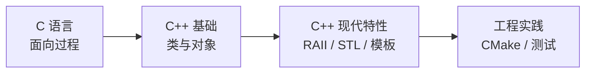

# C++ 零基础完整教程

**这条线适合两类人**：

- **会 C，想学 C++**（最常见的路径）
- **完全零基础**（建议先走 [C 零基础](../c-basics/)，否则会很痛苦）

## 为什么学 C++

| 理由 | 说明 |
| --- | --- |
| **比 C 安全** | RAII 自动管理资源，`std::string` 不用管长度 |
| **比 C 表达力强** | 泛型、重载、命名空间，代码更简洁 |
| **性能不输 C** | 「零开销抽象」——不用就不付代价 |
| **嵌入式也在用** | Arduino 框架、部分 RTOS 上层都是 C++ |

:::warning[但也别高估它]
C++ 的复杂度是出了名的：

- **语法极其庞杂**（标准文档 1800+ 页）
- **同样的功能有 N 种写法**，新手容易纠结
- **编译错误信息可以长达几百行**

**好消息**：日常开发用到的只是其中一小部分。**这条线只教"够用"的那部分**，不会把你淹没在语法细节里。
:::

## 和 C 的关系

**C++ 是 C 的超集**（基本兼容）：C 的语法几乎都能在 C++ 里用。

但**写 C++ 不等于用 C 的写法**——后面会反复强调「**用 C++ 的方式解决问题**」。

## 这条线的设计

| 特点 | 说明 |
| --- | --- |
| **每节只讲一件事** | 150~300 行，15 分钟读完 |
| **从 C 的痛点出发** | 每个新特性都先讲"它解决了 C 的什么问题" |
| **代码全实测** | 输出是真实运行结果 |
| **不碰冷门语法** | 只教日常真正会用的 |

## 全部 30 节

### 第一阶段：从 C 到 C++（5 节）

| # | 课 | 你会知道 |
| --- | --- | --- |
| 01 | [C++ 是什么](./01-what-is-cpp) | 和 C 的区别、为什么值得学 |
| 02 | [第一个 C++ 程序](./02-first-program) | `iostream`、`std::cout`、编译方式 |
| 03 | [引用与 const](./03-reference) | 引用 vs 指针、const 正确性 |
| 04 | [函数重载与默认参数](./04-overload) | 同名函数、给参数设默认值 |
| 05 | [auto 与范围 for](./05-auto-range) | 让编译器推导类型、更简洁的遍历 |

### 第二阶段：类与对象（6 节）

| # | 课 | 你会做 |
| --- | --- | --- |
| 06 | [类与对象入门](./06-class) | 定义类、成员函数、访问控制 |
| 07 | [构造函数与析构函数](./07-ctor-dtor) | 对象怎么创建和销毁 |
| 08 | [拷贝构造与赋值](./08-copy) | 对象复制的陷阱 |
| 09 | [运算符重载](./09-operator) | 让自定义类型支持 `+`、`==` |
| 10 | [继承与多态](./10-inherit) | 虚函数、`override` |
| 11 | [阶段实战：简易银行账户](./11-project-bank) | 用类做完整程序 |

### 第三阶段：RAII 与现代特性（8 节）

**这是 C++ 最有价值的部分。**

| # | 课 | 你会知道 |
| --- | --- | --- |
| 12 | [RAII：C++ 的核心思想](./12-raii) | 为什么 C++ 不用手动 `free` |
| 13 | [std::string 与 std::vector](./13-string-vector) | 告别 `char[]` 和 `malloc` |
| 14 | [智能指针 unique_ptr](./14-unique-ptr) | 自动释放的内存管理 |
| 15 | [智能指针 shared_ptr](./15-shared-ptr) | 共享所有权与循环引用 |
| 16 | [移动语义入门](./16-move) | `std::move` 到底做了什么 |
| 17 | [STL 容器选型](./17-containers) | vector/list/map/set 怎么选 |
| 18 | [STL 算法与 lambda](./18-algorithms) | `sort`/`find`/`for_each` + 匿名函数 |
| 19 | [阶段实战：学生管理系统](./19-project-students) | 用 vector + 类 + 算法 |

### 第四阶段：进阶与工程（11 节）

| # | 课 | 你会知道 |
| --- | --- | --- |
| 20 | [模板入门](./20-templates) | 泛型编程、写一个通用函数 |
| 21 | [异常处理](./21-exceptions) | `try/catch`、异常安全 |
| 22 | [命名空间与头文件](./22-namespace) | 组织大型项目 |
| 23 | [const 的完全指南](./23-const) | 各种位置的 const |
| 24 | [编译与链接](./24-build) | 四阶段、头文件与 ODR |
| 25 | [CMake 入门](./25-cmake) | 现代 C++ 工程标配 |
| 26 | [调试与常见错误](./26-debug) | 链接错误、未定义行为 |
| 27 | [性能与零开销抽象](./27-performance) | 什么时候 C++ 真的不比 C 慢 |
| 28 | [嵌入式 C++](./28-embedded) | 为什么很多嵌入式项目禁用异常和 RTTI |
| 29 | [现代 C++ 特性速览](./29-modern) | C++11/14/17/20 值得用的特性 |
| 30 | [下一步](./30-next) | 往哪个方向深入 |

## 学完之后

- 想补 C 的地基 → [C 零基础](../c-basics/)
- 想深入 C++ → [C++ 进阶](../cpp/)
- 想玩硬件 → [ESP 系列](../../hardware/esp/)
- 想学 C 的底层细节 → [Linux 系列](../../hardware/linux/)

## 学习建议

1. **C++ 不要从零学**。如果你没学过 C，先花两周走完 [C 零基础](../c-basics/) 的前 20 课
2. **每个例子都编译运行**。C++ 的坑大多在运行时才暴露
3. **别陷入语法细节**。知道「有这个东西」比「背下所有规则」重要
4. **记住一句话**：**用 C++ 的方式写 C++**，别把 C 代码改个后缀就当 C++ 用
