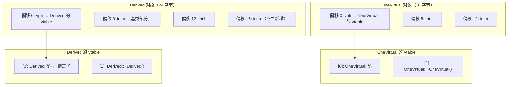

# 03 vtable：多态的实现原理
标准**不规定**多态怎么实现（只规定行为），但**所有主流编译器都用虚函数表（vtable / virtual method table）**。下面用实测展示 GCC 的实现。


看懂这张图就理解了一句话：**虚函数调用不是"查名字"，而是"按下标取函数指针再间接跳转"**——这也是它比普通函数调用慢、且无法内联的原因。

### 对象内存布局

```cpp
// vtable_layout.cpp
#include <cstdio>
#include <cstdint>

struct NoVirtual {
    int a;
    int b;
    void f() {}
};

struct OneVirtual {
    int a;
    int b;
    virtual void f() {}
    virtual ~OneVirtual() {}
};

struct Derived : OneVirtual {
    int c;
    void f() override {}
};

// 读取对象前 8 字节（vptr）
template<typename T>
uintptr_t read_vptr(const T& obj) {
    return *reinterpret_cast<const uintptr_t*>(&obj);
}

// 读取 vtable 的第 i 项
uintptr_t vtable_slot(uintptr_t vptr, int i) {
    return reinterpret_cast<uintptr_t*>(vptr)[i];
}

int main() {
    std::printf("sizeof(NoVirtual)  = %zu   (只有两个 int)\n", sizeof(NoVirtual));
    std::printf("sizeof(OneVirtual) = %zu   (多了一个 vptr)\n", sizeof(OneVirtual));
    std::printf("sizeof(Derived)    = %zu\n", sizeof(Derived));
    std::printf("sizeof(void*)      = %zu\n", sizeof(void*));

    OneVirtual o1, o2;
    Derived d;

    std::printf("\n--- 对象地址与 vptr\n");
    std::printf("&o1 = %p  vptr(o1) = %#lx\n", (void*)&o1, (unsigned long)read_vptr(o1));
    std::printf("&o2 = %p  vptr(o2) = %#lx   (同一类的对象共享 vtable)\n",
                (void*)&o2, (unsigned long)read_vptr(o2));
    std::printf("&d  = %p  vptr(d)  = %#lx   (不同类，不同 vtable)\n",
                (void*)&d, (unsigned long)read_vptr(d));

    std::printf("\n--- OneVirtual 的 vtable 前几项\n");
    uintptr_t vp1 = read_vptr(o1);
    for (int i = 0; i < 3; ++i)
        std::printf("  slot[%d] = %#lx\n", i, (unsigned long)vtable_slot(vp1, i));

    std::printf("\n--- Derived 的 vtable 前几项\n");
    uintptr_t vpd = read_vptr(d);
    for (int i = 0; i < 3; ++i)
        std::printf("  slot[%d] = %#lx\n", i, (unsigned long)vtable_slot(vpd, i));
}
```

**实测输出：**

```text
sizeof(NoVirtual)  = 8   (只有两个 int)
sizeof(OneVirtual) = 16   (多了一个 vptr)
sizeof(Derived)    = 24
sizeof(void*)      = 8

--- 对象地址与 vptr
&o1 = 00000037c31ff840  vptr(o1) = 0xa711aae0
&o2 = 00000037c31ff850  vptr(o2) = 0xa711aae0   (同一类的对象共享 vtable)
&d  = 00000037c31ff860  vptr(d)  = 0xa711ab10   (不同类，不同 vtable)

--- OneVirtual 的 vtable 前几项
  slot[0] = 0xa7118080
  slot[1] = 0xa71180a0
  slot[2] = 0xa7118090

--- Derived 的 vtable 前几项
  slot[0] = 0xa71180b0
  slot[1] = 0xa71180d0
  slot[2] = 0xa71180c0
```



**实测确认的三件事：**

1. **加了虚函数后对象多了一个指针的大小**（8 字节，64 位平台）——这就是 vptr
2. **同一类的所有对象共享同一张 vtable**（`o1` 和 `o2` 的 vptr 相同）
3. **vptr 位于对象的最前面**（偏移 0）

:::info[vtable 里还有什么]
除了虚函数指针，vtable 通常还包含：
- 指向 RTTI 信息（`type_info`）的指针
- 虚基类偏移
- （Itanium ABI，GCC/Clang 用）vtable 前两项是 "offset to top" 和 "typeinfo pointer"，真正的虚函数从第 0 或第 2 项开始

**这些是实现细节（Itanium C++ ABI），不是标准。** 别写依赖它们的代码——但理解它们能帮你调试。
:::

### 多重继承下的布局

```cpp
// multi_inherit.cpp
#include <cstdio>

struct A { virtual void fa() {} int a = 1; virtual ~A() = default; };
struct B { virtual void fb() {} int b = 2; virtual ~B() = default; };
struct C : A, B { int c = 3; void fa() override {} void fb() override {} };

int main() {
    std::printf("sizeof(A) = %zu\n", sizeof(A));
    std::printf("sizeof(B) = %zu\n", sizeof(B));
    std::printf("sizeof(C) = %zu   (两个 vptr + 三个 int)\n", sizeof(C));

    C c;
    std::printf("&c  = %p\n", (void*)&c);
    std::printf("(A*)&c = %p   (A 子对象在同一地址)\n", (void*)static_cast<A*>(&c));
    std::printf("(B*)&c = %p   (B 子对象有偏移！)\n", (void*)static_cast<B*>(&c));
    std::printf("offset of B subobject = %td\n",
                (char*)static_cast<B*>(&c) - (char*)&c);
}
```

**实测输出：**

```text
sizeof(A) = 16
sizeof(B) = 16
sizeof(C) = 32   (两个 vptr + 三个 int)
&c  = 00000093f1fffa20
(A*)&c = 00000093f1fffa20   (A 子对象在同一地址)
(B*)&c = 00000093f1fffa30   (B 子对象有偏移！)
offset of B subobject = 16
```

**多重继承时对象里有多个 vptr**，`B*` 和 `C*` 的地址**不一样**——编译器在转换时插入了偏移调整。这也解释了为什么「C 风格强转 `(B*)&c`」在多重继承下会出错，必须用 `static_cast`。

---

**翻页**：[← 上一页](./advanced-02) · [下一页 →](./advanced-04) · [返回目录](./)
