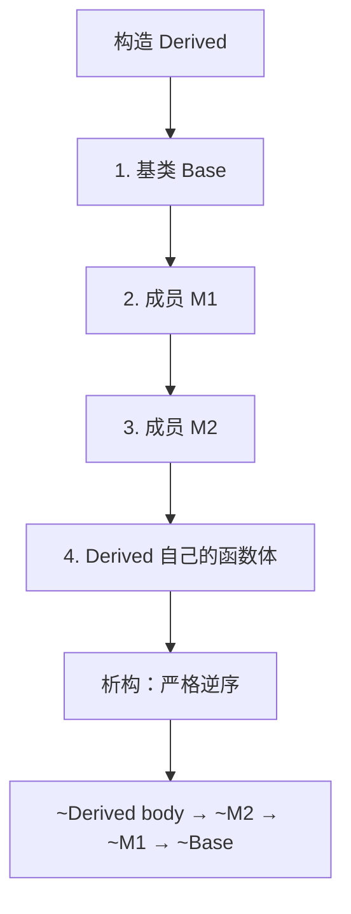

# 01 类与对象
**这里解决一个问题：C 里"资源的获取和释放靠人记"，C++ 里怎么让编译器保证它一定发生。**

答案只有一个词：**RAII**。这一页把 RAII 的地基——构造、析构、拷贝、移动——全部讲透，因为后面所有内容（智能指针、容器、锁、文件句柄）都是它的应用。

## 本页学什么

- 构造/析构的调用时机（含构造顺序的实测）
- 拷贝构造 vs 拷贝赋值：不是一回事
- 移动语义的接口形态（深入见 [移动语义](./move-semantics)）
- RAII：为什么它是 C++ 最重要的一个思想
- Rule of 0 / Rule of 3 / Rule of 5：什么时候必须写哪些函数
- `this` 指针、`static` 成员、友元

## 1. 构造与析构：调用时机

### 一个最小可观测的例子

```cpp
// lifecycle.cpp
#include <cstdio>

struct Tracer {
    const char* name;
    explicit Tracer(const char* n) : name(n) {
        std::printf("  ctor   %s\n", name);
    }
    ~Tracer() {
        std::printf("  dtor   %s\n", name);
    }
};

int main() {
    std::printf("--- enter main\n");
    {
        std::printf("--- enter block\n");
        Tracer a("a");
        {
            Tracer b("b");
        }
        std::printf("--- left inner block\n");
    }
    std::printf("--- left outer block\n");
    std::printf("--- exit main\n");
}
```

编译运行：

```bash
g++ -std=c++17 -fno-elide-constructors -o lifecycle.exe lifecycle.cpp && ./lifecycle.exe
```

**实测输出：**

```text
--- enter main
--- enter block
  ctor   a
  ctor   b
  dtor   b
--- left inner block
  dtor   a
--- left outer block
--- exit main
```

三个结论：

1. **构造函数在对象"诞生"时调用，析构在"离开作用域"时调用**——不是你手动调用的
2. **析构顺序与构造顺序严格相反**（栈的 LIFO）
3. 这个"离开作用域就自动析构"的机制，就是 RAII 的全部地基

### 成员与基类的构造顺序


```cpp
// order.cpp
#include <cstdio>

struct M1 { M1() { std::printf("  M1\n"); } ~M1() { std::printf("  ~M1\n"); } };
struct M2 { M2() { std::printf("  M2\n"); } ~M2() { std::printf("  ~M2\n"); } };

struct Base { Base() { std::printf("  Base\n"); } ~Base() { std::printf("  ~Base\n"); } };

struct Derived : Base {
    M1 m1;
    M2 m2;
    Derived() { std::printf("  Derived body\n"); }
    ~Derived() { std::printf("  ~Derived body\n"); }
};

int main() {
    std::printf("--- construct\n");
    Derived d;
    std::printf("--- destroy\n");
}
```

**实测输出：**

```text
--- construct
  Base
  M1
  M2
  Derived body
--- destroy
  ~Derived body
  ~M2
  ~M1
  ~Base
```



:::info[顺序是标准保证的]
**构造顺序是标准保证的**：基类（按继承声明顺序）→ 成员（按**声明顺序**，不是初始化列表顺序）→ 自己的函数体。

这引出一个经典 bug：**初始化列表的顺序和成员声明顺序不一致时，GCC 会警告**：

```cpp
struct S {
    int a;
    int b;
    S() : b(1), a(b) { }   // 实际先初始化 a（用未初始化的 b！）
};
```

**真实警告：**

```text
warning: 'S::b' will be initialized after 'S::a' [-Wreorder]
```

**永远让初始化列表的顺序 = 声明顺序。**
:::

## 2. 拷贝构造 vs 拷贝赋值

这两个经常被混淆，但它们是**不同的函数，在不同场合被调用**：

| 场合 | 调用的函数 | 对象状态 |
| --- | --- | --- |
| `T b = a;`（a 已存在） | **拷贝构造** | b 是新建的 |
| `T b(a);` | **拷贝构造** | b 是新建的 |
| `b = a;`（b 已存在） | **拷贝赋值** | b 已构造完 |
| 传值参数 `f(T x)` | **拷贝构造** | x 是新建的 |
| `return x;`（某些情况） | 拷贝/移动构造 | 见 [RVO](./move-semantics) |

```cpp
// copy_assign.cpp
#include <cstdio>
#include <utility>

struct Buf {
    int id;
    explicit Buf(int i) : id(i)                 { std::printf("  ctor(%d)\n", id); }
    Buf(const Buf& o) : id(o.id)                { std::printf("  copy-ctor from %d\n", o.id); }
    Buf& operator=(const Buf& o)                { std::printf("  copy-assign %d <- %d\n", id, o.id);
                                                  id = o.id; return *this; }
    Buf(Buf&& o) noexcept : id(o.id)            { std::printf("  move-ctor from %d\n", o.id); }
    Buf& operator=(Buf&& o) noexcept            { std::printf("  move-assign %d <- %d\n", id, o.id);
                                                  id = o.id; return *this; }
    ~Buf()                                      { std::printf("  dtor(%d)\n", id); }
};

void by_value(Buf x) { std::printf("  inside by_value id=%d\n", x.id); }

int main() {
    std::printf("1) Buf a(1);\n");      Buf a(1);
    std::printf("2) Buf b = a;\n");     Buf b = a;
    std::printf("3) Buf c(3);\n");      Buf c(3);
    std::printf("4) c = a;\n");         c = a;
    std::printf("5) by_value(a);\n");   by_value(a);
    std::printf("6) by_value(Buf(9));\n"); by_value(Buf(9));
    std::printf("7) Buf d = std::move(a);\n"); Buf d = std::move(a);
    std::printf("8) end of scope\n");
}
```

编译（**关掉 RVO 才能看到完整的拷贝/移动**）：

```bash
g++ -std=c++17 -fno-elide-constructors -o copy_assign.exe copy_assign.cpp && ./copy_assign.exe
```

**实测输出：**

```text
1) Buf a(1);
  ctor(1)
2) Buf b = a;
  copy-ctor from 1
3) Buf c(3);
  ctor(3)
4) c = a;
  copy-assign 3 <- 1
5) by_value(a);
  copy-ctor from 1
  inside by_value id=1
  dtor(1)
6) by_value(Buf(9));
  ctor(9)
  inside by_value id=9
  dtor(9)
7) Buf d = std::move(a);
  move-ctor from 1
8) end of scope
  dtor(1)
  dtor(1)
  dtor(1)
  dtor(1)
```

不加 `-fno-elide-constructors` 时输出会短很多（临时对象被优化掉）。**这个差异本身就是理解 RVO 的最好教材**，详见 [移动语义](./move-semantics)。

---

**翻页**：[下一页 →](./classes-02) · [返回目录](./)
