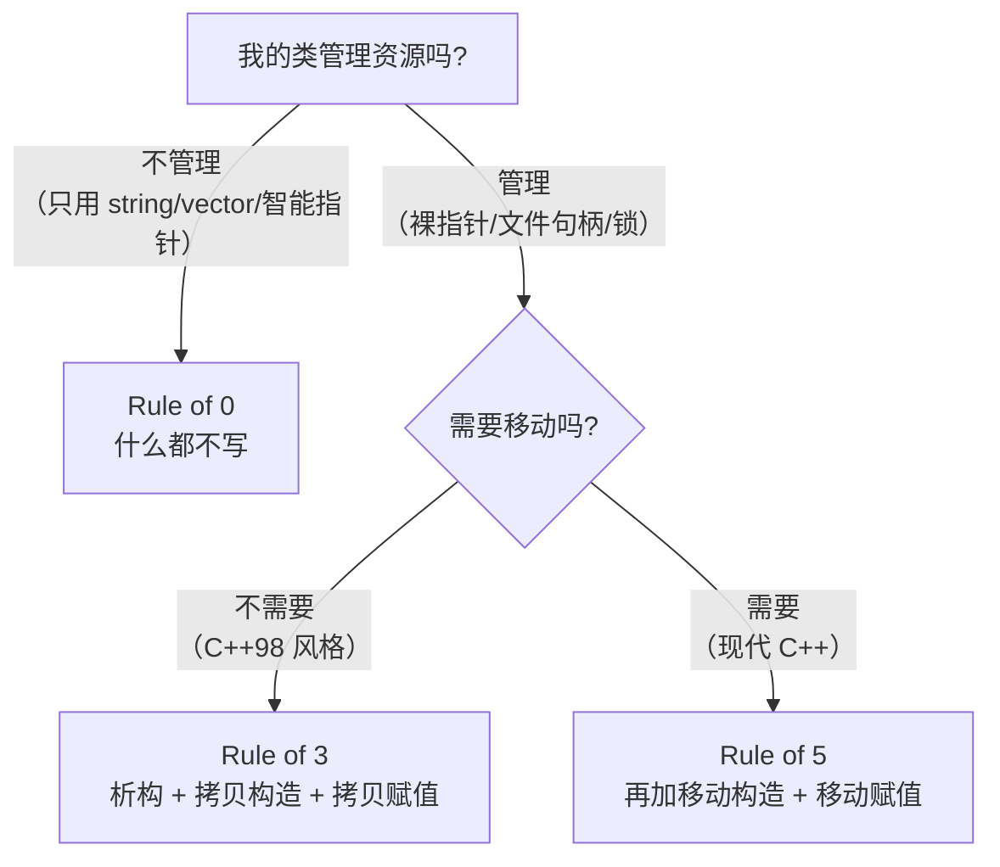

# 02 RAII：C++ 最重要的一个思想
### 定义

**RAII = Resource Acquisition Is Initialization**（资源获取即初始化）。

拆开说：

- **资源的获取**放在构造函数里
- **资源的释放**放在析构函数里
- 因为析构函数在离开作用域时**一定**被调用（无论正常返回还是抛异常），所以**资源一定被释放**

### 对比：C 的写法 vs C++ 的写法

```c
/* C 的写法：每个出口都要记得释放 */
int process_file(const char* path) {
    FILE* f = fopen(path, "r");
    if (!f) return -1;

    char* buf = malloc(4096);
    if (!buf) { fclose(f); return -2; }   /* 记得 fclose */

    if (parse(buf) < 0) {
        free(buf);                        /* 记得 free */
        fclose(f);                        /* 记得 fclose */
        return -3;
    }

    free(buf);
    fclose(f);
    return 0;
}
```

```cpp
// C++ 的写法：一个出口都不用记
int process_file(const std::string& path) {
    std::ifstream f(path);          // 析构时自动 close
    if (!f) return -1;

    std::vector<char> buf(4096);    // 析构时自动 free
    if (parse(buf) < 0) return -3;  // 直接 return，f 和 buf 都会正确释放

    return 0;
}
```

**关键差异不是"少写了几行"，而是"不可能忘记"。** 第一条路每加一个错误分支就多一次忘记释放的机会；第二条路的正确性由编译器保证。

### 异常安全：RAII 的真正价值

如果中间抛异常呢？

```cpp
// raii_exception.cpp
#include <cstdio>
#include <memory>
#include <stdexcept>

struct Guard {
    const char* n;
    explicit Guard(const char* s) : n(s) { std::printf("  acquire %s\n", n); }
    ~Guard()                             { std::printf("  release %s\n", n); }
};

void risky(bool boom) {
    Guard g1("mutex");
    Guard g2("file handle");
    std::printf("  ... working ...\n");
    if (boom) throw std::runtime_error("something failed");
    std::printf("  ... done ...\n");
}

int main() {
    try {
        std::printf("--- normal path\n");
        risky(false);
    } catch (const std::exception& e) {
        std::printf("caught: %s\n", e.what());
    }
    try {
        std::printf("--- exception path\n");
        risky(true);
    } catch (const std::exception& e) {
        std::printf("caught: %s\n", e.what());
    }
}
```

**实测输出：**

```text
--- normal path
  acquire mutex
  acquire file handle
  ... working ...
  ... done ...
  release file handle
  release mutex
--- exception path
  acquire mutex
  acquire file handle
  ... working ...
  release file handle
  release mutex
caught: something failed
```

**注意异常路径下的输出**：虽然 `throw` 直接跳出了函数，`g2` 和 `g1` 的析构**依然被调用了，且顺序正确**。这是标准保证的：栈展开（stack unwinding）过程中，已构造完成的局部对象会按逆序析构。

:::warning[析构函数里不要抛异常]
如果析构函数在栈展开过程中又抛出异常，C++ 会直接调用 `std::terminate()` 终止程序。

**规则：析构函数必须 `noexcept`**（不写时默认也是 `noexcept`，因为 C++11 起析构函数默认带 `noexcept`——但只要你声明了可能抛出的成员析构就会改变）。详见 [进阶特性](./advanced)。
:::

### 一个自己写的 RAII 封装

理解原理最好的方式是自己写一个：

```cpp
// my_raii.cpp
#include <cstdio>
#include <cstdlib>
#include <stdexcept>

// 封装 C 的 FILE*
class FileHandle {
public:
    explicit FileHandle(const char* path) : fp_(std::fopen(path, "r")) {
        if (!fp_) throw std::runtime_error("fopen failed");
        std::printf("  opened %s\n", path);
    }
    ~FileHandle() {
        if (fp_) { std::printf("  closed\n"); std::fclose(fp_); }
    }
    // 禁止拷贝（否则两个对象会 fclose 同一个 FILE*）
    FileHandle(const FileHandle&) = delete;
    FileHandle& operator=(const FileHandle&) = delete;
    // 允许移动
    FileHandle(FileHandle&& o) noexcept : fp_(o.fp_) { o.fp_ = nullptr; }
    FileHandle& operator=(FileHandle&& o) noexcept {
        if (this != &o) { if (fp_) std::fclose(fp_); fp_ = o.fp_; o.fp_ = nullptr; }
        return *this;
    }
    std::FILE* get() const { return fp_; }
private:
    std::FILE* fp_;
};

int main() {
    try {
        FileHandle f("my_raii.cpp");
        std::printf("  using file: %p\n", (void*)f.get());
    } catch (const std::exception& e) {
        std::printf("error: %s\n", e.what());
    }
}
```

**实测输出：**

```text
  opened my_raii.cpp
  using file: 000001D344DE0370     ← 地址每次运行都不同
  closed
```

这个 30 行的类就是 `std::unique_ptr` 的雏形。注意三个关键点：

1. **构造时获取，析构时释放**
2. **删除拷贝**（否则 double-free）
3. **实现移动**（转移所有权，把源置空）

## 4. Rule of 0 / 3 / 5

这是关于"什么时候必须写哪些特殊成员函数"的判据。

### 五个特殊成员函数

| 函数 | 签名 | 何时被调用 |
| --- | --- | --- |
| 析构函数 | `~T()` | 对象销毁 |
| 拷贝构造 | `T(const T&)` | 从同类对象新建 |
| 拷贝赋值 | `T& operator=(const T&)` | 已存在对象被赋值 |
| 移动构造 | `T(T&&) noexcept` | 从右值新建 |
| 移动赋值 | `T& operator=(T&&) noexcept` | 已存在对象被右值赋值 |

### 三条规则



- **Rule of 0**（推荐）：**不写任何特殊成员函数**。成员全部用能自我管理的类型（`std::string`、`std::vector`、`std::unique_ptr`），编译器生成的默认版本就完全正确。
- **Rule of 3**：如果你需要自己写析构函数（说明你在管理资源），那么**几乎一定**也需要自己写拷贝构造和拷贝赋值——否则默认的浅拷贝会出问题。
- **Rule of 5**：在 Rule of 3 的基础上，加上移动构造和移动赋值，让对象能被高效转移。

### 不遵守 Rule of 3 会怎样：一个真实崩溃

```cpp
// shallow.cpp —— 故意的错误示范，请勿模仿
#include <cstdio>
#include <cstring>
#include <cstdlib>

struct BadString {
    char* data;
    explicit BadString(const char* s) {
        data = (char*)std::malloc(std::strlen(s) + 1);
        std::strcpy(data, s);
        std::printf("  ctor  data=%p\n", (void*)data);
    }
    ~BadString() {
        std::printf("  dtor  data=%p\n", (void*)data);
        std::free(data);          // 析构里释放
    }
    // 故意不写拷贝构造：编译器生成的是"浅拷贝"
};

int main() {
    BadString a("hello");
    BadString b = a;              // 浅拷贝：b.data 和 a.data 指向同一块内存
    std::printf("a.data=%p b.data=%p  (same!)\n", (void*)a.data, (void*)b.data);
    std::printf("--- end of scope: will double-free\n");
}
```

**实测输出（MinGW，可能崩溃或不崩）：**

```text
（无稳定输出：double free 是未定义行为）
（开了堆检查 → 直接 abort；没开 → 可能静默跑完，然后在别处莫名崩）
```

**两个对象析构时 `free` 了同一块内存**——这就是经典的 **double free**。在开启堆检查的环境里会直接崩溃；在没检查的环境里它"可能正常工作"，然后某天在别的地方莫名其妙地崩。

:::danger[这就是为什么 Rule of 3 是硬规则]
只要你写了析构函数，就必须同时处理拷贝。**或者更好的做法：不写析构函数——用 `std::string` 代替 `char*`，问题直接消失（Rule of 0）。**
:::

### 现代写法：Rule of 0 的实际形态

```cpp
// rule_of_zero.cpp
#include <string>
#include <vector>
#include <memory>

struct Good {
    std::string name;                    // 自己管内存
    std::vector<int> samples;            // 自己管内存
    std::unique_ptr<int> optional_data;  // 自己管所有权

    // 什么都不用写！
    // 编译器生成的移动/析构全部正确；拷贝被自动删除（unique_ptr 不可拷贝）
};

int main() {
    Good a{"sensor", std::vector<int>{1,2,3}, std::make_unique<int>(42)};
    // Good b = a;              // ❌ 编译错：unique_ptr 让拷贝构造被删除
    Good c = std::move(a);      // ✅ 移动，正确
}
```

**这就是现代 C++ 的常态：绝大多数类应该是 Rule of 0。** 只有"封装裸资源"的那几个底层类（比如上面的 `FileHandle`）才需要 Rule of 5。

### `= default` 与 `= delete`

```cpp
struct Explict {
    Explict() = default;                              // 显式要求编译器生成
    Explict(const Explict&) = delete;                 // 明确禁止拷贝
    Explict& operator=(const Explict&) = delete;
    Explict(Explict&&) = default;                     // 允许移动
    ~Explict() = default;
};
```

- `= default`：**我要编译器生成的那个版本**（可用于恢复被抑制的默认函数）
- `= delete`：**这个函数不存在**，任何调用都是编译错误

:::info[一个重要细节]
一旦你**声明了移动构造或移动赋值**（即使是 `= default`），编译器就**不再隐式生成拷贝构造和拷贝赋值**（它们被定义为 `delete`）。反过来也一样：声明了拷贝操作，移动操作就不再隐式生成。

这就是为什么 `FileHandle` 里我显式写了 `= delete`——明确表达意图，比依赖隐式规则清晰。
:::

### 移动后对象的状态

```cpp
std::string a = "hello";
std::string b = std::move(a);
// a 现在处于"有效但未指定"状态
```

**标准规定：被移动后的对象处于"valid but unspecified state"（有效但未指定的状态）。** 具体来说：

- ✅ 可以对它赋值（`a = "new";`）
- ✅ 可以析构它
- ✅ 可以调用**没有前置条件**的函数（如 `std::string::size()`、`clear()`、`empty()`）
- ❌ **不能假设它的值**（不能假设 `a` 是空字符串——虽然多数实现会置空）

**唯一安全的做法：移动之后，要么重新赋值，要么不再使用它。**

---

**翻页**：[← 上一页](./classes-01) · [下一页 →](./classes-03) · [返回目录](./)
