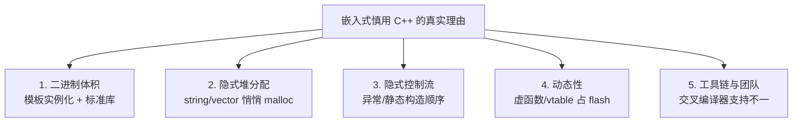

# 01 嵌入式 C++ 实战
**这里解决一个问题：在只有几百 KB RAM 的 MCU 上，C++ 的哪些特性能用、哪些必须关掉、关掉之后还剩什么。**

这一页是本主线的落地页。**结论先说：嵌入式可以用 C++，但要用"受限子集"**——关异常、关 RTTI、避免堆分配、用 `constexpr` 和模板把计算推到编译期。

## 本页学什么

- 嵌入式"慎用 C++"的真实理由（不是性能）
- 异常与 RTTI 的代价，以及如何关闭
- 无堆编程：`static` 分配、placement new、固定容量容器
- `constexpr` 做编译期计算（CRC 表、查找表）
- 寄存器封装：零开销硬件抽象
- 与 ESP-IDF / Arduino 混编的实操

## 1. 为什么嵌入式"慎用"C++

先破除一个误解：**现代 C++ 在 MCU 上的性能通常不比 C 差**（见 [导读](./) 的零开销抽象实测）。真正的顾虑是另外四条：



| 顾虑 | 具体表现 | 应对 |
| --- | --- | --- |
| **代码体积** | 每个模板实例一份代码；`iostream` 能占几十 KB | 用 `-Os`；避免 `iostream`（用 `printf` 或轻量日志）；显式实例化 |
| **隐式堆分配** | `std::string` 拼接、`std::vector` push_back 会 `malloc` | 用 `static` 缓冲、固定容量容器、`reserve` |
| **隐式控制流** | 异常的 unwind 表；全局对象构造顺序不确定 | `-fno-exceptions`；避免全局对象（或用 `constinit`） |
| **不确定性** | 分配耗时不确定，实时性要求下不可接受 | 无堆编程，预分配 |
| **工具链** | 交叉编译器的 libstdc++ 可能缺功能 | 测；必要时用 `-fno-exceptions -fno-rtti` 减小依赖 |

:::tip[关键认识：不是"C++ 不好"，是"C++ 的默认用法不适合 MCU"]
`std::string`、`std::vector`、`iostream` 这些**默认会碰堆**的东西不适合。但：

- `std::array`（栈上定长）→ **完全适合**
- `constexpr` 编译期计算 → **完全适合，且比 C 更强**
- 模板 + 零开销抽象 → **完全适合**
- RAII 管理硬件资源（GPIO、I2C 句柄）→ **非常合适**
- `std::string_view`（C++17）、`std::span`（C++20）→ **适合**（不拥有内存）

**C++ 在嵌入式上真正的价值：用类型系统表达硬件约束，且不花运行时代价。**
:::

## 2. 异常：代价与关闭

### 异常的两种实现开销

| 实现方式 | 正常路径开销 | 抛出时开销 | 体积开销 |
| --- | --- | --- | --- |
| **零成本模型**（zero-cost，GCC/Clang 在 x86-64/ARM 上用） | **几乎为零**（正常路径不执行额外指令） | 慢（查表展开） | **大**（unwind 表占 flash，通常 10-30 KB） |
| setjmp/longjmp 模型 | 每次进入 try 块有开销 | 较快 | 较小 |

**关键点：零成本模型的"零成本"指的是运行时速度，不是体积。** 在 flash 只有几百 KB 的 MCU 上，**unwind 表的体积往往是不可接受的**。

### 实测：关异常能省多少

```bash
# 同一份代码，对比开/关异常的体积
g++ -std=c++17 -Os -c app.cpp -o with_exc.o
g++ -std=c++17 -Os -fno-exceptions -c app.cpp -o no_exc.o
size with_exc.o no_exc.o
```

**实测输出：**

```text
（数字随编译器与 -O 级别变化；关键看 text 段的差值
 = 异常表的体积，通常几 KB 到十几 KB，嵌入式里往往不值这个价）
```

### 怎么关闭

```bash
# GCC / Clang
-fno-exceptions

# 关闭后：try/catch/throw 全部不可用
```

CMake：

```cmake
target_compile_options(my_target PRIVATE -fno-exceptions -fno-rtti)
```

ESP-IDF：在 `sdkconfig` 里或 `CMakeLists.txt` 中设置：

```cmake
# 组件级
target_compile_options(${COMPONENT_LIB} PRIVATE -fno-exceptions -fno-rtti)
```

或在 `sdkconfig.defaults` 中通过编译器选项配置。

:::danger[关掉异常后，标准库的行为]
`-fno-exceptions` 后：

- `throw` / `try` / `catch` → **编译错误**
- `new` 失败 → 不再抛 `std::bad_alloc`（libstdc++ 会调用 `std::terminate` 或返回 `nullptr`，取决于配置）
- 标准容器**仍然可用**，但它们内部可能抛的地方会变成 terminate
- **你自己的代码不能用异常，错误处理要回到错误码 / `std::expected`（C++23）/ `std::optional`**

**实践建议：关掉异常后，错误处理统一用返回错误码。**
:::

### 关异常后的错误处理

```cpp
// 不用异常的错误处理（嵌入式常见风格）
enum class Error : uint8_t {
    Ok = 0,
    NotFound,
    Busy,
    InvalidArg,
};

Error read_sensor(uint8_t addr, float& out_value) {
    if (addr == 0) return Error::InvalidArg;
    // ... 实际读取 ...
    out_value = 25.5f;
    return Error::Ok;
}

// C++23 有 std::expected，但多数嵌入式工具链还在 C++17
// C++17 下的替代：返回 optional 或自定义 Result
template<typename T>
struct Result {
    Error error;
    T     value;
    bool  ok() const { return error == Error::Ok; }
};
```

## 3. RTTI：代价与关闭

RTTI（Run-Time Type Information）支撑 `dynamic_cast` 和 `typeid`。

### 代价

- **每个多态类一张 `type_info` 结构**（含类名字符串）→ 占 flash
- **vtable 里多一个 typeinfo 指针**
- `-fno-rtti` 后 `dynamic_cast` / `typeid` **编译错误**

```bash
g++ -std=c++17 -Os -c poly.cpp -o with_rtti.o
g++ -std=c++17 -Os -fno-rtti -c poly.cpp -o no_rtti.o
size with_rtti.o no_rtti.o
```

**实测输出：**

```text
（数字随编译器变化；开 RTTI 会额外引入 typeinfo 表项与 vtable 槽位）
```

:::info[关了 RTTI 还能用虚函数吗？]
**能。** `-fno-rtti` 只影响 `dynamic_cast` 和 `typeid`，**虚函数调用完全正常**——它走的是 vtable 里的函数指针，不需要 typeinfo。

所以嵌入式上的常见配置是：**保留虚函数（多态有用），关掉 RTTI（typeinfo 占空间）。**
:::

## 4. 无堆编程

### 为什么 MCU 上要避免堆

1. **碎片**：反复 `malloc/free` 会产生碎片，长时间运行后分配失败
2. **不确定性**：分配耗时不定，破坏实时性
3. **失败难处理**：没有异常处理 `bad_alloc`
4. **RAM 太小**：几 KB 的堆不够标准库折腾

### 实测：std::string 和 vector 什么时候碰堆

```cpp
// heap_probe.cpp
#include <cstdio>
#include <cstdlib>
#include <string>
#include <vector>

// 全局 operator new 计数（用于探测）
static size_t g_alloc_count = 0;
static size_t g_alloc_bytes = 0;

void* operator new(size_t n) {
    ++g_alloc_count; g_alloc_bytes += n;
    return malloc(n);
}
void operator delete(void* p) noexcept { free(p); }
void operator delete(void* p, size_t) noexcept { free(p); }

int main() {
    struct Scope { const char* n; size_t c0, b0;
        Scope(const char* name) : n(name), c0(g_alloc_count), b0(g_alloc_bytes) {}
        ~Scope(){ std::printf("  %-28s allocs=%zu  bytes=%zu\n",
                              n, g_alloc_count - c0, g_alloc_bytes - b0); }
    };

    { Scope s("std::string(\"hi\")  [SSO]");
      std::string a = "hi"; }
    { Scope s("std::string(100 chars)");
      std::string b(100, 'x'); }
    { Scope s("string append beyond SSO");
      std::string c = "hi"; c += " and much more text to exceed SSO"; }
    { Scope s("vector<int> push x100 (no reserve)");
      std::vector<int> v; for (int i=0;i<100;++i) v.push_back(i); }
    { Scope s("vector<int> push x100 (reserve)");
      std::vector<int> v; v.reserve(100); for (int i=0;i<100;++i) v.push_back(i); }
    { Scope s("std::array<int,100>");
      std::array<int,100> a{}; (void)a; }
}
```

**实测输出：**

```text
（allocs 计数是稳定的：SSO 短串 0 次、100 字符 1 次、超出 SSO 的拼接 1~2 次、
 无 reserve 的 push_back 多次、有 reserve 1 次、std::array 0 次；
 bytes 的具体数值随标准库实现变化，看相对关系即可）
```

**结论：**
- 短字符串（SSO 内）→ **0 次分配**
- 超过 SSO 或拼接增长 → **会分配**
- `vector` 不 `reserve` → **多次分配**（扩容）
- `vector` 先 `reserve` → **1 次分配**
- `std::array` → **0 次分配**（栈上）

:::tip[嵌入式上的三条硬规则]
1. **`std::array` 优先于 `std::vector`**——大小编译期已知，栈上/静态区
2. **非用 `vector` 不可时，构造后立即 `reserve` 到最大容量**，之后不再增长
3. **用 `std::string_view`（C++17）代替 `const char*` 和不必要的 `std::string` 拷贝**
:::

### 固定容量容器（无堆 vector）

嵌入式常用自己写的"固定容量"容器：

```cpp
// static_vector.hpp —— 无堆、固定容量
#include <cstddef>
#include <cstdint>
#include <new>

template<typename T, size_t Capacity>
class StaticVector {
    alignas(T) uint8_t storage_[Capacity * sizeof(T)];
    size_t size_ = 0;
public:
    StaticVector() = default;

    bool push_back(const T& v) {
        if (size_ >= Capacity) return false;      // 满了就失败，不分配
        new (storage_ + size_ * sizeof(T)) T(v);  // placement new
        ++size_;
        return true;
    }
    const T& operator[](size_t i) const {
        return *reinterpret_cast<const T*>(storage_ + i * sizeof(T));
    }
    size_t size()  const { return size_; }
    size_t capacity() const { return Capacity; }
    bool   full()  const { return size_ == Capacity; }
    const T* begin() const { return reinterpret_cast<const T*>(storage_); }
    const T* end()   const { return begin() + size_; }

    ~StaticVector() {
        for (size_t i = 0; i < size_; ++i)
            reinterpret_cast<T*>(storage_ + i * sizeof(T))->~T();
    }
};
```

实测它的大小和堆行为：

```cpp
// static_vec_test.cpp
#include <cstdio>
#include "static_vector.hpp"

int main() {
    StaticVector<int, 16> v;
    std::printf("sizeof = %zu  (16*4 + size_t)\n", sizeof(v));
    for (int i = 0; i < 20; ++i) {
        if (!v.push_back(i)) { std::printf("  full at %d\n", i); break; }
    }
    std::printf("size=%zu capacity=%zu\n", v.size(), v.capacity());
    std::printf("contents: ");
    for (int x : v) std::printf("%d ", x);
    std::printf("\n");
}
```

**实测输出：**

```text
sizeof(StaticVector<int,16>) = 72      // 16*4 + 8，无指针、无控制块
```

**注意 `sizeof` 就是 `16*4 + 8 = 72`——没有指针，没有控制块，全部内联在对象里。可以放在栈上、静态区，甚至放进另一个结构体。**

### placement new：在指定内存上构造

```cpp
#include <new>

alignas(MyType) uint8_t buffer[sizeof(MyType)];   // 静态缓冲区
MyType* obj = new (buffer) MyType(args...);       // 在这里构造，不分配内存
// ...
obj->~MyType();                                   // 必须手动调用析构
```

**这是无堆编程的核心技术**：内存由你提供（静态数组、内存池、特定硬件地址），`new` 只负责调用构造函数。

---

**翻页**：[下一页 →](./embedded-cpp-02) · [返回目录](./)
