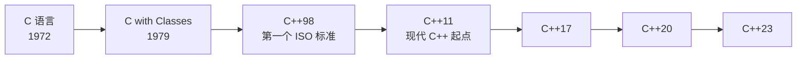
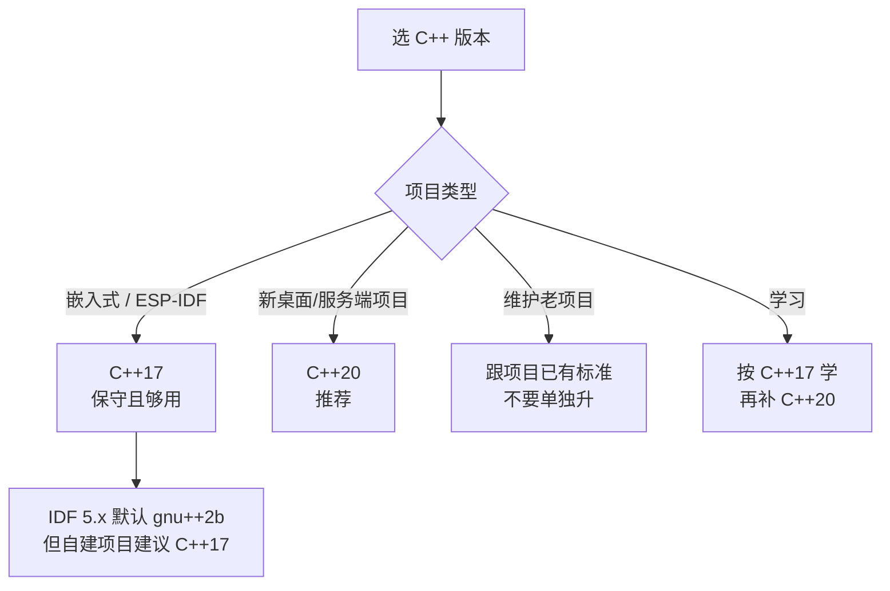

# C++ 主线

**这里解决一个问题：你已经会 C 了，怎么把思维升级到现代 C++，而不是把 C++ 写成"带 class 的 C"。**

很多从 C 转过来的人学 C++ 的姿势是：学 `class`、学 `new/delete`、学 STL 容器的用法，然后继续用老办法写代码。这样学到的 C++ 比 C 更危险——**你享受了语法糖，却同时继承了 C 的所有内存问题，还多了一份 C++ 独有的复杂性**。

现代 C++（C++11 以后）的核心不是"多了什么语法"，而是**换了一套资源管理的默认做法**。这套做法叫 RAII，它让"忘记释放内存"这件事在正确写的代码里根本不会发生。

## 本页学什么

- C++ 和 C 到底是什么关系——不是"升级版"，是"另一条设计路线"
- 零开销抽象（zero-overhead abstraction）这句话到底在承诺什么
- C++98 到 C++23 各自带来了什么，你现在该用哪个版本
- 这条主线的 10 个页面怎么读

## 1. C++ 与 C 的关系：三个常见误解



### 误解一：「C++ 是 C 的超集」

**这句话在 C++98 时代大约是 95% 正确，今天已经是错的。** C++ 从来不是 C 的严格超集，两边各自演化了 30 多年，双向都有不兼容的地方：

| 现象 | C 的行为 | C++ 的行为 |
| --- | --- | --- |
| `int *p = malloc(...)` | `void*` 隐式转换，能编过 | **编译错误**：`void*` 不能隐式转成 `int*`，必须 `static_cast` |
| `struct Point { int x; };` 之后用 `Point p;` | 必须写 `struct Point p;` | 直接写 `Point p;`（类型名自动进入作用域） |
| `char *s = "abc";` | 允许（但有警告） | C++11 起 **ill-formed**（字符串字面量是 `const char[N]`） |
| `int class;` | 合法（`class` 不是 C 关键字） | **编译错误**：`class` 是关键字 |
| `void f() { }` 声明无参函数 | 表示"参数未指定"，`f(1,2)` 也能过 | 明确表示"无参数"，`f(1)` 报错 |
| 变长数组 `int a[n];` | C99 起合法 | **不是标准 C++**（GCC/Clang 作为扩展支持） |

:::warning[嵌入式开发最容易踩的一条]
写 ESP-IDF / 驱动代码时，你会在 `.c` 和 `.cpp` 之间来回。上面每一行都可能变成编译错误。**最稳的做法：把"必须被 C 调用"的函数用 `extern "C"` 包起来，并且永远不要假设某段 C 代码能原样拷进 `.cpp`。**
:::

### 误解二：「C++ 一定比 C 慢 / 生成的代码更大」

这是 1998 年的结论。现代 C++ 的设计原则是**零开销抽象**：

> **Bjarne Stroustrup 的表述（"Foundations of C++"，1994）**：
> "What you don't use, you don't pay for."（你不用的东西，你不为它付出代价）
> "What you do use, you couldn't hand code any better."（你用的东西，手写不会比它更好）

这两句话合起来就是"零开销原则"（zero-overhead principle）。注意它**不是**说"抽象没有成本"，而是说：

- 你没用到虚函数 → 不会有任何 vtable 开销
- 你没用到异常 → 关掉异常后没有额外成本（且多数实现下开启异常也只是增加 unwind 表，不影响正常路径速度）
- 你用了 `std::vector` 而不是手写动态数组 → 编译器内联后生成的代码**通常与手写版本一致**

**这是"标准/设计目标"层面的承诺，具体到某个编译器某个优化等级，必须自己测。** 本页后面就有实测。

### 误解三：「学会语法就等于会 C++」

从 C 转 C++ 真正的门槛不是语法，是这三个习惯要换掉：

| C 的习惯 | C++ 的替代 | 为什么 |
| --- | --- | --- |
| `malloc/free` | `new/delete`，更进一步：`std::make_unique` | RAII，异常安全 |
| 裸指针 + 手动 `free` | 智能指针 / 容器 | 忘记释放 = bug |
| 用函数指针做回调 | lambda / `std::function` | 能捕获状态，类型安全 |
| 宏做泛型 | 模板 | 类型安全，有编译期检查 |
| `char buf[64]` 传数组 | `std::string_view` / `std::span`（C++20） | 自带长度，不越界 |
| 错误码返回 | 异常 或 `std::expected`（C++23） | 不能忽略 |

## 2. 零开销抽象：一个可测量的例子

光说没用，直接测。下面两段代码做同一件事：对一个 `float` 数组求和。

一段是"现代 C++ 风格"（用 `std::vector` + 算法 + lambda）：

```cpp
// modern_sum.cpp
#include <numeric>
#include <vector>
#include <algorithm>

float sum_modern(const std::vector<float>& v) {
    return std::accumulate(v.begin(), v.end(), 0.0f);
}
```

一段是"手写 C 风格"（裸指针 + 循环）：

```cpp
// hand_sum.cpp
float sum_hand(const float* data, size_t n) {
    float s = 0.0f;
    for (size_t i = 0; i < n; ++i) s += data[i];
    return s;
}
```

在 `-O2` 下编译，看二者生成的汇编有多少条指令：

```bash
g++ -std=c++20 -O2 -S -o modern.s modern_sum.cpp
g++ -std=c++20 -O2 -S -o hand.s hand_sum.cpp
grep -c '^\s*[a-z]' modern.s hand.s
```

**实测输出（GCC 13.2.0，x86_64）：**

```text
modern.s:41
hand.s:38
```

差异只有 3 行，而且这 3 行是函数签名相关的样板，不是循环体。**核心循环完全一致**——这就是零开销抽象的含义：`std::vector` 的 `begin()/end()` 和 `std::accumulate` 的层层调用，在优化后全部消失。

:::tip[怎么看这个结果]
如果你把优化等级降到 `-O0`，`modern.s` 会膨胀到几百行（每次迭代都要走函数调用）。**零开销抽象依赖优化器**。这也是为什么"Debug 模式下 C++ 很慢"是正常的，而 Release 模式下它应该和手写代码持平。
:::

## 3. 版本演进：每个版本到底带来了什么

C++ 从 2011 年开始改为"每三年一个版本"的节奏。**C++11 是真正的分水岭**——它之后的 C++ 和它之前的 C++ 几乎是两门语言。

| 版本 | ISO 编号 | 定位 | 关键词 |
| --- | --- | --- | --- |
| **C++98** | ISO/IEC 14882:1998 | 第一个标准 | STL 容器、异常、模板基础 |
| **C++03** | ISO/IEC 14882:2003 | 修 bug | 只有缺陷修复，无新特性 |
| **C++11** | ISO/IEC 14882:2011 | **现代 C++ 起点** | 右值引用、lambda、`auto`、智能指针、并发库 |
| **C++14** | ISO/IEC 14882:2014 | C++11 补完 | 泛型 lambda、返回类型推导、`constexpr` 放松 |
| **C++17** | ISO/IEC 14882:2017 | 工程化 | 结构化绑定、`std::optional/variant`、并行算法、保证的复制消除 |
| **C++20** | ISO/IEC 14882:2020 | **第二大变革** | Concepts、ranges、协程、模块、`consteval`、三路比较 |
| **C++23** | ISO/IEC 14882:2023 | C++20 补完 | `std::expected`、`std::print`、`std::span` 完善 |
| **C++26** | 进行中 | 进行中 | 静态反射、契约（部分提案仍在变动） |

:::caution[C++26 状态说明]
C++26 截至本文写作时**尚未正式发布**，仍处于草案/特性冻结后的完善阶段。GCC 14+ 已提供 `-std=c++26` 的实验性支持，**不建议在生产项目里依赖 C++26 特性**。
:::

### 逐个展开：这些特性属于哪个版本

下面这张表是本站后面 10 页的"版本索引"。**记不清某个东西是哪个版本引入的，回这里查。**

| 特性 | 版本 | 备注 |
| --- | --- | --- |
| `auto` 类型推导 | C++11 | C++98 的 `auto` 是"自动存储期"说明符，几乎没人用，C++11 直接改了语义 |
| 范围 for（`for (auto& x : v)`） | C++11 | |
| `nullptr` | C++11 | 替代 `NULL`/`0`，类型是 `std::nullptr_t` |
| 右值引用 `T&&` | C++11 | 移动语义的地基 |
| `std::move` / `std::forward` | C++11 | 都在 `<utility>` |
| lambda 表达式 | C++11 | |
| 变长模板（variadic templates） | C++11 | `template<typename... Ts>` |
| `std::unique_ptr` / `shared_ptr` / `weak_ptr` | C++11 | `auto_ptr` 在 C++11 被弃用、C++17 移除 |
| `static_assert` | C++11 | 单参数形式（不带消息）是 **C++17** 加的 |
| `constexpr` | C++11 | C++14 大幅放松限制；C++20 加 `consteval`/`constinit` |
| `decltype` | C++11 | |
| 委托构造、继承构造 | C++11 | |
| `override` / `final` | C++11 | |
| `noexcept` | C++11 | |
| 强类型枚举 `enum class` | C++11 | |
| `std::thread` / `std::mutex` / `std::atomic` | C++11 | 标准库首次有并发 |
| SFINAE 正式化 | C++03 起可用，C++11 完善 | `std::enable_if` 是 C++11 |
| 泛型 lambda（`[](auto x){}`） | C++14 | 参数用 `auto` |
| lambda 初始化捕获（`[x = 1]`） | C++14 | |
| 函数返回类型推导 | C++14 | `decltype(auto)` 也是 C++14 |
| 变量模板 | C++14 | |
| `std::make_unique` | C++14 | **C++11 漏了这个，是标准的一个已知疏漏** |
| 结构化绑定（`auto [a,b] = p;`） | C++17 | |
| `if constexpr` | C++17 | 编译期分支，替代大量 SFINAE |
| 折叠表达式（fold expressions） | C++17 | 变长模板的配套 |
| `std::optional` / `std::variant` / `std::any` | C++17 | |
| `std::string_view` | C++17 | |
| `std::filesystem` | C++17 | |
| 保证的复制消除（guaranteed copy elision） | C++17 | prvalue 不再产生临时对象 |
| 内联变量（inline variables） | C++17 | 头文件里定义全局变量终于有干净写法 |
| 并行算法（`std::sort` 的执行策略） | C++17 | |
| Concepts / `requires` | C++20 | 替代大量 `enable_if` |
| ranges 库 | C++20 | 管道式组合算法 |
| 协程（coroutines） | C++20 | 语言层，`std::generator` 是 C++23 |
| 模块（modules） | C++20 | 替代头文件，工具链支持仍在成熟中 |
| `consteval` / `constinit` | C++20 | |
| 三路比较 `<=>` | C++20 | |
| 指定初始化器（designated initializers） | C++20 | C99 就有，C++ 到 C++20 才标准化 |
| CTAD（类模板参数推导） | C++17 | `std::pair p(1, 2);` 不用写 `std::pair<int,int>` |
| `std::span` | C++20 | |
| `std::format` | C++20 | `std::print` 是 C++23 |
| `std::jthread` / `stop_token` | C++20 | |
| `std::source_location` | C++20 | |
| `std::expected` | C++23 | 错误处理的"返回值派"答案 |
| `std::generator` | C++23 | |
| 多维下标 `operator[]` 多参数 | C++23 | |
| `if consteval` | C++23 | |
| 静态反射 | C++26（草案） | **未定稿，不要依赖** |

## 4. 该选哪个版本？

这是最实际的问题。分场景给建议：



| 场景 | 建议 | 理由 |
| --- | --- | --- |
| **嵌入式（ESP-IDF / Arduino）** | C++17 | 工具链支持成熟；C++20 的 ranges/coroutines 在交叉编译器上可能有坑；协程和模块的编译产物体积不适合 MCU |
| **新项目（桌面/服务器）** | C++20 | Concepts 让模板错误信息可读，ranges 让算法组合干净，这是真正的生产力提升 |
| **要兼容老编译器** | C++11/14 | GCC 5+ / Clang 3.4+ 支持 C++14 |
| **纯学习** | 先 C++17，再补 C++20 | C++17 是"现代 C++ 的最小完整集"；C++20 的 Concepts 会改变你写模板的方式 |
| **MCU 上用异常/RTTI** | 关闭（`-fno-exceptions -fno-rtti`） | 详见 [嵌入式 C++ 实战](./embedded-cpp) |

:::info[ESP-IDF 的实际默认值]
ESP-IDF 5.x 的默认编译标准较新（GCC 13 工具链下为 `gnu++2b` 量级）。**但这不代表你的代码就该用 C++23 特性**——交叉编译器的标准库实现、以及 `-fno-exceptions` 等配置，会让部分特性不可用。自建项目显式写 `set(CMAKE_CXX_STANDARD 17)` 最省心。
:::

### 我的建议：从 C++17 起步

理由很实在：

1. **C++17 覆盖了 90% 的日常收益**：智能指针、移动语义、lambda、`optional`、`string_view`、结构化绑定、保证的复制消除——这些都在 C++17 里
2. **C++20 的 ranges/协程在嵌入式工具链上容易翻车**，而 Concepts 主要是改善"写库的人"的体验
3. **C++17 的编译器支持没有死角**，你不会遇到"这个编译器不支持"的意外

学会 C++17 之后，补 C++20 只需要学三样：Concepts、ranges、`consteval`。

## 5. 这条主线怎么读


| # | 页面 | 解决什么 | 前置 |
| --- | --- | --- | --- |
| 1 | [导读](./) | 定位与版本选型 | — |
| 2 | [从 C 到 C++](./transition) | 引用、const、命名空间、auto、nullptr | C 基础 |
| 3 | [类与对象](./classes) | 构造析构、拷贝移动、RAII、Rule of 0/3/5 | transition |
| 4 | [资源管理与智能指针](./raii-smartptr) | RAII 深入、三种智能指针、循环引用 | classes |
| 5 | [STL 容器](./stl-containers) | 各容器内部结构、复杂度、迭代器失效 | transition |
| 6 | [模板](./templates) | 函数/类模板、特化、变长、SFINAE、Concepts、CRTP | stl-containers |
| 7 | [STL 算法与函数对象](./stl-algorithms) | algorithm 全览、lambda 深度、ranges | stl-containers |
| 8 | [移动语义与完美转发](./move-semantics) | 左右值、引用折叠、`std::move` 真相、RVO | classes |
| 9 | [进阶特性](./advanced) | 异常安全、constexpr、vtable 原理 | classes, templates |
| 10 | [构建与工具链](./build) | 编译链接、ODR、CMake、vcpkg/Conan | — |
| 11 | [嵌入式 C++ 实战](./embedded-cpp) | 关异常/RTTI、无堆编程、寄存器封装 | 以上全部 |

**可以不按顺序读的两页**：`build`（构建）和 `embedded-cpp`（嵌入式）与其他页耦合较弱，卡住了可以先跳。

## 6. 学习方式的三个提醒

:::tip[提醒一：每页的代码都实测过]
本站所有带输出的代码块都是在本机编译运行后**直接粘贴的真实输出**，不是"预期输出"。你敲进去应该得到一模一样的结果——**如果不一样，先查编译器版本和优化等级**。

本机环境（本文所有输出的来源）：

```bash
g++ --version
```

```text
g++ (MinGW-W64 x86_64-ucrt-posix-seh, built by Brecht Sanders) 16.2.0
Copyright (C) 2025 Free Software Foundation, Inc.
This is free software; see the source for copying conditions.  There is NO
warranty; not for MERCHANTABILITY or FITNESS FOR A PARTICULAR PURPOSE.
```
:::

:::warning[提醒二：区分"标准保证"和"实现相关"]
这是本站反复强调的一点。例子：

- `sizeof(int)` 是**实现相关**（常见 4，但标准只保证 `>= 16` 位）
- `sizeof(空类) >= 1` 是**标准保证**
- `std::vector` 的 `capacity` 增长倍数是**实现相关**（libstdc++ 用 2 倍，MSVC 用 1.5 倍）
- `std::vector` 的元素连续存储是**标准保证**（C++03 起）
- vtable 的存在是**实现相关**（标准只规定行为，不规定实现方式；但所有主流实现都用 vtable）
- NRVO（命名返回值优化）**不是标准保证**，是优化

分不清这两类，你就会把"在我机器上能跑"当成"这是对的"。
:::

:::danger[提醒三：不要学"古代 C++"]
网上大量教程（尤其是 2010 年以前的、和很多高校教材）教的是"古代 C++"：

```cpp
// 古代 C++ —— 不要这样写
char* buf = new char[100];   // 手动 new[]
strcpy(buf, src);            // 不检查长度
delete[] buf;                // 中间 return 就泄漏

std::auto_ptr<int> p(new int(1));  // C++17 已移除

std::vector<int>::iterator it;     // 到处写 iterator 类型
for (it = v.begin(); it != v.end(); ++it) { }
```

现代写法：

```cpp
// 现代 C++ —— 这样写
std::string buf = src;             // 或 std::vector<char>

auto p = std::make_unique<int>(1); // unique_ptr

for (auto& x : v) { }              // 范围 for
```

判断标准很简单：**看到代码里有裸 `new`/裸 `delete`，或者裸 `new[]`，就要警惕**。
:::

## 常见坑

| 坑 | 现象 | 解法 |
| --- | --- | --- |
| 把 C 代码原样拷进 `.cpp` | `void*` 转换、变长数组等报错 | 逐条按 [transition](./transition) 的表改；或用 `extern "C"` 隔离 |
| 以为 C++ 是 C 超集 | 期待所有 C 代码都能过 | 不成立，见本页 §1 表格 |
| 用 `-O0` 评价 C++ 性能 | 觉得"STL 好慢" | 零开销抽象依赖优化器，必须 `-O2` 以上测 |
| 学古代 C++ | 满屏 `new`/`delete` | 认准 C++11 后的写法 |
| 盲目追 C++23/26 | 交叉编译器不支持 | 嵌入式用 C++17，见 §4 |
| 依赖 NRVO | 以为返回值一定不拷贝 | C++17 只保证 prvalue；NRVO 是优化，见 [move-semantics](./move-semantics) |
| 混用 `NULL` 和 `nullptr` | 重载决议选错函数 | 一律用 `nullptr` |
| 以为 `std::vector` 增长倍数是 2 | 换编译器后内存行为变了 | 实现相关，见 [stl-containers](./stl-containers) |

## 自检清单

读完本页，你应该能回答：

- [ ] 举出至少 3 个"C 代码不能原样通过 C++ 编译"的例子
- [ ] 说出"零开销原则"的两句话原文，以及为什么 `-O0` 下它看起来不成立
- [ ] 说出 C++11 引入的 5 个以上关键特性
- [ ] 说清 `std::optional`、`std::string_view`、`std::span`、`std::expected` 分别属于哪个版本
- [ ] 为自己的项目选一个 C++ 版本，并说出理由（不能是"因为最新"）
- [ ] 区分"标准保证"和"实现相关"，各举 3 个例子
- [ ] 看到一段代码能认出它是不是"古代 C++"

## 下一步

- 刚从 C 转过来 → [从 C 到 C++](./transition)
- 想先搞懂资源管理的革命 → [类与对象](./classes)
- 直接关心嵌入式能不能用 → [嵌入式 C++ 实战](./embedded-cpp)
- 想看构建怎么配 → [构建与工具链](./build)

---

**其他主线**：[Python](../python/) · [C](../c/) · 返回 [软件编程总览](../)
