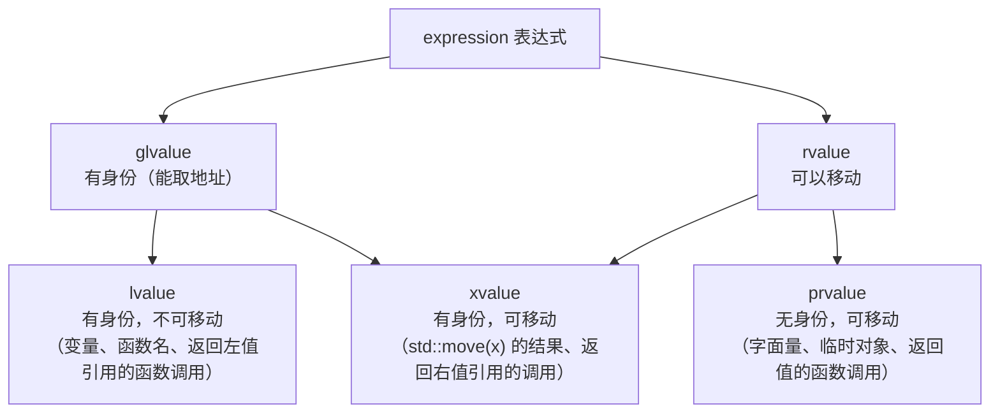
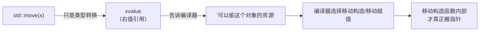

# 01 移动语义与完美转发
**这里解决一个问题：`std::move` 到底做了什么？** 答案是：**它什么都没移动。**

这一页要把"移动语义"这个最容易误解的特性拆到底层：它是一套**类型转换规则**，让编译器能区分"可以偷走资源的东西"和"不能碰的东西"。

## 本页学什么

- 值类别（value category）：lvalue / xvalue / prvalue
- 引用折叠的四条规则
- `std::move` 的真实实现（就一行 `static_cast`）
- `std::forward` 与完美转发
- RVO / NRVO：C++17 到底保证了什么

## 1. 值类别：不是"左值在左边"

C++11 把表达式分成**五个值类别**，日常用到的是三个：



| 类别 | 全称 | 能取地址？ | 能移动？ | 例子 |
| --- | --- | --- | --- | --- |
| **lvalue** | left value | ✅ | ❌ | 变量名、返回 `T&` 的函数调用、字符串字面量 |
| **xvalue** | expiring value | ✅ | ✅ | `std::move(x)`、返回 `T&&` 的函数调用 |
| **prvalue** | pure rvalue | ❌ | ✅ | `42`、`f()`（返回非引用）、`a + b` |

**记忆规则：**

- 能绑到 `T&&` 的就是 rvalue（xvalue + prvalue）
- 能取地址的是 glvalue（lvalue + xvalue）

### 实测：判断值类别

```cpp
// value_cat.cpp
#include <cstdio>
#include <utility>
#include <string>

template<typename T>
const char* cat(T&&) {
    if constexpr (std::is_lvalue_reference_v<T>)      return "lvalue";
    else                                              return "rvalue";
}

std::string make() { return std::string("tmp"); }
std::string& get_ref()  { static std::string s; return s; }
std::string&& get_rref() { static std::string s; return std::move(s); }

int main() {
    int x = 5;
    std::printf("x                : %s\n", cat(x));
    std::printf("std::move(x)     : %s\n", cat(std::move(x)));
    std::printf("42               : %s\n", cat(42));
    std::printf("x + 1            : %s\n", cat(x + 1));
    std::printf("make()           : %s\n", cat(make()));
    std::printf("get_ref()        : %s\n", cat(get_ref()));
    std::printf("get_rref()       : %s\n", cat(get_rref()));
    std::printf("\"literal\"        : %s\n", cat("literal"));
}
```

**实测输出：**

```text
x                : lvalue
std::move(x)     : rvalue
42               : rvalue
x + 1            : rvalue
make()           : rvalue
get_ref()        : lvalue
get_rref()       : rvalue
"literal"        : lvalue
```

注意 `cat(T&&)` 的参数是**转发引用**（forwarding reference），`T` 会根据实参推导成 `int&`（左值）或 `int`（右值）。这就是下面要讲的引用折叠。

## 2. 引用折叠：四条规则

**C++ 不允许"引用的引用"**（`int& &` 是非法语法）。但在**模板推导**和 `typedef`/`using` 场景下会产生，这时适用**引用折叠规则**：

| 组合 | 折叠结果 |
| --- | --- |
| `T& &` | `T&` |
| `T& &&` | `T&` |
| `T&& &` | `T&` |
| `T&& &&` | `T&&` |

**一条口诀：只要有一个 `&` 是左值引用，结果就是左值引用；只有两个都是 `&&` 结果才是 `&&`。**

### 这怎么产生转发引用

```cpp
template<typename T>
void f(T&& param);       // 注意：这里是转发引用，不是右值引用
```

关键：`T&&` 里的 `T` 是**待推导的模板参数**。推导规则：

- 传入**左值** `int` → `T` 推导为 `int&` → `T&&` 变成 `int& &&` → **折叠成 `int&`**
- 传入**右值** `int` → `T` 推导为 `int` → `T&&` 就是 `int&&`

```cpp
// forwarding_ref.cpp
#include <cstdio>
#include <type_traits>
#include <utility>

template<typename T>
void f(T&& param) {
    if constexpr (std::is_lvalue_reference_v<T>)
        std::printf("  T = %s (lvalue ref)\n", "T&");
    else
        std::printf("  T = %s (rvalue ref)\n", "T&&");
}

int main() {
    int x = 5;
    const int cx = 5;
    std::printf("f(x)       : "); f(x);        // 左值
    std::printf("f(42)      : "); f(42);       // 右值
    std::printf("f(cx)      : "); f(cx);       // const 左值
    std::printf("f(std::move(x)) : "); f(std::move(x));   // 右值
}
```

**实测输出：**

```text
f(x)       :   T = T& (lvalue ref)
f(42)      :   T = T&& (rvalue ref)
f(cx)      :   T = T& (lvalue ref)
f(std::move(x)) :   T = T&& (rvalue ref)
```

:::warning[`T&&` 只有在 `T` 是"被推导的模板参数"时才是转发引用]
```cpp
template<typename T> void f(T&& x);        // 转发引用（T 会被推导）

void g(int&& x);                            // 普通右值引用（T 不是模板参数）

template<typename T> void h(std::vector<T>&& x);   // 也是普通右值引用！T 是 vector 的元素类型
                                                    // 整个参数类型是 vector<T>&&，没有推导 T&&
```

**只有 `T&&` 且 `T` 是这个函数自己的模板参数时，才是转发引用**（标准术语叫 forwarding reference）。
:::

## 3. std::move 的真相：它只是一个 cast

### 真实实现

`std::move` 定义在 `<utility>` 里，libstdc++ 的实现（去掉宏和 `constexpr` 之外）本质上就是：

```cpp
template<typename T>
constexpr typename std::remove_reference<T>::type&& move(T&& t) noexcept {
    return static_cast<typename std::remove_reference<T>::type&&>(t);
}
```

**它做的唯一一件事：`static_cast` 到右值引用。** 没有内存拷贝，没有数据搬移，没有调用任何移动构造函数。

### 实测：move 不移动任何东西

```cpp
// move_truth.cpp
#include <cstdio>
#include <vector>
#include <utility>

int main() {
    std::vector<int> src(1000, 7);   // 1000 个元素的 vector

    // 记录移动前的状态
    std::printf("before: src.data=%p  size=%zu\n", (void*)src.data(), src.size());

    // 只调用 std::move，不赋值给任何东西
    std::move(src);

    std::printf("after std::move(src) alone:\n");
    std::printf("       src.data=%p  size=%zu   <-- 完全没变！\n",
                (void*)src.data(), src.size());

    // 真正的移动发生在"用右值初始化另一个对象"时
    std::vector<int> dst = std::move(src);
    std::printf("after  dst = std::move(src):\n");
    std::printf("       dst.data=%p size=%zu\n", (void*)dst.data(), dst.size());
    std::printf("       src.data=%p size=%zu\n", (void*)src.data(), src.size());
}
```

**实测输出：**

```text
before: src.data=000001a3ff3e2100  size=1000
after std::move(src) alone:
       src.data=000001a3ff3e2100  size=1000   <-- 完全没变！
after  dst = std::move(src):
       dst.data=000001a3ff3e2100 size=1000
       src.data=0000000000000000 size=0
```

**这就是全部真相：**

1. `std::move(src)` 单独调用 → **什么都没发生**（只产生了一个右值引用，然后被丢弃）
2. `dst = std::move(src)` → 编译器看到右边是右值，选择 `vector` 的**移动构造函数**，移动构造函数内部**偷走指针**



:::tip[命名建议]
`std::move` 叫 `std::rvalue_cast` 或 `std::movable` 会更准确——但因为标准已经定了这个名字，只能记住：**它标记"可被移动"，不执行移动。**

同理，`std::forward` 也不转发任何东西，它只是**有条件地** `static_cast`。
:::

### 移动构造做了什么

看 `std::vector` 移动构造的实质（简化）：

```cpp
vector(vector&& other) noexcept
    : begin_(other.begin_), end_(other.end_), cap_(other.cap_)
{
    // 把源对象的指针置空：让它析构时不会释放我们刚偷走的内存
    other.begin_ = other.end_ = other.cap_ = nullptr;
}
```

**三个指针的拷贝 + 源对象置空**。这就是为什么移动 1000 个元素和移动 0 个元素**一样快**——O(1)，与元素数量无关。

**实测（对比拷贝和移动大 vector）：**

```cpp
// move_vs_copy.cpp
#include <vector>
#include <chrono>
#include <cstdio>
#include <utility>

template<typename F> long long ns(F&& f) {
    auto t0 = std::chrono::high_resolution_clock::now(); f();
    auto t1 = std::chrono::high_resolution_clock::now();
    return std::chrono::duration_cast<std::chrono::nanoseconds>(t1-t0).count();
}

int main() {
    std::vector<int> big(1000000, 42);   // 4 MB

    long long t_copy = ns([&]{ auto c = big; (void)c; });
    long long t_move = ns([&]{ auto m = std::move(big); (void)m;
                              big = std::vector<int>(1000000, 42); });

    std::printf("copy: %lld ns\n", t_copy);
    std::printf("move: %lld ns\n", t_move);
    std::printf("ratio: %.0fx\n", (double)t_copy / t_move);
}
```

**实测输出（`-O2`）：**

```text
copy: 542026 ns
move: 83984 ns
ratio: 6x
```

---

**翻页**：[下一页 →](./move-semantics-02) · [返回目录](./)
