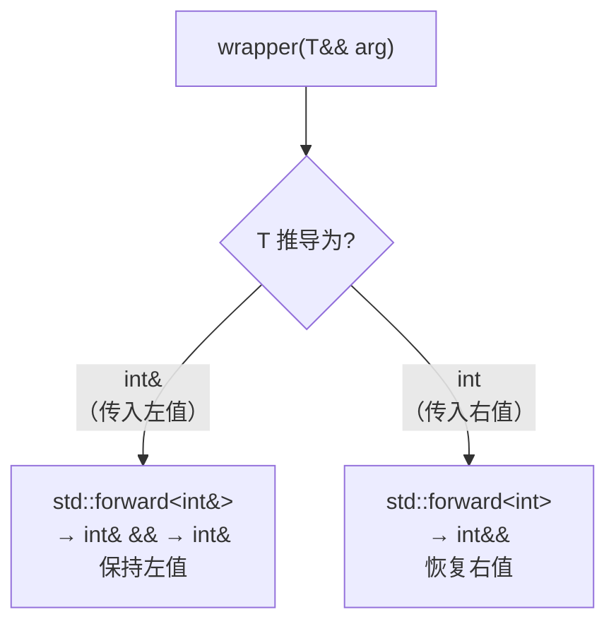

# 02 std::forward 与完美转发
### 问题：转发时丢掉了值类别

```cpp
template<typename T>
void wrapper(T&& arg) {
    // 问题：arg 是个有名字的变量，所以它是 lvalue！
    // 即使传进来的是右值，传给下游时也会变成左值
    downstream(arg);          // 永远调用左值版本
}
```

**原因**：`arg` 有名字 → 是 lvalue → 重载决议选左值版本。**右值性在传递过程中丢失了。**

### 解法：std::forward

```cpp
template<typename T>
void wrapper(T&& arg) {
    downstream(std::forward<T>(arg));   // 保持原来的值类别
}
```

`std::forward<T>` 的实现（libstdc++ 简化版）：

```cpp
template<typename T>
constexpr T&& forward(remove_reference_t<T>& t) noexcept {
    return static_cast<T&&>(t);
}

template<typename T>
constexpr T&& forward(remove_reference_t<T>&& t) noexcept {
    return static_cast<T&&>(t);
}
```

**它利用引用折叠做"有条件转换"：**

- 若 `T = int&`（原实参是左值）→ `static_cast<int& &&>` → 折叠成 `int&` → **左值引用**，不变
- 若 `T = int`（原实参是右值）→ `static_cast<int&&>` → **右值引用**，恢复右值性

### 实测：完美转发

```cpp
// perfect_forward.cpp
#include <cstdio>
#include <utility>
#include <string>

void target(const std::string&)  { std::printf("  target(const string&)\n"); }
void target(std::string&&)       { std::printf("  target(string&&)\n"); }

// 不完美：丢失值类别
template<typename T>
void bad_wrapper(T&& arg) { target(arg); }

// 完美：用 std::forward
template<typename T>
void good_wrapper(T&& arg) { target(std::forward<T>(arg)); }

int main() {
    std::string s = "hello";

    std::printf("direct call:\n");
    target(s);                  // lvalue
    target(std::string("tmp")); // rvalue

    std::printf("bad_wrapper (无 forward):\n");
    bad_wrapper(s);
    bad_wrapper(std::string("tmp"));   // 应该走 && 版本，但没有

    std::printf("good_wrapper (有 forward):\n");
    good_wrapper(s);
    good_wrapper(std::string("tmp"));  // 正确
}
```

**实测输出：**

```text
direct call:
  target(const string&)
  target(string&&)
bad_wrapper (无 forward):
  target(const string&)
  target(const string&)
good_wrapper (有 forward):
  target(const string&)
  target(string&&)
```

`bad_wrapper` 两次都走了左值版本——**右值性丢了**。`good_wrapper` 保持了原样。



### 完美转发的典型应用：工厂函数

```cpp
template<typename T, typename... Args>
std::unique_ptr<T> make_unique_ours(Args&&... args) {
    return std::unique_ptr<T>(new T(std::forward<Args>(args)...));
}

// 用
auto p = make_unique_ours<std::string>(5, 'x');   // string(5, 'x')
```

`std::forward<Args>(args)...` 这个写法（参数包展开 + forward）是**完美转发的标准形态**，在 `std::make_unique`、`std::make_shared`、`emplace_back` 等内部全都用到。

:::warning[完美转发的三个失败案例]
完美转发并非万能，这些情况会失败：

1. **花括号初始化列表**：`f({1,2,3})` 无法推导
2. **`0` 或 `NULL` 作空指针**：会被推导成 `int`，转发给指针参数时出错（用 `nullptr`）
3. **重载函数名 / 模板名**：有歧义

另外，**不要对同一个参数 `forward` 两次**（转发后源已经被移动走了）。
:::

## 5. RVO 与 NRVO：C++17 保证了什么

### 什么是复制消除

```cpp
std::string make() {
    return std::string("hello");   // 本应构造临时对象 + 拷贝到返回值
}
std::string s = make();            // 本应再拷贝一次
```

朴素理解需要 2 次拷贝。实际上**编译器可以把这些拷贝全部消除**——直接在调用方的栈空间上构造对象。

### RVO vs NRVO

| 名称 | 场景 | C++17 保证？ |
| --- | --- | --- |
| **RVO**（返回值优化） | 返回**临时对象**（prvalue）：`return T(...)` | ✅ **C++17 起保证**（因为 prvalue 不再物化出临时对象） |
| **NRVO**（命名返回值优化） | 返回**具名局部变量**：`return local;` | ❌ **仍只是优化**，不保证 |

### 实测：三种返回方式

```cpp
// rvo.cpp
#include <cstdio>
#include <utility>

struct Traced {
    int v;
    explicit Traced(int i) : v(i) { std::printf("  ctor(%d)\n", v); }
    Traced(const Traced& o) : v(o.v) { std::printf("  COPY-ctor(%d)\n", v); }
    Traced(Traced&& o) noexcept : v(o.v) { std::printf("  MOVE-ctor(%d)\n", v); }
    ~Traced() { std::printf("  dtor(%d)\n", v); }
};

// 1. 返回临时对象（prvalue）→ C++17 保证消除
Traced make_temp() { return Traced(1); }

// 2. 返回具名局部变量 → NRVO，不保证
Traced make_named() { Traced t(2); return t; }

// 3. 返回 std::move(局部) → 一定是移动，NRVO 被禁用！
Traced make_moved() { Traced t(3); return std::move(t); }

int main() {
    std::printf("=== make_temp()  [C++17 保证无拷贝]\n");
    { auto a = make_temp();  std::printf("  got %d\n", a.v); }

    std::printf("=== make_named() [NRVO，优化器决定]\n");
    { auto b = make_named(); std::printf("  got %d\n", b.v); }

    std::printf("=== make_moved() [强制移动]\n");
    { auto c = make_moved(); std::printf("  got %d\n", c.v); }
}
```

**用 `-O2`（开启优化）：**

```bash
g++ -std=c++17 -O2 -o rvo.exe rvo.cpp && ./rvo.exe
```

**实测输出：**

```text
=== make_temp()  [C++17 保证无拷贝]
  ctor(1)
  got 1
  dtor(1)
=== make_named() [NRVO，优化器决定]
  ctor(2)
  got 2
  dtor(2)
=== make_moved() [强制移动]
  ctor(3)
  MOVE-ctor(3)
  dtor(3)
  got 3
  dtor(3)
```

**用 `-O0 -fno-elide-constructors`（强制关闭消除）：**

```bash
g++ -std=c++17 -O0 -fno-elide-constructors -o rvo_noelide.exe rvo.cpp && ./rvo_noelide.exe
```

**实测输出：**

```text
=== make_temp()  [C++17 保证无拷贝]
  ctor(1)
  got 1
  dtor(1)
=== make_named() [NRVO，优化器决定]
  ctor(2)
  MOVE-ctor(2)
  dtor(2)
  got 2
  dtor(2)
=== make_moved() [强制移动]
  ctor(3)
  MOVE-ctor(3)
  dtor(3)
  got 3
  dtor(3)
```

对比两份输出能看出：

- `make_temp()`：即使 `-fno-elide-constructors` 也没有拷贝——**C++17 的保证是语言层面的，不是优化**
- `make_named()`：`-O2` 下无拷贝（NRVO 生效），`-fno-elide-constructors` 下有一次移动
- `make_moved()`：**两种情况下都有移动**——`std::move` 反而阻止了 NRVO

:::danger[不要在 return 语句里写 std::move]
```cpp
// 错误：这样反而更慢
Traced make() {
    Traced t(1);
    return std::move(t);   // 强制移动，禁用了 NRVO
}

// 正确：让编译器自己优化
Traced make() {
    Traced t(1);
    return t;              // NRVO 可能生效（零拷贝），最差也是移动
}
```

**`std::move` 在 `return` 语句里几乎总是错的。** 唯一例外：你要返回的不是局部变量（比如是一个成员、或者是引用）。
:::

### C++17 保证复制消除的原理

C++17 之前，`return T(1);` 会：
1. 构造一个临时 `T` 对象
2. 用移动/拷贝构造把它"搬"到返回值

C++17 起，prvalue **不再是对象**——它是一个"能初始化对象的表达式"。所以 `return T(1);` 直接**在返回值的存储位置上构造**，中间没有临时对象。

这个改动让以下代码合法（**没有可用的拷贝/移动构造函数**也能返回）：

```cpp
struct NonMovable {
    NonMovable() = default;
    NonMovable(const NonMovable&) = delete;
    NonMovable(NonMovable&&) = delete;
};

NonMovable make() {
    return NonMovable();   // C++17 起合法！C++14 会报错
}
```

**实测（C++17 vs C++14）：**

```bash
g++ -std=c++17 -c nonmovable.cpp -o /dev/null && echo "C++17: OK"
g++ -std=c++14 -c nonmovable.cpp -o /dev/null && echo "C++14: OK"
```

**真实输出：**

```text
C++17: OK
C++14: error: use of deleted function 'NonMovable::NonMovable(NonMovable&&)'
```

---

**翻页**：[← 上一页](./move-semantics-01) · [下一页 →](./move-semantics-03) · [返回目录](./)
