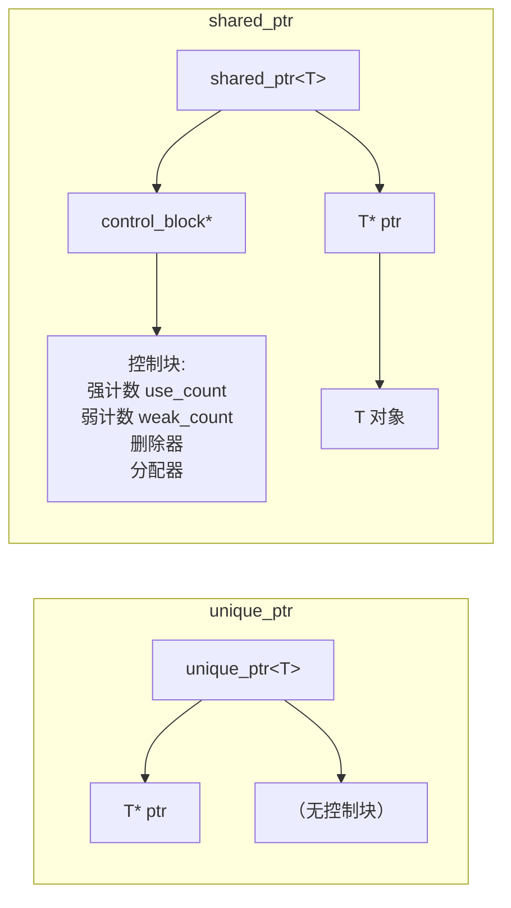

# 01 资源管理与智能指针
**这里解决一个问题：`new` 出来的对象，怎么保证一定被 `delete`。**

C++11 的答案是不让你写 `new`——用 `std::make_unique` / `std::make_shared` 创建，用智能指针持有，所有权规则由类型系统表达。这一页讲清这三个智能指针**内部到底长什么样**，因为"知道它多大、几个指针"比"会调用 `.get()`"重要得多。

## 本页学什么

- RAII 的三种资源：内存、文件句柄、锁
- `unique_ptr`：零开销的独占所有权
- `shared_ptr`：控制块、引用计数、`make_shared` 为什么更快
- `weak_ptr`：打破循环引用
- 自定义删除器：管理非内存资源
- 所有权语义怎么在 API 里表达

## 1. RAII 深入：不止是内存

RAII 管的不只是内存。任何"获取了必须归还"的东西都是资源：

| 资源 | 获取 | 释放 | C++ 的 RAII 封装 |
| --- | --- | --- | --- |
| 堆内存 | `new` / `malloc` | `delete` / `free` | `std::unique_ptr` / `std::vector` |
| 文件句柄 | `fopen` | `fclose` | `std::fstream` 或自定义删除器 |
| 互斥锁 | `lock()` | `unlock()` | `std::lock_guard` / `std::scoped_lock`（C++17） |
| 网络 socket | `socket()` | `close()` | 自定义删除器 |
| 硬件外设 | `i2c_master_bus_add_device` | `..._rm_device` | 自定义删除器（嵌入式常见） |
| 线程 | 创建 | `join` | `std::jthread`（C++20，析构自动 join） |

### 锁的 RAII：一个必须讲的例子

```cpp
// lock_raii.cpp
#include <mutex>
#include <cstdio>

std::mutex g_mtx;
int g_counter = 0;

void bad_increment() {
    g_mtx.lock();
    ++g_counter;
    if (g_counter == 2) return;    // 忘记 unlock！死锁
    g_mtx.unlock();
}

void good_increment() {
    std::lock_guard<std::mutex> guard(g_mtx);   // 构造时 lock
    ++g_counter;
    if (g_counter == 2) return;                 // 安全：析构时 unlock
}

int main() {
    good_increment();
    std::printf("counter = %d\n", g_counter);
    good_increment();
    std::printf("counter = %d, mutex still usable\n", g_counter);
}
```

**实测输出：**

```text
counter = 1
counter = 2, mutex still usable
```

`std::lock_guard` 就是"锁版本的 RAII"：构造函数 `lock()`，析构函数 `unlock()`。**无论函数从哪个出口离开，锁一定被释放。**

C++17 起用 `std::scoped_lock` 更好——它能一次锁多个互斥量且避免死锁：

```cpp
std::scoped_lock lock(mtx1, mtx2);   // C++17，用 std::lock 算法避免死锁
```

## 2. unique_ptr：零开销的独占所有权

### 它有多大？实测

```cpp
// ptr_sizes.cpp
#include <memory>
#include <cstdio>
#include <string>

struct Big { char pad[64]; };

int main() {
    std::printf("sizeof(void*)            = %zu\n", sizeof(void*));
    std::printf("sizeof(unique_ptr<int>)  = %zu\n", sizeof(std::unique_ptr<int>));
    std::printf("sizeof(shared_ptr<int>)  = %zu\n", sizeof(std::shared_ptr<int>));
    std::printf("sizeof(weak_ptr<int>)    = %zu\n", sizeof(std::weak_ptr<int>));
    std::printf("sizeof(raw int*)         = %zu\n", sizeof(int*));

    // 带自定义删除器（无状态 lambda）
    auto del = [](int* p) { delete p; };
    std::printf("sizeof(unique_ptr<int, lambda-del>) = %zu\n",
                sizeof(std::unique_ptr<int, decltype(del)>));

    // 带函数指针删除器
    std::printf("sizeof(unique_ptr<int, fn-ptr-del>) = %zu\n",
                sizeof(std::unique_ptr<int, void(*)(int*)>));
}
```

编译运行：

```bash
g++ -std=c++17 -O2 -o ptr_sizes.exe ptr_sizes.cpp && ./ptr_sizes.exe
```

**实测输出（x86_64）：**

```text
sizeof(void*)            = 8
sizeof(unique_ptr<int>)  = 8
sizeof(shared_ptr<int>)  = 16
sizeof(weak_ptr<int>)    = 16
sizeof(raw int*)         = 8
sizeof(unique_ptr<int, lambda-del>) = 8
sizeof(unique_ptr<int, fn-ptr-del>) = 16
```

三个关键事实：

1. **`unique_ptr` 的大小 == 裸指针大小**（8 字节）。这就是"零开销"的实证——它只是一个带自动 `delete` 的指针，没有引用计数，没有控制块。
2. **`shared_ptr` 是裸指针的两倍**（16 字节）——因为它有两个指针：**对象指针 + 控制块指针**。
3. **`weak_ptr` 也是 16 字节**——它同样持有控制块指针。
4. **无状态的 lambda 删除器不增加 `unique_ptr` 的大小**（EBO 空基类优化）；**函数指针删除器会让 `unique_ptr` 变成 16 字节**（多存一个函数指针）。



### unique_ptr 的所有权语义

```cpp
// unique_demo.cpp
#include <memory>
#include <cstdio>
#include <utility>

struct Res {
    int id;
    explicit Res(int i) : id(i) { std::printf("  Res(%d) created\n", id); }
    ~Res() { std::printf("  Res(%d) destroyed\n", id); }
};

void take_ownership(std::unique_ptr<Res> r) {          // 值传递 = 所有权转移
    std::printf("  inside take_ownership, id=%d\n", r->id);
}                                                       // 离开时析构

void borrow(const Res& r) {                            // 借用：用引用
    std::printf("  borrowing id=%d\n", r.id);
}

int main() {
    auto p = std::make_unique<Res>(1);
    std::printf("use_count style: p.get()=%p\n", (void*)p.get());

    borrow(*p);                        // 借用，p 仍拥有

    // take_ownership(p);              // 编译错误：unique_ptr 不可拷贝
    take_ownership(std::move(p));      // 必须显式 move
    std::printf("after move, p.get()=%p (null)\n", (void*)p.get());
    std::printf("p == nullptr? %s\n", p ? "no" : "yes");

    auto q = std::make_unique<Res>(2);
    Res* raw = q.release();            // 交出所有权，返回裸指针
    std::printf("released raw=%p, q=%p\n", (void*)raw, (void*)q.get());
    delete raw;                        // 现在必须手动 delete
}
```

**实测输出：**

```text
  Res(1) created
use_count style: p.get()=0000028f7dbc4f80
  borrowing id=1
  inside take_ownership, id=1
  Res(1) destroyed
after move, p.get()=0000000000000000 (null)
p == nullptr? yes
  Res(2) created
released raw=0000028f7dbc4f80, q=0000000000000000
  Res(2) destroyed
```

### 把 unique_ptr 用作 API 契约

这是现代 C++ 里**最重要的 API 设计手法**——用参数类型表达所有权：

| 参数类型 | 含义 | 调用方怎么写 |
| --- | --- | --- |
| `T*` | **借用**，不接管所有权，可能为 null | `f(p.get())` 或 `f(raw)` |
| `T&` | **借用**，不接管，不可为 null | `f(*p)` |
| `std::unique_ptr<T>`（值） | **接管所有权** | `f(std::move(p))` |
| `std::unique_ptr<T>&`（引用） | **可能修改这个指针本身**（少见） | `f(p)` |
| `const std::unique_ptr<T>&` | 只读借用，但绑定到智能指针（不推荐） | — |

:::tip[一条简单规则]
**函数不需要所有权时，参数用 `T*` 或 `T&`，不要用智能指针。**

理由：如果你写 `void f(const std::unique_ptr<T>& p)`，调用方**必须**有一个 `unique_ptr`，传不了栈上的对象、也传不了 `shared_ptr`。而 `void f(const T&)` 谁都能传。**用最宽松的类型表达你的真实需求。**
:::

### 数组版本

```cpp
auto arr = std::make_unique<int[]>(10);   // C++14 起，对应 delete[]
arr[0] = 1;
// 注意：unique_ptr<T[]> 没有 operator*，只有 operator[]
```

---

**翻页**：[下一页 →](./raii-smartptr-02) · [返回目录](./)
