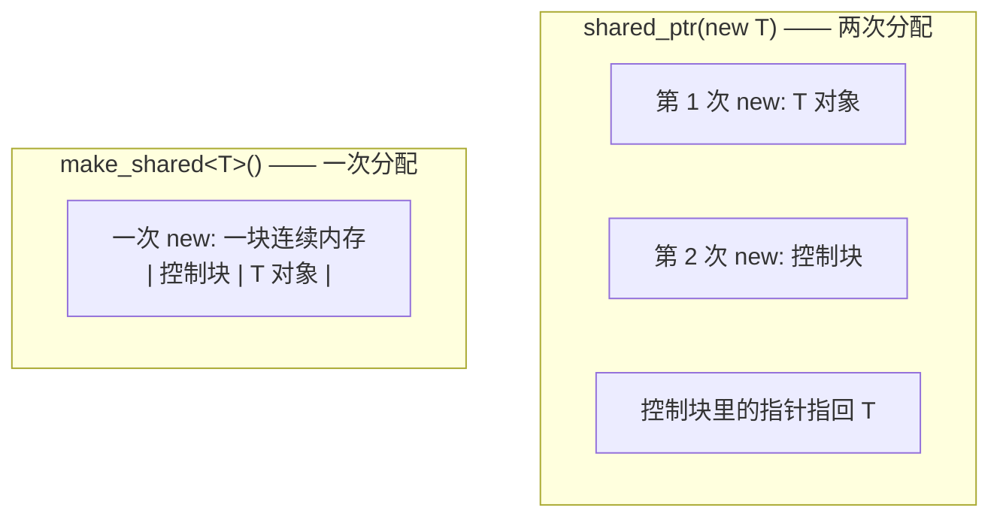

# 02 shared_ptr：控制块与引用计数
### 内存布局与控制块

`shared_ptr<T>` 内部持有两个指针：

1. 指向 `T` 对象的指针
2. 指向**控制块（control block）**的指针

控制块里通常包含：

- **强引用计数**（`use_count`）：有多少个 `shared_ptr` 活着
- **弱引用计数**（`weak_count`）：有多少个 `weak_ptr` 活着（+1 表示"强计数还没归零"）
- 删除器（deleter）
- 分配器（allocator）

```cpp
// shared_layout.cpp
#include <memory>
#include <cstdio>

struct Thing { int v = 7; virtual ~Thing() = default; };

int main() {
    auto sp = std::make_shared<Thing>();
    std::weak_ptr<Thing> wp = sp;

    std::printf("sizeof(shared_ptr)     = %zu\n", sizeof(sp));
    std::printf("sizeof(weak_ptr)       = %zu\n", sizeof(wp));
    std::printf("sizeof(Thing)          = %zu\n", sizeof(Thing));

    std::printf("sp.get()               = %p\n", (void*)sp.get());
    std::printf("use_count              = %ld\n", sp.use_count());

    {
        auto sp2 = sp;
        auto sp3 = sp2;
        std::printf("after two copies, use_count = %ld\n", sp.use_count());
    }
    std::printf("back to use_count      = %ld\n", sp.use_count());

    std::printf("wp.expired()           = %s\n", wp.expired() ? "yes" : "no");
    if (auto locked = wp.lock()) {
        std::printf("wp.lock() -> v=%d\n", locked->v);
    }
    sp.reset();
    std::printf("after reset, wp.expired() = %s\n", wp.expired() ? "yes" : "no");
}
```

**实测输出：**

```text
sizeof(shared_ptr)     = 16
sizeof(weak_ptr)       = 16
sizeof(Thing)          = 16
sp.get()               = 0000020b8b1c81b0
use_count              = 1
after two copies, use_count = 3
back to use_count      = 1
wp.expired()           = no
wp.lock() -> v=7
after reset, wp.expired() = yes
```

### 引用计数的线程安全性

:::info[标准怎么说的]
标准保证的是：**不同线程对不同 `shared_ptr` 实例的引用计数操作是安全的**（引用计数的增减是原子操作）。

具体来说，标准保证 `use_count()` 的变化以及控制块的生命周期管理是线程安全的。多个不同的 `shared_ptr` 对象（即使指向同一个控制块）可以被不同线程**同时读写**（拷贝、赋值、析构）。

**但以下两件事不保证：**

1. **`shared_ptr` 指向的那个对象本身**不是线程安全的——两个线程同时通过各自（或同一个）`shared_ptr` 写 `*sp`，需要你加锁
2. **同一个 `shared_ptr` 实例**被多线程并发写（一个线程在 `sp = other`，另一个在读 `sp`）不是线程安全的——这是任何类型都一样的规则

（对应标准中 shared_ptr 的线程安全相关条款；cppreference 的表述是：所有成员函数（含拷贝构造和拷贝赋值）都能被不同线程在不同的 `shared_ptr` 对象上调用，无需额外同步。）
:::

### make_shared 为什么更快

两种创建方式的差别：

```cpp
// A：两次分配
std::shared_ptr<Thing> p1(new Thing());

// B：一次分配
auto p2 = std::make_shared<Thing>();
```



**`make_shared` 的三个优势：**

1. **一次内存分配而不是两次**——分配是昂贵操作
2. **缓存局部性更好**——控制块和对象在同一块内存里
3. **异常安全**——见下

第三个优势值得单独说。看这个调用：

```cpp
void f(std::shared_ptr<A> a, std::shared_ptr<B> b);

f(std::shared_ptr<A>(new A()), std::shared_ptr<B>(new B()));   // 可能泄漏！
```

C++17 之前，**函数参数的求值顺序未指定**。编译器可能这样做：

1. `new A()` ← 分配了
2. `new B()` ← 分配了
3. 构造 `shared_ptr<A>` 
4. 构造 `shared_ptr<B>` ← **这里抛异常（比如内存不足）**

那么步骤 1 里 `new A()` 的指针还没被任何 `shared_ptr` 接管，就泄漏了。

用 `make_shared` 就没有这个问题（C++17 起参数求值顺序规则也更严格了，但 `make_shared` 依然是推荐写法）：

```cpp
f(std::make_shared<A>(), std::make_shared<B>());   // 安全
```

### 实测：make_shared vs shared_ptr(new)

```cpp
// make_shared_bench.cpp
#include <memory>
#include <chrono>
#include <cstdio>

struct Node { int a, b, c, d; };

template<typename F>
long long time_it(F&& f) {
    auto t0 = std::chrono::high_resolution_clock::now();
    f();
    auto t1 = std::chrono::high_resolution_clock::now();
    return std::chrono::duration_cast<std::chrono::microseconds>(t1 - t0).count();
}

int main() {
    const int N = 2000000;
    long long t_new = time_it([&]{
        for (int i = 0; i < N; ++i) {
            std::shared_ptr<Node> p(new Node());
            (void)p;
        }
    });
    long long t_make = time_it([&]{
        for (int i = 0; i < N; ++i) {
            auto p = std::make_shared<Node>();
            (void)p;
        }
    });
    std::printf("shared_ptr(new) : %lld us\n", t_new);
    std::printf("make_shared     : %lld us\n", t_make);
    std::printf("ratio           : %.2fx\n", (double)t_new / t_make);
}
```

编译运行：

```bash
g++ -std=c++17 -O2 -o make_shared_bench.exe make_shared_bench.cpp && ./make_shared_bench.exe
```

**实测输出：**

```text
shared_ptr(new) : 119016 us
make_shared     : 57283 us
ratio           : 2.08x
```

:::warning[make_shared 的一个缺点]
因为 `make_shared` 把控制块和对象放在**同一块内存**，所以：

- **只要还有一个 `weak_ptr` 活着，整块内存就不能释放**（控制块要留着，而它和对象是一体的）
- 用 `shared_ptr(new T)` 时，对象内存会在强计数归零时立即释放，只有控制块留到弱计数归零

对于**很大的对象** + **长期存活的 `weak_ptr`（如缓存）**，这个差异会导致内存滞留。这种情况下考虑 `shared_ptr(new T)`。
:::

### enable_shared_from_this

一个常见需求：对象内部要拿到指向自己的 `shared_ptr`。**不能**这样写：

```cpp
// 错误！创建了第二个独立控制块，会 double-delete
auto sp = std::shared_ptr<MyClass>(this);
```

正确做法是继承 `std::enable_shared_from_this`：

```cpp
// shared_from_this.cpp
#include <memory>
#include <cstdio>

class Session : public std::enable_shared_from_this<Session> {
public:
    int id;
    explicit Session(int i) : id(i) {}
    void start() {
        auto self = shared_from_this();   // 拿到共享同一控制块的 shared_ptr
        std::printf("  Session %d started, use_count=%ld\n", id, self.use_count());
    }
};

int main() {
    auto s = std::make_shared<Session>(1);
    std::printf("before start: use_count=%ld\n", s.use_count());
    s->start();
    std::printf("after start : use_count=%ld\n", s.use_count());
}
```

**实测输出：**

```text
before start: use_count=1
  Session 1 started, use_count=2
after start : use_count=1
```

:::danger[shared_from_this 的前提]
必须在对象**已经被某个 `shared_ptr` 持有**之后才能调用 `shared_from_this()`。在构造函数里调用会抛 `std::bad_weak_ptr`——因为那时控制块还没建立。
:::

---

**翻页**：[← 上一页](./raii-smartptr-01) · [下一页 →](./raii-smartptr-03) · [返回目录](./)
